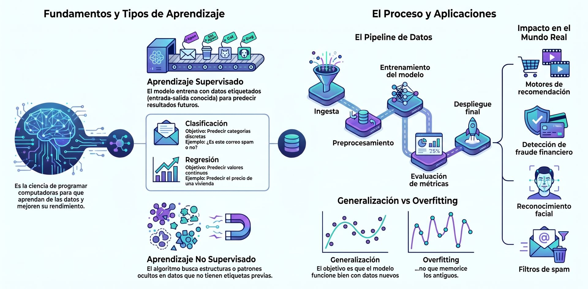
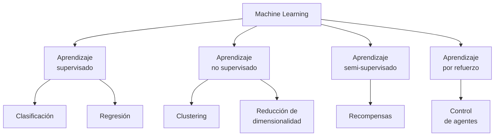

## **Machine Learning**



### ¿Qué es?
El **Machine Learning** (o Aprendizaje Automático) es una rama de la Inteligencia Artificial y de las ciencias de la computación que se enfoca en el diseño y desarrollo de algoritmos y modelos matemáticos capaces de identificar patrones, extraer conocimiento a partir de datos empíricos y generalizar dicho conocimiento para realizar predicciones o tomar decisiones automatizadas sin requerir instrucciones programadas de forma explícita.

En la programación informática tradicional, un ingeniero codifica un conjunto exhaustivo de reglas estáticas y condicionales lógicas (if-else) que operan sobre datos de entrada para generar un resultado. No obstante, este enfoque resulta inviable para abordar problemas complejos de alta dimensionalidad (como la visión computacional, el reconocimiento de voz o la detección de fraudes), donde las reglas humanas son incompletas, cambiantes o imposibles de formular a mano. En contraste, **el paradigma de Machine Learning invierte esta dinámica**: el algoritmo recibe datos empíricos (y, en ciertos casos, sus respuestas correctas) y aprende de forma inductiva las reglas matemáticas subyacentes que gobiernan el fenómeno.


### Definiciones Formales

A nivel académico, el aprendizaje automático se comprende a través de dos definiciones clásicas y complementarias:

1.  **Definición Operativa (Arthur Samuel, 1959):**  
    > *"El Machine Learning es el campo de estudio que otorga a las computadoras la capacidad de aprender sin ser explícitamente programadas"*.
2.  **Definición Formal de Ingeniería (Tom M. Mitchell, 1997):**  
    > *"Se dice que un programa de computadora aprende de la experiencia $E$ con respecto a alguna clase de tareas $T$ y una medida de desempeño $P$, si su desempeño en las tareas en $T$, medido por $P$, mejora con la experiencia $E$"*.

*   **Ejemplo educativo:** En un filtro de correo no deseado (*spam filter*):
    *   **Tarea ($T$):** Clasificar nuevos correos electrónicos como legítimos (*ham*) o no deseados (*spam*).
    *   **Experiencia ($E$):** El conjunto de entrenamiento histórico compuesto por miles de correos previamente etiquetados.
    *   **Desempeño ($P$):** La proporción de correos clasificados correctamente sobre el total evaluado (exactitud o *accuracy*).


### Formulación Matemática

Desde la perspectiva de la estadística matemática y la teoría de la aproximación, la mayoría de los problemas de modelado predictivo se reducen a **aprender una función objetivo $f$ desconocida** que mapea un espacio de variables explicativas o características (*features*) a una variable de respuesta (*target*):

```math
Y = f(X) + \epsilon
```

*   $X \in \mathbb{R}^{N \times d}$ es la matriz de diseño o vector de variables de entrada independientes.
*   $Y$ es la variable dependiente o etiqueta que se busca predecir.
*   $f: X \to Y$ es el mapeo funcional desconocido que el algoritmo debe estimar a partir de la muestra observada.
*   $\epsilon$ representa el **error irreducible**, generado por ruido estocástico o factores omitidos en la medición que ningún modelo puede eliminar.

Para estimar $f$, el algoritmo selecciona una hipótesis dentro de un espacio de funciones parametrizado por un vector de pesos o coeficientes $\theta$. Para guiar el aprendizaje, se define una **función de coste o pérdida** ($\mathcal{L}(y, \hat{y})$ o $J(\theta)$) que cuantifica matemáticamente la discrepancia entre la predicción generada $\hat{y} = f(X; \theta)$ y el valor real $y$. Mediante algoritmos de optimización (como el **descenso de gradiente**), los parámetros $\theta$ se ajustan iterativamente para minimizar dicha pérdida:

```math
\theta^* = \arg\min_{\theta} \sum_{i=1}^{N} \mathcal{L}\left(y^{(i)}, f(x^{(i)}; \theta)\right)
```


### Taxonomía de Paradigmas

El Machine Learning se clasifica fundamentalmente en función de la naturaleza de la señal de supervisión provista al sistema:



#### A. Aprendizaje Supervisado (*Supervised Learning*)
El modelo se entrena a partir de observaciones que cuentan con pares de entrada y salida conocidos 

```math
(\{x^{(i)}, y^{(i)}\}_{i=1}^N)
``` 

El algoritmo actúa como un estudiante guiado por un supervisor:
*   **Clasificación:** El objetivo es predecir una clase discreta o categoría cualitativa. Puede ser **binaria** (e.g., tumor maligno vs. benigno, transacción fraudulenta vs. legítima) o **multiclase** (e.g., clasificación de dígitos manuscritos del 0 al 9 o reconocimiento óptico de caracteres).
    *   *Algoritmos representativos:* 
        * Regresión Logística, 
        * Árboles de Decisión (CART), 
        * Máquinas de Vectores de Soporte (SVM), 
        * Naive Bayes, 
        * Ensambles como Random Forest o Gradient Boosted Trees.
*   **Regresión:** El objetivo es predecir una magnitud numérica continua.
    *   *Ejemplos:* Predecir el valor de cotización de una vivienda en función de sus metros cuadrados y ubicación, o estimar la demanda energética horaria.
    *   *Algoritmos representativos:* 
        * Regresión Lineal OLS, 
        * Regresión Ridge/Lasso, 
        * Regresión con Soporte Vectorial (SVR).

#### B. Aprendizaje No Supervisado (*Unsupervised Learning*)
El conjunto de datos carece de etiquetas de salida ($y$); el sistema únicamente dispone de variables explicativas $X$. Su propósito es descubrir la estructura geométrica interna, densidades o correlaciones latentes en los datos:

*   **Clustering (Agrupamiento):** Particiona observaciones en grupos homogéneos (*clusters*) donde los elementos de un mismo grupo maximizan su similitud intra-clúster y minimizan su similitud inter-clúster. (e.g., segmentación conductual de clientes mediante K-Means o DBSCAN).

*   **Reducción de Dimensionalidad:** Proyecta datos desde un espacio de alta dimensionalidad hacia un subespacio latente conservando la mayor cantidad de varianza posible. (e.g., Análisis de Componentes Principales - PCA, t-SNE).

*   **Detección de Anomalías:** Identifica vectores de entrada cuyas características estadísticas divergen marcadamente de la distribución normal de los datos.

#### C. Aprendizaje Semi-supervisado y Auto-supervisado
*   **Semi-supervisado:** Aborda escenarios comunes en la industria donde etiquetar datos resulta costoso o requiere expertos humanos, pero se cuenta con abundantes datos crudos sin etiquetar. El modelo aprovecha la geometría de las instancias no etiquetadas para guiar y robustecer los límites de decisión aprendidos a partir de una pequeña muestra etiquetada.

*   **Auto-supervisado (*Self-supervised*):** Genera etiquetas supervisadas de manera automática a partir de la propia estructura de los datos sin anotación manual previa. Por ejemplo, enmarcar tareas auxiliares donde se enmascaran palabras o parches de imágenes y la red neuronal debe reconstruir el segmento faltante.

#### D. Aprendizaje por Refuerzo (*Reinforcement Learning*)
Un **agente de software** aprende a tomar decisiones secuenciales interactuando activamente con un entorno dinámico, formalizado habitualmente como un Proceso de Decisión de Markov (MDP). En lugar de correcciones supervisadas, el agente recibe retroalimentación en forma de **recompensas escalares positivas o penalizaciones** según el impacto de sus acciones, aprendiendo una política óptima ($\pi$) mediante ensayo y error sistemático. Es la base de sistemas autónomos de navegación, robótica y motores de juego avanzados como AlphaGo.


### Generalización, Sesgo y Varianza

El valor práctico de un modelo de aprendizaje automático no radica en su capacidad para memorizar el conjunto de entrenamiento, sino en su **capacidad de generalización**: la aptitud para predecir con exactitud sobre instancias nunca antes vistas pertenecientes a la misma distribución del problema. 

El error de generalización de un estimador se descompone teóricamente en tres elementos:

```math
\text{Error Total} = \text{Sesgo}^2 (\text{Bias}^2) + \text{Varianza} (\text{Variance}) + \sigma_{\text{irreducible}}^2
```

```
   Alto Subajuste              Punto Óptimo                  Alto Sobreajuste
    (Underfitting)                                            (Overfitting)
   (Sesgo dominante)         (Balance de Error)            (Varianza dominante)
           X                            X                           X
         X   X                        X    X                    X   X   X
       X       X                    X        X                X   X   X   X
 ──────────────────────       ─ ─ ─ ─ ─ ─ ─ ─ ─ ─ ─      ~~~~~~~~~~~~~~~~~~~~~~
(Modelo rígido / lineal)     (Complejidad adecuada)     (Modelo memoriza el ruido)
                                         
```

*   **Sesgo (Bias):** Error introducido al aproximar una relación física o conductual compleja mediante supuestos de modelo excesivamente simplistas o rígidos (e.g., asumir linealidad en un fenómeno no lineal). Un sesgo elevado conduce al **subajuste (*underfitting*)**, donde el modelo rinde pobremente tanto en el conjunto de entrenamiento como en el de prueba.

*   **Varianza (Variance):** Sensibilidad del estimador ante pequeñas fluctuaciones o ruido estocástico en el conjunto de datos de entrenamiento. Un modelo con excesiva flexibilidad (como un árbol de decisión profundo no podado) ajustará sus parámetros al ruido muestral particular, derivando en **sobreajuste (*overfitting*)**: un rendimiento casi perfecto en entrenamiento, pero un colapso en datos reales de producción.

*   **Teorema de "No Free Lunch" (Wolpert, 1996):** No existe un único algoritmo de Machine Learning que supere a todos los demás en todos los problemas posibles. Cada algoritmo incorpora supuestos inductivos distintos (*inductive bias*); por ello, la práctica rigurosa exige comparar múltiples familias de modelos mediante esquemas de validación empírica.


### Demostración Práctica

El siguiente flujo estructurado en Python (utilizando `scikit-learn`) ejemplifica el ciclo de vida de un problema supervisado de clasificación: partición de datos para evitar fugas de información, preprocesamiento estándar, entrenamiento de un modelo, evaluación sobre datos no vistos y visualización del reporte de desempeño:

```python showLineNumbers
import numpy as np
import pandas as pd
from sklearn.datasets import load_breast_cancer
from sklearn.model_selection import train_test_split
from sklearn.preprocessing import StandardScaler
from sklearn.linear_model import LogisticRegression
from sklearn.metrics import accuracy_score, classification_report, confusion_matrix

# =====================================================================
# 1. Ingesta y Exploración de Datos
# =====================================================================
# Cargamos un dataset canónico de diagnóstico médico (569 instancias, 30 variables)
raw_data = load_breast_cancer()
X = pd.DataFrame(raw_data.data, columns=raw_data.feature_names)
y = raw_data.target  # 0: Maligno, 1: Benigno

print("Dimensiones de la matriz de características X:", X.shape)
print("Distribución de clases (0=Maligno, 1=Benigno):", np.bincount(y))

# =====================================================================
# 2. Partición Rigurosa de Datos (Train / Test Split)
# =====================================================================
# Reservamos el 20% de los datos para la evaluación final no vista (Test set).
# stratify=y preserva la proporción original de las clases en ambos conjuntos.
X_train, X_test, y_train, y_test = train_test_split(
    X, y, test_size=0.20, random_state=42, stratify=y
)

# =====================================================================
# 3. Preprocesamiento e Ingeniería de Características
# =====================================================================
# Estandarización de variables (media=0, varianza unitaria).
# REGLA METODOLÓGICA: Ajustar (fit) únicamente con datos de entrenamiento
# para prevenir fugas de datos (Data Leakage) hacia el conjunto de test.
scaler = StandardScaler()
X_train_scaled = scaler.fit_transform(X_train)
X_test_scaled = scaler.transform(X_test)

# =====================================================================
# 4. Entrenamiento del Algoritmo (Fase de Aprendizaje)
# =====================================================================
# Instanciamos un clasificador logístico con regularización L2
model = LogisticRegression(max_iter=1000, random_state=42)

# El método .fit() desencadena la optimización matemática de los pesos
model.fit(X_train_scaled, y_train)

# =====================================================================
# 5. Evaluación de Desempeño y Generalización
# =====================================================================
# Predicción sobre el conjunto de prueba (datos que el modelo nunca vio)
y_pred = model.predict(X_test_scaled)

# Cálculo de la métrica general de exactitud (P en la formulación de Mitchell)
acc = accuracy_score(y_test, y_pred)
print(f"\nExactitud en el conjunto de prueba: {acc * 100:.2f}%\n")

# Matriz de confusión para desglosar falsos positivos y falsos negativos
print("Matriz de Confusión:")
print(confusion_matrix(y_test, y_pred))

# Reporte detallado con métricas de Precisión, Recall y F1-Score
print("\nReporte de Clasificación:")
print(classification_report(y_test, y_pred, target_names=raw_data.target_names))
```


### Aplicaciones

*   **Visión por Computadora:** Utiliza redes neuronales (como las CNN) para procesar píxeles e imitar el córtex visual humano. Permite el reconocimiento de objetos, detección de rostros, interpretación de imágenes médicas (MRI/CT) y la navegación de coches autónomos.

*   **Procesamiento de Lenguaje Natural (NLP):** Se encarga de la lectura y comprensión del lenguaje humano, hablado o escrito, mediante computadoras. Incluye tareas como la traducción automática, resúmenes de texto, reconocimiento de voz y la creación de asistentes virtuales como Siri o Alexa.

*   **Recomendadores:** Motores que sugieren productos o contenido (como Netflix, Spotify o Amazon) analizando el historial y las preferencias individuales para personalizar la experiencia del usuario.

*   **Detección de Fraudes:** Aplicación de aprendizaje no supervisado para identificar **anomalías** o patrones de acceso inusuales en transacciones bancarias o de tarjetas de crédito que se desvían de la norma.

*   **Análisis de Sentimientos:** Subcampo del NLP (u minería de opinión) que busca extraer el estado de ánimo o la polaridad (positivo, negativo o neutral) de un texto, como reseñas de productos o comentarios en redes sociales.

### Desafíos

*   **Sesgo en los Datos:** Los modelos solo pueden ser tan buenos como los datos con los que se entrenan. Si los datos de entrada están incompletos o reflejan prejuicios humanos (como seleccionar mayoritariamente imágenes de un solo tipo), el modelo aprenderá **patrones sesgados** y discriminará en sus predicciones.

*   **Privacidad y Seguridad:** Existe un desafío crítico en diseñar sistemas que permitan servicios personalizados sin comprometer la **confidencialidad** y seguridad de los datos de los usuarios. El uso de metadatos y la recopilación masiva de información plantea dilemas sobre la propiedad de los datos.

*   **Transparencia y Explicabilidad:** Muchos modelos avanzados (como las Redes Neuronales) son considerados **"cajas negras"** debido a que su estructura interna es difícil de interpretar para un humano. Es vital que un usuario pueda seguir el raciocinio de una decisión, especialmente en diagnósticos médicos o finanzas.

*   **Impacto Social y Laboral:** Las tecnologías de automatización de la "Industria 4.0" están transformando la producción, el comercio y la forma en que socializamos, lo que genera preocupaciones sobre el desplazamiento laboral y la evolución de la naturaleza del trabajo.

*   **Responsabilidad en el Uso del ML:** El analista tiene la responsabilidad ética de entender qué hace el programa con los datos. Se ha propuesto el uso de auditorías por terceros y revisiones éticas como parte de la planificación de proyectos de ciencia de datos.

*   **Regulación y Normativas:** Es necesario el cumplimiento de leyes que gobiernan el manejo de datos, como el **GDPR** (Reglamento General de Protección de Datos), para garantizar una gestión justa y legal de la información personal.

### Resumiendo

1.  **Fundamento:** El Machine Learning sustituye las reglas deterministas programadas manualmente por **modelos computacionales inducidos a partir de la experiencia empírica**.
2.  **Mecánica interna:** Todo algoritmo formula un espacio de hipótesis, calcula el desvío de sus predicciones mediante una **función de coste** y optimiza sus parámetros internos minimizando dicho error.
3.  **Cuatro pilares:** Se estructura principalmente en aprendizaje **supervisado** (con etiquetas), **no supervisado** (sin etiquetas), **semi-supervisado** (combinado) y **por refuerzo** (basado en interacción y recompensas).
4.  **Meta primordial:** El objetivo cardinal de cualquier sistema de Machine Learning no es ajustar de memoria los datos de entrenamiento, sino alcanzar una **óptima capacidad de generalización** ante datos inéditos en producción.

***

📊 En tu panel de **Studio** cuentas con artefactos visuales como la infografía **"Guía de Aprendizaje No Supervisado"** y la presentación **"Descifrando el Machine Learning"**. ¿Te gustaría que diseñe un cuestionario interactivo de opción múltiple (Quiz) para evaluar y consolidar la comprensión de tus alumnos sobre el dilema sesgo-varianza, las diferencias matemáticas entre regresión y clasificación, y la prevención de fugas de datos en el preprocesamiento?


