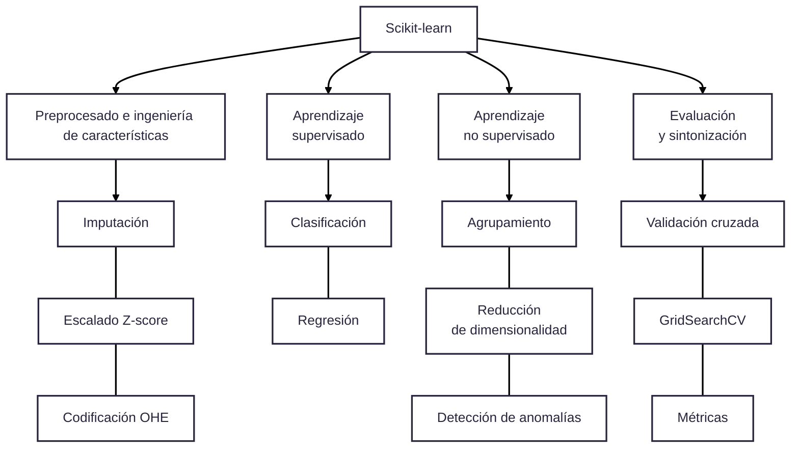

## **Scikit-Learn**

**Scikit-learn** es la biblioteca de **aprendizaje automático** (machine learning) más popular y prominente para el lenguaje de programación Python. Es un proyecto de código abierto, distribuido bajo la licencia permisiva BSD, lo que permite su uso tanto en entornos académicos como comerciales sin restricciones.

**Scikit-learn** (frecuentemente importada en código como `sklearn`) es la biblioteca estándar de código abierto más popular y exhaustiva de Python para el desarrollo de algoritmos tradicionales de **Machine Learning** y minería de datos. Concebida originalmente como una extensión del ecosistema de computación científica de **SciPy**, está construida sobre los cimientos matemáticos de **NumPy** (para operaciones matriciales vectorizadas de alto rendimiento) y se integra de forma directa con **Matplotlib** y **Pandas**.


La biblioteca fue creada originalmente por **David Cournapeau en 2007** como parte de un proyecto de Google Summer of Code. Desde entonces, ha sido liderada por un equipo de investigadores del [Instituto Francés de Investigación en Informática y Automática (**Inria**)](https://www.inria.fr/fr) y, más recientemente, por **[Probabl.ai](https://www.probabl.ai/)**. 

Se ha consolidado como un estándar en la industria gracias a su **documentación extensa y de alta calidad**, así como a una comunidad activa de desarrolladores que aseguran su constante mejora y fiabilidad mediante pruebas automatizadas. Scikit-learn no está diseñado para el procesamiento de "Big Data" en clústeres distribuidos, sino que se centra en algoritmos eficientes para una sola máquina, integrándose perfectamente con el ecosistema científico de Python.

### Funcionalidades Principales

Scikit-learn ofrece una amplia gama de herramientas para las tareas fundamentales del aprendizaje automático:

*   **Clasificación:** Identificación de a qué categoría pertenece un objeto (ej. detección de spam o reconocimiento de imágenes).
*   **Regresión:** Predicción de variables continuas asociadas a un objeto (ej. precios de viviendas).
*   **Clustering:** Agrupación automática de objetos similares en grupos sin etiquetas previas.
*   **Reducción de Dimensionalidad:** Disminución del número de variables aleatorias a considerar (ej. PCA).
*   **Preprocesado:** Transformación y normalización de datos antes del entrenamiento.
*   **Selección de Modelos:** Comparación, validación y elección de parámetros y modelos (ej. búsqueda en cuadrícula o validación cruzada).

### Características

El éxito de la biblioteca radica en su **API limpia, uniforme y optimizada**, diseñada bajo principios que facilitan su uso:

1.  **Consistencia:** Todos los objetos comparten una interfaz común basada en métodos limitados y coherentes.

2.  **Interfaz de Estimadores:** Cualquier objeto que aprenda de los datos se denomina **estimador** y utiliza el método `fit()` para ajustar los parámetros del modelo.

3.  **Transformadores y Predictores:** Los objetos que transforman datos usan `transform()`, mientras que los modelos que realizan predicciones usan `predict()`.

4.  **Composición:** Es posible encadenar múltiples pasos de procesamiento (como escalado y clasificación) en un solo objeto denominado **Pipeline**, lo que reduce errores y simplifica el flujo de trabajo.

5.  **Fundamentación Técnica:** Está construida sobre las librerías fundamentales **NumPy** (para manejo eficiente de arreglos), **SciPy** (para computación científica) y **Matplotlib** (para visualización). Además, interactúa de forma nativa con **Pandas**, permitiendo trabajar directamente con estructuras de datos tabulares.


### Fundamentos de Arquitectura

El éxito de scikit-learn en la academia y la industria radica en su **API unificada, consistente y modular**, la cual permite cambiar de un algoritmo a otro modificando apenas una línea de código. Su arquitectura interna se rige por tres abstracciones esenciales (la llamada *Estimator API*):

#### A. Estimadores (*Estimators*)
Un **estimador** es cualquier objeto capaz de aprender o ajustar parámetros a partir de un conjunto de datos. 
*   **Método central:** `fit(X, y=None)`.
*   **Mecánica interna:** Al invocar `fit()`, el algoritmo procesa la matriz de características \\(X\\) (y opcionalmente el vector objetivo \\(y\\) en tareas supervisadas) para calcular y optimizar sus pesos.
*   **Convención de inspección:** Cualquier parámetro o coeficiente aprendido a través de `fit()` se almacena internamente con un **guion bajo final** (como `coef_`, `intercept_`, `statistics_` o `lambdas_`) para diferenciarlo de los hiperparámetros de configuración inicial pasados al constructor. Además, llamar a `fit()` reinicia por completo el estado del modelo.

#### B. Transformadores (*Transformers*)
Un **transformador** es un estimador especializado en el preprocesamiento, escalado o extracción de variables.
*   **Métodos centrales:** `transform(X)` y `fit_transform(X)`.
*   **Mecánica interna:** `transform()` aplica los parámetros aprendidos durante `fit()` sobre un nuevo conjunto de datos sin volver a recalcularlos. Scikit-learn incluye el atajo optimizado `fit_transform()`, que calcula las estadísticas de entrenamiento y devuelve la matriz transformada en un único paso. La mayoría de los transformadores también exponen `inverse_transform()` para regresar los datos a su escala original.

#### C. Predictores (*Predictors*)
Un **predictor** es un estimador capaz de realizar inferencias sobre instancias no observadas.
*   **Métodos centrales:** `predict(X)`, `predict_proba(X)` y `score(X, y)`.
*   **Mecánica interna:** `predict()` recibe observaciones \\(X\\) y devuelve las clases o valores continuos estimados. Para evaluar la incertidumbre o probabilidades de pertenencia a cada clase en problemas de clasificación, se utiliza `predict_proba()` o `decision_function()`. Por su parte, `score()` calcula una métrica de rendimiento estándar (exactitud en clasificación o \\(R^2\\) en regresión).

#### D. Tuberías y Flujos Encadenados (*Pipelines*)
Scikit-learn implementa la clase **`Pipeline`** (y el atajo sintáctico `make_pipeline`) para encapsular secuencias completas de transformadores finalizadas por un estimador.

*   **Prevención de fuga de datos (*Data Leakage*):** Al integrar el preprocesamiento dentro de un Pipeline y evaluarlo con **`cross_val_score`** o **`GridSearchCV`**, se garantiza que el escalado o imputación de datos se ajuste estrictamente sobre los pliegues de entrenamiento y nunca sobre los pliegues de validación/prueba.


### Usos Principales

Scikit-learn abarca prácticamente todas las fases del ciclo de vida del modelado clásico en Machine Learning:
<br/>

<br/>

1.  **Preprocesamiento e Ingeniería de Características (`sklearn.preprocessing`, `sklearn.impute`):**
    *   **Imputación:** Manejo de valores faltantes mediante media, mediana o moda (`SimpleImputer`), o modelos iterativos multivariados (`IterativeImputer`, `KNNImputer`).
    *   **Escalado de variables:** Uniformización de rangos mediante estandarización Z-score (`StandardScaler`), normalización Min-Max (`MinMaxScaler`) o escalado robusto a valores atípicos (`RobustScaler`).
    *   **Codificación categórica:** Conversión de texto a variables binarias (`OneHotEncoder`, `OrdinalEncoder`).
    *   **Transformaciones funcionales:** Transformaciones logarítmicas, de potencia o Box-Cox/Yeo-Johnson (`PowerTransformer`, `FunctionTransformer`) para estabilizar varianzas.

2.  **Aprendizaje Supervisado:**
    *   **Clasificación (`sklearn.linear_model`, `sklearn.svm`, `sklearn.tree`, `sklearn.ensemble`):** Predicción de categorías discretas. Incluye Regresión Logística, Support Vector Machines (SVC), Árboles de Decisión, Naive Bayes y ensambles como Random Forest, AdaBoost y Stacking.
    *   **Regresión:** Estimación de valores numéricos continuos mediante Regresión Lineal OLS (`LinearRegression`), modelos regularizados (`Ridge`, `Lasso`, `ElasticNet`), Regresión de Vectores de Soporte (`SVR`) y árboles regresores.

3.  **Aprendizaje No Supervisado:**
    *   **Clustering / Análisis de grupos (`sklearn.cluster`):** Segmentación de instancias sin etiquetas previas, como \\(K\\)-Means o Agrupamiento Jerárquico Aglomerativo.
    *   **Reducción de Dimensionalidad (`sklearn.decomposition`):** Proyección espacial mediante Análisis de Componentes Principales (`PCA`) para eliminar multicolinealidad, comprimir variables y facilitar la visualización.

4.  **Evaluación y Sintonización de Modelos (`sklearn.model_selection`, `sklearn.metrics`):**
    *   Partición rigurosa de conjuntos (`train_test_split`, `StratifiedKFold`, `TimeSeriesSplit`).
    *   Búsqueda automatizada de hiperparámetros óptimos (`GridSearchCV`, `RandomizedSearchCV`).
    *   Métricas de rendimiento: matrices de confusión, precisión, recall, puntuación F1, curvas ROC-AUC y error cuadrático medio (RMSE).


### Implementación en Python

El siguiente script ejemplifica la construcción de un flujo de Machine Learning bajo las mejores prácticas de **scikit-learn**, encadenando imputación, escalado, reducción de dimensionalidad y clasificación dentro de un `Pipeline` con búsqueda de hiperparámetros:

```python showLineNumbers
import numpy as np
from sklearn.datasets import load_breast_cancer
from sklearn.model_selection import train_test_split, GridSearchCV, StratifiedKFold
from sklearn.preprocessing import StandardScaler
from sklearn.decomposition import PCA
from sklearn.svm import SVC
from sklearn.pipeline import Pipeline
from sklearn.metrics import classification_report, confusion_matrix

# 1. Carga de datos y partición en entrenamiento y prueba
raw_data = load_breast_cancer()
X, y = raw_data.data, raw_data.target

X_train, X_test, y_train, y_test = train_test_split(
    X, y, test_size=0.20, random_state=42, stratify=y
)

# 2. Construcción de la Tubería (Pipeline): Preprocesamiento + Estimador final
pipeline = Pipeline([
    ("scaler", StandardScaler()),                 # Paso 1: Estandarización Z-score
    ("pca", PCA(random_state=42)),                 # Paso 2: Reducción de dimensiones
    ("classifier", SVC(kernel="rbf", random_state=42)) # Paso 3: Clasificador SVM
])

# 3. Definición de la rejilla de hiperparámetros a optimizar
# Se accede a los parámetros de cada etapa usando la convención: <nombre_etapa>__<parametro>
param_grid = {
    "pca__n_components":,
    "classifier__C": [0.1, 1.0, 10.0],
    "classifier__gamma": ["scale", 0.01, 0.1]
}

# 4. Sintonización mediante Validación Cruzada Estratificada
cv_strategy = StratifiedKFold(n_splits=5, shuffle=True, random_state=42)
grid_search = GridSearchCV(
    estimator=pipeline,
    param_grid=param_grid,
    cv=cv_strategy,
    scoring="accuracy",
    n_jobs=-1
)

# El método fit ajusta y evalúa todas las etapas sin fuga de datos
grid_search.fit(X_train, y_train)

# 5. Evaluación final sobre datos de prueba no vistos
best_model = grid_search.best_estimator_
y_pred = best_model.predict(X_test)

print(f"Mejores Hiperparámetros: {grid_search.best_params_}")
print(f"Exactitud en validación cruzada: {grid_search.best_score_:.4f}")
print("\nMatriz de Confusión en Test:")
print(confusion_matrix(y_test, y_pred))
print("\nReporte de Clasificación en Test:")
print(classification_report(y_test, y_pred, target_names=raw_data.target_names))
```


### Límites Arquitectónicos
**¿Cuándo NO usar Scikit-learn?**

*   **Restricción de Cómputo Mono-nodo:** Scikit-learn está diseñado para procesar datos en la memoria RAM de una única máquina; no cuenta con soporte nativo para ejecución distribuida en clústeres de Big Data. Cuando el volumen de datos alcanza la escala de cientos de gigabytes o terabytes, se debe migrar a motores distribuidos como **PySpark MLlib**, el cual adopta exactamente la misma abstracción de *Pipelines*, *Estimators* y *Transformers* inspirada en scikit-learn.

*   **Deep Learning y Aceleración por GPU:** Aunque scikit-learn incluye implementaciones básicas de redes neuronales multicapa (`MLPClassifier`, `MLPRegressor`), carece de aceleración por GPU y no permite diseñar arquitecturas complejas de aprendizaje profundo, para las cuales se debe recurrir a librerías especializadas como **PyTorch** o **TensorFlow**.

