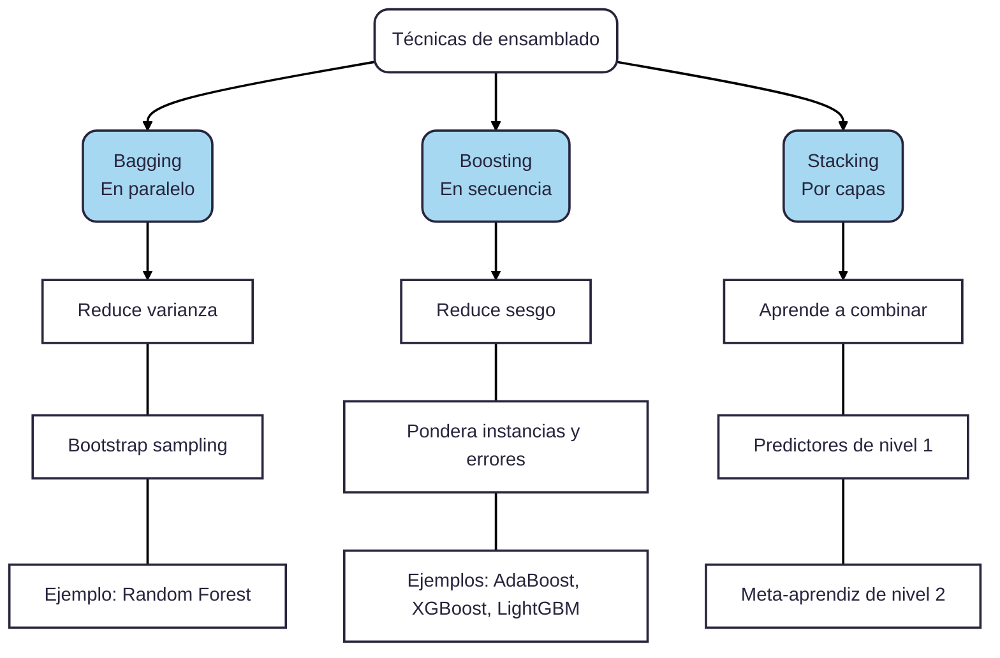
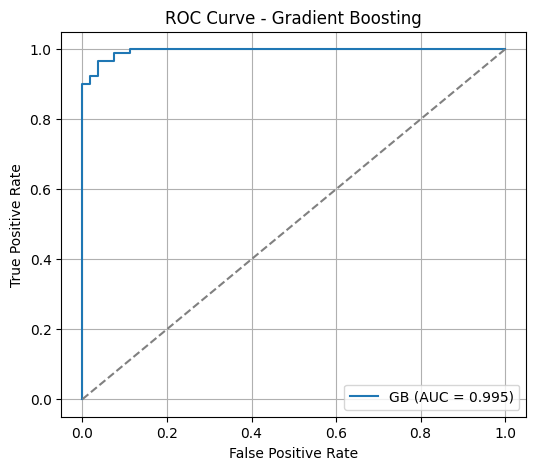
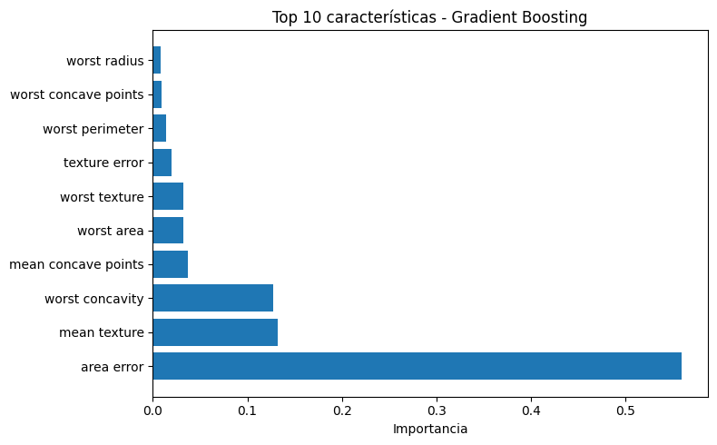
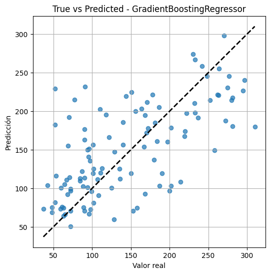
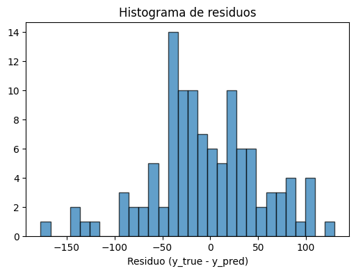
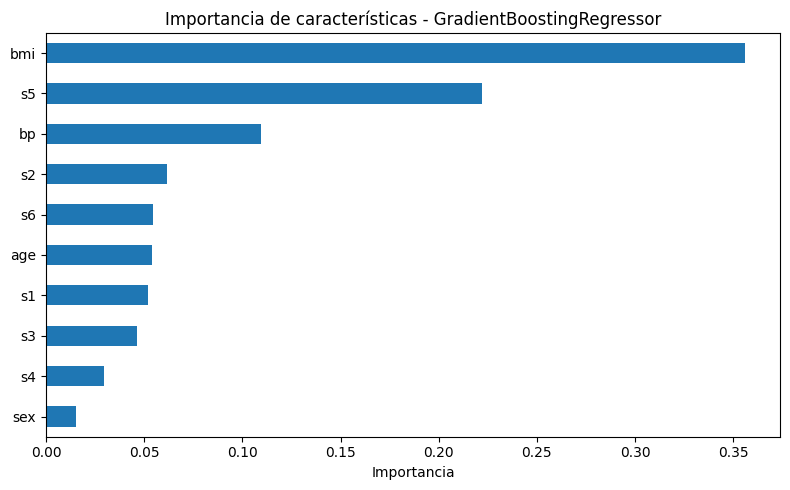

El **Gradient Boosting** (Impulso de Gradiente) es una técnica de ensamblado (*ensemble*) utilizada en machine learning para construir modelos predictivos potentes a partir de la combinación secuencial de modelos débiles, generalmente árboles de decisión poco profundos. El objetivo es mejorar la precisión corrigiendo los errores cometidos por los modelos anteriores en cada iteración.

Este algoritmo pertenece a la clase de modelos basados en árboles (Tree-Based) y se utiliza tanto para problemas de clasificación como de regresión.

La característica distintiva del gradient boosting es su enfoque de **ensamblado secuencial**, a diferencia de otros métodos (como Random Forest) que construyen modelos en paralelo.

1. **Construcción Serial**: Los árboles de decisión se construyen uno tras otro.
**
2. **Corrección de Errores**: Cada nuevo árbol que se añade al modelo intenta corregir los errores o las debilidades del árbol construido inmediatamente anterior.

3. **Minimización de la Pérdida**: El método utiliza el concepto de **gradiente** (que es la pendiente de una función) para determinar la dirección en la que deben ajustarse los parámetros del modelo, con el objetivo de minimizar la función de pérdida. Este proceso es similar a cómo el algoritmo de Descenso de Gradiente (Gradient Descent) se utiliza en redes neuronales para optimizar los pesos.

## Parámetros y Ventajas
Los modelos de gradient boosting suelen utilizar árboles poco profundos (a menudo con una profundidad máxima de uno a cinco niveles) y dependen de una fuerte pre-poda, en lugar de la aleatoriedad, para controlar la complejidad.

Dos parámetros clave para sintonizar este modelo son:
- **Learning Rate (Tasa de Aprendizaje)**: Este parámetro es crucial porque controla la fuerza con la que cada nuevo árbol intenta corregir los errores cometidos por los árboles anteriores.

- **n_estimators (Número de Estimadores)**: Representa la cantidad de árboles que se construirán en la secuencia.

Los algoritmos de gradient boosting se encuentran frecuentemente entre las soluciones ganadoras de las competiciones de aprendizaje automático y se utilizan ampliamente en la industria debido a su alta precisión.


### Definición matemática

Gradient Boosting busca minimizar una función de pérdida $L(y, F(x))$ (por ejemplo, el error cuadrático para regresión o la log-loss para clasificación) mediante la construcción de un modelo aditivo:

$$
F_{m}(x) = F_{m-1}(x) + \gamma_m h_m(x)
$$

donde:
- $F_{m}(x)$ es el modelo en la iteración $m$,
- $F_{m-1}(x)$ es el modelo anterior,
- $h_m(x)$ es el nuevo modelo débil (por ejemplo, un árbol de decisión),
- $\gamma_m$ es el peso (tasa de aprendizaje) asignado a $h_m(x)$.

En cada iteración, $h_m(x)$ se ajusta para aproximar el gradiente negativo de la función de pérdida respecto a las predicciones actuales, es decir, el error residual:

$$
r_{im} = -\left[ \frac{\partial L(y_i, F(x_i))}{\partial F(x_i)} \right]_{F(x) = F_{m-1}(x)}
$$

El nuevo modelo $h_m(x)$ se entrena para predecir estos residuos.


## **Tecnica de ensemble**

Una **técnica de ensamblado** (*ensemble learning* o método de ensamble) es un paradigma donde **se combinan estratégicamente las predicciones de múltiples modelos de aprendizaje (denominados estimadores base o *base learners*) para construir un meta-modelo o predictor consolidado con un rendimiento y capacidad de generalización superiores a los de cualquiera de sus modelos individuales por separado**.


### Fundamento Teórico y Matemático
**La «Sabiduría de las Masas»**

El principio fundamental detrás del ensamble descansa en la analogía de la **sabiduría de las masas** (*wisdom of the crowd*: *el juicio colectivo de un comité diverso e independiente suele cometer menos errores que un único experto aislado*.

Desde la perspectiva estadística, consideremos un problema de clasificación binaria abordado por un comité de $n$ clasificadores independientes, cada uno con una tasa de error base $\epsilon < 0.5$ (es decir, ligeramente mejor que el azar). La predicción final se toma por votación mayoritaria. El error del ensamble ocurre solo cuando la mayoría de los modelos fallan simultáneamente, lo cual se modela mediante la función de masa de probabilidad de una distribución binomial:

```math
P(\text{error del ensamble}) = \sum_{k = \lceil n/2 \rceil}^{n} \binom{n}{k} \epsilon^k (1 - \epsilon)^{n - k}
```

*   **Ejemplo analítico:** Si combinamos $n = 11$ clasificadores independientes con una probabilidad de error individual de $\epsilon = 0.25$ (25%), la probabilidad de que al menos 6 de ellos fallen al mismo tiempo se reduce drásticamente a **$0.034$ (3.4%)**.
*   **Condición crítica de diversidad:** Para que esta reducción teórica del error funcione, los modelos deben ser **lo más diversos e incorrelacionados posible**. Si todos los modelos fuesen idénticos o cometieran exactamente los mismos errores, el ensamble no ofrecería ningún beneficio frente a un modelo individual.


### Descomposición del Error
**Sesgo y Varianza**

El error de generalización en Machine Learning se descompone en **Sesgo** (*Bias*), **Varianza** (*Variance*) y **Ruido Irreducible**:

```math
\text{Error Total} = \text{Sesgo}^2 + \text{Varianza} + \sigma^2
```

Las técnicas de ensamblado atacan de manera diferenciada estos dos componentes clave:
*   **Reducción de Varianza:** Busca suavizar la inestabilidad de estimadores complejos que sufren de sobreajuste (*overfitting*).
*   **Reducción de Sesgo:** Busca enriquecer y flexibilizar estimadores muy simples o rígidos que sufren de subajuste (*underfitting*).


### Las Tres Familias Principales de Ensamblado

Existen tres arquitecturas o metodologías fundamentales para construir ensambles:



#### A. Bagging (*Bootstrap Aggregating* - Entrenamiento en Paralelo)
*   **Mecánica:** A partir del conjunto original de $N$ observaciones, se generan múltiples subconjuntos de datos mediante **muestreo aleatorio con reemplazo** (*bootstrapping*). En cada subconjunto se entrena un estimador base de forma independiente y paralela. Finalmente, las predicciones se consolidan por **voto de mayoría/moda** (en clasificación) o por **promedio aritmético** (en regresión).
*   **Impacto Teórico:** **Reduce primordialmente la varianza** sin incrementar el sesgo, siendo ideal para algoritmos inestables y propensos al sobreajuste como los árboles de decisión no podados.
*   **Algoritmo Emblemático:** **Random Forest**, el cual añade a Bagging una segunda fuente de aleatoriedad al muestrear aleatoriamente un subconjunto de características (*features*) en cada nodo de división para descorrelacionar aún más los árboles.

#### B. Boosting (Entrenamiento en Secuencia Adaptativa)
*   **Mecánica:** Los estimadores base (usualmente aprendices débiles o *weak learners*, como árboles poco profundos o *stumps*) se entrenan de manera **estrictamente secuencial e iterativa**. Cada nuevo modelo se enfoca en corregir los errores o residuos cometidos por los modelos predecesores:
    *   *AdaBoost:* Ajusta y amplifica los pesos de las observaciones mal clasificadas en cada iteración.
    *   *Gradient Boosting (GBM, XGBoost, LightGBM):* Cada nuevo árbol se ajusta directamente a los gradientes negativos (residuos) de la función de pérdida diferenciable.
*   **Impacto Teórico:** **Reduce drásticamente el sesgo** del modelo construyendo un estimador fuerte a partir de componentes simples. Suelen ser los modelos tabulares más competitivos en la práctica y en competiciones de ciencia de datos.

#### C. Stacking (*Stacked Generalization* - Aprendizaje por Capas)
*   **Mecánica:** En lugar de emplear reglas fijas de votación o promedio, entrena un **meta-modelo** (*blender*) que aprende de forma supervisada a ponderar las predicciones emitidas por un grupo de modelos base heterogéneos (por ejemplo, combinando un SVM, una Regresión Logística y un Random Forest).
*   **Prevención de Fuga de Información:** Para entrenar el meta-aprendiz sin causar sobreajuste, las predicciones de los modelos base deben generarse mediante esquemas estrictos de **validación cruzada** (*out-of-fold predictions*).


### Implementación Práctica (Scikit-Learn)

El siguiente script ilustra y compara cómo se construyen en Python las tres metodologías principales (Bagging con Random Forest, Boosting con Gradient Boosting y Stacking mediante un meta-clasificador):

<details>
<summary>🖥️ Código</summary>

```python showLineNumbers
"""
Módulo Universitario: Implementación Comparativa de Técnicas de Ensamblado.
"""

from sklearn.datasets import load_breast_cancer
from sklearn.model_selection import train_test_split
from sklearn.metrics import accuracy_score

# Estimadores base y ensambles
from sklearn.ensemble import (
    RandomForestClassifier,        # Bagging optimizado
    GradientBoostingClassifier,    # Boosting basado en residuos
    StackingClassifier             # Stacking heterogéneo
)
from sklearn.linear_model import LogisticRegression
from sklearn.svm import SVC
from sklearn.tree import DecisionTreeClassifier

# 1. Carga de datos y partición en Train / Test
X, y = load_breast_cancer(return_X_y=True)
X_train, X_test, y_train, y_test = train_test_split(
    X, y, test_size=0.25, random_state=42, stratify=y
)

# 2. ENFOQUE A: BAGGING (Random Forest)
# Reduce la varianza promediando múltiples árboles independientes
rf_ensemble = RandomForestClassifier(n_estimators=100, max_features='sqrt', random_state=42)
rf_ensemble.fit(X_train, y_train)
acc_rf = accuracy_score(y_test, rf_ensemble.predict(X_test))

# 3. ENFOQUE B: BOOSTING (Gradient Boosting)
# Reduce el sesgo entrenando árboles secuenciales que corrigen los residuos
gb_ensemble = GradientBoostingClassifier(n_estimators=100, learning_rate=0.1, max_depth=3, random_state=42)
gb_ensemble.fit(X_train, y_train)
acc_gb = accuracy_score(y_test, gb_ensemble.predict(X_test))

# 4. ENFOQUE C: STACKING (Modelos Heterogéneos + Meta-Estimador)
# Un meta-clasificador aprende a combinar las predicciones de modelos de distinta naturaleza
base_learners = [
    ('dt', DecisionTreeClassifier(max_depth=4, random_state=42)),
    ('svc', SVC(probability=True, kernel='linear', random_state=42))
]
stacking_ensemble = StackingClassifier(
    estimators=base_learners,
    final_estimator=LogisticRegression(),
    cv=5
)
stacking_ensemble.fit(X_train, y_train)
acc_stack = accuracy_score(y_test, stacking_ensemble.predict(X_test))

# Resultados comparativos
print("=== EXACTITUD EN EL CONJUNTO DE PRUEBA ===")
print(f"1. Bagging (Random Forest):      {acc_rf * 100:.2f}%")
print(f"2. Boosting (Gradient Boosting): {acc_gb * 100:.2f}%")
print(f"3. Stacking (Heterogéneo):       {acc_stack * 100:.2f}%")
```
</details>

### Aplicaciones comunes

Gradient Boosting se utiliza ampliamente en tareas de regresión y clasificación, como predicción de precios, scoring crediticio, detección de fraudes y competiciones de ciencia de datos (por ejemplo, XGBoost, LightGBM y CatBoost son variantes populares). 

Su fortaleza radica en su alta precisión y capacidad para manejar datos heterogéneos y relaciones complejas.

### Resumen 

1.  **Definición:** Un ensamble es un meta-modelo que integra un colectivo de estimadores base para minimizar el error de generalización de forma más efectiva que un modelo aislado.

2.  **Mecanismos:** 
    *   **Bagging** entrena en paralelo sobre muestras con reemplazo y promedia, **reduciendo la varianza**.
    *   **Boosting** entrena en secuencia corrigiendo iterativamente los errores previos, **reduciendo el sesgo**.
    *   **Stacking** utiliza un segundo nivel de modelado para aprender la combinación óptima de modelos diversos.
    
3.  **Compromiso de Ingeniería:** Aunque los ensambles suelen ganar competencias de Machine Learning debido a su alta precisión, introducen mayor costo computacional en entrenamiento e inferencia, y una menor interpretabilidad en comparación con modelos lineales o árboles individuales.


***
## 🖥️ **Ejemplos**

### Regresión

**Ejemplo de uso en Python (regresión):**


```python showLineNumbers
from sklearn.ensemble import GradientBoostingRegressor
import numpy as np

# Datos de ejemplo
X = np.array([[1], [2], [3], [4], [5]])
y = np.array([2, 4, 5, 4, 5])

# Entrenamiento del modelo Gradient Boosting
gb = GradientBoostingRegressor(n_estimators=100, learning_rate=0.1, max_depth=2)
gb.fit(X, y)

# Predicción
y_pred = gb.predict(X)
print("Predicciones:", y_pred)
```

    Predicciones: [2.00411646 4.00125883 4.99461973 4.00475908 4.9952459 ]


### Clasificacion (breast cancer)


```python showLineNumbers
from sklearn.datasets import load_breast_cancer
from sklearn.ensemble import GradientBoostingClassifier
from sklearn.preprocessing import StandardScaler
from sklearn.model_selection import train_test_split
from sklearn.metrics import accuracy_score, classification_report, confusion_matrix, roc_auc_score, roc_curve
import numpy as np
import pandas as pd

# Gradient Boosting (clasificación) con un dataset clásico: Breast Cancer
import matplotlib.pyplot as plt

# Cargar datos
data = load_breast_cancer()
X_bc = data.data
y_bc = data.target
feature_names = data.feature_names

# División train/test
X_train_bc, X_test_bc, y_train_bc, y_test_bc = train_test_split(
    X_bc, y_bc, test_size=0.25, random_state=42, stratify=y_bc
)

# Escalado (opcional pero recomendado para muchos modelos)
scaler = StandardScaler()
X_train_s = scaler.fit_transform(X_train_bc)
X_test_s = scaler.transform(X_test_bc)

# Entrenar el modelo Gradient Boosting (clasificador)
gb_clf = GradientBoostingClassifier(
    n_estimators=200,
    learning_rate=0.1,
    max_depth=3,
    random_state=42
)
gb_clf.fit(X_train_s, y_train_bc)

# Predicciones y evaluación
y_pred = gb_clf.predict(X_test_s)
y_proba = gb_clf.predict_proba(X_test_s)[:, 1]

print("Accuracy:", round(accuracy_score(y_test_bc, y_pred), 4))
print("ROC AUC:", round(roc_auc_score(y_test_bc, y_proba), 4))
print("\nClassification Report:\n", classification_report(y_test_bc, y_pred))
print("Confusion Matrix:\n", confusion_matrix(y_test_bc, y_pred))

# Curva ROC
fpr, tpr, _ = roc_curve(y_test_bc, y_proba)
plt.figure(figsize=(6,5))
plt.plot(fpr, tpr, label=f'GB (AUC = {roc_auc_score(y_test_bc, y_proba):.3f})')
plt.plot([0,1], [0,1], '--', color='gray')
plt.xlabel('False Positive Rate')
plt.ylabel('True Positive Rate')
plt.title('ROC Curve - Gradient Boosting')
plt.legend()
plt.grid(True)
plt.show()

# Importancias de características (top 10)
importances = gb_clf.feature_importances_
idxs = np.argsort(importances)[::-1][:10]
top_feats = feature_names[idxs]
top_vals = importances[idxs]

plt.figure(figsize=(8,5))
plt.barh(np.arange(len(top_feats))[::-1], top_vals[::-1], align='center')
plt.yticks(np.arange(len(top_feats)), top_feats[::-1])
plt.xlabel('Importancia')
plt.title('Top 10 características - Gradient Boosting')
plt.tight_layout()
plt.show()
```

    Accuracy: 0.958
    ROC AUC: 0.995
    
    Classification Report:
                   precision    recall  f1-score   support
    
               0       0.98      0.91      0.94        53
               1       0.95      0.99      0.97        90
    
        accuracy                           0.96       143
       macro avg       0.96      0.95      0.95       143
    weighted avg       0.96      0.96      0.96       143
    
    Confusion Matrix:
     [[48  5]
     [ 1 89]]


    

    


    

    

### Regresión (diabetes)

Ejemplo de regresion con gradient boosting (diabetes)


```python showLineNumbers
from sklearn.datasets import load_diabetes
from sklearn.ensemble import GradientBoostingRegressor
from sklearn.model_selection import train_test_split
from sklearn.preprocessing import StandardScaler
from sklearn.metrics import mean_squared_error, r2_score
import numpy as np
import pandas as pd

# Ejemplo completo de regresión con Gradient Boosting (sklearn) usando el dataset "diabetes"
import matplotlib.pyplot as plt

# Cargar datos
data = load_diabetes()
X = data.data
y = data.target
feature_names = data.feature_names

# División train/test
X_train, X_test, y_train, y_test = train_test_split(X, y, test_size=0.25, random_state=42)

# Escalado de características (recomendado)
scaler = StandardScaler()
X_train_s = scaler.fit_transform(X_train)
X_test_s = scaler.transform(X_test)

# Definir y entrenar el modelo Gradient Boosting (regresión)
gb = GradientBoostingRegressor(n_estimators=300, learning_rate=0.05, max_depth=3, random_state=42)
gb.fit(X_train_s, y_train)

# Predicción y métricas
y_pred = gb.predict(X_test_s)
mse = mean_squared_error(y_test, y_pred)
rmse = np.sqrt(mse)
r2 = r2_score(y_test, y_pred)
print(f"MSE: {mse:.3f}    RMSE: {rmse:.3f}    R2: {r2:.3f}")

# Gráfica: True vs Predicted
plt.figure(figsize=(6,6))
plt.scatter(y_test, y_pred, alpha=0.7)
plt.plot([y_test.min(), y_test.max()], [y_test.min(), y_test.max()], 'k--', lw=2)
plt.xlabel("Valor real")
plt.ylabel("Predicción")
plt.title("True vs Predicted - GradientBoostingRegressor")
plt.grid(True)
plt.show()

# Histograma de residuos
residuals = y_test - y_pred
plt.figure(figsize=(6,4))
plt.hist(residuals, bins=30, edgecolor='k', alpha=0.7)
plt.xlabel("Residuo (y_true - y_pred)")
plt.title("Histograma de residuos")
plt.show()

# Importancias de características
fi = gb.feature_importances_
fi_series = pd.Series(fi, index=feature_names).sort_values(ascending=True)
plt.figure(figsize=(8,5))
fi_series.plot.barh()
plt.title("Importancia de características - GradientBoostingRegressor")
plt.xlabel("Importancia")
plt.tight_layout()
plt.show()
```

    MSE: 3243.543    RMSE: 56.952    R2: 0.413


    

    


    

    


    

    

