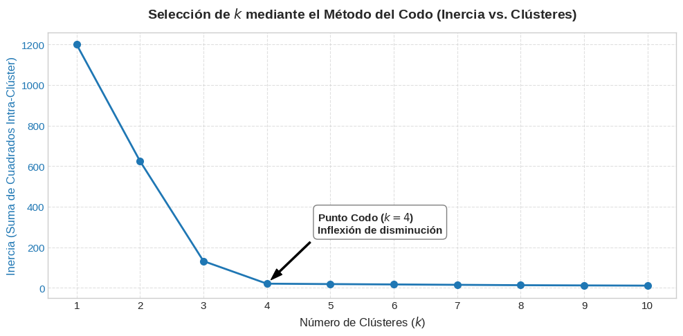
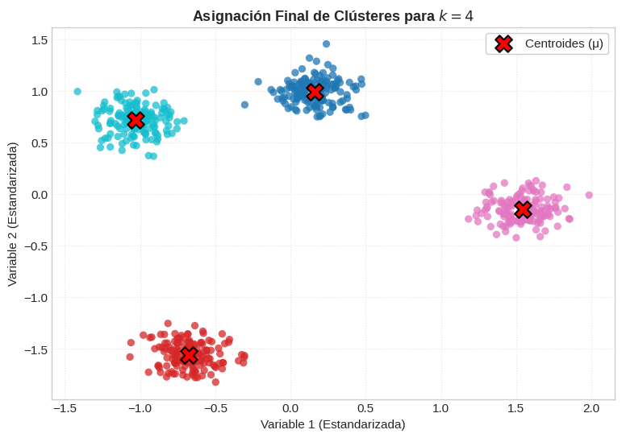

## **k-medias**

**K-means** (o algoritmo de las $k$-medias) es uno de los algoritmos de **aprendizaje no supervisado** (*unsupervised learning*) y particionamiento más utilizados en ciencia de datos e ingeniería de datos. Su propósito es dividir un conjunto de datos multidimensional no etiquetado en **$k$ grupos disjuntos (clústeres)**, donde el hiperparámetro $k$ representa el número predeterminado de conglomerados que se desea identificar.

Pertenece a la categoría de **clustering basado en prototipos** (*prototype-based clustering*): cada grupo está formalmente representado por un vector central en el espacio continuo denominado **centroide** ($\mu_j$), el cual corresponde a la media aritmética de todas las observaciones asignadas a dicho clúster.


### Formulación Matemática

Desde una perspectiva de optimización matemática, K-means busca particionar $n$ observaciones $\{x^{(1)}, x^{(2)}, \dots, x^{(n)}\} \subset \mathbb{R}^d$ en $k$ conjuntos $C = \{C_1, C_2, \dots, C_k\}$ de tal forma que se minimice la suma de errores cuadráticos dentro de cada clúster, conocida formalmente como **WCSS** (*Within-Cluster Sum of Squares*), **distorsión** o **inercia**:

```math 
J = \sum_{j=1}^{k} \sum_{i=1}^{n} w^{(i,j)} \, \big\| x^{(i)} - \mu^{(j)} \big\|_2^2
```

Donde:
*   $\mu^{(j)} \in \mathbb{R}^d$ es el centroide del clúster $j$.
*   $w^{(i,j)} \in \{0, 1\}$ es una variable binaria indicadora de pertenencia ($w^{(i,j)} = 1$ si la instancia $x^{(i)}$ pertenece al clúster $j$, y $0$ en caso contrario).
*   $\|\cdot\|_2$ representa la **distancia euclidiana** en el espacio $d$-dimensional.

Minimizar esta función objetivo global de forma exacta sobre todas las particiones posibles es un problema computacional de clase **NP-hard** debido a la explosión combinatoria de asignaciones.


### El Algoritmo Estándar
**Algoritmo de Lloyd (Expectation–Maximization)**

En la práctica, K-means utiliza un enfoque heurístico iterativo voraz (*greedy*) propuesto por Stuart Lloyd y Edward Forgy, el cual sigue el esquema de **Esperanza–Maximización (E-M)**:

```
                     ┌──────────────────────────────────────────┐
                     │          Inicio: Elegir k puntos         │
                     │          como centroides iniciales       │
                     └────────────────────┬─────────────────────┘
                                          │
                                          ▼
                      ┌────────────────────────────────────────┐
                 ┌───►│ Paso E (Asignación):                   │
                 │    │ Asignar cada x_i al centroide más      │
                 │    │ cercano según la distancia euclidiana  │
                 │    └───────────────────┬────────────────────┘
                 │                        │
                 │                        ▼
                 │    ┌────────────────────────────────────────┐
                 │    │ Paso M (Actualización):                │
                 │    │ Recalcular el centroide de cada grupo  │
                 │    │ como la media aritmética de sus puntos │
                 │    └───────────────────┬────────────────────┘
                 │                        │
                 └─── [¿Cambió la asignación o centroides?] ───┘
                                  No (Convergió)
                                          │
                                          ▼
                                   [ Modelo Final ]
```

1.  **Inicialización:** Se seleccionan $k$ centroides iniciales $\{\mu^{(1)}, \dots, \mu^{(k)}\}$ en el espacio de características (tradicionalmente seleccionados al azar entre las muestras del dataset).

2.  **Paso de Asignación (Paso E):** Cada observación $x^{(i)}$ se asigna de manera exclusiva (clasificación dura o *hard clustering*) al centroide más cercano utilizando la distancia euclidiana:
    ```math 
    c^{(i)} = \arg\min_{j \in \{1, \dots, k\}} \big\| x^{(i)} - \mu^{(j)} \big\|_2^2
    ```
    Esto divide el espacio en regiones poliédricas conocidas como **teselación o particiones de Voronoi**.

3.  **Paso de Actualización (Paso M):** Una vez asignados los puntos, el algoritmo recalcula la posición física de cada centroide determinando la media aritmética de todas las observaciones que cayeron en ese clúster:
    ```math 
    \mu^{(j)} = \frac{1}{|C_j|} \sum_{x \in C_j} x
    ```
4.  **Criterio de Parada:** Los pasos 2 y 3 se repiten recursivamente hasta que se cumple una condición de parada: los centroides dejan de moverse, las asignaciones no cambian entre iteraciones, el cambio en la inercia cae por debajo de un umbral de tolerancia (`tol`), o se alcanza un número máximo de iteraciones (`max_iter`).


### Técnicas de Inicialización
**K-means++**

Dado que el algoritmo de Lloyd converge de forma monotónica pero está sujeto a quedar atrapado en **mínimos locales subóptimos** según la semilla aleatoria inicial, David Arthur y Sergei Vassilvitskii introdujeron en 2006 la técnica **K-means++**:
*   El primer centroide se elige uniformemente al azar del conjunto de datos.
*   Los centroides subsiguientes se seleccionan mediante un muestreo probabilístico proporcional al cuadrado de la distancia mínima del punto a los centroides ya existentes:
    ```math
     P(x) = \frac{D(x)^2}{\sum_{l} D(x_l)^2}
     ```
*   Esta inicialización dispersa los centroides en regiones distantes del espacio, reduciendo sustancialmente el número de iteraciones necesarias y previniendo malas configuraciones locales. En `scikit-learn`, `init='k-means++'` es la opción activa por defecto.


### Selección del Número de Clústeres ($k$)

Dado que K-means requiere definir $k$ *a priori*, la calidad del particionamiento suele determinarse mediante métodos intrínsecos no supervisados:

#### A. Método del Codo (*Elbow Method*)
Se entrena el algoritmo para una secuencia de valores crecientes de $k$ (por ejemplo, de 1 a 10) y se grafica la inercia resultante frente a $k$. A medida que $k$ crece, la inercia decrece de forma natural. El valor óptimo se ubica en el punto de inflexión o "codo", donde la reducción marginal de distorsión deja de ser pronunciada.


#### B. Análisis de Coeficiente de Silueta (*Silhouette Analysis*)
Mide tanto la cohesión interna como la separación inter-clúster de cada muestra. Para una instancia $i$, el coeficiente $s^{(i)}$ se define como:
```math 
s^{(i)} = \frac{b^{(i)} - a^{(i)}}{\max(a^{(i)}, b^{(i)})}
```
*   $a^{(i)}$ es la distancia media intra-clúster (cohesión).
*   $b^{(i)}$ es la distancia media al clúster vecino más cercano (separación).
*   El rango oscila entre $-1$ y $+1$. Valores cercanos a $+1$ indican que la muestra está densamente agrupada y lejos de otros clústeres; valores cercanos a $0$ sugieren solapamiento en las fronteras, y valores negativos indican posibles clasificaciones erróneas.

***
### El metodo del codo

El **método del codo** (*elbow method*) es una técnica heurística visual e intrínseca utilizada en el aprendizaje no supervisado para estimar el número óptimo de grupos o clústeres ($k$) en algoritmos de particionamiento como **K-means**. 

Dado que en los problemas de agrupamiento no se dispone de etiquetas de clase de referencia (*ground truth*), la determinación de $k$ representa uno de los retos centrales del análisis de clústeres.


#### Fundamentos 

En el algoritmo K-means, la calidad del agrupamiento para un valor fijo de $k$ se cuantifica mediante la **inercia**, también denominada **distorsión**, suma total de errores cuadráticos intra-clúster (**WCSS** / **SSE**) o *Total Within Sum of Squares* (**TWSS**). 

Esta métrica mide la compacidad de los clústeres sumando las distancias euclidianas al cuadrado entre cada observación $x^{(i)}$ y el centroide $\mu^{(j)}$ al que fue asignada:


#### La dinámica del descenso y el «Punto de Inflexión»
A medida que el hiperparámetro $k$ aumenta, la inercia disminuye de forma monotónica:
* Al introducir más centroides, las observaciones quedan físicamente más próximas a su centroide asignado. 
* En el caso extremo donde $k = N$ (cada punto es su propio clúster), la inercia es exactamente cero ($0$), lo que representa un sobreajuste total sin capacidad de abstracción de patrones.
* **El Criterio del Codo:** Al trazar la curva de la inercia en función de $k$, la reducción marginal de error suele ser muy pronunciada al inicio y se estabiliza drásticamente a partir de cierto umbral. El punto donde se produce este quiebre visible o cambio abrupto en la pendiente —asemejando la articulación de un codo humano en flexión— señala el punto de equilibrio donde agregar más clústeres deja de justificar el incremento en la complejidad del modelo.


<br />
<Tabs>
<TabItem value="mnp" label="Antecedentes" default>
<div class="alert alert--primary">
**Ejemplo Método del codo**

Código completo estructurado, cubriendo la generación sintética de datos, el escalado, la iteración de K-means evaluando la inercia, la graficación del codo y la validación cruzada con el **coeficiente de silueta**:




</div>
</TabItem>
<TabItem value="mnp-python" label="🖥️ Código">

```python showLineNumbers
""" Selección de Clústeres Óptimos con el Método del Codo
En este código analizaremos cómo determinar el hiperparámetro $k$ en K-Means mediante:
1. Generación de un espacio multidimensional sintético con agrupaciones bien delimitadas.
2. Estandarización de variables ($Z$-score) para preservar las métricas de distancia euclidiana.
3. Evaluación iterativa de la Inercia (Within-Cluster Sum of Squares - WCSS).
4. Localización del punto de inflexión ("codo") y validación mediante Silhouette Score.
"""
import numpy as np
import pandas as pd
import matplotlib.pyplot as plt
from sklearn.datasets import make_blobs
from sklearn.preprocessing import StandardScaler
from sklearn.cluster import KMeans
from sklearn.metrics import silhouette_score

# Configuración visual para mantener fondos claros y figuras de alta resolución
plt.style.use('seaborn-v0_8-whitegrid' if 'seaborn-v0_8-whitegrid' in plt.style.available else 'default')
plt.rcParams['figure.figsize'] = (10, 6)
plt.rcParams['font.size'] = 11

"""
Generación y Estandarización de Datos
"""

# Generamos 600 observaciones sintéticas agrupadas intencionalmente en 4 centros
# X contiene las variables explicativas continuas; ignoramos y_true (no supervisado)
X_raw, y_true = make_blobs(
    n_samples=600,
    n_features=2,
    centers=4,
    cluster_std=0.75,
    random_state=42
)

# REGLA METODOLÓGICA: Como K-means calcula distancias euclidianas,
# es mandatorio estandarizar los atributos para evitar que una escala domine el coste.
scaler = StandardScaler()
X = scaler.fit_transform(X_raw)

print(f"Dimensiones de la matriz de entrada X: {X.shape}")

"""
Ejecución del Bucle de Inercia
"""

# Evaluamos un rango de k desde 1 hasta 10 clústeres
k_candidatos = range(1, 11)
inercias = []
coeficientes_silueta = []

for k in k_candidatos:
    # Usamos init='k-means++' para optimizar la dispersión inicial de los centroides
    km = KMeans(
        n_clusters=k,
        init='k-means++',
        n_init=10,
        max_iter=300,
        random_state=42
    )
    km.fit(X)
    
    # La inercia calculada (WCSS) queda almacenada en el atributo km.inertia_
    inercias.append(km.inertia_)
    
    # El coeficiente de silueta solo está definido formalmente para k >= 2
    if k >= 2:
        score_sil = silhouette_score(X, km.labels_)
        coeficientes_silueta.append(score_sil)
    else:
        coeficientes_silueta.append(None)

# Resumen tabular de la evaluación
df_evaluacion = pd.DataFrame({
    'k': list(k_candidatos),
    'Inercia (WCSS)': inercias,
    'Silhouette Score': coeficientes_silueta
})
display(df_evaluacion)

"""
Graficación de la Curva del Codo (Elbow Curve)
"""
fig, ax1 = plt.subplots(figsize=(10, 5), facecolor='white')

# Curva principal de Inercia
color_inercia = '#1f77b4'
ax1.plot(k_candidatos, inercias, marker='o', color=color_inercia, linewidth=2, markersize=7)
ax1.set_title('Selección de $k$ mediante el Método del Codo (Inercia vs. Clústeres)', fontsize=14, fontweight='bold', pad=15)
ax1.set_xlabel('Número de Clústeres ($k$)', fontsize=12)
ax1.set_ylabel('Inercia (Suma de Cuadrados Intra-Clúster)', color=color_inercia, fontsize=12)
ax1.tick_params(axis='y', labelcolor=color_inercia)
ax1.set_xticks(list(k_candidatos))
ax1.grid(True, linestyle='--', alpha=0.6)

# Anotación pedagógica en el punto de codo esperado (k=4)
punto_codo_k = 4
inercia_codo = inercias[punto_codo_k - 1]
ax1.annotate(
    f'Punto Codo ($k={punto_codo_k}$)\nInflexión de disminución',
    xy=(punto_codo_k, inercia_codo),
    xytext=(punto_codo_k + 0.8, inercia_codo + 250),
    arrowprops=dict(facecolor='black', shrink=0.08, width=1.5, headwidth=8),
    fontsize=11,
    fontweight='bold',
    bbox=dict(boxstyle="round,pad=0.4", fc="white", ec="gray", lw=1)
)

plt.tight_layout()
plt.show()

"""
 Validación Visual del Clúster Óptimo Obtenido
"""

# Entrenamos el modelo definitivo configurado en k=4
k_optimo = 4
modelo_final = KMeans(n_clusters=k_optimo, init='k-means++', n_init=10, random_state=42)
etiquetas_finales = modelo_final.fit_predict(X)
centroides = modelo_final.cluster_centers_

# Visualización del particionamiento y centroides resultantes
plt.figure(figsize=(9, 6), facecolor='white')
scatter = plt.scatter(
    X[:, 0], X[:, 1],
    c=etiquetas_finales,
    cmap='tab10',
    s=45,
    alpha=0.75,
    edgecolors='none'
)

# Graficamos la posición de los centroides calculados
plt.scatter(
    centroides[:, 0], centroides[:, 1],
    marker='X',
    s=220,
    c='red',
    edgecolors='black',
    linewidths=1.5,
    label='Centroides (\u03bc)'
)

plt.title(f'Asignación Final de Clústeres para $k={k_optimo}$', fontsize=13, fontweight='bold')
plt.xlabel('Variable 1 (Estandarizada)', fontsize=11)
plt.ylabel('Variable 2 (Estandarizada)', fontsize=11)
plt.legend(frameon=True, facecolor='white', framealpha=1)
plt.grid(True, linestyle=':', alpha=0.5)
plt.show()
```
</TabItem>
</Tabs><br />


---

### 3. Consideraciones Críticas en Ingeniería de Datos

* **Ambigüedad del codo:** En conjuntos de datos complejos, con solapamiento o ruido considerable, la curva de distorsión puede ser suave y carecer de una inflexión nítida. En tales casos, se recomienda complementar la decisión utilizando el **análisis de silueta** o el **índice de Davies-Bouldin**.
* **Sensibilidad a la escala:** K-means minimiza la distancia euclidiana no ponderada; si no se aplica una estandarización previa (`StandardScaler` o `MinMaxScaler`), las variables con rangos numéricos elevados dominarán la inercia, distorsionando la ubicación del codo.
* **Alternativas automatizadas:** En flujos de ingeniería se suele emplear la librería `yellowbrick.cluster.KElbowVisualizer` para calcular la derivada segunda de la curva y localizar automáticamente la máxima curvatura geométrica.

***


### Supuestos, Limitaciones y Variantes de Escalabilidad

*   **Supuesto de Esfericidad:** K-means asume implícitamente que los clústeres son esféricos (isotrópicos), convexos y de varianza/diámetro similar en todas las dimensiones. Falla ante agrupaciones con formas alargadas, elipsoidales o patrones geométricos no lineales complejos (como las medialunas de *two moons*), escenarios donde algoritmos como **DBSCAN** o modelos de mezclas gaussianas (**GMM**) son más adecuados.
*   **Sensibilidad a la Escala y Valores Atípicos:** Como se fundamenta en la distancia euclidiana, variables con escalas numéricas grandes dominan artificialmente la función de coste; por ello, la **estandarización de variables (`StandardScaler`)** antes del entrenamiento es obligatoria. Además, la presencia de *outliers* sesga severamente la media aritmética, desplazando los centroides.
*   **Escalabilidad Masiva (Mini-Batch K-Means y K-Means||):**
    *   **Mini-Batch K-Means:** En lugar de calcular distancias sobre todas las observaciones en cada ciclo, utiliza pequeños subconjuntos de datos en memoria para actualizar los centroides gradualmente, permitiendo procesar millones de instancias que no caben en RAM.
    *   **K-Means|| en Apache Spark:** Variante altamente paralelizable implementada en Spark MLlib que realiza múltiples selecciones de centroides por paso sobre el clúster distribuido.


### Implementación (Scikit-Learn)

El siguiente script ilustra el preprocesamiento con escalado, la aplicación del método del codo y la evaluación mediante el coeficiente de silueta:

```python
"""
Módulo Universitario: Implementación y Evaluación de K-Means en Scikit-Learn.
"""

import numpy as np
import matplotlib.pyplot as plt
from sklearn.datasets import make_blobs
from sklearn.preprocessing import StandardScaler
from sklearn.cluster import KMeans
from sklearn.metrics import silhouette_score

# 1. Generación de datos sintéticos no etiquetados (3 cúmulos bien definidos)
X_raw, _ = make_blobs(n_samples=400, centers=3, cluster_std=0.85, random_state=42)

# 2. Preprocesamiento: Estandarización obligatoria para distancias euclidianas
scaler = StandardScaler()
X_scaled = scaler.fit_transform(X_raw)

# 3. Método del Codo (Elbow Method) para determinar k óptimo
valores_k = range(2, 9)
inercias = []
siluetas = []

for k in valores_k:
    # Usamos n_init=10 y la inicialización k-means++ por defecto
    km = KMeans(n_clusters=k, init='k-means++', n_init=10, max_iter=300, random_state=42)
    etiquetas = km.fit_predict(X_scaled)
    
    inercias.append(km.inertia_)
    siluetas.append(silhouette_score(X_scaled, etiquetas))

# Inspección de métricas numéricas
print("=== EVALUACIÓN INTRÍNSECA DE CLÚSTERES ===")
for k, inercia, sil in zip(valores_k, inercias, siluetas):
    print(f"k = {k} | Inercia (Distorsión): {inercia:.2f} | Coeficiente de Silueta: {sil:.4f}")

# 4. Ajuste final con el k óptimo (k=3)
modelo_optimo = KMeans(n_clusters=3, init='k-means++', n_init=10, random_state=42)
predicciones = modelo_optimo.fit_predict(X_scaled)
centroides = modelo_optimo.cluster_centers_

print(f"\nCentroides finales calculados:\n{centroides}")
```


### Resumen

1.  **Naturaleza:** Algoritmo no supervisado de particionamiento duro basado en prototipos (centroides).
2.  **Mecanismo:** Algoritmo E-M (Lloyd) iterativo que alterna entre **asignar** cada muestra al centroide euclidiano más cercano y **actualizar** los centroides calculando la media aritmética de cada grupo.
3.  **Optimizador:** Minimiza la inercia o suma de distancias cuadráticas intra-clúster (WCSS).
4.  **Validación:** El número $k$ se sintoniza típicamente analizando la curva del codo de la inercia y maximizando el coeficiente medio de silueta.

## 🖥️ **Ejemplos**