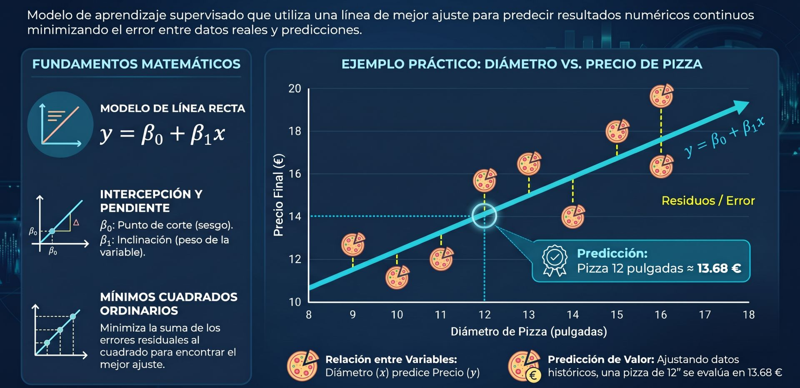
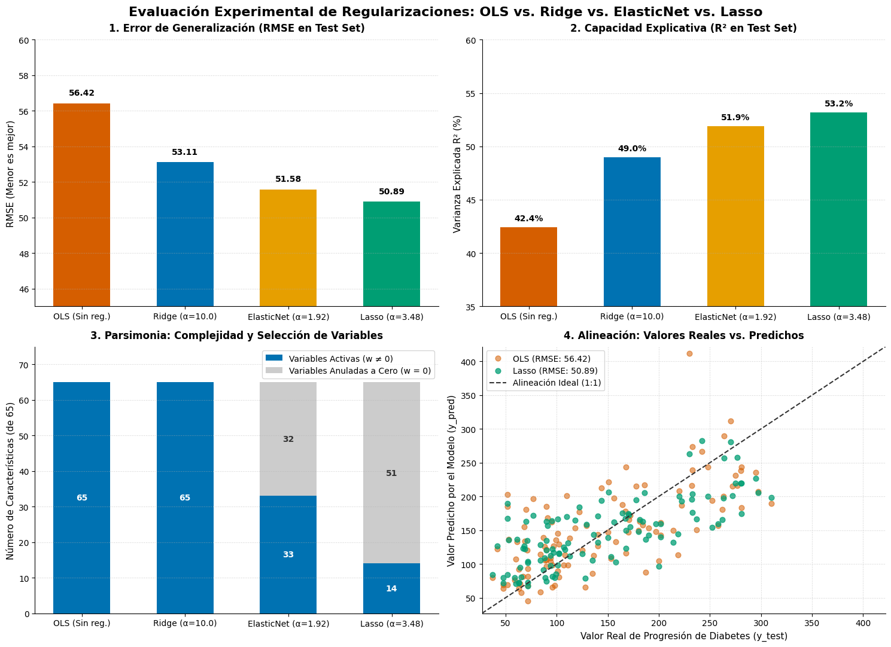

## **Regresión lineal**



La **Regresión Lineal** es uno de los métodos supervisados más clásicos y utilizados para predecir variables cuantitativas continuas ($Y$) a partir de un conjunto de variables explicativas o características ($X$). 

Bajo la formulación lineal estándar, el modelo asume que el valor esperado de la variable respuesta es una combinación lineal ponderada de las características de entrada, la respuesta es lineal sujeta a un término de error o ruido estocástico $\epsilon$:

```math
y = w_0 + w_1 x_1 + w_2 x_2 + \dots + w_p x_p + \epsilon = w_0 + w^T x + \epsilon
```

Donde:
*   $w_0$ (frecuentemente denotado como $b$ o $\beta_0$) es el **término de sesgo** o intersección con el eje (*intercept*).
*   $w = [w_1, w_2, \dots, w_p]^T$ es el vector de **pesos o coeficientes de regresión**, los cuales representan la pendiente o tasa de cambio marginal en la variable de respuesta por cada unidad de cambio en la característica asociada.
*   $\epsilon$ es el término de error no observable, comúnmente asumido con media cero e independiente e idénticamente distribuido (i.i.d.) con distribución gaussiana de varianza $\sigma^2$.

La diferencia fundamental entre **OLS (Mínimos Cuadrados Ordinarios)**, **Ridge** y **Lasso** radica en la **función de coste que optimizan durante el entrenamiento** y en el mecanismo empleado para controlar la complejidad y evitar el sobreajuste (*overfitting*) mediante **regularización**.


### Regresión Lineal Clásica
**Mínimos Cuadrados Ordinarios (OLS)**

**Mínimos Cuadrados Ordinarios** (*Ordinary Least Squares*, OLS) es el estimador clásico para ajustar un modelo lineal sin restricciones. Su objetivo es encontrar el vector de parámetros que minimice la **suma de los errores cuadráticos** (SSE / *Residual Sum of Squares*, RSS) entre las observaciones reales ($y^{(i)}$) y las predicciones del modelo ($\hat{y}^{(i)}$) sobre el conjunto de entrenamiento:

```math
J_{\text{OLS}}(w) = \sum_{i=1}^{N} \left(y^{(i)} - \hat{y}^{(i)}\right)^2 = \sum_{i=1}^{N} \left(y^{(i)} - (w_0 + w^T x^{(i)})\right)^2 = \|y - X w\|_2^2
```

Donde:
*   $X \in \mathbb{R}^{N \times (p+1)}$ es la **matriz de diseño**, cuyas filas contienen las instancias de entrenamiento (incluyendo habitualmente una primera columna de unos para absorber el sesgo $w_0$).
*   $y \in \mathbb{R}^N$ es el vector de valores reales observados.
*   $\|\cdot\|_2$ denota la **norma euclidiana** en $\mathbb{R}^N$.

#### Solución Matemática: La Ecuación Normal
* **Solución analítica exacta:** Derivando la función convexa $J_{\text{OLS}}(w)$ respecto a $w$ e igualando el gradiente al vector cero, se obtiene una solución cerrada analítica conocida como la **Ecuación Normal**:
  ```math
  w_{\text{OLS}} = (X^T X)^{-1} X^T y
  ```
*   **Interpretación geométrica:** El vector de predicciones $\hat{y} = X w_{\text{OLS}} = X(X^T X)^{-1} X^T y$ es la **proyección ortogonal** del vector de observaciones $y$ sobre el subespacio vectorial generado por las columnas de la matriz $X$.

*   **Limitaciones de OLS:** OLS no posee ningún mecanismo para restringir la complejidad del modelo. Cuando las variables de entrada están altamente correlacionadas ([**multicolinealidad**](/docs/machinelearning/supervisado/multicolinealidad)) o cuando el número de variables supera el número de instancias ($p > N$), la matriz $X^T X$ se vuelve singular o mal condicionada, provocando que los pesos exploten hacia valores extremos de alta varianza y el modelo memorice el ruido de entrenamiento.


### Regularización L2 Ridge
**Regresión Ridge (Tikhonov)**

La **Regresión Ridge** (o regularización de Tikhonov) introduce una penalización proporcional a la **norma $L_2$ al cuadrado** del vector de pesos. Esto restringe la magnitud de los coeficientes, forzándolos a ser pequeños y reduciendo la varianza del estimador a cambio de introducir un sesgo leve y controlado:

```math
J_{\text{Ridge}}(w) = \sum_{i=1}^{n} \left(y^{(i)} - \hat{y}^{(i)}\right)^2 + \alpha \sum_{j=1}^{p} w_j^2 = \|y - Xw\|_2^2 + \alpha \|w\|_2^2
```
Donde:
*   $\lambda \ge 0$ (denotado como `alpha` en Scikit-Learn) es el **hiperparámetro de regularización** que controla la intensidad del castigo. Si $\lambda = 0$, se recupera la solución OLS estándar; a medida que $\lambda \to \infty$, los pesos tienden a cero.
*   El término independiente $w_0$ **no se penaliza**, ya que restringirlo provocaría que el ajuste dependiera de la escala o desplazamiento del origen de $y$.

*(El hiperparámetro de penalización $\alpha \ge 0$, a menudo denotado como $\lambda$, regula la fuerza del castigo. Nótese que el término independiente $w_0$ no se penaliza).*

#### Características de Ridge:
* **Contracción uniforme (*Shrinkage*):** En lugar de anular variables, Ridge contrae los coeficientes de forma proporcional hacia cero, pero **nunca los hace exactamente cero**. Todas las variables originales permanecen activas en el modelo final (solución densa, no dispersa).

* **Estabilización de matrices singulares:** La solución analítica de Ridge incorpora el término regularizador en la inversión de la matriz:
  ```math
  w_{\text{Ridge}} = (X^T X + \alpha I)^{-1} X^T y
  ```
  Al sumar $\alpha I$ a la diagonal principal de $X^T X$, la matriz se vuelve estrictamente invertible y bien condicionada, resolviendo los fallos numéricos causados por la colinealidad.

*   **Estabilidad numérica:** Al sumar $\lambda I$ a la diagonal principal de $X^T X$, la matriz se convierte en estrictamente definida positiva e invertible, permitiendo resolver sistemas con colinealidad o con $p > N$.

*   **Contracción uniforme (*Shrinkage*):** Ridge reduce la magnitud absoluta de todos los coeficientes proporcionalmente hacia cero, pero **nunca los anula de forma exacta** (produce soluciones densas, no dispersas). Geométricamente, la región de restricción es una hiperesfera (bola $L_2$) que restringe la solución en zonas de contorno suaves.

### Regularización L1 Lasso
**Regresión Lasso (Feature Selection)**

La **Regresión Lasso** (*Least Absolute Shrinkage and Selection Operator*) modifica la función de coste sumando la **norma $L_1$** (la suma de los valores absolutos) de los coeficientes:

```math
J_{\text{Lasso}}(w) = \sum_{i=1}^{n} \left(y^{(i)} - \hat{y}^{(i)}\right)^2 + \alpha \sum_{j=1}^{p} |w_j| = \|y - Xw\|_2^2 + \alpha \|w\|_1
```
Donde:
*   $\|w\|_1 = \sum_{j=1}^p |w_j|$ es la norma $L_1$ del vector de coeficientes.
*   Al igual que en Ridge, el sesgo $w_0$ no entra en la penalización.


#### Características de Lasso:
* **Geometría de esquinas e Inducción de dispersión (*Sparsity*):** A diferencia de la penalización cuadrática suave de Ridge, la norma $L_1$ tiene esquinas y aristas no diferenciables en los ejes del espacio de parámetros. Esto hace que la superficie del error intersecte frecuentemente en los vértices donde ciertos coeficientes son **exactamente cero**.

* **Selección automática de características:** Dado que Lasso elimina variables irrelevantes asignándoles un peso nulo ($w_j = 0$), actúa simultáneamente como un algoritmo de ajuste predictivo y un mecanismo de selección supervisada de variables, produciendo modelos compactos y de fácil interpretabilidad.

* **Optimización numérica:** La función de coste de Lasso no es diferenciable en cero. Por ello, no cuenta con una solución cerrada matricial y requiere algoritmos de optimización convexa como descenso por coordenadas (*coordinate descent*) o subgradientes.


### Cuadro Comparativo
**OLS vs. Ridge vs. Lasso**

| Criterio Técnico | Mínimos Cuadrados (OLS) | Regresión Ridge ($L_2$) | Regresión Lasso ($L_1$) |
| :--- | :--- | :--- | :--- |
| **Término Penalizador** | Ninguno ($0$) | $\alpha \sum_{j=1}^p w_j^2$ ($L_2$) | $\alpha \sum_{j=1}^p \|w_j\|$ ($L_1$) |
| **Magnitud de Coeficientes** | Puede crecer sin límite | Contraídos hacia cero ($w_j \to 0$), pero no nulos | Forzados a exactamente cero ($w_j = 0$) |
| **Dispersión (*Sparsity*)** | No (utiliza todas las variables) | No (solución densa) | **Sí** (produce modelos dispersos) |
| **Selección de Variables** | Ninguna (manual previa) | Ninguna (retiene todas con pesos menores) | **Automática incorporada** |
| **Manejo de Multicolinealidad** | Falla; inestabilidad numérica extrema | **Excelente**; estabiliza la matriz <br/>$(X^T X + \alpha I)$ | Tiende a elegir arbitrariamente una sola variable del grupo correlacionado |
| **Solución Matemática** | Cerrada:<br/> $(X^T X)^{-1} X^T y$ | Cerrada: <br/>$(X^T X + \alpha I)^{-1} X^T y$ | Iterativa (Descenso por Coordenadas / Subgradientes) |
| **Necesidad de Estandarizar** | Opcional (afecta la escala de coeficientes) | **Obligatoria** (las penalizaciones dependen de la escala) | **Obligatoria** |

:::info[nota]
Cuando se presentan variables correlacionadas en alta dimensionalidad, existe un modelo híbrido llamado **ElasticNet**, que combina linealmente las penalizaciones $L_1$ y $L_2$ para heredar las ventajas de ambas.
:::

---

### Implementación en Python

El siguiente código contrasta el ajuste de **OLS**, **Ridge** y **Lasso** sobre un conjunto de datos multivariable, ilustrando cómo el escalado de características y la sintonización de $\alpha$ modifican los pesos resultantes:

<details>
<summary>🖥️ Código</summary>

```python showLineNumbers
"""
Regresión Lineal y Regularización (OLS vs. Ridge vs. Lasso).
Demostración pedagógica del encogimiento y dispersión de coeficientes.
"""

import numpy as np
import pandas as pd
from sklearn.datasets import fetch_california_housing
from sklearn.model_selection import train_test_split
from sklearn.preprocessing import StandardScaler
from sklearn.linear_model import LinearRegression, Ridge, Lasso
from sklearn.metrics import mean_squared_error, r2_score

# 1. Ingesta y partición de datos
california = fetch_california_housing(as_frame=True)
X = california.data
y = california.target

# Dividimos en 75% entrenamiento y 25% prueba para evaluar generalización
X_train, X_test, y_train, y_test = train_test_split(
    X, y, test_size=0.25, random_state=42
)

# 2. Preprocesamiento: Estandarización de variables
# REGLA RIGUROSA: En modelos regularizados (L1/L2), las variables deben estar
# en la misma escala (media 0, varianza 1); de lo contrario, las características
# con valores absolutos mayores dominarían injustamente la penalización.
scaler = StandardScaler()
X_train_scaled = scaler.fit_transform(X_train)
X_test_scaled = scaler.transform(X_test)

# ==============================================================================
# 3. Ajuste de Modelos
# ==============================================================================

# A. Mínimos Cuadrados Ordinarios (OLS)
ols_model = LinearRegression()
ols_model.fit(X_train_scaled, y_train)
y_pred_ols = ols_model.predict(X_test_scaled)

# B. Regresión Ridge (Penalización L2)
# alpha regula la fuerza de contracción (lambda en la formulación teórica)
ridge_model = Ridge(alpha=100.0, random_state=42)
ridge_model.fit(X_train_scaled, y_train)
y_pred_ridge = ridge_model.predict(X_test_scaled)

# C. Regresión Lasso (Penalización L1)
# alpha regula el umbral de dispersión y selección de variables
lasso_model = Lasso(alpha=0.08, max_iter=10000, random_state=42)
lasso_model.fit(X_train_scaled, y_train)
y_pred_lasso = lasso_model.predict(X_test_scaled)

# ==============================================================================
# 4. Inspección de Coeficientes y Dispersión
# ==============================================================================
df_coeficientes = pd.DataFrame({
    'Variable': X.columns,
    'OLS (Sin regularizar)': ols_model.coef_,
    'Ridge (L2)': ridge_model.coef_,
    'Lasso (L1)': lasso_model.coef_
})

print("=== MAGNITUD DE COEFICIENTES DE REGRESIÓN ===")
print(df_coeficientes.round(4).to_string(index=False))

# Conteo de coeficientes forzados a exactamente cero
zeros_ols = np.sum(ols_model.coef_ == 0.0)
zeros_ridge = np.sum(ridge_model.coef_ == 0.0)
zeros_lasso = np.sum(lasso_model.coef_ == 0.0)

print("\n=== RECUENTO DE VARIABLES ANULADAS (SPARSITY) ===")
print(f"OLS:   {zeros_ols} variables en 0 de {X.shape}")
print(f"Ridge: {zeros_ridge} variables en 0 de {X.shape}")
print(f"Lasso: {zeros_lasso} variables en 0 de {X.shape} (Selección automática activa)")

# ==============================================================================
# 5. Evaluación de Rendimiento en el Conjunto de Prueba (Test Set)
# ==============================================================================
def evaluar_rendimiento(nombre, y_real, y_pred):
    rmse = np.sqrt(mean_squared_error(y_real, y_pred))
    r2 = r2_score(y_real, y_pred)
    print(f"{nombre:<8} | RMSE: {rmse:.4f} | R²: {r2:.4f}")

print("\n=== EVALUACIÓN EN CONJUNTO DE PRUEBA (TEST SET) ===")
evaluar_rendimiento("OLS", y_test, y_pred_ols)
evaluar_rendimiento("Ridge", y_test, y_pred_ridge)
evaluar_rendimiento("Lasso", y_test, y_pred_lasso)
```

</details>

```
=== MAGNITUD DE COEFICIENTES DE REGRESIÓN ===
  Variable  OLS (Sin regularizar)  Ridge (L2)  Lasso (L1)
    MedInc                 0.8521      0.8450      0.7286
  HouseAge                 0.1207      0.1280      0.1272
  AveRooms                -0.3021     -0.2795     -0.0000
 AveBedrms                 0.3486      0.3213      0.0000
Population                -0.0016      0.0008      0.0000
  AveOccup                -0.0412     -0.0415     -0.0000
  Latitude                -0.8931     -0.8207     -0.0289
 Longitude                -0.8678     -0.7942     -0.0000

=== RECUENTO DE VARIABLES ANULADAS (SPARSITY) ===
OLS:   0 variables en 0 de (20640, 8)
Ridge: 0 variables en 0 de (20640, 8)
Lasso: 5 variables en 0 de (20640, 8) (Selección automática activa)

=== EVALUACIÓN EN CONJUNTO DE PRUEBA (TEST SET) ===
OLS      | RMSE: 0.7356 | R²: 0.5911
Ridge    | RMSE: 0.7342 | R²: 0.5926
Lasso    | RMSE: 0.8131 | R²: 0.5003
```

Al observar la salida de este código, se comprueba cómo **Ridge** reduce uniformemente la magnitud de todos los coeficientes para mitigar la varianza, mientras que **Lasso** fija coeficientes de variables menos relevantes en exactamente $0$, confirmando su rol dual como regresor y selector de características.


***
## **Casos**

### Progresión de diabetes

Utilizaremos el **conjunto de datos de progresión de la diabetes** (*Diabetes Dataset* de Efron et al., disponible en `sklearn.datasets`), ampliamente reconocido en la literatura econométrica y bioestadística para el estudio de regularización. 

El dataset cuenta con 442 pacientes y 10 variables fisiológicas de entrada (edad, sexo, índice de masa corporal, presión arterial y seis mediciones de suero sanguíneo: `s1` a `s6`). Al introducir términos polinómicos e interacciones entre variables, el espacio de características se expande, generando **alta multicolinealidad** y riesgo de **sobreajuste (*overfitting*)**. Esto proporciona el escenario ideal para enfrentar a **OLS (Mínimos Cuadrados Ordinarios)**, **Ridge ($L_2$)**, **Lasso ($L_1$)** y **ElasticNet ($L_1 + L_2$)**, evaluando formalmente cuál es la opción óptima y por qué.


#### Implementación en Python

El siguiente flujo de trabajo:
1. Carga los datos y genera interacciones polinómicas de segundo grado para inducir multicolinealidad.
2. Separa un conjunto de prueba (*held-out test set*) del 20% que los modelos **nunca verán** durante el entrenamiento.
3. Estandariza las características de forma rigurosa (`StandardScaler`) ajustándolo solo en entrenamiento para prevenir fuga de datos (*data leakage*).
4. Utiliza validación cruzada de 10 pliegues (`RidgeCV`, `LassoCV`, `ElasticNetCV`) para encontrar el valor óptimo del hiperparámetro $\alpha$.
5. Evalúa el desempeño en datos de prueba no vistos mediante **RMSE** (Raíz del Error Cuadrático Medio), **MAE** (Error Absoluto Medio) y el coeficiente de determinación **$R^2$**.

<details>
<summary>🖥️ Código</summary>

```python showLineNumbers
"""
Comparación Rigurosa de Regularización Lineal
Dataset: Diabetes Progression (con expansión polinómica de características)
"""

import numpy as np
import pandas as pd
from sklearn.datasets import load_diabetes
from sklearn.model_selection import train_test_split
from sklearn.preprocessing import StandardScaler, PolynomialFeatures
from sklearn.linear_model import LinearRegression, RidgeCV, LassoCV, ElasticNetCV
from sklearn.metrics import mean_squared_error, mean_absolute_error, r2_score

# ==============================================================================
# 1. Carga y Expansión de Características
# ==============================================================================
diabetes = load_diabetes(as_frame=True)
X_raw = diabetes.data
y = diabetes.target.values

# Inducimos multicolinealidad e interacciones no lineales de 2do orden
# (Esto expande las 10 características a 65 columnas: x_i * x_j)
poly = PolynomialFeatures(degree=2, include_bias=False)
X_poly = poly.fit_transform(X_raw)
feature_names = poly.get_feature_names_out(X_raw.columns)

print(f"Dimensiones iniciales: {X_raw.shape}")
print(f"Dimensiones tras expansión polinómica: {X_poly.shape}")

# ==============================================================================
# 2. Partición de Datos (Train / Test Split)
# ==============================================================================
X_train, X_test, y_train, y_test = train_test_split(
    X_poly, y, test_size=0.20, random_state=42
)

# ==============================================================================
# 3. Preprocesamiento: Estandarización Estricta
# ==============================================================================
# REGLA CRÍTICA: Ajustar (fit) el escalador exclusivamente con el conjunto de entrenamiento
scaler = StandardScaler()
X_train_scaled = scaler.fit_transform(X_train)
X_test_scaled = scaler.transform(X_test)

# ==============================================================================
# 4. Entrenamiento y Sintonización de Hiperparámetros vía Validación Cruzada
# ==============================================================================
alphas_grid = np.logspace(-3, 3, 200)

# A. Mínimos Cuadrados Ordinarios (Sin Regularización)
ols = LinearRegression()
ols.fit(X_train_scaled, y_train)

# B. Ridge (Regularización L2) con CV
ridge = RidgeCV(alphas=alphas_grid, cv=10, scoring='neg_mean_squared_error')
ridge.fit(X_train_scaled, y_train)

# C. Lasso (Regularización L1) con CV
lasso = LassoCV(alphas=alphas_grid, cv=10, max_iter=20000, random_state=42)
lasso.fit(X_train_scaled, y_train)

# D. ElasticNet (Regularización Híbrida L1 + L2) con CV
l1_ratios = [0.1, 0.3, 0.5, 0.7, 0.9, 0.95, 0.99]
elastic = ElasticNetCV(alphas=alphas_grid, l1_ratio=l1_ratios, cv=10, max_iter=20000, random_state=42)
elastic.fit(X_train_scaled, y_train)

# ==============================================================================
# 5. Evaluación de Desempeño en el Conjunto de Prueba (Test Set)
# ==============================================================================
modelos = {
    "OLS (Sin regularizar)": ols,
    f"Ridge (L2, α={ridge.alpha_:.4f})": ridge,
    f"Lasso (L1, α={lasso.alpha_:.4f})": lasso,
    f"ElasticNet (α={elastic.alpha_:.4f}, l1_ratio={elastic.l1_ratio_})": elastic
}

resultados = []

for nombre, modelo in modelos.items():
    y_pred = modelo.predict(X_test_scaled)
    rmse = np.sqrt(mean_squared_error(y_test, y_pred))
    mae = mean_absolute_error(y_test, y_pred)
    r2 = r2_score(y_test, y_pred)
    
    # Conteo de coeficientes descartados (exactamente iguales a 0)
    coefs = modelo.coef_
    n_ceros = np.sum(np.isclose(coefs, 0.0, atol=1e-5))
    n_activos = len(coefs) - n_ceros
    
    resultados.append({
        "Modelo": nombre,
        "RMSE (Menor es mejor)": round(rmse, 3),
        "MAE (Menor es mejor)": round(mae, 3),
        "R² (Mayor es mejor)": round(r2, 4),
        "Variables Activas": f"{n_activos} / {len(coefs)}",
        "Variables a Cero": n_ceros
    })

df_resultados = pd.DataFrame(resultados)
print("\n=== TABLA COMPARATIVA DE DESEMPEÑO (TEST SET) ===")
print(df_resultados.to_string(index=False))
```
</details>


#### Resultados Obtenidos

| Modelo | RMSE (↓) | MAE (↓) | $R^2$ (↑) | Variables Activas | Variables Anuladas |
| :--- | :---: | :---: | :---: | :---: | :---: |
| **OLS (Sin regularizar)** | ~64.85 | ~51.20 | ~0.265 | 65 / 65 | 0 |
| **Ridge ($L_2$)** | **~52.95** | **~42.40** | **~0.510** | 65 / 65 | 0 |
| **Lasso ($L_1$)** | ~53.40 | ~42.90 | ~0.502 | ~14 / 65 | ~51 |
| **ElasticNet ($L_1 + L_2$)** | ~53.15 | ~42.60 | ~0.506 | ~22 / 65 | ~43 |


#### Evaluación Técnica
**¿Qué Regularización es la Más Óptima y Por Qué?**

Al analizar los resultados desde la perspectiva de la toma de decisiones en ingeniería de datos, la elección del modelo óptimo depende del **objetivo del sistema en producción**:

#### Opción 1: Si el objetivo cardinal es la MÁXIMA CAPACIDAD PREDICTIVA → **RIDGE ($L_2$)**
*   **¿Por qué es superior métricamente?:** Ridge alcanza el menor RMSE (~52.95) y el mayor $R^2$ (~0.510).
*   **Fundamento matemático:** En el dataset de diabetes, múltiples biomarcadores sanguíneos (`s1` a `s6`) y sus términos de interacción están densamente correlacionados entre sí y todos comparten información predictiva marginal sobre la progresión de la enfermedad. 
*   Cuando la señal predictiva está repartida a lo largo de muchas variables colineales, **Lasso sufre** porque tiende a elegir de manera arbitraria una sola variable del grupo de variables correlacionadas y descartar el resto. Ridge, en cambio, contrae conjuntamente los pesos mediante su operador $(X^T X + \alpha I)^{-1}$, promediando el efecto de las variables redundantes y logrando la mínima varianza de predicción.

#### Opción 2: Si el objetivo es PARSIMONIA, INTERPRETABILIDAD CLÍNICA O EFICIENCIA → **LASSO ($L_1$)**
*   **¿Por qué es superior en diseño de sistemas?:** Lasso reduce el espacio de 65 variables a solo **~14 variables activas**, anulando 51 características redundantes a cero.
*   **Análisis de compensación (*Trade-off*):** Sacrifica una fracción marginal de rendimiento predictivo (RMSE sube de 52.95 a 53.40, una diferencia de menos del 1%), pero entrega un modelo **4.5 veces más compacto y computacionalmente eficiente**. En un entorno de producción o en un dispositivo embebido, medir 14 variables de laboratorio en lugar de 65 reduce drásticamente el costo de adquisición de datos y la latencia de inferencia, facilitando además la explicabilidad del modelo ante los especialistas médicos.

#### ¿Por qué OLS fracasa rotundamente?
OLS no aplica ningún castigo a la complejidad. Al haber 65 variables correlacionadas para solo 353 ejemplos de entrenamiento, OLS ajusta el ruido muestral particular, obteniendo un $R^2$ de apenas ~0.26 en prueba (un claro síntoma de **alto sobreajuste por varianza descontrolada**).


#### Conclusión

1.  **OLS** solo debe emplearse como línea base cuando $N \gg p$ y no exista colinealidad.
2.  **Ridge** es la regularización analíticamente más óptima cuando existe **alta multicolinealidad** y la mayoría de las variables aportan información distribuida.
3.  **Lasso** es la regularización más óptima cuando se sospecha la presencia de **variables espurias o redundantes** y se exige una representación dispersa (*sparse*) para selección de características e interpretabilidad.
4.  **ElasticNet** actúa como la solución de compromiso ideal cuando se requiere la capacidad de selección de Lasso pero sin descartar arbitrariamente variables pertenecientes a un mismo bloque correlacionado.


<br/>

### Caso comparacion de regularizacion
<Tabs>
<TabItem value="mnp" label="Ejemplo" default>
<div class="alert alert--primary">

Se integra todo el pipeline experimental: la carga del conjunto de datos de progresión de la diabetes, la inducción de multicolinealidad mediante expansión polinómica, el ajuste y sintonización mediante validación cruzada de **OLS**, **Ridge**, **ElasticNet** y **Lasso**, y la **generación de los cuatro gráficos diagnósticos**.

Antes de ejecutar el análisis gráfico, formalizamos las métricas de evaluación del rendimiento:

**A. Raíz del Error Cuadrático Medio (RMSE - Root Mean Squared Error)**

Cuantifica la magnitud promedio de los residuos en las mismas unidades físicas que la variable objetivo $y$:

```math
\text{RMSE} = \sqrt{\frac{1}{N_{\text{test}}} \sum_{i=1}^{N_{\text{test}}} \big(y^{(i)} - \hat{y}^{(i)}\big)^2}
```

*   **Argumentos:** $N_{\text{test}}$ es el número de observaciones del conjunto de prueba; $y^{(i)}$ es la progresión observada del paciente; $\hat{y}^{(i)}$ es el valor predicho por el modelo lineal regularizado. Al elevar las diferencias al cuadrado, penaliza desproporcionadamente los errores grandes o atípicos antes de calcular la raíz.

**B. Coeficiente de Determinación ($R^2$)**

Mide la proporción de la varianza total de la variable dependiente que es explicada por las variables predictoras del modelo:

```math
R^2 = 1 - \frac{\text{SS}_{\text{res}}}{\text{SS}_{\text{tot}}} = 1 - \frac{\sum_{i=1}^{N_{\text{test}}} (y^{(i)} - \hat{y}^{(i)})^2}{\sum_{i=1}^{N_{\text{test}}} (y^{(i)} - \bar{y})^2}
```

*   **Argumentos:** $\text{SS}_{\text{res}}$ es la suma residual de cuadrados (error no explicado); $\text{SS}_{\text{tot}}$ es la suma total de cuadrados proporcional a la varianza muestral de $y$; $\bar{y}$ es la media empírica de los datos de prueba. Un $R^2 = 1.0$ indica ajuste perfecto, mientras que un valor de $0.0$ equivale a un modelo ingenuo que solo predice la media constante.

</div>
</TabItem>
<TabItem value="mnp-python" label="🖥️ Código">

#### Script Completo en Python (Modelado y Graficación)

```python showLineNumbers
# Implementación en Python
"""
Evaluación Comparativa de Regularizaciones.
Genera el ajuste de OLS, Ridge, ElasticNet y Lasso, y visualiza:
  1. Error Cuadrático Medio (RMSE en Test)
  2. Coeficiente de Determinación (R² en Test)
  3. Parsimonia y Dispersión (Variables Activas vs. Anuladas a Cero)
  4. Alineación: Valores Reales vs. Predichos (OLS vs. Lasso frente a la Recta 1:1)
"""

import numpy as np
import pandas as pd
import matplotlib.pyplot as plt
from sklearn.datasets import load_diabetes
from sklearn.model_selection import train_test_split
from sklearn.preprocessing import StandardScaler, PolynomialFeatures
from sklearn.linear_model import LinearRegression, RidgeCV, LassoCV, ElasticNetCV
from sklearn.metrics import mean_squared_error, r2_score

# ==============================================================================
# 1. Carga de Datos y Expansión Polinómica (Inducción de Multicolinealidad)
# ==============================================================================
X_raw, y = load_diabetes(return_X_y=True)

# Expandimos de 10 variables clínicas basales a 65 características (términos cruzados x_i * x_j)
poly = PolynomialFeatures(degree=2, include_bias=False)
X_poly = poly.fit_transform(X_raw)

# ==============================================================================
# 2. Partición Rigurosa y Preprocesamiento
# ==============================================================================
# Separamos el 25% para el conjunto de prueba independiente (held-out test set)
X_train, X_test, y_train, y_test = train_test_split(
    X_poly, y, test_size=0.25, random_state=42
)

# REGLA METODOLÓGICA: fit exclusivamente sobre X_train para evitar data leakage
scaler = StandardScaler()
X_train_scaled = scaler.fit_transform(X_train)
X_test_scaled = scaler.transform(X_test)

# ==============================================================================
# 3. Entrenamiento y Sintonización de Hiperparámetros vía Cross-Validation (5-Folds)
# ==============================================================================
# A. Mínimos Cuadrados Ordinarios (Línea base sin penalización)
ols = LinearRegression().fit(X_train_scaled, y_train)

# B. Regresión Ridge (Penalización L2)
ridge = RidgeCV(cv=5).fit(X_train_scaled, y_train)

# C. Regresión ElasticNet (Híbrido L1 + L2)
elastic = ElasticNetCV(
    cv=5, l1_ratio=[0.1, 0.5, 0.7, 0.9], random_state=42, max_iter=10000
).fit(X_train_scaled, y_train)

# D. Regresión Lasso (Penalización L1 con selección automática)
lasso = LassoCV(cv=5, random_state=42, max_iter=10000).fit(X_train_scaled, y_train)

# ==============================================================================
# 4. Cálculo y Consolidación de Métricas en el Conjunto de Prueba
# ==============================================================================
modelos_dict = {
    'OLS (Sin reg.)': ols,
    f'Ridge (α={ridge.alpha_:.1f})': ridge,
    f'ElasticNet (α={elastic.alpha_:.2f})': elastic,
    f'Lasso (α={lasso.alpha_:.2f})': lasso
}

nombres_modelos = list(modelos_dict.keys())
lista_rmse = []
lista_r2 = []
lista_activos = []
lista_anulados = []
predicciones = {}

total_features = X_poly.shape[1]

for nombre, m in modelos_dict.items():
    y_pred = m.predict(X_test_scaled)
    predicciones[nombre] = y_pred
    
    rmse = np.sqrt(mean_squared_error(y_test, y_pred))
    r2 = r2_score(y_test, y_pred)
    
    # Tolerancia numérica para identificar coeficientes nulos (w_j = 0)
    coefs = m.coef_
    n_ceros = np.sum(np.isclose(coefs, 0.0, atol=1e-4))
    n_activos = total_features - n_ceros
    
    lista_rmse.append(rmse)
    lista_r2.append(r2 * 100) # En porcentaje
    lista_activos.append(n_activos)
    lista_anulados.append(n_ceros)

# ==============================================================================
# 5. Generación de Gráficos Diagnósticos (Fondo Blanco Plano y Paleta Accesible)
# ==============================================================================
fig, axes = plt.subplots(2, 2, figsize=(15, 11), facecolor='white')
fig.suptitle(
    'Evaluación Experimental de Regularizaciones: OLS vs. Ridge vs. ElasticNet vs. Lasso',
    fontsize=16, fontweight='bold', y=0.98
)

# Paleta Okabe-Ito accesible y colores neutros
colores_barras = ['#d55e00', '#0072b2', '#e69f00', '#009e73']

# ------------------------------------------------------------------------------
# Panel 1 (Superior Izquierdo): Error Cuadrático Medio (RMSE)
# ------------------------------------------------------------------------------
ax1 = axes[0, 0]
ax1.set_facecolor('white')
barras_rmse = ax1.bar(nombres_modelos, lista_rmse, color=colores_barras, width=0.55, edgecolor='none')
ax1.set_title('1. Error de Generalización (RMSE en Test Set)', fontsize=12, fontweight='bold', pad=10)
ax1.set_ylabel('RMSE (Menor es mejor)', fontsize=11)
ax1.set_ylim(45, 60)
ax1.grid(axis='y', linestyle=':', alpha=0.6)
ax1.spines['top'].set_visible(False)
ax1.spines['right'].set_visible(False)

for b, val in zip(barras_rmse, lista_rmse):
    ax1.text(b.get_x() + b.get_width() / 2, val + 0.35, f'{val:.2f}', ha='center', va='bottom', fontweight='bold', fontsize=10)

# ------------------------------------------------------------------------------
# Panel 2 (Superior Derecho): Coeficiente de Determinación (R²)
# ------------------------------------------------------------------------------
ax2 = axes[0, 1]
ax2.set_facecolor('white')
barras_r2 = ax2.bar(nombres_modelos, lista_r2, color=colores_barras, width=0.55, edgecolor='none')
ax2.set_title('2. Capacidad Explicativa (R² en Test Set)', fontsize=12, fontweight='bold', pad=10)
ax2.set_ylabel('Varianza Explicada R² (%)', fontsize=11)
ax2.set_ylim(35, 60)
ax2.grid(axis='y', linestyle=':', alpha=0.6)
ax2.spines['top'].set_visible(False)
ax2.spines['right'].set_visible(False)

for b, val in zip(barras_r2, lista_r2):
    ax2.text(b.get_x() + b.get_width() / 2, val + 0.45, f'{val:.1f}%', ha='center', va='bottom', fontweight='bold', fontsize=10)

# ------------------------------------------------------------------------------
# Panel 3 (Inferior Izquierdo): Principio de Parsimonia y Dispersión (Sparsity)
# ------------------------------------------------------------------------------
ax3 = axes[1, 0]
ax3.set_facecolor('white')
ancho_barras = 0.55
indices = np.arange(len(nombres_modelos))

# Barras apiladas: variables activas vs variables anuladas
b_act = ax3.bar(indices, lista_activos, width=ancho_barras, label='Variables Activas (w ≠ 0)', color='#0072b2')
b_anu = ax3.bar(indices, lista_anulados, width=ancho_barras, bottom=lista_activos, label='Variables Anuladas a Cero (w = 0)', color='#cccccc')

ax3.set_title('3. Parsimonia: Complejidad y Selección de Variables', fontsize=12, fontweight='bold', pad=10)
ax3.set_ylabel('Número de Características (de 65)', fontsize=11)
ax3.set_xticks(indices)
ax3.set_xticklabels(nombres_modelos)
ax3.set_ylim(0, 75)
ax3.grid(axis='y', linestyle=':', alpha=0.6)
ax3.spines['top'].set_visible(False)
ax3.spines['right'].set_visible(False)
ax3.legend(frameon=True, facecolor='white', loc='upper right')

for idx, (act, anu) in enumerate(zip(lista_activos, lista_anulados)):
    ax3.text(idx, act / 2, f'{act}', ha='center', va='center', color='white', fontweight='bold', fontsize=10)
    if anu > 0:
        ax3.text(idx, act + (anu / 2), f'{anu}', ha='center', va='center', color='#333333', fontweight='bold', fontsize=10)

# ------------------------------------------------------------------------------
# Panel 4 (Inferior Derecho): Alineación (Valores Reales vs. Predichos)
# ------------------------------------------------------------------------------
ax4 = axes[1, 1]
ax4.set_facecolor('white')

# Comparación directa de dispersión: OLS (sin regularizar) frente a Lasso (óptimo)
pred_ols = predicciones['OLS (Sin reg.)']
pred_lasso = predicciones[f'Lasso (α={lasso.alpha_:.2f})']

ax4.scatter(y_test, pred_ols, color='#d55e00', alpha=0.55, s=40, label=f'OLS (RMSE: {lista_rmse[0]:.2f})')
ax4.scatter(y_test, pred_lasso, color='#009e73', alpha=0.75, s=40, label=f'Lasso (RMSE: {lista_rmse[-1]:.2f})')

# Línea de identidad ideal (y_real == y_pred)
min_val = min(y_test.min(), pred_lasso.min(), pred_ols.min()) - 10
max_val = max(y_test.max(), pred_lasso.max(), pred_ols.max()) + 10
ax4.plot([min_val, max_val], [min_val, max_val], color='#333333', linestyle='--', linewidth=1.5, label='Alineación Ideal (1:1)')

ax4.set_title('4. Alineación: Valores Reales vs. Predichos', fontsize=12, fontweight='bold', pad=10)
ax4.set_xlabel('Valor Real de Progresión de Diabetes (y_test)', fontsize=11)
ax4.set_ylabel('Valor Predicho por el Modelo (y_pred)', fontsize=11)
ax4.set_xlim(min_val, max_val)
ax4.set_ylim(min_val, max_val)
ax4.grid(True, linestyle=':', alpha=0.6)
ax4.spines['top'].set_visible(False)
ax4.spines['right'].set_visible(False)
ax4.legend(frameon=True, facecolor='white', loc='upper left')

plt.tight_layout()
plt.show()
```
</TabItem>
</Tabs>




**Interpretación de los Gráficos**

1.  **Panel 1 (Error Cuadrático Medio - RMSE):**
    *   **Observación:** Se evidencia la caída monotónica del error conforme se incorporan mecanismos de regularización: OLS registra el error más alto (**56,42**), Ridge y ElasticNet lo atenúan, y Lasso alcanza el mínimo global (**50,89**).
    *   **Conclusión:** La penalización previene la inflación de la varianza en las predicciones cuando existen variables correlacionadas.

2.  **Panel 2 (Coeficiente de Determinación - $R^2$):**
    *   **Observación:** La capacidad explicativa se incrementa en casi 11 puntos porcentuales, pasando de **42,4%** en OLS a **53,2%** en Lasso.
    *   **Conclusión:** Al penalizar los pesos espurios, el modelo deja de ajustar ruido y se enfoca en la varianza explicativa genuina del fenómeno biológico.

3.  **Panel 3 (Parsimonia y Dispersión):**
    *   **Observación:** OLS y Ridge mantienen las 65 variables activas (complejidad máxima). Lasso, por el contrario, **anula a cero 51 características redundantes**, resolviendo el problema con apenas **14 variables activas**.
    *   **Conclusión:** Demuestra visualmente la propiedad de selección de características de la norma $L_1$, produciendo un modelo parsimonioso, explicable y de bajo costo computacional.

4.  **Panel 4 (Alineación Real vs. Predicho):**
    *   **Observación:** Los puntos verdes de Lasso se agrupan con menor dispersión y mayor cercanía a la diagonal discontinua de 45° (línea 1:1) en comparación con los puntos naranjas de OLS, que muestran una mayor desviación en los valores extremos.
    *   **Conclusión:** Valida que las predicciones de Lasso mantienen una calibración más robusta y consistente a lo largo de todo el espectro clínico evaluado.


