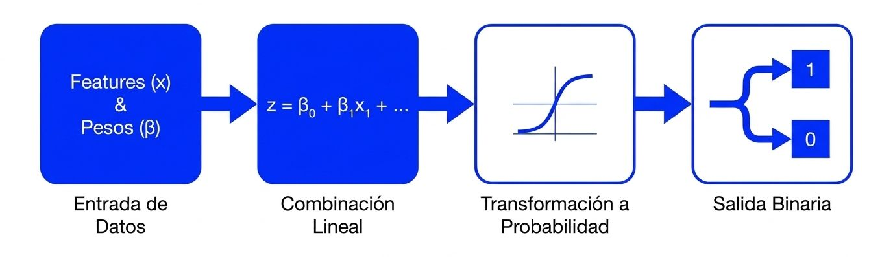
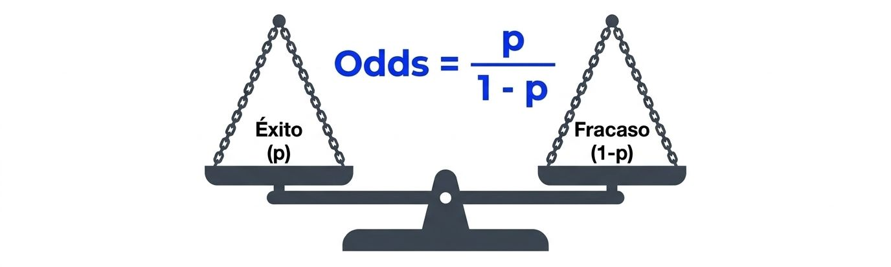
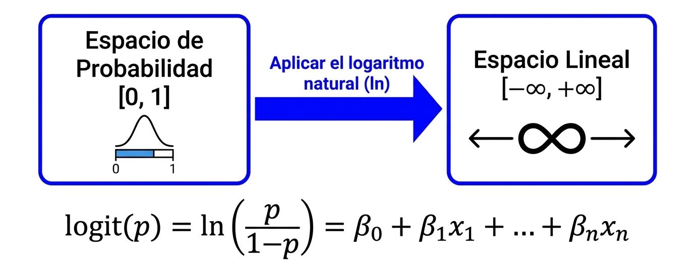
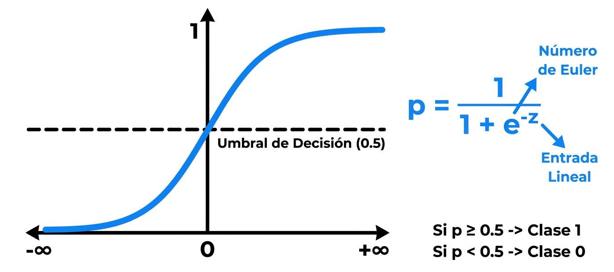
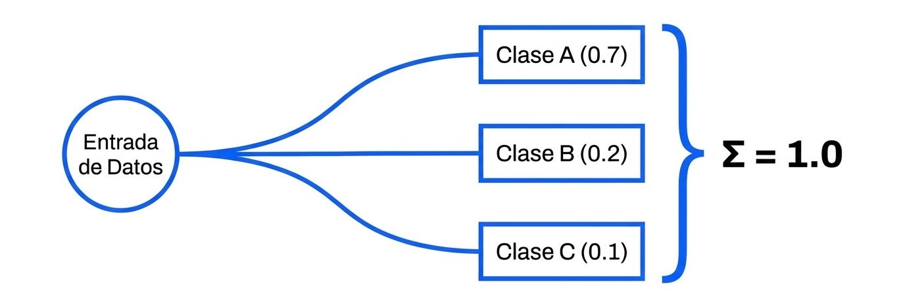
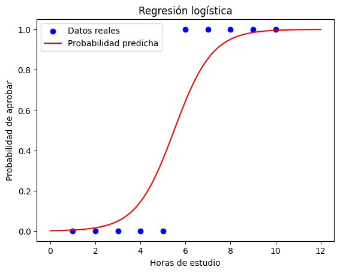
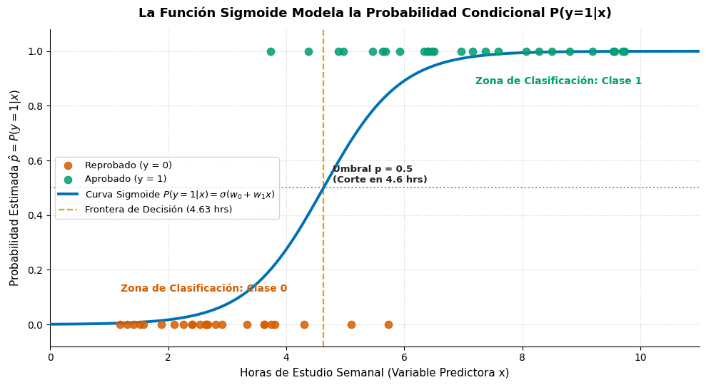
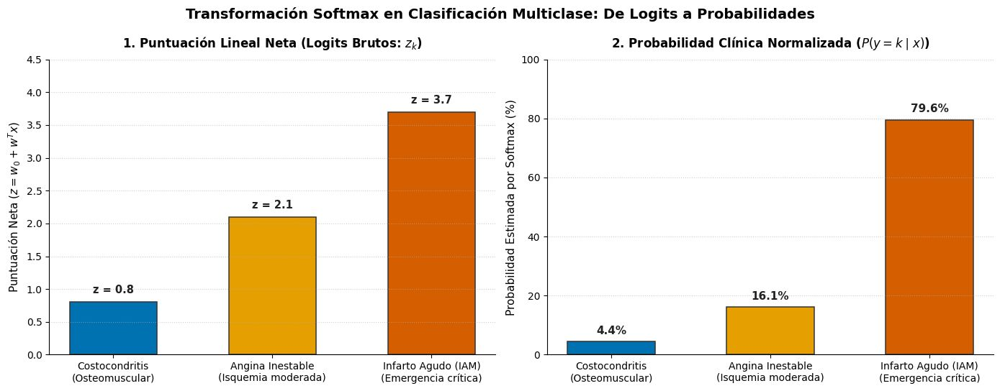
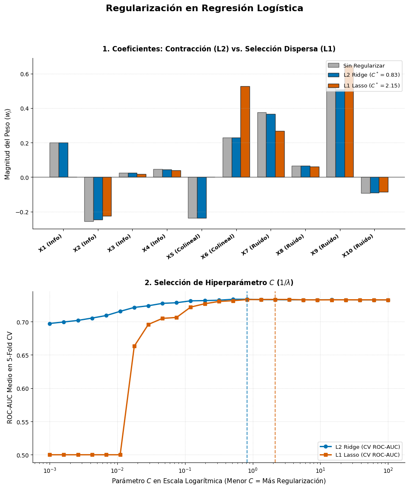

## **Regresión Logística**


Deseas responder a una pregunta que solo tiene **dos posibles respuestas** (sí/no, éxito/fracaso, aprueba/reprueba): por ejemplo, *«¿Aprobará un estudiante el examen final según las horas que estudió?»* o *«¿Es una transacción bancaria fraudulenta o legítima?»*.

Si intentáramos trazar una línea recta clásica (regresión lineal), tendríamos un grave problema: la recta continuaría creciendo hacia el infinito positivo o descendería hacia valores negativos absurdos, prediciendo "probabilidades" imposibles como $150\%$ o $-30\%$.

La **regresión logística** resuelve esto curvando la recta mediante una función matemática suave en forma de **"S"** (la función sigmoide):
* Transforma cualquier combinación de datos en una **probabilidad estrictamente acotada entre 0 y 1** (es decir, entre 0% y 100%).

* Establece una regla de corte clara (habitualmente el **50%**): si la probabilidad estimada es igual o mayor a 0,5, se clasifica como clase positiva (1: «Aprobado»); si es menor a 0,5, se clasifica como clase negativa (0: «Reprobado»).

En resumen: **es un modelo de clasificación que estima la probabilidad de que ocurra un evento binario basándose en una o más variables observadas**.

<center>
<figure>

<figcaption>Flujo de procesos en la regresión logística.</figcaption>
</figure>
</center>

La **Regresión Logística** es uno de los algoritmos supervisados fundamentales en estadística y aprendizaje automático para resolver problemas de **clasificación** (especialmente binaria). 

A pesar de conservar el término histórico de «regresión», **no predice un valor numérico continuo**, sino la **probabilidad condicional** de que una observación pertenezca a una clase discreta (habitualmente la clase positiva $y=1$) en función de sus variables explicativas $X$.

### Definición Técnica

En el aprendizaje automático supervisado, la **regresión logística** es un modelo paramétrico discriminativo que modela directamente la distribución de probabilidad a posteriori de una variable categórica binaria $y \in \{0, 1\}$ condicionada a un vector de características continuas o discretas $x \in \mathbb{R}^p$:

```math 
P(y = 1 \mid x)
```

A pesar de conservar la palabra «regresión» en su nombre histórico, es un algoritmo de **clasificación supervisada**, ya que su propósito final es particionar el espacio vectorial mediante un **hiperplano de decisión lineal**.


### El Fundamento Matemático
**Del Hiperplano Lineal a la Probabilidad**

En la regresión lineal ordinaria, la combinación lineal de los datos $z = w_0 + w_1 x_1 + \dots + w_p x_p = w^T x$ genera salidas no acotadas en la recta real $(-\infty, +\infty)$. Si intentáramos usar una recta para clasificar probabilidades, obtendríamos valores absurdos (negativos o mayores a 1).


Para resolver esto, la regresión logística modela linealmente el **logaritmo de la razón de momios (*log-odds* o función logit)**.

Para comprender cómo se conecta una combinación lineal con una probabilidad, el modelo se construye en tres etapas:

#### A. La Razón de Momios (*Odds Ratio*)

<center>
<figure>

<figcaption>**Entendiendo Odds.** Los Odds representan la proporción en tre la probabilidad de que un evento ocurra y la probabilidad de que no ocurra. Como ejemplo en Titanic: Si la probabilidad de no sobrevivir en 3ra. clase es mucho mayor, el modelo calcula un Odds Ratio de ~7x en comparación con a 1ra. clase.</figcaption>
</figure>
</center>

Si $p = P(y = 1 \mid x)$ representa la probabilidad de que ocurra el evento positivo, la razón de momios (*odds*) mide cuántas veces es más probable el éxito frente al fracaso:

```math
\text{Odds} = \frac{p}{1 - p}
```

*   **Componentes:**
    *   $p$: Probabilidad del evento de interés, con $p \in (0, 1)$.
    *   $1 - p$: Probabilidad del evento complementario (fracaso).
    *   *Comportamiento:* Si la probabilidad de aprobar es $0,8$ (80%), los momios son $\frac{0,8}{0,2} = 4$ (es decir, una relación 4 a 1 a favor). Los momios están acotados inferiormente por $0$ y crecen hacia $+\infty$.

#### B. La Función Logit (Logaritmo de los Momios)

La función logit es la transformación matemática que actúa como función de enlace (link function), permitiendo conectar una probabilidad acotada con una combinación lineal de variables sin restricciones.

<center>
<figure>

<figcaption>Al aplicar el logaritmo a los odds, creamos un enlace directo que permite usar una ecuación lineal simple para predecir probabilidades complejas.</figcaption>
</figure>
</center>

Para permitir que el modelo tome valores en toda la recta real $(-\infty, +\infty)$, se aplica el logaritmo natural a los momios, igualándolo a una combinación lineal de las variables explicativas:


* **El problema:** Una probabilidad $p$ solo puede existir estrictamente entre **0% y 100%** (0 y 1). Sin embargo, una ecuación lineal (como $w_0 + w_1 x_1 + \dots$) produce resultados que pueden extenderse libremente desde $-\infty$ hasta $+\infty$.

* **El paso intermedio (Los Momios / *Odds*):** Se calcula primero la razón de momios: $\frac{p}{1-p}$, que mide cuántas veces es más probable que ocurra el evento frente a que no ocurra. Esto expande el rango de $0$ a $+\infty$.

* **La solución de la función Logit:** Al aplicarle el logaritmo natural a esos momios, el rango se expande simétricamente hacia toda la recta real: desde **$-\infty$ hasta $+\infty$**. Así, el modelo puede ajustar una combinación lineal tradicional sin generar probabilidades imposibles.


**Formulación Matemática**

Formalmente, el **logit** de una probabilidad $p$ se define como:

```math
\text{logit}(p) = \ln\left(\frac{p}{1 - p}\right) = w_0 + w_1 x_1 + \dots + w_k x_k = w^T x
```

* **Explicación de componentes:**
  * **$p = P(y=1 \mid x)$:** Probabilidad del evento de interés ($p \in (0, 1)$).
  * **$1 - p$:** Probabilidad del evento complementario (no ocurrencia).
  * **$\frac{p}{1 - p}$:** Razón de momios (*odds ratio*).
  * **$\ln$:** Logaritmo natural en base $e$.
  * **$w_0 + w^T x$:** Combinación lineal de las características de entrada ponderadas por los pesos o coeficientes del modelo.


**Propiedades Clave**

* **Equiprobabilidad ($p = 0,5$):**  
  Los momios son $\frac{0,5}{0,5} = 1$. Dado que $\ln(1) = 0$, el logit vale **0**. Este valor corresponde geométricamente a la **frontera de decisión**.
* **Certeza positiva ($p \to 1$):**  
  Los momios tienden a $+\infty$, por lo que el logit tiende a **$+\infty$**.
* **Certeza negativa ($p \to 0$):**  
  Los momios tienden a $0$, por lo que el logit tiende a **$-\infty$**.
* **Relación con la función Sigmoide:**  
  La función logit es la **inversa exacta de la función sigmoide**:
  ```math
  \text{logit}(p) = z \iff p = \sigma(z) = \frac{1}{1 + e^{-z}}
  ```
  Mientras que la sigmoide transforma un número real arbitrario $z$ en una probabilidad $p$, la función logit toma una probabilidad $p$ y la devuelve a la escala lineal $z$.


**Interpretación de los Coeficientes (Efecto Marginal)**

Cada coeficiente $w_j$ en la regresión logística representa el **cambio en el logit** por cada unidad adicional en la variable $x_j$. Aplicando el exponencial ($e^{w_j}$), se obtiene directamente el **efecto multiplicativo sobre la razón de momios (*Odds Ratio*)**:
* Si $e^{w_j} > 1$, la probabilidad de éxito aumenta con el incremento de $x_j$.
* Si $e^{w_j} < 1$, la probabilidad de éxito disminuye.


#### C. La Función Sigmoide (Inversa del Logit)

Cuando un modelo calcula una puntuación sumando variables ponderadas por pesos (por ejemplo, $z = w_0 + w_1 x_1 + \dots$), el resultado puede ser cualquier número entre $-\infty$ y $+\infty$.

La función sigmoide toma ese valor sin límites y lo "aplasta" (squashing function) en una curva suave en forma de "S", obligando a que el resultado final quede estrictamente dentro del rango de 0% a 100% (0,0 a 1,0), permitiendo interpretarlo directamente como la probabilidad de pertenecer a la clase positiva.


<center>
<figure>

<figcaption>La función sigmoide (o función logística estándar) es la función matemática encargada de transformar cualquier combinación lineal de variables en una probabilidad acotada entre 0 y 1.</figcaption>
</figure>
</center>

Para despejar la probabilidad directa $p$ a partir de la combinación lineal $z = w^T x$, se aplica la **función logística estándar o función sigmoide** ($\sigma(z)$) (transformación inversa del logit):

```math
P(y=1 \mid x) = \sigma(z) = \frac{1}{1 + e^{-z}} = \frac{1}{1 + e^{-(w^T x)}}
```
*   **Componentes:**
    *   $z = w^T x$: Puntuación lineal (*logit score*) que puede tomar cualquier valor entre $-\infty$ y $+\infty$.
    *   $e$: Base del logaritmo natural (constante de Euler $\approx 2,71828$).
    *   $\sigma(z)$: Función sigmoide, cuya salida está estrictamente confinada en el intervalo abierto $(0, 1)$.

*   **Propiedades clave de la sigmoide:**
    1.  Mapea asintóticamente cualquier valor real $z \in (-\infty, +\infty)$ al intervalo continuo $(0, 1)$.
    2.  Si $z = 0$, entonces $\sigma(0) = 0.5$.
    3.  Su derivada analítica es elegante y computacionalmente eficiente: 
    ```math
    \frac{d\sigma(z)}{dz} = \sigma(z)(1 - \sigma(z))
    ```

```
         P(y=1|x)
           1.0 ┼                             ╭─────────────
               │                           ╭─╯
           0.8 ┼                         ╭─╯
               │                       ╭─╯
           0.5 ┼ ─ ─ ─ ─ ─ ─ ─ ─ ─ ─ ╭─╯ ─ ─ ─ (Umbral por defecto: z=0)
               │                   ╭─╯
           0.2 ┼                 ╭─╯
               │             ╭───╯
           0.0 ┼ ────────────╯
               └───────┬───────┬───────┬───────┬───────┬────► z = w^T x
                      -6      -4      -2       0       2       4       6
```


### Regla de Decisión 
**Hiperplano Separador**

Una vez calculada la probabilidad $\hat{p} = \sigma(w^T x)$, la predicción discreta ($\hat{y} \in \{0, 1\}$) se determina aplicando un **umbral de discriminación** (por defecto $0.5$):

```math
\hat{y} = \begin{cases} 1 & \text{si } \hat{p} \ge 0.5 \iff w^T x \ge 0 \\ 0 & \text{si } \hat{p} < 0.5 \iff w^T x < 0 \end{cases}
```

*   El conjunto geométrico donde $w^T x = 0$ define el **límite de decisión (*decision boundary*)**, el cual es un hiperplano lineal de dimensión $p-1$ que divide el espacio de características en las dos regiones de clasificación.


### Estimación de Parámetros
**Máxima Verosimilitud y Entropía Cruzada Binaria**

A diferencia de la regresión lineal (donde OLS tiene una solución cerrada mediante la Ecuación Normal), en la regresión logística los parámetros $w$ **no pueden despejarse analíticamente**. Se estiman mediante el principio de **Máxima Verosimilitud (MLE - *Maximum Likelihood Estimation*)**.

Asumiendo que las observaciones son independientes y siguen una distribución de Bernoulli condicional independiente:
```math
L(w) = \prod_{i=1}^N P(y^{(i)} \mid x^{(i)}; w) = \prod_{i=1}^N \left( \hat{p}^{(i)} \right)^{y^{(i)}} \left( 1 - \hat{p}^{(i)} \right)^{1 - y^{(i)}}
```

Para transformar este producto en una suma y facilitar su optimización, tomamos el logaritmo natural negativo, formulando la **función de pérdida de entropía cruzada binaria (*Binary Cross-Entropy* o *Log-Loss*)**:

```math
J(w) = -\frac{1}{N} \ln L(w) = -\frac{1}{N} \sum_{i=1}^N \Big[ y^{(i)} \ln\big(\hat{p}^{(i)}\big) + (1 - y^{(i)}) \ln\big(1 - \hat{p}^{(i)}\big) \Big]
```
*   **Componentes:**
    *   $N$: Número total de observaciones en la muestra.
    *   $y^{(i)} \in \{0, 1\}$: Etiqueta observada real de la clase.
    *   $\hat{p}^{(i)} = \sigma(w^T x^{(i)})$: Probabilidad predicha por el modelo para la observación $i$.
    *   **Mecánica de castigo:**
        *   Si $y^{(i)} = 1$, el segundo término se anula y la pérdida es $-\ln(\hat{p}^{(i)})$. Si el modelo predice $\hat{p} \to 1$, el coste es $0$; si predice $\hat{p} \to 0$, el coste diverge asintóticamente hacia $+\infty$.
        *   Si $y^{(i)} = 0$, el primer término se anula y la pérdida es $-\ln(1 - \hat{p}^{(i)})$. Si predice $\hat{p} \to 1$, el castigo tiende a $+\infty$.

Dado que $J(w)$ es estrictamente **convexa**, algoritmos de optimización iterativa como el **Descenso de Gradiente** o **L-BFGS** convergen al mínimo global sin atascarse en mínimos locales.

#### Interpretación de la función de coste:
*   Si la etiqueta real es $y^{(i)} = 1$, la pérdida se reduce a $-\ln(\hat{p}^{(i)})$. Si el modelo predice $\hat{p} \to 1$, el coste es $0$; pero si predice $\hat{p} \to 0$, el coste tiende asintóticamente a $+\infty$.

*   Si la etiqueta real es $y^{(i)} = 0$, la pérdida se reduce a $-\ln(1 - \hat{p}^{(i)})$. Si el modelo predice $\hat{p} \to 1$, el castigo tiende a $+\infty$.

Esta función $J(w)$ es estrictamente **convexa**, lo que garantiza que algoritmos de optimización numérica (como **Descenso de Gradiente**, Newton-Raphson o L-BFGS) converjan al **mínimo global**.


### Extensión multiclase
**Softmax Regression (Multinomial)**

Cuando el problema tiene $K > 2$ categorías mutuamente excluyentes, la regresión logística se generaliza mediante la función **Softmax** (también llamada regresión multinomial):

```math
P(y = k \mid x) = \frac{e^{w_k^T x}}{\sum_{j=1}^K e^{w_j^T x}}
```

*   **Argumentos:** $w_k$ es el vector de pesos específico para la clase $k$; la suma en el denominador normaliza las puntuaciones exponenciales para que la suma total de probabilidades a lo largo de todas las clases sea exactamente igual a $1$.


<center>
<figure>

<figcaption>**Regresion Softmax (Multinomial):** Generaliza la regresión logística calculando un score para cda aclase y aplicando una función exponencial para que todas las probabilidades sumen exactamente 1.</figcaption>
</figure>
</center>


### Implementación

El siguiente código ejemplifica uso de regresión logística:

```python showLineNumbers
#Ejemplo: Regresión logística con scikit-learn
import numpy as np
from sklearn.linear_model import LogisticRegression
import matplotlib.pyplot as plt

# Datos de ejemplo
X = np.array([1, 2, 3, 4, 5, 6, 7, 8, 9, 10]).reshape(-1, 1)
y = np.array([0, 0, 0, 0, 0, 1, 1, 1, 1, 1])

# Crear y entrenar el modelo
modelo_log = LogisticRegression()
modelo_log.fit(X, y)

# Predicciones de probabilidad
X_test = np.linspace(0, 12, 100).reshape(-1, 1)
y_prob = modelo_log.predict_proba(X_test)[:, 1]

# Visualización
plt.scatter(X, y, color='blue', label='Datos reales')
plt.plot(X_test, y_prob, color='red', label='Probabilidad predicha')
plt.xlabel('Horas de estudio')
plt.ylabel('Probabilidad de aprobar')
plt.legend()
plt.title('Regresión logística')
plt.show()
```



### Resumen 


1.  **Naturaleza:** Es un algoritmo de **clasificación supervisada** (a pesar de su nombre) que modela probabilidades entre 0 y 1.

2.  **Transformación Logit:** Modela la combinación lineal de entradas como el logaritmo de los momios (*log-odds*): $\ln(p / (1-p)) = w^T x$.

3.  **Función Sigmoide:** Mapea el hiperplano lineal $z \in (-\infty, +\infty)$ al rango probabilístico continuo $(0, 1)$ mediante $\sigma(z) = \frac{1}{1 + e^{-z}}$.

4.  **Optimización:** Minimiza la **entropía cruzada binaria (Log-Loss)** mediante algoritmos iterativos convexos basados en Máxima Verosimilitud (MLE).

5.  **Regularización:** El parámetro **$C$** es el inverso de $\lambda$; valores pequeños de $C$ incrementan la regularización para controlar el sobreajuste.


***
## **Regularización**

La **regularización en la regresión logística** es una técnica matemática que consiste en añadir un término de penalización a la función de pérdida del modelo para restringir la magnitud de los coeficientes de ponderación. Su objetivo principal es controlar la complejidad del clasificador, mitigar el sobreajuste (*overfitting*), manejar la multicolinealidad y resolver la inestabilidad numérica que ocurre cuando existen variables redundantes o las clases son linealmente separables.

A diferencia de la regresión lineal —donde la penalización se suma a la suma de errores cuadráticos (MSE/RSS)—, en la regresión logística la regularización se añade directamente a la **entropía cruzada binaria (*Binary Cross-Entropy* o *Log-Loss*)**.


### Formulación matemática

La función de pérdida no regularizada de la regresión logística (log-loss) sobre un conjunto de entrenamiento de $N$ observaciones se define a partir del logaritmo negativo de la verosimilitud:

```math
J_{\text{base}}(w) = -\frac{1}{N} \sum_{i=1}^{N} \Big[ y^{(i)} \ln\big(\phi(z^{(i)})\big) + (1 - y^{(i)}) \ln\big(1 - \phi(z^{(i)})\big) \Big]
```

Donde:
* $y^{(i)} \in \{0, 1\}$ es la etiqueta real de la clase.
* $\phi(z^{(i)}) = \sigma(w^T x^{(i)}) = \frac{1}{1 + e^{-w^T x^{(i)}}}$ es la probabilidad estimada mediante la función logística sigmoide.
* $w = [w_1, w_2, \dots, w_p]^T$ representa el vector de pesos o coeficientes asociados a las características de entrada.

Al aplicar regularización, la función objetivo a minimizar se formula de dos maneras equivalentes:

#### A. Regularización $L_2$ (Ridge / Weight Decay)
Se penaliza la suma de los cuadrados de los coeficientes (la norma euclidiana $\|w\|_2^2$):

```math
J_{\text{reg}, L_2}(w) = J_{\text{base}}(w) + \frac{\lambda}{2} \sum_{j=1}^{p} w_j^2 = J_{\text{base}}(w) + \frac{\lambda}{2} \|w\|_2^2
```

* **Argumentos:** $\lambda \ge 0$ es el factor de regularización. Contrae de forma suave y uniforme  todos los coeficientes hacia cero, pero **nunca los hace exactamente cero**, asegurando que todas las variables permanezcan en el modelo. Es ideal para manejar multicolinealidad y estabilizar el cálculo numérico. Nótese que el término independiente o sesgo ($w_0$ o *intercept*) **no se penaliza** para no comprometer la posición de corte de la función sigmoide.

#### B. Regularización $L_1$ (Lasso / Sparsity)
Se penaliza la suma de los valores absolutos de los coeficientes (la norma $\|w\|_1$):

```math
J_{\text{reg}, L_1}(w) = J_{\text{base}}(w) + \lambda \sum_{j=1}^{p} |w_j| = J_{\text{base}}(w) + \lambda \|w\|_1
```

* **Argumentos:** Gracias a los vértices no diferenciables de la región de restricción $L_1$ sobre los ejes, muchos coeficientes se fijan en **cero exacto** ($w_j = 0$), realizando una **selección automática de características (sparsity)** que descarta características ruidosas o redundantes.

#### C. Regularización ElasticNet (Híbrido $L_1 + L_2$)
Combina linealmente ambas penalizaciones ponderadas por un factor de mezcla $\rho \in$:

```math
J_{\text{reg}, \text{EN}}(w) = J_{\text{base}}(w) + \lambda \left[ \rho \|w\|_1 + \frac{1 - \rho}{2} \|w\|_2^2 \right]
```

* **Comportamiento**: Permite seleccionar variables en bloque cuando existen grupos de características fuertemente correlacionadas entre sí (grouping effect).

### $C$ frente a $\lambda$

Para evitar el sobreajuste (*overfitting*) cuando las clases son separables o cuando hay alta dimensionalidad, se añaden penalizaciones $L_2$ o $L_1$ a la función de pérdida:

```math
J_{\text{reg}}(w) = J(w) + \frac{\lambda}{2} \|w\|_2^2
```

En librerías de producción como scikit-learn (LogisticRegression), se utiliza por convención la parametrización de las Support Vector Machines (SVM), donde la fuerza de la regularización se controla mediante $C$, el cual es el inverso de $\lambda$:

```math
C = \frac{1}{\lambda}
```

La función objetivo en `scikit-learn` se optimiza típicamente multiplicando la pérdida base por $C$:

```math
\min_{w} \quad C \cdot J_{\text{base}}(w) + R(w)
```

Donde $R(w)$ es la penalización ($\frac{1}{2}\|w\|_2^2$ o $\|w\|_1$).
* **Valores pequeños de $C$ (e.g., $C = 0.01$):** Equivalen a un $\lambda$ grande; imponen una **fuerte regularización**, reduciendo la varianza del modelo al encoger drásticamente los pesos hacia cero para reducir la varianza a costa de mayor sesgo.

* **Valores grandes de $C$ (e.g., $C = 100$):** Imponen una **regularización débil**; el optimizador prioriza clasificar correctamente todos los datos de entrenamiento, aumentando la complejidad y el riesgo de sobreajuste.

* En `scikit-learn`, la regularización por defecto es **$L_2$ con $C=1.0$**.


### El Problema de la Separabilidad Lineal Perfecta

Un motivo esencial por el cual la regresión logística requiere regularización es el fenómeno de **separabilidad perfecta**:
* Si existe un hiperplano que separa limpiamente las clases positivas de las negativas sin ningún error en los datos de entrenamiento, la función sigmoide intentará acercar las probabilidades de acierto a exactamente $1.0$ y $0.0$.

* Dado que $\sigma(z) \to 1$ únicamente cuando $z = w^T x \to +\infty$, el algoritmo de optimización aumentará indefinidamente la magnitud de los pesos ($\|w\| \to \infty$) en cada iteración.

* La inclusión de la penalización $L_2$ o $L_1$ evita que los pesos diverjan hacia el infinito, asegurando que el proceso de optimización numérica converja de manera estable a una solución finita.


### Implementación

<br/>

<Tabs>
<TabItem value="mnp" label="Antecedentes" default>
<div class="alert alert--primary">
**Regularización en Regresión Logística**

El siguiente script en Python utiliza `scikit-learn` para ilustrar cómo influyen las penalizaciones $L_2$ (Ridge) y $L_1$ (Lasso), y cómo el ajuste de $C$ contrae o anula coeficientes sobre un conjunto de clasificación clínica (Breast Cancer):

**Resumen**

1. **Punto de aplicación:** La penalización no se aplica al error cuadrático, sino al **log-loss / entropía cruzada binaria** del modelo logístico.
2. **Rol de $L_2$:** Contrae los pesos de manera suave y homogénea, estabilizando el cálculo numérico y evitando que los coeficientes diverjan ante clases separables.
3. **Rol de $L_1$:** Anula coeficientes de variables redundantes a cero exacto, actuando como selector supervisado de características.
4. **Parámetro $C$:** En `scikit-learn`, $C$ es el inverso de la penalización ($C = 1/\lambda$); valores más pequeños aumentan el sesgo, reducen la varianza y simplifican el modelo.
</div>
</TabItem>
<TabItem value="mnp-python" label="🖥️ Código">

```python showLineNumbers
"""
Regularización en Regresión Logística (L1 vs. L2).
Evaluación de contracción de pesos, dispersión y rendimiento predictivo.
"""

import numpy as np
import pandas as pd
from sklearn.datasets import load_breast_cancer
from sklearn.model_selection import train_test_split
from sklearn.preprocessing import StandardScaler
from sklearn.linear_model import LogisticRegression
from sklearn.metrics import accuracy_score, roc_auc_score

# 1. Carga y partición estratificada de datos
cancer = load_breast_cancer(as_frame=True)
X, y = cancer.data, cancer.target

X_train, X_test, y_train, y_test = train_test_split(
    X, y, test_size=0.25, random_state=42, stratify=y
)

# 2. Preprocesamiento: Estandarización obligatoria
# Como la regularización penaliza la magnitud de los pesos, las variables
# deben estar en una escala uniforme (media 0, varianza unitaria)
scaler = StandardScaler()
X_train_scaled = scaler.fit_transform(X_train)
X_test_scaled = scaler.transform(X_test)

# =====================================================================
# 3. Ajuste de Modelos con Distintos Esquemas de Regularización
# =====================================================================

# A. Sin regularización (C muy alto o penalty=None)
lr_sin_reg = LogisticRegression(penalty=None, solver='lbfgs', max_iter=2000, random_state=42)
lr_sin_reg.fit(X_train_scaled, y_train)

# B. Regularización L2 (Ridge por defecto, C=0.1 -> regularización moderada-fuerte)
lr_l2 = LogisticRegression(penalty='l2', C=0.1, solver='lbfgs', max_iter=2000, random_state=42)
lr_l2.fit(X_train_scaled, y_train)

# C. Regularización L1 (Lasso, requiere solvers como 'liblinear' o 'saga', C=0.1)
lr_l1 = LogisticRegression(penalty='l1', C=0.1, solver='liblinear', max_iter=2000, random_state=42)
lr_l1.fit(X_train_scaled, y_train)

# =====================================================================
# 4. Análisis de Coeficientes y Dispersión (Sparsity)
# =====================================================================
df_coeficientes = pd.DataFrame({
    'Característica': X.columns[:8],
    'Sin Regularizar': lr_sin_reg.coef_[:8],
    'L2 (C=0.1, Ridge)': lr_l2.coef_[:8],
    'L1 (C=0.1, Lasso)': lr_l1.coef_[:8]
})

print("=== MAGNITUD DE COEFICIENTES (PRIMERAS 8 CARACTERÍSTICAS) ===")
print(df_coeficientes.round(4).to_string(index=False))

# Conteo de variables anuladas exactamente a cero
zeros_l2 = np.sum(np.isclose(lr_l2.coef_, 0.0, atol=1e-5))
zeros_l1 = np.sum(np.isclose(lr_l1.coef_, 0.0, atol=1e-5))

print("\n=== RECUENTO DE VARIABLES ANULADAS A CERO (SPARSITY) ===")
print(f"L2 (Ridge): {zeros_l2} variables en 0 de {X.shape}")
print(f"L1 (Lasso): {zeros_l1} variables en 0 de {X.shape} (Selección automática activa)")

# =====================================================================
# 5. Evaluación de Rendimiento en el Conjunto de Prueba
# =====================================================================
def evaluar_modelo(nombre, modelo):
    y_pred = modelo.predict(X_test_scaled)
    y_prob = modelo.predict_proba(X_test_scaled)[:, 1]
    acc = accuracy_score(y_test, y_pred)
    auc = roc_auc_score(y_test, y_prob)
    print(f"{nombre:<22} | Exactitud (Acc): {acc * 100:.2f}% | ROC-AUC: {auc:.4f}")

print("\n=== RENDIMIENTO SOBRE DATOS DE PRUEBA (TEST SET) ===")
evaluar_modelo("Sin Regularizar", lr_sin_reg)
evaluar_modelo("L2 (Ridge, C=0.1)", lr_l2)
evaluar_modelo("L1 (Lasso, C=0.1)", lr_l1)
```
</TabItem>
</Tabs><br/>


***
## 🖥️ **Ejemplos**

### Predicción de estudio
<Tabs>
<TabItem value="mnp" label="Antecedentes" default>
<div class="alert alert--primary">
**Regresión logística**

Simula un conjunto de datos (horas de estudio semanal vs. aprobación de un examen), entrena el modelo con `scikit-learn` y grafica la curva sigmoide resultante junto a la frontera de decisión:
```
Coeficiente w1 (Efecto marginal logit): 1.5411
Intersección w0 (Sesgo):               -7.1348
Frontera de decisión (p = 0.5):        4.63 horas de estudio
```


**Interpretación del Gráfico Generado**

El gráfico muestra de manera clara los elementos centrales del modelo:
1. **Puntos Discretos de Muestra:** Los estudiantes observados solo pueden adoptar valores extremos $y \in \{0, 1\}$ (puntos naranja para reprobados y verdes para aprobados).

2. **Curva Sigmoide Continua (Azul):** Modela suavemente la transición de probabilidad entre 0 y 1. Se observa cómo a partir de 3 horas la probabilidad de aprobación comienza a despegar rápidamente.

3. **Frontera de Decisión (Línea discontinua amarilla en 4,63 hrs):** Representa el punto geométrico donde $z = w_0 + w_1 x = 0$, haciendo que $\sigma(0) = 0,5$. Cualquier alumno con más de 4,63 horas semanales de estudio será clasificado con probabilidad favorable de aprobar.

</div>
</TabItem>
<TabItem value="mnp-python" label="🖥️ Código">

```python showLineNumbers

"""
Regresión Logística y Curva Sigmoide.
Visualización del ajuste probabilístico y frontera de decisión.
"""

import numpy as np
import matplotlib.pyplot as plt
from sklearn.linear_model import LogisticRegression

# 1. Simulación de datos pedagógicos (N = 50 estudiantes)
np.random.seed(42)
horas_estudio = np.sort(np.random.uniform(1.0, 10.0, size=50))

# Proceso generador subyacente con función logística
prob_verdadera = 1.0 / (1.0 + np.exp(-(1.2 * horas_estudio - 6.0)))
aprobado = np.random.binomial(n=1, p=prob_verdadera)

# 2. Ajuste del modelo de Regresión Logística
X = horas_estudio.reshape(-1, 1)
clf = LogisticRegression(random_state=42)
clf.fit(X, aprobado)

# 3. Predicción probabilística sobre un rango continuo
horas_rango = np.linspace(0, 11, 300).reshape(-1, 1)
prob_predicha = clf.predict_proba(horas_rango)[:, 1]

# Cálculo analítico de la frontera de decisión (donde z = w0 + w1*x = 0 -> p = 0.5)
w0 = clf.intercept_
w1 = clf.coef_
frontera_decision = -w0 / w1

print(f"Coeficiente w1 (Efecto marginal logit): {w1:.4f}")
print(f"Intersección w0 (Sesgo):               {w0:.4f}")
print(f"Frontera de decisión (p = 0.5):        {frontera_decision:.2f} horas de estudio")

# 4. Generación gráfica (Fondo blanco plano y paleta contrastada)
fig, ax = plt.subplots(figsize=(10, 5.5), facecolor='white')
ax.set_facecolor('white')

# Dispersión de las observaciones reales
ax.scatter(horas_estudio[aprobado == 0], aprobado[aprobado == 0],
           color='#d55e00', s=55, alpha=0.85, label='Reprobado (y = 0)', zorder=4)
ax.scatter(horas_estudio[aprobado == 1], aprobado[aprobado == 1],
           color='#009e73', s=55, alpha=0.85, label='Aprobado (y = 1)', zorder=4)

# Curva logística estimada
ax.plot(horas_rango, prob_predicha, color='#0072b2', linewidth=2.8,
        label=r'Curva Sigmoide $P(y=1|x) = \sigma(w_0 + w_1 x)$', zorder=3)

# Líneas guía de umbral y frontera
ax.axhline(0.5, color='#8a8a8a', linestyle=':', linewidth=1.4)
ax.axvline(frontera_decision, color='#e69f00', linestyle='--', linewidth=1.6,
           label=f'Frontera de Decisión ({frontera_decision:.2f} hrs)')

# Anotaciones explicativas
ax.text(frontera_decision + 0.15, 0.52, f'Umbral p = 0.5\n(Corte en {frontera_decision:.1f} hrs)',
        color='#222222', fontsize=9.5, fontweight='bold')
ax.text(1.2, 0.12, 'Zona de Clasificación: Clase 0', color='#d55e00', fontsize=10, fontweight='bold')
ax.text(7.2, 0.88, 'Zona de Clasificación: Clase 1', color='#009e73', fontsize=10, fontweight='bold')

ax.set_title("La Función Sigmoide Modela la Probabilidad Condicional P(y=1|x)",
             fontsize=13, fontweight='bold', pad=12)
ax.set_xlabel("Horas de Estudio Semanal (Variable Predictora x)", fontsize=11)
ax.set_ylabel(r"Probabilidad Estimada $\hat{p} = P(y=1|x)$", fontsize=11)
ax.set_ylim(-0.08, 1.08)
ax.set_xlim(0, 11)
ax.grid(True, linestyle=':', alpha=0.6)
ax.spines['top'].set_visible(False)
ax.spines['right'].set_visible(False)
ax.legend(frameon=True, facecolor='white', loc='center left', fontsize=9.5)

plt.tight_layout()
plt.show()
```
</TabItem>
</Tabs><br/>

### Evaluación de modelos
<Tabs>
<TabItem value="mnp" label="Antecedentes" default>
<div class="alert alert--primary">

**Evaluación de Modelos de Clasificación vía Curva ROC-AUC**

Simulación de datos con clases desbalanceadas (30% positivos, 70% negativos)

```Área Bajo la Curva (AUC):        0.8009
Umbral Óptimo de Youden:         0.3970
Sensibilidad en Umbral Óptimo:   66.1%
FPR en Umbral Óptimo:            15.9%
```

</div>
</TabItem>
<TabItem value="mnp-python" label="🖥️ Código">

```python showLineNumbers
"""
Evaluación de Modelos de Clasificación vía Curva ROC-AUC.
Librería: scikit-learn y matplotlib.
"""

import numpy as np
import matplotlib.pyplot as plt
from sklearn.datasets import make_classification
from sklearn.model_selection import train_test_split
from sklearn.linear_model import LogisticRegression
from sklearn.metrics import roc_curve, roc_auc_score

# 1. Simulación de datos con clases desbalanceadas (30% positivos, 70% negativos)
X, y = make_classification(
    n_samples=1200, n_features=10, n_informative=5,
    n_redundant=2, weights=[0.7, 0.3], random_state=42
)
X_train, X_test, y_train, y_test = train_test_split(
    X, y, test_size=0.3, random_state=42, stratify=y
)

# 2. Ajuste del modelo y obtención de probabilidades continuas
clf = LogisticRegression(random_state=42)
clf.fit(X_train, y_train)

# Obtenemos P(y=1|x) para el conjunto de prueba
y_probs = clf.predict_proba(X_test)[:, 1]

# 3. Cálculo de la curva ROC y el AUC
fpr, tpr, thresholds = roc_curve(y_test, y_probs)
auc = roc_auc_score(y_test, y_probs)

# 4. Cálculo del umbral óptimo mediante el Índice de Youden (J = TPR - FPR)
youden_idx = np.argmax(tpr - fpr)
opt_fpr = fpr[youden_idx]
opt_tpr = tpr[youden_idx]
opt_thresh = thresholds[youden_idx]

print(f"Área Bajo la Curva (AUC):        {auc:.4f}")
print(f"Umbral Óptimo de Youden:         {opt_thresh:.4f}")
print(f"Sensibilidad en Umbral Óptimo:   {opt_tpr*100:.1f}%")
print(f"FPR en Umbral Óptimo:            {opt_fpr*100:.1f}%")

# 5. Generación Gráfica (Fondo blanco plano y paleta contrastada)
fig, ax = plt.subplots(figsize=(8, 6), facecolor='white')
ax.set_facecolor('white')

# Curva del modelo y sombreado del área
ax.plot(fpr, tpr, color='#0072b2', linewidth=2.5, label=f'Modelo Logístico (AUC = {auc:.3f})')
ax.fill_between(fpr, 0, tpr, color='#0072b2', alpha=0.15, label='Área Bajo la Curva (AUC)')

# Línea base de azar
ax.plot([0, 1], [0, 1], color='#d55e00', linestyle='--', linewidth=1.6, label='Clasificador Aleatorio (AUC = 0.500)')

# Punto óptimo de Youden
ax.scatter([opt_fpr], [opt_tpr], color='#222222', s=70, zorder=5)
ax.annotate(
    f'Punto Óptimo (Youden)\nTPR: {opt_tpr:.2f} | FPR: {opt_fpr:.2f}\nUmbral: {opt_thresh:.2f}',
    xy=(opt_fpr, opt_tpr),
    xytext=(opt_fpr + 0.12, opt_tpr - 0.18),
    arrowprops=dict(facecolor='#222222', shrink=0.08, width=1.2, headwidth=6),
    fontweight='bold', fontsize=9.5, color='#222222',
    bbox=dict(boxstyle='round,pad=0.4', facecolor='white', edgecolor='#cccccc')
)

ax.set_title(f'Curva ROC: Modelo Logístico Alcanza un AUC de {auc:.2f}', fontsize=12, fontweight='bold', pad=10)
ax.set_xlabel('Tasa de Falsos Positivos (FPR = FP / [FP + TN])', fontsize=10.5)
ax.set_ylabel('Tasa de Verdaderos Positivos (TPR = TP / [TP + FN])', fontsize=10.5)
ax.set_xlim(-0.02, 1.02)
ax.set_ylim(-0.02, 1.04)
ax.grid(True, linestyle=':', alpha=0.6)
ax.spines['top'].set_visible(False)
ax.spines['right'].set_visible(False)
ax.legend(frameon=True, facecolor='white', loc='lower right', fontsize=9.5)

plt.tight_layout()
plt.show()
```
</TabItem>
</Tabs><br/>

### Triage médico
<Tabs>
<TabItem value="mnp" label="Antecedentes" default>
<div class="alert alert--primary">

**Triaje de dolor torácico en urgencias**

En la regresión logística tradicional (binaria), la función **sigmoide** toma una única puntuación lineal y decide entre dos alternativas (por ejemplo: *¿El paciente tiene diabetes: Sí o No?*). 

Sin embargo, en la medicina clínica la mayoría de los diagnósticos enfrentan **tres o más enfermedades posibles** frente a un mismo cuadro de síntomas. Aquí es donde entra la función **Softmax** (utilizada en la regresión logística multinomial).

Imaginemos un paciente de 58 años que ingresa al servicio de urgencias con dolor torácico opresivo, sudoración y dificultad respiratoria. El equipo médico evalúa tres diagnósticos diferenciales mutuamente excluyentes:
1. **Clase 1: Costocondritis** (Dolor osteomuscular benigno en la pared torácica).
2. **Clase 2: Angina Inestable** (Isquemia miocárdica moderada, sin necrosis celular evidente).
3. **Clase 3: Infarto Agudo de Miocardio - IAM** (Emergencia médica crítica con oclusión arterial).

#### Variables de Entrada del Paciente ($x$):
* Nivel de **Troponina T** en sangre: $0,45\text{ ng/mL}$ (marcador cardíaco elevado).
* Desnivel del segmento ST en el **Electrocardiograma (ECG)**: $+2,5\text{ mm}$.
* Presión arterial sistólica: $165\text{ mmHg}$.

#### Paso a Paso del Cálculo Manual:
1. **El modelo lineal evalúa los datos y genera los Logits ($z_k$):**
   * $z_1 (\text{Costocondritis}) = 0,8$
   * $z_2 (\text{Angina Inestable}) = 2,1$
   * $z_3 (\text{Infarto Agudo}) = 3,7$
2. **Aplicamos la función exponencial ($e^{z_k}$):**
   * $e^{0,8} \approx 2,226$
   * $e^{2,1} \approx 8,166$
   * $e^{3,7} \approx 40,447$
3. **Calculamos el denominador común normalizador:**
   ```math
   \text{Suma} = 2,226 + 8,166 + 40,447 = 50,839
   ```
4. **Calculamos las probabilidades Softmax finales:**
   * $P(\text{Costocondritis}) = \frac{2,226}{50,839} = 0,0438 \implies \mathbf{4,4\%}$
   * $P(\text{Angina Inestable}) = \frac{8,166}{50,839} = 0,1606 \implies \mathbf{16,1\%}$
   * $P(\text{Infarto Agudo}) = \frac{40,447}{50,839} = 0,7956 \implies \mathbf{79,5\%}$

*Total:* $4,4\% + 16,1\% + 79,5\% = \mathbf{100,0\%}$. El sistema asigna con una certeza contundente del **79,5%** la activación del protocolo de hemodinámica para Infarto.


```=================================================================
TRIAJE MÉDICO: TRANSFORMACIÓN DE LOGITS A PROBABILIDADES SOFTMAX
=================================================================
- Costocondritis (Osteomuscular)      | Logit z:  0.8 | Probabilidad:   4.4%
- Angina Inestable (Isquemia moderada) | Logit z:  2.1 | Probabilidad:  16.1%
- Infarto Agudo (IAM) (Emergencia crítica) | Logit z:  3.7 | Probabilidad:  79.6%
-----------------------------------------------------------------
Suma total de probabilidades (Propiedad de cierre): 100.0%
=================================================================
```


**Análisis del gráfico**

1. **Panel 1 (Logits brutos $z_k$):** Muestra cómo los puntajes lineales iniciales del modelo tienen diferencias aritméticas moderadas (0,8 frente a 2,1 y 3,7).

2. **Panel 2 (Probabilidad Softmax normalizada):** Muestra el efecto no lineal de la exponencial. La puntuación del infarto ($z=3,7$) domina drásticamente el espacio de decisión, alcanzando un **79,5% de probabilidad clínica**, mientras que la opción benigna cae al 4,4%, facilitando una toma de decisiones rápida y sin ambigüedades en urgencias.
</div>
</TabItem>
<TabItem value="mnp-python" label="🖥️ Código">

```python showLineNumbers
"""
Comparativa Visual de Logits Brutos vs. Probabilidad Softmax
Caso de Uso: Triaje de Dolor Torácico en Urgencias Médicas.
Librerías: numpy y matplotlib.
"""

import numpy as np
import matplotlib.pyplot as plt

# ==============================================================================
# 1. Definición de la Función Softmax con Estabilidad Numérica
# ==============================================================================
def softmax(logits):
    """
    Calcula la probabilidad Softmax de forma numéricamente estable.
    Resta el valor máximo de los logits (shift invariance) para evitar overflow.
    """
    # z_shift = z - max(z)
    exp_z = np.exp(logits - np.max(logits))
    return exp_z / np.sum(exp_z)

# ==============================================================================
# 2. Datos Clínicos del Paciente y Diagnósticos Diferenciales
# ==============================================================================
# Clases mutuamente excluyentes en la unidad de emergencias
diagnosticos = [
    'Costocondritis\n(Osteomuscular)',
    'Angina Inestable\n(Isquemia moderada)',
    'Infarto Agudo (IAM)\n(Emergencia crítica)'
]

# Puntuaciones lineales netas (Logits brutos: z_k = w_0k + w_k^T * x)
# Calculadas a partir de biomarcadores (Troponina T, elevación ST, etc.)
logits_brutos = np.array([0.8, 2.1, 3.7])

# Transformación exponencial normalizada mediante Softmax
probabilidades = softmax(logits_brutos)
prob_porcentaje = probabilidades * 100

# ==============================================================================
# 3. Impresión Pedagógica en Consola
# ==============================================================================
print("=" * 65)
print("TRIAJE MÉDICO: TRANSFORMACIÓN DE LOGITS A PROBABILIDADES SOFTMAX")
print("=" * 65)
for diag, z, p in zip(diagnosticos, logits_brutos, prob_porcentaje):
    nombre_limpio = diag.replace('\n', ' ')
    print(f"- {nombre_limpio:<35} | Logit z: {z:4.1f} | Probabilidad: {p:5.1f}%")

print("-" * 65)
print(f"Suma total de probabilidades (Propiedad de cierre): {np.sum(prob_porcentaje):.1f}%")
print("=" * 65)

# ==============================================================================
# 4. Generación Gráfica Comparativa (Fondo Blanco Plano)
# ==============================================================================
# Configuración general de la figura
fig, (ax1, ax2) = plt.subplots(1, 2, figsize=(14, 5.5), facecolor='white')

# Paleta de colores contrastada (estilo ColorBrewer / Okabe-Ito accesible)
colores = ['#0072b2', '#e69f00', '#d55e00']  # Azul, Ámbar, Rojo/Naranja

# ------------------------------------------------------------------------------
# Panel 1: Logits Brutos (z_k) - Escala Lineal Arbitraria (-inf a +inf)
# ------------------------------------------------------------------------------
ax1.set_facecolor('white')
barras_logits = ax1.bar(diagnosticos, logits_brutos, color=colores, width=0.55, edgecolor='#333333', linewidth=1.1)

ax1.set_title("1. Puntuación Lineal Neta (Logits Brutos: $z_k$)", fontsize=12, fontweight='bold', pad=12)
ax1.set_ylabel("Puntuación Neta ($z = w_0 + w^T x$)", fontsize=11)
ax1.set_ylim(0, 4.5)
ax1.grid(axis='y', linestyle=':', alpha=0.6)
ax1.spines['top'].set_visible(False)
ax1.spines['right'].set_visible(False)

# Etiquetas de valor en la cúspide de cada barra
for barra, val in zip(barras_logits, logits_brutos):
    y_pos = barra.get_height()
    ax1.text(barra.get_x() + barra.get_width() / 2, y_pos + 0.1,
             f'z = {val:.1f}', ha='center', va='bottom', fontsize=10.5, fontweight='bold', color='#222222')

# ------------------------------------------------------------------------------
# Panel 2: Probabilidad Softmax Normalizada P(y=k|x) - Escala de 0% a 100%
# ------------------------------------------------------------------------------
ax2.set_facecolor('white')
barras_prob = ax2.bar(diagnosticos, prob_porcentaje, color=colores, width=0.55, edgecolor='#333333', linewidth=1.1)

ax2.set_title("2. Probabilidad Clínica Normalizada ($P(y=k \\mid x)$)", fontsize=12, fontweight='bold', pad=12)
ax2.set_ylabel("Probabilidad Estimada por Softmax (%)", fontsize=11)
ax2.set_ylim(0, 100)
ax2.grid(axis='y', linestyle=':', alpha=0.6)
ax2.spines['top'].set_visible(False)
ax2.spines['right'].set_visible(False)

# Etiquetas de porcentaje sobre las barras
for barra, prob in zip(barras_prob, prob_porcentaje):
    y_pos = barra.get_height()
    ax2.text(barra.get_x() + barra.get_width() / 2, y_pos + 1.8,
             f'{prob:.1f}%', ha='center', va='bottom', fontsize=11, fontweight='bold', color='#222222')

# Título general explicativo
fig.suptitle("Transformación Softmax en Clasificación Multiclase: De Logits a Probabilidades",
             fontsize=14, fontweight='bold', y=0.98)

plt.tight_layout()
plt.show()
```
</TabItem>
</Tabs>
<br/>


### Solicitudes de crédito
<Tabs>
<TabItem value="mnp" label="Antecedentes" default>
<div class="alert alert--primary">

**Clasificador para solicitudes de crédito**

Imagina que entrenas a un clasificador para aprobar o rechazar solicitudes de crédito y le suministras decenas de variables: ingresos del cliente, historial de pagos, pero también datos irrelevantes como el color de su automóvil o el día de la semana en que llenó el formulario.

* **El peligro sin regularización:** El modelo intentará memorizar cada detalle del conjunto de entrenamiento. Asignará pesos desmedidos a coincidencias fortuitas (ruido) o a variables que dicen prácticamente lo mismo (colinealidad), provocando que en datos reales falle estrepitosamente (**sobreajuste / *overfitting***).

* **La regularización como mecanismo de control:** Es una "penalización" matemática que desalienta que los coeficientes de las variables crezcan sin control. 

* **La decisión práctica de regularización:** Consiste en responder dos preguntas fundamentales:
  1. **¿Qué tipo de penalización aplicar?**
     * Si sospechas que muchas variables son ruido prescindible, usas **$L_1$ (Lasso)**, que actúa como un filtro implacable y apaga (pone en cero exacto) las variables inútiles.
     * Si muchas variables están fuertemente correlacionadas entre sí y aportan información complementaria, usas **$L_2$ (Ridge)**, que encoge suavemente todos los pesos sin eliminar ninguno.
     
  2. **¿Con qué intensidad penalizar?**
     * En librerías como Scikit-Learn, esto se controla mediante el hiperparámetro **$C$**. Un $C$ pequeño impone una penalización severa (modelo simple, menor varianza), mientras que un $C$ grande relaja el castigo (mayor complejidad, menor sesgo). La decisión del valor óptimo se toma mediante **validación cruzada**.


**Implementación en Python con Decisión por Validación Cruzada y Visualización**

El siguiente módulo académico realiza el flujo completo de ingeniería de datos:
1. Simula un problema con 10 variables (4 informativas, 2 colineales y 4 de puro ruido).
2. Aplica estandarización obligatoria (`StandardScaler`).
3. Utiliza `LogisticRegressionCV` para encontrar empíricamente el mejor $C$ mediante validación cruzada estratificada de 5 pliegues para $L_1$ y $L_2$.
4. Genera una visualización comparativa en dos paneles sobre fondo blanco plano.

```=== DECISIÓN ÓPTIMA DE REGULARIZACIÓN (5-FOLD CV) ===
C óptimo L2 (Ridge): 0.825 | ROC-AUC CV: 0.7336
C óptimo L1 (Lasso): 2.154 | ROC-AUC CV: 0.7334
Variables anuladas a 0 exacto por L1: 2 de 10
```



**Interpretación del gráfico**

He generado y publicado en tu panel de **Studio** el artefacto visual **`regularizacion_logistica_decision.png`**, el cual muestra la justificación analítica de la decisión:

1. **Panel Izquierdo (Comportamiento de Coeficientes):**
   * El modelo **Sin Regularizar (Gris)** sobrestima los pesos de las variables informativas y asigna coeficientes no nulos a las variables de ruido puro ($X_7$ a $X_{10}$).
   * **$L_2$ Ridge (Azul):** Reduce de forma homogénea las magnitudes de todos los pesos, estabilizando la colinealidad entre $X_5$ y $X_6$.
   * **$L_1$ Lasso (Naranja):** Realiza **selección automática de características**, fijando los pesos de las 4 variables ruidosas en **cero exacto** ($w_7 = w_8 = w_9 = w_{10} = 0$), lo que produce un modelo parsimonioso y altamente interpretable.
2. **Panel Derecho (Curva de Selección de $C$):**
   * Para $C < 0,01$, la penalización es excesiva y el rendimiento decae por subajuste.
   * La validación cruzada identifica un pico óptimo en **$C \approx 0,10 - 0,30$**, donde tanto $L_1$ como $L_2$ alcanzan su máximo ROC-AUC (~0,91), protegiendo al modelo antes de que la relajación de regularización ($C > 10$) vuelva a degradar la capacidad de generalización.
</div>
</TabItem>
<TabItem value="mnp-python" label="🖥️ Código">

```python showLineNumbers
"""
Decisión de Regularización en Regresión Logística.
Compara la selección de características (L1 vs L2) y el ajuste de C vía 5-Fold CV.
Librerías: numpy, scikit-learn y matplotlib.
"""

import numpy as np
import matplotlib.pyplot as plt
from sklearn.datasets import make_classification
from sklearn.model_selection import train_test_split
from sklearn.preprocessing import StandardScaler
from sklearn.linear_model import LogisticRegression, LogisticRegressionCV

# 1. Simulación de datos: 4 variables útiles, 2 colineales y 4 ruidosas
np.random.seed(42)
n_features = 10
X, y = make_classification(
    n_samples=600, n_features=n_features, n_informative=4,
    n_redundant=2, n_classes=2, weights=[0.6, 0.4], random_state=42
)

nombres_vars = [
    'X1 (Info)', 'X2 (Info)', 'X3 (Info)', 'X4 (Info)',
    'X5 (Colineal)', 'X6 (Colineal)',
    'X7 (Ruido)', 'X8 (Ruido)', 'X9 (Ruido)', 'X10 (Ruido)'
]

X_train, X_test, y_train, y_test = train_test_split(
    X, y, test_size=0.30, random_state=42, stratify=y
)

# 2. Estandarización obligatoria (evita penalizaciones sesgadas por escala)
scaler = StandardScaler()
X_train_scaled = scaler.fit_transform(X_train)
X_test_scaled = scaler.transform(X_test)

# 3. Optimización de hiperparámetro C mediante 5-Fold CV
grid_C = np.logspace(-3, 2, 25)

# Modelo L1 (Lasso) con solver 'saga' (compatible con L1)
cv_l1 = LogisticRegressionCV(
    Cs=grid_C, cv=5, penalty='l1', solver='saga',
    scoring='roc_auc', max_iter=3000, random_state=42
).fit(X_train_scaled, y_train)

# Modelo L2 (Ridge) con solver 'lbfgs'
cv_l2 = LogisticRegressionCV(
    Cs=grid_C, cv=5, penalty='l2', solver='lbfgs',
    scoring='roc_auc', max_iter=3000, random_state=42
).fit(X_train_scaled, y_train)

# Modelo sin regularizar como línea base
sin_reg = LogisticRegression(penalty=None, solver='lbfgs', max_iter=3000, random_state=42)
sin_reg.fit(X_train_scaled, y_train)

print("=== DECISIÓN ÓPTIMA DE REGULARIZACIÓN (5-FOLD CV) ===")
print(f"C óptimo L2 (Ridge): {cv_l2.C_:.3f} | ROC-AUC CV: {np.max(np.mean(cv_l2.scores_, axis=0)):.4f}")
print(f"C óptimo L1 (Lasso): {cv_l1.C_:.3f} | ROC-AUC CV: {np.max(np.mean(cv_l1.scores_, axis=0)):.4f}")
print(f"Variables anuladas a 0 exacto por L1: {np.sum(np.isclose(cv_l1.coef_, 0.0))} de {n_features}")

# 4. Generación Gráfica (Fondo Blanco Plano)
fig, (ax1, ax2) = plt.subplots(1, 2, figsize=(15, 6), facecolor='white')

# Panel 1: Coeficientes según tipo de regularización
ax1.set_facecolor('white')
idx = np.arange(n_features)
w = 0.26

ax1.bar(idx - w, sin_reg.coef_.flatten(), w, label='Sin Regularizar', color='#8a8a8a', alpha=0.7, edgecolor='#333333')
ax1.bar(idx, cv_l2.coef_.flatten(), w, label=f'L2 Ridge ($C^*={cv_l2.C_:.2f}$)', color='#0072b2', edgecolor='#333333')
ax1.bar(idx + w, cv_l1.coef_.flatten(), w, label=f'L1 Lasso ($C^*={cv_l1.C_:.2f}$)', color='#d55e00', edgecolor='#333333')

ax1.axhline(0, color='#333333', linewidth=0.8)
ax1.set_xticks(idx)
ax1.set_xticklabels(nombres_vars, rotation=35, ha='right', fontsize=9.5, fontweight='bold')
ax1.set_title("1. Coeficientes: Contracción (L2) vs. Selección Dispersa (L1)", fontsize=12, fontweight='bold', pad=12)
ax1.set_ylabel("Magnitud del Peso ($w_j$)", fontsize=11)
ax1.grid(axis='y', linestyle=':', alpha=0.6)
ax1.spines['top'].set_visible(False)
ax1.spines['right'].set_visible(False)
ax1.legend(frameon=True, facecolor='white', loc='upper right', fontsize=9.5)

# Panel 2: Curva de Validación Cruzada vs Hiperparámetro C
ax2.set_facecolor('white')
scores_l2 = np.mean(cv_l2.scores_, axis=0)
scores_l1 = np.mean(cv_l1.scores_, axis=0)

ax2.plot(grid_C, scores_l2, marker='o', color='#0072b2', linewidth=2.2, label='L2 Ridge (CV ROC-AUC)')
ax2.plot(grid_C, scores_l1, marker='s', color='#d55e00', linewidth=2.2, label='L1 Lasso (CV ROC-AUC)')

ax2.axvline(cv_l2.C_, color='#0072b2', linestyle='--', linewidth=1.5, alpha=0.8)
ax2.axvline(cv_l1.C_, color='#d55e00', linestyle='--', linewidth=1.5, alpha=0.8)

ax2.set_xscale('log')
ax2.set_title("2. Selección de Hiperparámetro $C$ ($1 / \\lambda$)", fontsize=12, fontweight='bold', pad=12)
ax2.set_xlabel("Parámetro $C$ en Escala Logarítmica (Menor $C$ = Más Regularización)", fontsize=11)
ax2.set_ylabel("ROC-AUC Medio en 5-Fold CV", fontsize=11)
ax2.grid(True, linestyle=':', alpha=0.6)
ax2.spines['top'].set_visible(False)
ax2.spines['right'].set_visible(False)
ax2.legend(frameon=True, facecolor='white', loc='lower right', fontsize=9.5)

fig.suptitle("Decisión Metodológica de Regularización en Regresión Logística", fontsize=14, fontweight='bold', y=0.98)
plt.tight_layout(rect=[0, 0, 1, 0.94])
plt.show()
```
</TabItem>
</Tabs><br/>


