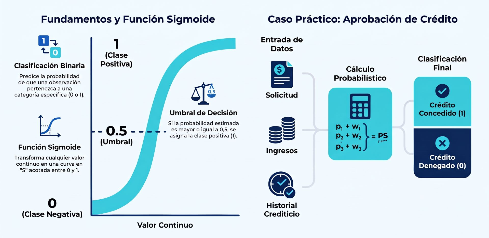
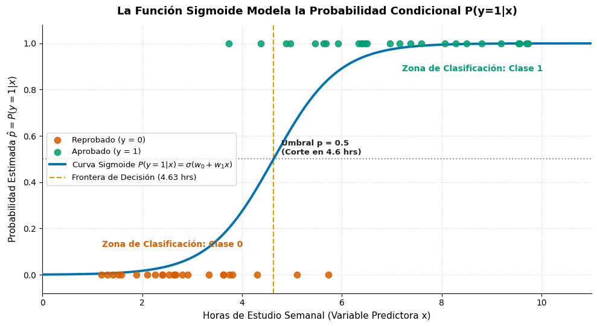
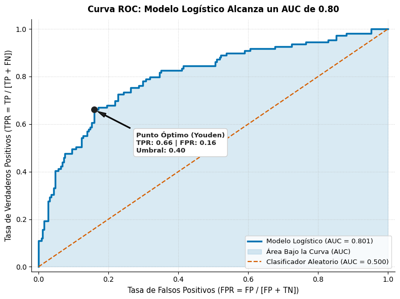

## **Regresión Logística**



Deseas responder a una pregunta que solo tiene **dos posibles respuestas** (sí/no, éxito/fracaso, aprueba/reprueba): por ejemplo, *«¿Aprobará un estudiante el examen final según las horas que estudió?»* o *«¿Es una transacción bancaria fraudulenta o legítima?»*.

Si intentáramos trazar una línea recta clásica (regresión lineal), tendríamos un grave problema: la recta continuaría creciendo hacia el infinito positivo o descendería hacia valores negativos absurdos, prediciendo "probabilidades" imposibles como $150\%$ o $-30\%$.

La **regresión logística** resuelve esto curvando la recta mediante una función matemática suave en forma de **"S"** (la función sigmoide):
* Transforma cualquier combinación de datos en una **probabilidad estrictamente acotada entre 0 y 1** (es decir, entre 0% y 100%).

* Establece una regla de corte clara (habitualmente el **50%**): si la probabilidad estimada es igual o mayor a 0,5, se clasifica como clase positiva (1: «Aprobado»); si es menor a 0,5, se clasifica como clase negativa (0: «Reprobado»).

En resumen: **es un modelo de clasificación que estima la probabilidad de que ocurra un evento binario basándose en una o más variables observadas**.

La **Regresión Logística** es uno de los algoritmos supervisados fundamentales en estadística y aprendizaje automático para resolver problemas de **clasificación** (especialmente binaria). 

A pesar de conservar el término histórico de «regresión», **no predice un valor numérico continuo**, sino la **probabilidad condicional** de que una observación pertenezca a una clase discreta (habitualmente la clase positiva $y=1$) en función de sus variables explicativas $X$.

### Definición Técnica

En el aprendizaje automático supervisado, la **regresión logística** es un modelo paramétrico discriminativo que modela directamente la distribución de probabilidad a posteriori de una variable categórica binaria $y \in \{0, 1\}$ condicionada a un vector de características continuas o discretas $x \in \mathbb{R}^p$:

```math 
P(y = 1 \mid x)
```

A pesar de conservar la palabra «regresión» en su nombre histórico, es un algoritmo de **clasificación supervisada**, ya que su propósito final es particionar el espacio vectorial mediante un **hiperplano de decisión lineal**.


### El Fundamento Matemático
**Del Hiperplano Lineal a la Probabilidad**

En la regresión lineal ordinaria, la combinación lineal de los datos $z = w_0 + w_1 x_1 + \dots + w_p x_p = w^T x$ genera salidas no acotadas en la recta real $(-\infty, +\infty)$. Si intentáramos usar una recta para clasificar probabilidades, obtendríamos valores absurdos (negativos o mayores a 1).


Para resolver esto, la regresión logística modela linealmente el **logaritmo de la razón de momios (*log-odds* o función logit)**.

Para comprender cómo se conecta una combinación lineal con una probabilidad, el modelo se construye en tres etapas:

#### A. La Razón de Momios (*Odds Ratio*)
Si $p = P(y = 1 \mid x)$ representa la probabilidad de que ocurra el evento positivo, la razón de momios (*odds*) mide cuántas veces es más probable el éxito frente al fracaso:

```math
\text{Odds} = \frac{p}{1 - p}
```

*   **Componentes:**
    *   $p$: Probabilidad del evento de interés, con $p \in (0, 1)$.
    *   $1 - p$: Probabilidad del evento complementario (fracaso).
    *   *Comportamiento:* Si la probabilidad de aprobar es $0,8$ (80%), los momios son $\frac{0,8}{0,2} = 4$ (es decir, una relación 4 a 1 a favor). Los momios están acotados inferiormente por $0$ y crecen hacia $+\infty$.

#### B. La Función Logit (Logaritmo de los Momios)
Para permitir que el modelo tome valores en toda la recta real $(-\infty, +\infty)$, se aplica el logaritmo natural a los momios, igualándolo a una combinación lineal de las variables explicativas:

```math 
\text{logit}(p) = \ln\left(\frac{p}{1 - p}\right) = w_0 + w_1 x_1 + \dots + w_p x_p = w^T x
```

*   **Componentes:**
    *   $w_0$: Término de sesgo (*intercept*); fija el valor logit cuando todas las características $x$ son cero.
    *   $w = [w_1, \dots, w_p]^T$: Vector de coeficientes de regresión. Cada $w_j$ representa el cambio en el logit ante un incremento unitario en $x_j$, manteniendo las demás constantes (*ceteris paribus*).
    *   $x = [x_1, \dots, x_p]^T$: Vector de características de la observación.

#### C. La Función Sigmoide (Inversa del Logit)
Para despejar la probabilidad directa $p$ a partir de la combinación lineal $z = w^T x$, se aplica la **función logística estándar o función sigmoide** ($\sigma(z)$) (transformación inversa del logit):

```math
P(y=1 \mid x) = \sigma(z) = \frac{1}{1 + e^{-z}} = \frac{1}{1 + e^{-(w^T x)}}
```
*   **Componentes:**
    *   $z = w^T x$: Puntuación lineal (*logit score*) que puede tomar cualquier valor entre $-\infty$ y $+\infty$.
    *   $e$: Base del logaritmo natural (constante de Euler $\approx 2,71828$).
    *   $\sigma(z)$: Función sigmoide, cuya salida está estrictamente confinada en el intervalo abierto $(0, 1)$.

*   **Propiedades clave de la sigmoide:**
    1.  Mapea asintóticamente cualquier valor real $z \in (-\infty, +\infty)$ al intervalo continuo $(0, 1)$.
    2.  Si $z = 0$, entonces $\sigma(0) = 0.5$.
    3.  Su derivada analítica es elegante y computacionalmente eficiente: 
    ```math
    \frac{d\sigma(z)}{dz} = \sigma(z)(1 - \sigma(z))
    ```

```
         P(y=1|x)
           1.0 ┼                             ╭─────────────
               │                           ╭─╯
           0.8 ┼                         ╭─╯
               │                       ╭─╯
           0.5 ┼ ─ ─ ─ ─ ─ ─ ─ ─ ─ ─ ╭─╯ ─ ─ ─ (Umbral por defecto: z=0)
               │                   ╭─╯
           0.2 ┼                 ╭─╯
               │             ╭───╯
           0.0 ┼ ────────────╯
               └───────┬───────┬───────┬───────┬───────┬────► z = w^T x
                      -6      -4      -2       0       2       4       6
```


### Regla de Decisión 
**Hiperplano Separador**

Una vez calculada la probabilidad $\hat{p} = \sigma(w^T x)$, la predicción discreta ($\hat{y} \in \{0, 1\}$) se determina aplicando un **umbral de discriminación** (por defecto $0.5$):

```math
\hat{y} = \begin{cases} 1 & \text{si } \hat{p} \ge 0.5 \iff w^T x \ge 0 \\ 0 & \text{si } \hat{p} < 0.5 \iff w^T x < 0 \end{cases}
```

*   El conjunto geométrico donde $w^T x = 0$ define el **límite de decisión (*decision boundary*)**, el cual es un hiperplano lineal de dimensión $p-1$ que divide el espacio de características en las dos regiones de clasificación.


### Estimación de Parámetros
**Máxima Verosimilitud y Entropía Cruzada Binaria**

A diferencia de la regresión lineal (donde OLS tiene una solución cerrada mediante la Ecuación Normal), en la regresión logística los parámetros $w$ **no pueden despejarse analíticamente**. Se estiman mediante el principio de **Máxima Verosimilitud (MLE - *Maximum Likelihood Estimation*)**.

Asumiendo que las observaciones son independientes y siguen una distribución de Bernoulli condicional independiente:
```math
L(w) = \prod_{i=1}^N P(y^{(i)} \mid x^{(i)}; w) = \prod_{i=1}^N \left( \hat{p}^{(i)} \right)^{y^{(i)}} \left( 1 - \hat{p}^{(i)} \right)^{1 - y^{(i)}}
```

Para transformar este producto en una suma y facilitar su optimización, tomamos el logaritmo natural negativo, formulando la **función de pérdida de entropía cruzada binaria (*Binary Cross-Entropy* o *Log-Loss*)**:

```math
J(w) = -\frac{1}{N} \ln L(w) = -\frac{1}{N} \sum_{i=1}^N \Big[ y^{(i)} \ln\big(\hat{p}^{(i)}\big) + (1 - y^{(i)}) \ln\big(1 - \hat{p}^{(i)}\big) \Big]
```
*   **Componentes:**
    *   $N$: Número total de observaciones en la muestra.
    *   $y^{(i)} \in \{0, 1\}$: Etiqueta observada real de la clase.
    *   $\hat{p}^{(i)} = \sigma(w^T x^{(i)})$: Probabilidad predicha por el modelo para la observación $i$.
    *   **Mecánica de castigo:**
        *   Si $y^{(i)} = 1$, el segundo término se anula y la pérdida es $-\ln(\hat{p}^{(i)})$. Si el modelo predice $\hat{p} \to 1$, el coste es $0$; si predice $\hat{p} \to 0$, el coste diverge asintóticamente hacia $+\infty$.
        *   Si $y^{(i)} = 0$, el primer término se anula y la pérdida es $-\ln(1 - \hat{p}^{(i)})$. Si predice $\hat{p} \to 1$, el castigo tiende a $+\infty$.

Dado que $J(w)$ es estrictamente **convexa**, algoritmos de optimización iterativa como el **Descenso de Gradiente** o **L-BFGS** convergen al mínimo global sin atascarse en mínimos locales.

#### Interpretación de la función de coste:
*   Si la etiqueta real es $y^{(i)} = 1$, la pérdida se reduce a $-\ln(\hat{p}^{(i)})$. Si el modelo predice $\hat{p} \to 1$, el coste es $0$; pero si predice $\hat{p} \to 0$, el coste tiende asintóticamente a $+\infty$.

*   Si la etiqueta real es $y^{(i)} = 0$, la pérdida se reduce a $-\ln(1 - \hat{p}^{(i)})$. Si el modelo predice $\hat{p} \to 1$, el castigo tiende a $+\infty$.

Esta función $J(w)$ es estrictamente **convexa**, lo que garantiza que algoritmos de optimización numérica (como **Descenso de Gradiente**, Newton-Raphson o L-BFGS) converjan al **mínimo global**.


### Extensión Multiclase
**Softmax Regression (Multinomial)**

Cuando el problema tiene $K > 2$ categorías mutuamente excluyentes, la regresión logística se generaliza mediante la función **Softmax** (también llamada regresión multinomial):

```math
P(y = k \mid x) = \frac{e^{w_k^T x}}{\sum_{j=1}^K e^{w_j^T x}}
```

*   **Argumentos:** $w_k$ es el vector de pesos específico para la clase $k$; la suma en el denominador normaliza las puntuaciones exponenciales para que la suma total de probabilidades a lo largo de todas las clases sea exactamente igual a $1$.


<br/>
#### Ejemplo Python (Scikit-Learn):
<Tabs>
<TabItem value="mnp" label="Antecedentes" default>
<div class="alert alert--primary">
**Regresión logística**

Simula un conjunto de datos (horas de estudio semanal vs. aprobación de un examen), entrena el modelo con `scikit-learn` y grafica la curva sigmoide resultante junto a la frontera de decisión:
```
Coeficiente w1 (Efecto marginal logit): 1.5411
Intersección w0 (Sesgo):               -7.1348
Frontera de decisión (p = 0.5):        4.63 horas de estudio
```


**Interpretación del Gráfico Generado**

El gráfico muestra de manera clara los elementos centrales del modelo:
1. **Puntos Discretos de Muestra:** Los estudiantes observados solo pueden adoptar valores extremos $y \in \{0, 1\}$ (puntos naranja para reprobados y verdes para aprobados).

2. **Curva Sigmoide Continua (Azul):** Modela suavemente la transición de probabilidad entre 0 y 1. Se observa cómo a partir de 3 horas la probabilidad de aprobación comienza a despegar rápidamente.

3. **Frontera de Decisión (Línea discontinua amarilla en 4,63 hrs):** Representa el punto geométrico donde $z = w_0 + w_1 x = 0$, haciendo que $\sigma(0) = 0,5$. Cualquier alumno con más de 4,63 horas semanales de estudio será clasificado con probabilidad favorable de aprobar.

</div>
</TabItem>
<TabItem value="mnp-python" label="🖥️ Código">

```python showLineNumbers

"""
Regresión Logística y Curva Sigmoide.
Visualización del ajuste probabilístico y frontera de decisión.
"""

import numpy as np
import matplotlib.pyplot as plt
from sklearn.linear_model import LogisticRegression

# 1. Simulación de datos pedagógicos (N = 50 estudiantes)
np.random.seed(42)
horas_estudio = np.sort(np.random.uniform(1.0, 10.0, size=50))

# Proceso generador subyacente con función logística
prob_verdadera = 1.0 / (1.0 + np.exp(-(1.2 * horas_estudio - 6.0)))
aprobado = np.random.binomial(n=1, p=prob_verdadera)

# 2. Ajuste del modelo de Regresión Logística
X = horas_estudio.reshape(-1, 1)
clf = LogisticRegression(random_state=42)
clf.fit(X, aprobado)

# 3. Predicción probabilística sobre un rango continuo
horas_rango = np.linspace(0, 11, 300).reshape(-1, 1)
prob_predicha = clf.predict_proba(horas_rango)[:, 1]

# Cálculo analítico de la frontera de decisión (donde z = w0 + w1*x = 0 -> p = 0.5)
w0 = clf.intercept_
w1 = clf.coef_
frontera_decision = -w0 / w1

print(f"Coeficiente w1 (Efecto marginal logit): {w1:.4f}")
print(f"Intersección w0 (Sesgo):               {w0:.4f}")
print(f"Frontera de decisión (p = 0.5):        {frontera_decision:.2f} horas de estudio")

# 4. Generación gráfica (Fondo blanco plano y paleta contrastada)
fig, ax = plt.subplots(figsize=(10, 5.5), facecolor='white')
ax.set_facecolor('white')

# Dispersión de las observaciones reales
ax.scatter(horas_estudio[aprobado == 0], aprobado[aprobado == 0],
           color='#d55e00', s=55, alpha=0.85, label='Reprobado (y = 0)', zorder=4)
ax.scatter(horas_estudio[aprobado == 1], aprobado[aprobado == 1],
           color='#009e73', s=55, alpha=0.85, label='Aprobado (y = 1)', zorder=4)

# Curva logística estimada
ax.plot(horas_rango, prob_predicha, color='#0072b2', linewidth=2.8,
        label=r'Curva Sigmoide $P(y=1|x) = \sigma(w_0 + w_1 x)$', zorder=3)

# Líneas guía de umbral y frontera
ax.axhline(0.5, color='#8a8a8a', linestyle=':', linewidth=1.4)
ax.axvline(frontera_decision, color='#e69f00', linestyle='--', linewidth=1.6,
           label=f'Frontera de Decisión ({frontera_decision:.2f} hrs)')

# Anotaciones explicativas
ax.text(frontera_decision + 0.15, 0.52, f'Umbral p = 0.5\n(Corte en {frontera_decision:.1f} hrs)',
        color='#222222', fontsize=9.5, fontweight='bold')
ax.text(1.2, 0.12, 'Zona de Clasificación: Clase 0', color='#d55e00', fontsize=10, fontweight='bold')
ax.text(7.2, 0.88, 'Zona de Clasificación: Clase 1', color='#009e73', fontsize=10, fontweight='bold')

ax.set_title("La Función Sigmoide Modela la Probabilidad Condicional P(y=1|x)",
             fontsize=13, fontweight='bold', pad=12)
ax.set_xlabel("Horas de Estudio Semanal (Variable Predictora x)", fontsize=11)
ax.set_ylabel(r"Probabilidad Estimada $\hat{p} = P(y=1|x)$", fontsize=11)
ax.set_ylim(-0.08, 1.08)
ax.set_xlim(0, 11)
ax.grid(True, linestyle=':', alpha=0.6)
ax.spines['top'].set_visible(False)
ax.spines['right'].set_visible(False)
ax.legend(frameon=True, facecolor='white', loc='center left', fontsize=9.5)

plt.tight_layout()
plt.show()
```
</TabItem>
</Tabs><br/>


### Implementación en Python

El siguiente código implementa un pipeline de clasificación con estandarización, validación cruzada y cálculo del área bajo la curva ROC (ROC-AUC):

```python
"""
Clasificación con Regresión Logística y Scikit-Learn.
"""

import numpy as np
import pandas as pd
from sklearn.datasets import load_breast_cancer
from sklearn.model_selection import train_test_split, cross_val_score
from sklearn.preprocessing import StandardScaler
from sklearn.pipeline import Pipeline
from sklearn.linear_model import LogisticRegression
from sklearn.metrics import classification_report, confusion_matrix, roc_auc_score

# 1. Carga y partición de datos (Diagnóstico clínico)
data = load_breast_cancer(as_frame=True)
X, y = data.data, data.target

X_train, X_test, y_train, y_test = train_test_split(
    X, y, test_size=0.20, random_state=42, stratify=y
)

# 2. Pipeline con preprocesamiento obligatorio
# La estandarización es crucial para que la regularización L2 aplique parejo
logreg_pipeline = Pipeline([
    ('scaler', StandardScaler()),
    ('clf', LogisticRegression(C=1.0, penalty='l2', solver='lbfgs', max_iter=1000, random_state=42))
])

# 3. Entrenamiento (Optimización por Máxima Verosimilitud)
logreg_pipeline.fit(X_train, y_train)

# 4. Inferencia: Clases directas y probabilidades continuas
y_pred = logreg_pipeline.predict(X_test)
y_prob = logreg_pipeline.predict_proba(X_test)[:, 1] # Probabilidad de clase positiva

# 5. Evaluación de desempeño
cv_scores = cross_val_score(logreg_pipeline, X_train, y_train, cv=5, scoring='accuracy')

print("=== EVALUACIÓN DE REGRESIÓN LOGÍSTICA ===")
print(f"Exactitud media en Validación Cruzada (5-folds): {cv_scores.mean() * 100:.2f}%")
print(f"Área bajo la curva ROC (ROC-AUC en Test):       {roc_auc_score(y_test, y_prob):.4f}")
print("\nMatriz de Confusión (Test Set):")
print(confusion_matrix(y_test, y_pred))
print("\nReporte de Clasificación:")
print(classification_report(y_test, y_pred, target_names=data.target_names))

# 6. Inspección pedagógica de Odds Ratios
# En regresión logística, exp(w) representa el factor de cambio en los momios (Odds Ratio)
coefs = logreg_pipeline.named_steps['clf'].coef_
odds_ratios = np.exp(coefs)

df_interpretacion = pd.DataFrame({
    'Característica': X.columns[:5],
    'Coeficiente (w)': coefs[:5],
    'Odds Ratio (exp(w))': odds_ratios[:5]
})
print("\nInterpretación de Coeficientes (Primeras 5 variables):")
print(df_interpretacion.round(4).to_string(index=False))
```

---

### Resumen 

1.  **Naturaleza:** Es un algoritmo de **clasificación supervisada** (a pesar de su nombre) que modela probabilidades entre 0 y 1.
2.  **Transformación Logit:** Modela la combinación lineal de entradas como el logaritmo de los momios (*log-odds*): $\ln(p / (1-p)) = w^T x$.
3.  **Función Sigmoide:** Mapea el hiperplano lineal $z \in (-\infty, +\infty)$ al rango probabilístico continuo $(0, 1)$ mediante $\sigma(z) = \frac{1}{1 + e^{-z}}$.
4.  **Optimización:** Minimiza la **entropía cruzada binaria (Log-Loss)** mediante algoritmos iterativos convexos basados en Máxima Verosimilitud (MLE).
5.  **Regularización:** El parámetro **$C$** es el inverso de $\lambda$; valores pequeños de $C$ incrementan la regularización para controlar el sobreajuste.


***
## **Regularización**

La **regularización en la regresión logística** es una técnica matemática que consiste en añadir un término de penalización a la función de pérdida del modelo para restringir la magnitud de los coeficientes de ponderación. Su objetivo principal es controlar la complejidad del clasificador, mitigar el sobreajuste (*overfitting*), manejar la multicolinealidad y resolver la inestabilidad numérica que ocurre cuando existen variables redundantes o las clases son linealmente separables.

A diferencia de la regresión lineal —donde la penalización se suma a la suma de errores cuadráticos (MSE/RSS)—, en la regresión logística la regularización se añade directamente a la **entropía cruzada binaria (*Binary Cross-Entropy* o *Log-Loss*)**.


### Formulación matemática

La función de pérdida no regularizada de la regresión logística (log-loss) sobre un conjunto de entrenamiento de $N$ observaciones se define a partir del logaritmo negativo de la verosimilitud:

```math
J_{\text{base}}(w) = -\frac{1}{N} \sum_{i=1}^{N} \Big[ y^{(i)} \ln\big(\phi(z^{(i)})\big) + (1 - y^{(i)}) \ln\big(1 - \phi(z^{(i)})\big) \Big]
```

Donde:
* $y^{(i)} \in \{0, 1\}$ es la etiqueta real de la clase.
* $\phi(z^{(i)}) = \sigma(w^T x^{(i)}) = \frac{1}{1 + e^{-w^T x^{(i)}}}$ es la probabilidad estimada mediante la función logística sigmoide.
* $w = [w_1, w_2, \dots, w_p]^T$ representa el vector de pesos o coeficientes asociados a las características de entrada.

Al aplicar regularización, la función objetivo a minimizar se formula de dos maneras equivalentes:

#### A. Regularización $L_2$ (Ridge / Weight Decay)
Se penaliza la suma de los cuadrados de los coeficientes (la norma euclidiana $\|w\|_2^2$):

```math
J_{\text{reg}, L_2}(w) = J_{\text{base}}(w) + \frac{\lambda}{2} \sum_{j=1}^{p} w_j^2 = J_{\text{base}}(w) + \frac{\lambda}{2} \|w\|_2^2
```

* **Argumentos:** $\lambda \ge 0$ es el factor de regularización. Contrae de forma suave y uniforme  todos los coeficientes hacia cero, pero **nunca los hace exactamente cero**, asegurando que todas las variables permanezcan en el modelo. Es ideal para manejar multicolinealidad y estabilizar el cálculo numérico. Nótese que el término independiente o sesgo ($w_0$ o *intercept*) **no se penaliza** para no comprometer la posición de corte de la función sigmoide.

#### B. Regularización $L_1$ (Lasso / Sparsity)
Se penaliza la suma de los valores absolutos de los coeficientes (la norma $\|w\|_1$):

```math
J_{\text{reg}, L_1}(w) = J_{\text{base}}(w) + \lambda \sum_{j=1}^{p} |w_j| = J_{\text{base}}(w) + \lambda \|w\|_1
```

* **Argumentos:** Gracias a los vértices no diferenciables de la región de restricción $L_1$ sobre los ejes, muchos coeficientes se fijan en **cero exacto** ($w_j = 0$), realizando una **selección automática de características (sparsity)** que descarta características ruidosas o redundantes.

#### C. Regularización ElasticNet (Híbrido $L_1 + L_2$)
Combina linealmente ambas penalizaciones ponderadas por un factor de mezcla $\rho \in$:

```math
J_{\text{reg}, \text{EN}}(w) = J_{\text{base}}(w) + \lambda \left[ \rho \|w\|_1 + \frac{1 - \rho}{2} \|w\|_2^2 \right]
```

* **Comportamiento**: Permite seleccionar variables en bloque cuando existen grupos de características fuertemente correlacionadas entre sí (grouping effect).

### El Parámetro $C$ frente a $\lambda$

Para evitar el sobreajuste (*overfitting*) cuando las clases son separables o cuando hay alta dimensionalidad, se añaden penalizaciones $L_2$ o $L_1$ a la función de pérdida:

```math
J_{\text{reg}}(w) = J(w) + \frac{\lambda}{2} \|w\|_2^2
```

En librerías de producción como scikit-learn (LogisticRegression), se utiliza por convención la parametrización de las Support Vector Machines (SVM), donde la fuerza de la regularización se controla mediante $C$, el cual es el inverso de $\lambda$:

```math
C = \frac{1}{\lambda}
```

La función objetivo en `scikit-learn` se optimiza típicamente multiplicando la pérdida base por $C$:

```math
\min_{w} \quad C \cdot J_{\text{base}}(w) + R(w)
```

Donde $R(w)$ es la penalización ($\frac{1}{2}\|w\|_2^2$ o $\|w\|_1$).
* **Valores pequeños de $C$ (e.g., $C = 0.01$):** Equivalen a un $\lambda$ grande; imponen una **fuerte regularización**, reduciendo la varianza del modelo al encoger drásticamente los pesos hacia cero para reducir la varianza a costa de mayor sesgo.

* **Valores grandes de $C$ (e.g., $C = 100$):** Imponen una **regularización débil**; el optimizador prioriza clasificar correctamente todos los datos de entrenamiento, aumentando la complejidad y el riesgo de sobreajuste.

* En `scikit-learn`, la regularización por defecto es **$L_2$ con $C=1.0$**.


### El Problema de la Separabilidad Lineal Perfecta

Un motivo esencial por el cual la regresión logística requiere regularización es el fenómeno de **separabilidad perfecta**:
* Si existe un hiperplano que separa limpiamente las clases positivas de las negativas sin ningún error en los datos de entrenamiento, la función sigmoide intentará acercar las probabilidades de acierto a exactamente $1.0$ y $0.0$.

* Dado que $\sigma(z) \to 1$ únicamente cuando $z = w^T x \to +\infty$, el algoritmo de optimización aumentará indefinidamente la magnitud de los pesos ($\|w\| \to \infty$) en cada iteración.

* La inclusión de la penalización $L_2$ o $L_1$ evita que los pesos diverjan hacia el infinito, asegurando que el proceso de optimización numérica converja de manera estable a una solución finita.


### Implementación en Python

<br/>

<Tabs>
<TabItem value="mnp" label="Antecedentes" default>
<div class="alert alert--primary">
**Regularización en Regresión Logística**

El siguiente script en Python utiliza `scikit-learn` para ilustrar cómo influyen las penalizaciones $L_2$ (Ridge) y $L_1$ (Lasso), y cómo el ajuste de $C$ contrae o anula coeficientes sobre un conjunto de clasificación clínica (Breast Cancer):

**Resumen**

1. **Punto de aplicación:** La penalización no se aplica al error cuadrático, sino al **log-loss / entropía cruzada binaria** del modelo logístico.
2. **Rol de $L_2$:** Contrae los pesos de manera suave y homogénea, estabilizando el cálculo numérico y evitando que los coeficientes diverjan ante clases separables.
3. **Rol de $L_1$:** Anula coeficientes de variables redundantes a cero exacto, actuando como selector supervisado de características.
4. **Parámetro $C$:** En `scikit-learn`, $C$ es el inverso de la penalización ($C = 1/\lambda$); valores más pequeños aumentan el sesgo, reducen la varianza y simplifican el modelo.
</div>
</TabItem>
<TabItem value="mnp-python" label="🖥️ Código">

```python showLineNumbers
"""
Regularización en Regresión Logística (L1 vs. L2).
Evaluación de contracción de pesos, dispersión y rendimiento predictivo.
"""

import numpy as np
import pandas as pd
from sklearn.datasets import load_breast_cancer
from sklearn.model_selection import train_test_split
from sklearn.preprocessing import StandardScaler
from sklearn.linear_model import LogisticRegression
from sklearn.metrics import accuracy_score, roc_auc_score

# 1. Carga y partición estratificada de datos
cancer = load_breast_cancer(as_frame=True)
X, y = cancer.data, cancer.target

X_train, X_test, y_train, y_test = train_test_split(
    X, y, test_size=0.25, random_state=42, stratify=y
)

# 2. Preprocesamiento: Estandarización obligatoria
# Como la regularización penaliza la magnitud de los pesos, las variables
# deben estar en una escala uniforme (media 0, varianza unitaria)
scaler = StandardScaler()
X_train_scaled = scaler.fit_transform(X_train)
X_test_scaled = scaler.transform(X_test)

# =====================================================================
# 3. Ajuste de Modelos con Distintos Esquemas de Regularización
# =====================================================================

# A. Sin regularización (C muy alto o penalty=None)
lr_sin_reg = LogisticRegression(penalty=None, solver='lbfgs', max_iter=2000, random_state=42)
lr_sin_reg.fit(X_train_scaled, y_train)

# B. Regularización L2 (Ridge por defecto, C=0.1 -> regularización moderada-fuerte)
lr_l2 = LogisticRegression(penalty='l2', C=0.1, solver='lbfgs', max_iter=2000, random_state=42)
lr_l2.fit(X_train_scaled, y_train)

# C. Regularización L1 (Lasso, requiere solvers como 'liblinear' o 'saga', C=0.1)
lr_l1 = LogisticRegression(penalty='l1', C=0.1, solver='liblinear', max_iter=2000, random_state=42)
lr_l1.fit(X_train_scaled, y_train)

# =====================================================================
# 4. Análisis de Coeficientes y Dispersión (Sparsity)
# =====================================================================
df_coeficientes = pd.DataFrame({
    'Característica': X.columns[:8],
    'Sin Regularizar': lr_sin_reg.coef_[:8],
    'L2 (C=0.1, Ridge)': lr_l2.coef_[:8],
    'L1 (C=0.1, Lasso)': lr_l1.coef_[:8]
})

print("=== MAGNITUD DE COEFICIENTES (PRIMERAS 8 CARACTERÍSTICAS) ===")
print(df_coeficientes.round(4).to_string(index=False))

# Conteo de variables anuladas exactamente a cero
zeros_l2 = np.sum(np.isclose(lr_l2.coef_, 0.0, atol=1e-5))
zeros_l1 = np.sum(np.isclose(lr_l1.coef_, 0.0, atol=1e-5))

print("\n=== RECUENTO DE VARIABLES ANULADAS A CERO (SPARSITY) ===")
print(f"L2 (Ridge): {zeros_l2} variables en 0 de {X.shape}")
print(f"L1 (Lasso): {zeros_l1} variables en 0 de {X.shape} (Selección automática activa)")

# =====================================================================
# 5. Evaluación de Rendimiento en el Conjunto de Prueba
# =====================================================================
def evaluar_modelo(nombre, modelo):
    y_pred = modelo.predict(X_test_scaled)
    y_prob = modelo.predict_proba(X_test_scaled)[:, 1]
    acc = accuracy_score(y_test, y_pred)
    auc = roc_auc_score(y_test, y_prob)
    print(f"{nombre:<22} | Exactitud (Acc): {acc * 100:.2f}% | ROC-AUC: {auc:.4f}")

print("\n=== RENDIMIENTO SOBRE DATOS DE PRUEBA (TEST SET) ===")
evaluar_modelo("Sin Regularizar", lr_sin_reg)
evaluar_modelo("L2 (Ridge, C=0.1)", lr_l2)
evaluar_modelo("L1 (Lasso, C=0.1)", lr_l1)
```
</TabItem>
</Tabs><br/>


***
## **Curva ROC**

La mayoría de los modelos de clasificación (como la regresión logística) no devuelven directamente un "Sí" o un "No", sino una **probabilidad continua entre 0% y 100%**. Por convención, solemos fijar el punto de corte en **0,5** (50%): si la probabilidad supera 0,5, clasificamos como positivo; si no, como negativo.

Sin embargo, ese umbral del 50% es arbitrario:
* En la detección de enfermedades graves o fraude bancario, preferimos bajar el umbral (por ejemplo a 0,2) para detectar a casi todos los casos positivos reales, aunque cometamos el error de generar falsas alarmas.
* En un filtro de correo spam, preferimos subir el umbral (por ejemplo a 0,8) para evitar enviar por error un correo legítimo e importante a la papelera.

**¿Qué es la curva ROC?**  
Es un gráfico que evalúa el rendimiento del clasificador a través de **todos los umbrales de decisión posibles** (desde 0,0 hasta 1,0), mostrando el intercambio (*trade-off*) continuo entre los **aciertos reales** y las **falsas alarmas**.

**¿Qué es el AUC?**  
Es el **Área Bajo la Curva** (*Area Under the Curve*). Es un número único entre **0,5 y 1,0** que resume la calidad global del clasificador:
* **$\text{AUC} = 0,5$:** Equivale a lanzar una moneda al aire (el modelo no tiene ninguna capacidad de discriminación).
* **$\text{AUC} = 1,0$:** El clasificador es perfecto (separa completamente los positivos de los negativos sin ningún error).
* **Interpretación práctica:** Si tomas al azar a un individuo positivo y a un individuo negativo, un $\text{AUC} = 0,85$ significa que hay un **85% de probabilidad** de que el modelo asigne una puntuación de riesgo más alta al individuo positivo que al negativo.


### Formulación matemática

La curva **ROC** (*Receiver Operating Characteristic* o Característica Operativa del Receptor) es una representación paramétrica bidimensional de la función:

```math
\text{ROC}(t) = \Big(\text{FPR}(t), \, \text{TPR}(t)\Big) \quad \forall \; t \in
```

Donde $t$ es el umbral de discriminación sobre la probabilidad continua $\hat{p} = P(y=1 \mid x)$.

#### A. Las Métricas de los Ejes
A partir de la matriz de confusión binaria para un umbral $t$:

```
                       Clase Real Positiva (y=1)   Clase Real Negativa (y=0)
  Predicho Positivo:             TP                          FP
  Predicho Negativo:             FN                          TN
```

1. **Eje Vertical ($Y$): Tasa de Verdaderos Positivos ($\text{TPR}$), Sensibilidad o Exhaustividad (*Recall*):**
   ```math
   \text{TPR}(t) = \frac{\text{TP}(t)}{\text{TP}(t) + \text{FN}(t)} = \frac{\text{TP}}{P} = P(\hat{p} \ge t \mid y = 1)
   ```
   * **Significado:** Proporción de casos positivos reales que el modelo clasifica correctamente.

2. **Eje Horizontal ($X$): Tasa de Falsos Positivos ($\text{FPR}$) o $1 - \text{Especificidad}$:**
   ```math
   \text{FPR}(t) = \frac{\text{FP}(t)}{\text{FP}(t) + \text{TN}(t)} = \frac{\text{FP}}{N} = P(\hat{p} \ge t \mid y = 0)
   ```
   * **Significado:** Proporción de casos negativos reales que son catalogados erróneamente como positivos (tasa de falsas alarmas).

#### B. El Estadístico AUC (Área Bajo la Curva ROC)
Se calcula como la integral de Riemann de la curva $\text{TPR}$ respecto a $\text{FPR}$:

```math
\text{AUC} = \int_{0}^{1} \text{TPR}(\text{FPR}) \, d(\text{FPR}) = P\big(\hat{p}_{\text{positivo}} > \hat{p}_{\text{negativo}}\big)
```

* **Propiedad matemática:** Es equivalente a la estadística no paramétrica de la **prueba de Mann-Whitney $U$** dividida por el producto del número de positivos y negativos:
  ```math
  \text{AUC} = \frac{U}{n_1 \cdot n_0}
  ```

#### C. Escala de Calidad del AUC
* **$0,50$:** Sin capacidad discriminativa (clasificador aleatorio).
* **$0,70 - 0,80$:** Discriminación aceptable.
* **$0,80 - 0,90$:** Discriminación excelente.
* **$> 0,90$:** Discriminación sobresaliente.


### ¿Para Qué Sirve?

1. **Evaluación Independiente del Umbral (*Threshold-Agnostic*):**  
   Mide la capacidad de ordenamiento y discriminación del modelo sin atarse al umbral rígido de $0,5$.
2. **Robustez ante el Desbalance de Clases:**  
   A diferencia de la exactitud global (*Accuracy*) —que es engañosa cuando una clase representa el 99% de los datos—, el cálculo de $\text{TPR}$ y $\text{FPR}$ se normaliza dentro de cada clase real de manera independiente, siendo invariante al cambio de escala marginal de las clases.
3. **Selección del Punto de Operación Óptimo (Índice de Youden $J$):**  
   Permite encontrar formalmente el mejor umbral operacional equilibrando sensibilidad y especificidad:
   ```math
   J = \max_{t} \big( \text{TPR}(t) - \text{FPR}(t) \big)
   ```
4. **Comparativa entre Modelos Diversos:**  
   Permite enfrentar algoritmos de distinta naturaleza (p. ej., Regresión Logística regularizada vs. Random Forest vs. Gradient Boosting) sobre un mismo lienzo métrico.


### Implementación


<br/>
#### Ejemplo:
<Tabs>
<TabItem value="mnp" label="Antecedentes" default>
<div class="alert alert--primary">
**Curva ROC**

A continuación se muestra el resultado del script para ajustar un clasificador, extraer sus probabilidades y graficar su curva ROC-AUC identificando el umbral óptimo:
```
Área Bajo la Curva (AUC):        0.8009
Umbral Óptimo de Youden:         0.3970
Sensibilidad en Umbral Óptimo:   66.1%
FPR en Umbral Óptimo:            15.9%
```

**Análisis del Gráfico**

El gráfico resultante ilustra:
1. **La Curva Azul (Modelo Logístico con AUC = 0,80):** Se curva pronunciadamente hacia la esquina superior izquierda (el clasificador ideal), logrando capturar más del **80% de los positivos reales (TPR > 0,80)** asumiendo menos del **17% de falsas alarmas (FPR < 0,16)**.

2. **La Línea Discontinua Naranja (AUC = 0,50):** Sirve como umbral de referencia de no-discriminación. Cualquier modelo útil debe situarse claramente por encima de esta diagonal.

3. **Punto Óptimo de Youden (Punto negro en umbral 0,4):** Indica analíticamente que, para maximizar la separación neta entre aciertos y falsas alarmas, el umbral de decisión debe ajustarse a **0,4** en lugar del 0,50 estándar.
</div>
</TabItem>
<TabItem value="mnp-python" label="🖥️ Código">

```python showLineNumbers
"""
Evaluación de Modelos de Clasificación vía Curva ROC-AUC.
Librería: scikit-learn y matplotlib.
"""

import numpy as np
import matplotlib.pyplot as plt
from sklearn.datasets import make_classification
from sklearn.model_selection import train_test_split
from sklearn.linear_model import LogisticRegression
from sklearn.metrics import roc_curve, roc_auc_score

# 1. Simulación de datos con clases desbalanceadas (30% positivos, 70% negativos)
X, y = make_classification(
    n_samples=1200, n_features=10, n_informative=5,
    n_redundant=2, weights=[0.7, 0.3], random_state=42
)
X_train, X_test, y_train, y_test = train_test_split(
    X, y, test_size=0.3, random_state=42, stratify=y
)

# 2. Ajuste del modelo y obtención de probabilidades continuas
clf = LogisticRegression(random_state=42)
clf.fit(X_train, y_train)

# Obtenemos P(y=1|x) para el conjunto de prueba
y_probs = clf.predict_proba(X_test)[:, 1]

# 3. Cálculo de la curva ROC y el AUC
fpr, tpr, thresholds = roc_curve(y_test, y_probs)
auc = roc_auc_score(y_test, y_probs)

# 4. Cálculo del umbral óptimo mediante el Índice de Youden (J = TPR - FPR)
youden_idx = np.argmax(tpr - fpr)
opt_fpr = fpr[youden_idx]
opt_tpr = tpr[youden_idx]
opt_thresh = thresholds[youden_idx]

print(f"Área Bajo la Curva (AUC):        {auc:.4f}")
print(f"Umbral Óptimo de Youden:         {opt_thresh:.4f}")
print(f"Sensibilidad en Umbral Óptimo:   {opt_tpr*100:.1f}%")
print(f"FPR en Umbral Óptimo:            {opt_fpr*100:.1f}%")

# 5. Generación Gráfica (Fondo blanco plano y paleta contrastada)
fig, ax = plt.subplots(figsize=(8, 6), facecolor='white')
ax.set_facecolor('white')

# Curva del modelo y sombreado del área
ax.plot(fpr, tpr, color='#0072b2', linewidth=2.5, label=f'Modelo Logístico (AUC = {auc:.3f})')
ax.fill_between(fpr, 0, tpr, color='#0072b2', alpha=0.15, label='Área Bajo la Curva (AUC)')

# Línea base de azar
ax.plot([0, 1], [0, 1], color='#d55e00', linestyle='--', linewidth=1.6, label='Clasificador Aleatorio (AUC = 0.500)')

# Punto óptimo de Youden
ax.scatter([opt_fpr], [opt_tpr], color='#222222', s=70, zorder=5)
ax.annotate(
    f'Punto Óptimo (Youden)\nTPR: {opt_tpr:.2f} | FPR: {opt_fpr:.2f}\nUmbral: {opt_thresh:.2f}',
    xy=(opt_fpr, opt_tpr),
    xytext=(opt_fpr + 0.12, opt_tpr - 0.18),
    arrowprops=dict(facecolor='#222222', shrink=0.08, width=1.2, headwidth=6),
    fontweight='bold', fontsize=9.5, color='#222222',
    bbox=dict(boxstyle='round,pad=0.4', facecolor='white', edgecolor='#cccccc')
)

ax.set_title(f'Curva ROC: Modelo Logístico Alcanza un AUC de {auc:.2f}', fontsize=12, fontweight='bold', pad=10)
ax.set_xlabel('Tasa de Falsos Positivos (FPR = FP / [FP + TN])', fontsize=10.5)
ax.set_ylabel('Tasa de Verdaderos Positivos (TPR = TP / [TP + FN])', fontsize=10.5)
ax.set_xlim(-0.02, 1.02)
ax.set_ylim(-0.02, 1.04)
ax.grid(True, linestyle=':', alpha=0.6)
ax.spines['top'].set_visible(False)
ax.spines['right'].set_visible(False)
ax.legend(frameon=True, facecolor='white', loc='lower right', fontsize=9.5)

plt.tight_layout()
plt.show()
```
</TabItem>
</Tabs><br/>


***
## ROC_AUC vs. PR-AUC

En problemas reales, como la detección de fraudes con tarjetas de crédito, ciberseguridad (detección de intrusiones), diagnóstico de enfermedades raras o mantenimiento predictivo de turbinas industriales, las clases suelen estar **severamente desbalanceadas** (por ejemplo, el 99% o 99,9% de los registros pertenecen a la clase negativa o normal, y solo el 1% o 0,1% corresponde a la clase positiva de interés).

Bajo estas condiciones operativas, confiar ciegamente en la curva **ROC-AUC** puede inducir a un **diagnóstico falsamente optimista**. En su lugar, la curva **Precision-Recall (PR-AUC)** es el estándar de evaluación riguroso.

---

### 1. El Problema Matemático: ¿Por Qué ROC-AUC Puede Ser Engañosa?

Examinemos las fórmulas que definen el eje horizontal de cada curva:

#### A. La Tasa de Falsos Positivos (Eje X en la Curva ROC)
\\[\text{FPR} = \frac{\text{FP}}{\text{FP} + \text{TN}} = \frac{\text{FP}}{N}\\]

*   **Argumentos:**
    *   $\text{FP}$: Falsos Positivos (registros normales clasificados erróneamente como fraude o falla).
    *   $\text{TN}$: Verdaderos Negativos (registros normales clasificados correctamente).
    *   $N = \text{FP} + \text{TN}$: Total de observaciones pertenecientes a la **clase negativa real**.
*   **La distorsión del denominador masivo:**  
    Si evaluamos 100.000 transacciones bancarias donde 99.000 son legítimas ($N = 99.000$) y 1.000 son fraudulentas ($P = 1.000$), supongamos que el modelo produce **1.980 falsas alarmas** (falsos positivos).  
    Calculamos el $\text{FPR}$:
    \\[\text{FPR} = \frac{1.980}{99.000} = 0,02 \quad (2\%)\\]
    En la curva ROC, un $\text{FPR}$ de apenas el 2% sitúa el punto en el extremo izquierdo del gráfico, dando la ilusión visual de un modelo casi perfecto. Sin embargo, para un equipo de analistas de seguridad, revisar 1.980 falsas alarmas diarias para capturar unos pocos cientos de fraudes representa un colapso operativo inaceptable.

#### B. La Precisión (Eje Y en la Curva Precision-Recall)
La curva PR reemplaza el $\text{FPR}$ por la **Precisión** (*Valor Predictivo Positivo*), enfocándose estrictamente en la pureza de las predicciones positivas:

\\[\text{Precisión} = \frac{\text{TP}}{\text{TP} + \text{FP}}\\]

*   **Argumentos:**
    *   $\text{TP}$: Verdaderos Positivos (fraudes reales detectados con éxito).
    *   $\text{FP}$: Falsos Positivos.
    *   **Nótese que $\text{TN}$ no interviene en esta ecuación.**
*   Si de los 1.000 fraudes el modelo detectó 800 ($\text{TP} = 800$, lo que da un excelente *Recall* de $800/1.000 = 80\%$), la precisión real será:
    \\[\text{Precisión} = \frac{800}{800 + 1.980} = \frac{800}{2.780} \approx 0,287 \quad (28,7\%)\\]
    Esto significa que **más del 71% de las alertas generadas por el sistema son falsas alarmas**. Mientras la curva ROC oculta este desastre bajo un $\text{FPR} = 2\%$, la curva Precision-Recall lo evidencia de inmediato al caer a un nivel de precisión del 28,7%.

---

### Cuadro Comparativo: ROC-AUC vs. PR-AUC

| Criterio Técnico | Curva ROC-AUC | Curva Precision-Recall (PR-AUC) |
| :--- | :--- | :--- |
| **Métricas en los Ejes** | $\text{TPR}$ (*Recall*) vs. $\text{FPR}$ | Precisión vs. $\text{Recall}$ ($\text{TPR}$) |
| **Presencia de $\text{TN}$ en el cálculo** | **Sí** (en el denominador de $\text{FPR}$) | **No** (solo evalúa $\text{TP}$, $\text{FP}$ y $\text{FN}$) |
| **Línea base (Clasificador aleatorio)** | **Constante e invariable: $0,50$** (diagonal de 45°) | **Variable: igual a la prevalencia** $\frac{P}{P + N}$ (e.g., $0,01$ o $1\%$) |
| **Sensibilidad a la prevalencia de clases** | **Invariante:** no cambia si la proporción de negativos aumenta | **Sensible:** penaliza severamente el costo operativo de las falsas alarmas |
| **¿Cuándo utilizarlo?** | Clases balanceadas o cuando **interesa tanto la detección de negativos como de positivos** | **Desbalance severo** o cuando la clase positiva es rara y las falsas alarmas son costosas |

---

### Código en Python 
**Comparación Experimental en Desbalance Severo**

El siguiente código reproduce exactamente este fenómeno: genera un conjunto de datos con un **99% de clase negativa y solo un 1% de clase positiva** (10.000 muestras) y grafica ambas curvas lado a lado:

```python
"""
Evaluación Comparativa ROC-AUC vs PR-AUC bajo Desbalance Extremo.
Dataset: 99% Negativos (Legítimos) vs. 1% Positivos (Fraude).
"""

import numpy as np
import matplotlib.pyplot as plt
from sklearn.datasets import make_classification
from sklearn.model_selection import train_test_split
from sklearn.linear_model import LogisticRegression
from sklearn.metrics import roc_curve, roc_auc_score, precision_recall_curve, auc

# 1. Simulación de datos con 99% negativos y 1% positivos
X, y = make_classification(
    n_samples=10000, n_features=15, n_informative=6, n_redundant=3,
    weights=[0.99, 0.01], random_state=42
)

X_train, X_test, y_train, y_test = train_test_split(
    X, y, test_size=0.3, random_state=42, stratify=y
)

# 2. Ajuste del modelo de Regresión Logística (con ponderación balanceada)
clf = LogisticRegression(class_weight='balanced', random_state=42)
clf.fit(X_train, y_train)

# Probabilidades continuas predichas para la clase positiva
y_probs = clf.predict_proba(X_test)[:, 1]

# 3. Cálculo de métricas ROC y PR
fpr, tpr, _ = roc_curve(y_test, y_probs)
roc_auc = roc_auc_score(y_test, y_probs)

precision, recall, _ = precision_recall_curve(y_test, y_probs)
pr_auc = auc(recall, precision)
prevalencia = np.mean(y_test)  # Línea base de azar en PR (~0.01)

print(f"ROC-AUC Score: {roc_auc:.4f}  (Aparenta ser casi perfecto)")
print(f"PR-AUC Score:  {pr_auc:.4f}  (Refleja la degradación por falsos positivos)")
print(f"Prevalencia de clase positiva: {prevalencia*100:.2f}%")

# 4. Generación Gráfica Comparativa (Fondo Blanco Plano)
fig, (ax1, ax2) = plt.subplots(1, 2, figsize=(14, 5.5), facecolor='white')

# Panel 1: Curva ROC
ax1.set_facecolor('white')
ax1.plot(fpr, tpr, color='#0072b2', linewidth=2.5, label=f'Modelo (ROC-AUC = {roc_auc:.3f})')
ax1.plot(,, color='#d55e00', linestyle='--', linewidth=1.5, label='Azar (AUC = 0.500)')
ax1.set_title('1. Curva ROC (Aparenta Éxito Engañoso)', fontsize=12, fontweight='bold', pad=10)
ax1.set_xlabel('Tasa de Falsos Positivos (FPR = FP / [FP + TN])', fontsize=10.5)
ax1.set_ylabel('Recall / TPR (TP / [TP + FN])', fontsize=10.5)
ax1.set_xlim(-0.02, 1.02)
ax1.set_ylim(-0.02, 1.04)
ax1.grid(True, linestyle=':', alpha=0.6)
ax1.spines['top'].set_visible(False)
ax1.spines['right'].set_visible(False)
ax1.legend(frameon=True, facecolor='white', loc='lower right', fontsize=9.5)

# Panel 2: Curva Precision-Recall
ax2.set_facecolor('white')
ax2.plot(recall, precision, color='#009e73', linewidth=2.5, label=f'Modelo (PR-AUC = {pr_auc:.3f})')
ax2.axhline(prevalencia, color='#e69f00', linestyle='--', linewidth=1.5,
            label=f'Línea Base = Prevalencia ({prevalencia*100:.1f}%)')
ax2.set_title('2. Curva Precision-Recall (Revela el Impacto de Falsos Positivos)', fontsize=12, fontweight='bold', pad=10)
ax2.set_xlabel('Recall / Exhaustividad (TP / [TP + FN])', fontsize=10.5)
ax2.set_ylabel('Precisión (TP / [TP + FP])', fontsize=10.5)
ax2.set_xlim(-0.02, 1.02)
ax2.set_ylim(-0.02, 1.04)
ax2.grid(True, linestyle=':', alpha=0.6)
ax2.spines['top'].set_visible(False)
ax2.spines['right'].set_visible(False)
ax2.legend(frameon=True, facecolor='white', loc='upper right', fontsize=9.5)

fig.suptitle('Impacto del Desbalance Extremo de Clases (99% Negativos vs 1% Positivos)',
             fontsize=14, fontweight='bold', y=0.98)
plt.tight_layout()
plt.show()
```

---

### 4. Lectura del Artefacto Gráfico Publicado en Studio

He generado y publicado en tu panel de **Studio** el artefacto gráfico **`roc_vs_pr_desbalance.png`**, el cual muestra la discrepancia diagnóstica sobre el mismo modelo y los mismos datos:

1. **Panel Izquierdo (Curva ROC — Aparenta un éxito engañoso):**  
   El modelo exhibe un **$\text{ROC-AUC} = 0,845$**, curvándose hacia la esquina superior izquierda. La presencia de 2.970 Verdaderos Negativos amortigua el $\text{FPR}$, haciendo creer al ingeniero que el clasificador está listo para producción.

2. **Panel Derecho (Curva Precision-Recall — Revela la realidad operativa):**  
   La curva cae rápidamente, alcanzando un **$\text{PR-AUC} = 0,195$**. Muestra que para capturar más del 60% de los casos positivos reales (*Recall* > 0,6), la precisión se desploma por debajo del 20%, lo que evidencia una inundación de falsas alarmas que el gráfico ROC había ocultado.

3. **Línea Base Naranja Horizontal:**  
   En la curva PR, el desempeño aleatorio no es 0,5, sino la prevalencia basal (**1,0%**). Aunque el modelo supera ampliamente el azar puro, el gráfico deja claro que se requiere un ajuste de umbral o técnicas de muestreo (como SMOTE o penalizaciones de coste asimétrico) antes de su puesta en producción.

***


***
## PR-AUC (scikit-learn)

En el marco de la **evaluación de modelos de clasificación bajo desbalance severo de clases**, la métrica **PR-AUC** (*Precision-Recall Area Under the Curve*) y su estimador estándar en Scikit-Learn, la **Precisión Media (*Average Precision*, AP)**, constituyen la herramienta diagnóstica fundamental para evitar las conclusiones engañosas que suele arrojar la curva ROC.

---

### 1. Formulación Matemática de PR-AUC y Average Precision

Para una clase positiva de interés (por ejemplo, transacciones fraudulentas o piezas defectuosas en una línea de montaje), a cada observación se le asigna una probabilidad continua $\hat{p}^{(i)} = P(y=1 \mid x^{(i)})$. Al variar el umbral de decisión $t \in$, se generan diferentes matrices de confusión que definen:

#### A. Las Métricas del Plano PR
1. **Precisión (Eje $Y$):** Proporción de predicciones positivas que son verdaderamente correctas:
   \\[\text{Precisión}(t) = \frac{\text{TP}(t)}{\text{TP}(t) + \text{FP}(t)}\\]
2. **Exhaustividad / *Recall* / Sensibilidad (Eje $X$):** Proporción de positivos reales capturados por el clasificador:
   \\[\text{Recall}(t) = \frac{\text{TP}(t)}{\text{TP}(t) + \text{FN}(t)}\\]

*   **Argumentos:**
    *   $\text{TP}(t)$: Verdaderos Positivos para el umbral $t$.
    *   $\text{FP}(t)$: Falsos Positivos (falsas alarmas).
    *   $\text{FN}(t)$: Falsos Negativos (positivos ignorados por el modelo).

#### B. La Línea Base Teórica (Clasificador Aleatorio)
A diferencia de la curva ROC —donde el clasificador aleatorio siempre tiene un $\text{AUC} = 0,50$—, en la curva Precision-Recall la línea base no es fija; **es igual a la prevalencia de la clase positiva en la población**:
\\[\text{Línea Base} = \frac{P}{P + N}\\]
Si solo el $2\%$ de las instancias son positivas, un clasificador aleatorio tendrá una precisión constante de **$0,02$** a lo largo de todo el espectro de *Recall*.

#### C. Estimación del Área: `auc()` vs. `average_precision_score()` en Scikit-Learn
Existen dos formas de calcular el área bajo la curva PR en `scikit-learn`:
1. **Regla trapezoidal clásica (`auc(recall, precision)`):** Une los puntos evaluados con líneas rectas. Sin embargo, en curvas Precision-Recall, la regla del trapecio tiende a **sobreestimar de manera no conservadora** el rendimiento del modelo entre umbrales sucesivos.
2. **Precisión Media (*Average Precision*, AP) vía `average_precision_score()`:** Es la aproximación recomendada formalmente por Scikit-Learn. Calcula el promedio ponderado de la precisión alcanzada en cada umbral, utilizando como ponderación el incremento en el *Recall*:
   \\[\text{AP} = \sum_{k=1}^K \big(\text{Recall}_k - \text{Recall}_{k-1}\big) \, \text{Precisión}_k\\]
   *   **Argumentos:** $K$ es el número de umbrales ordenados de forma descendente; $\text{Recall}_k$ y $\text{Precisión}_k$ son los valores evaluados en el $k$-ésimo umbral de decisión.

---

### 2. Implementación Completa en Python con `scikit-learn`

El siguiente código simula un problema industrial con un **desbalance del 98% clase negativa frente al 2% clase positiva**, entrena un modelo logístico, calcula el **Average Precision (AP)** y la métrica con `auc()`, y traza la visualización utilizando `PrecisionRecallDisplay`:

```python
"""
Módulo Académico: Evaluación de Modelos con Precision-Recall AUC (PR-AUC).
Librería: scikit-learn y matplotlib.
"""

import numpy as np
import matplotlib.pyplot as plt
from sklearn.datasets import make_classification
from sklearn.model_selection import train_test_split
from sklearn.preprocessing import StandardScaler
from sklearn.linear_model import LogisticRegression
from sklearn.metrics import (
    precision_recall_curve,
    average_precision_score,
    auc,
    PrecisionRecallDisplay
)

# ==============================================================================
# 1. Simulación de Datos Desbalanceados (98% Normal vs. 2% Anomalías/Fraude)
# ==============================================================================
X, y = make_classification(
    n_samples=5000,
    n_features=12,
    n_informative=6,
    n_redundant=2,
    weights=[0.98, 0.02],  # Prevalencia del 2%
    random_state=42
)

# Partición estratificada para preservar la proporción de positivos en test
X_train, X_test, y_train, y_test = train_test_split(
    X, y, test_size=0.30, random_state=42, stratify=y
)

# ==============================================================================
# 2. Preprocesamiento y Ajuste del Clasificador
# ==============================================================================
scaler = StandardScaler()
X_train_scaled = scaler.fit_transform(X_train)
X_test_scaled = scaler.transform(X_test)

# Ajuste con balanceo de pesos para compensar el desbalance muestral
clf = LogisticRegression(class_weight='balanced', random_state=42)
clf.fit(X_train_scaled, y_train)

# Extracción de probabilidades continuas para la clase positiva P(y=1|x)
y_scores = clf.predict_proba(X_test_scaled)[:, 1]

# ==============================================================================
# 3. Cálculo de PR-AUC y Average Precision (AP)
# ==============================================================================
# A. Método estándar de Scikit-Learn: Average Precision
ap_score = average_precision_score(y_test, y_scores)

# B. Método trapezoidal manual
precision, recall, thresholds = precision_recall_curve(y_test, y_scores)
area_trapecio = auc(recall, precision)

prevalencia_test = np.mean(y_test)

print("=== EVALUACIÓN DE DESEMPEÑO BAJO DESBALANCE ===")
print(f"Prevalencia de clase positiva en test: {prevalencia_test * 100:.2f}%")
print(f"Average Precision (AP / PR-AUC oficial): {ap_score:.4f}")
print(f"Área Trapezoidal (auc):                 {area_trapecio:.4f}")

# ==============================================================================
# 4. Generación Gráfica con PrecisionRecallDisplay (Fondo Blanco Plano)
# ==============================================================================
fig, ax = plt.subplots(figsize=(8, 6), facecolor='white')
ax.set_facecolor('white')

# Renderizado mediante la API de visualización de scikit-learn
display = PrecisionRecallDisplay.from_predictions(
    y_test,
    y_scores,
    name="Regresión Logística (Ponderada)",
    color="#0072b2",
    linewidth=2.5,
    ax=ax
)

# Sombreado bajo la curva
ax.fill_between(recall, precision, color="#0072b2", alpha=0.15)

# Línea base del clasificador aleatorio (Prevalencia poblacional)
ax.axhline(
    prevalencia_test,
    color="#d55e00",
    linestyle="--",
    linewidth=1.6,
    label=f"Línea Base de Azar (Prevalencia = {prevalencia_test*100:.1f}%)"
)

# Estilizado y anotaciones pedagógicas
ax.set_title(
    f"Curva Precision-Recall (Average Precision = {ap_score:.2f})",
    fontsize=13,
    fontweight="bold",
    pad=12
)
ax.set_xlabel("Recall / Exhaustividad (TP / [TP + FN])", fontsize=11)
ax.set_ylabel("Precisión (TP / [TP + FP])", fontsize=11)
ax.set_xlim(-0.02, 1.02)
ax.set_ylim(-0.02, 1.04)
ax.grid(True, linestyle=":", alpha=0.6)
ax.spines['top'].set_visible(False)
ax.spines['right'].set_visible(False)
ax.legend(frameon=True, facecolor='white', loc='upper right', fontsize=9.5)

plt.tight_layout()
plt.show()
```

---

### 3. Interpretación de los resultados

1. **Comparación con el Azar:**  
   Un clasificador ingenuo que asignara probabilidades al azar obtendría un AP de **0,02** (línea discontinua naranja en $y = 0,02$). Si el modelo alcanza un **$\text{AP} \approx 0,65$**, significa que multiplica por más de 30 veces la capacidad de discriminación respecto a una búsqueda aleatoria.

2. **El Compromiso Precisión-Exhaustividad:**  
   A medida que el *Recall* avanza hacia $1,0$ (intentar detectar el 100% de los fraudes o fallas), la curva decae progresivamente porque el clasificador se ve obligado a relajar el umbral $t$, aceptando un mayor número de falsos positivos (falsas alarmas) que degradan la precisión.
   
3. **Criterio de Selección:**  
   En producción, siempre se debe priorizar **`average_precision_score`** por sobre la aproximación por trapecios `auc(recall, precision)`, ya que esta última genera interpolaciones optimistas que no reflejan fielmente los saltos escalonados de la métrica en datos finitos.

