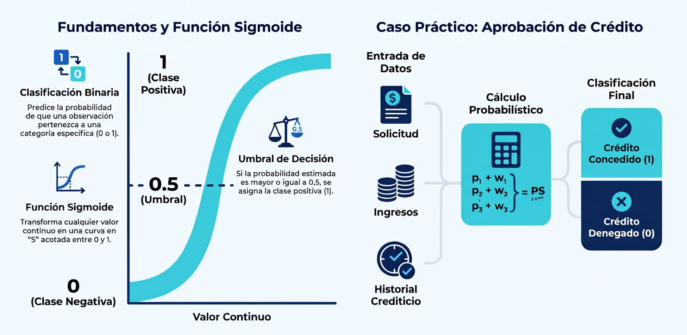

## **Regresión Logística**



Deseas responder a una pregunta que solo tiene **dos posibles respuestas** (sí/no, éxito/fracaso, aprueba/reprueba): por ejemplo, *«¿Aprobará un estudiante el examen final según las horas que estudió?»* o *«¿Es una transacción bancaria fraudulenta o legítima?»*.

Si intentáramos trazar una línea recta clásica (regresión lineal), tendríamos un grave problema: la recta continuaría creciendo hacia el infinito positivo o descendería hacia valores negativos absurdos, prediciendo "probabilidades" imposibles como $150\%$ o $-30\%$.

La **regresión logística** resuelve esto curvando la recta mediante una función matemática suave en forma de **"S"** (la función sigmoide):
* Transforma cualquier combinación de datos en una **probabilidad estrictamente acotada entre 0 y 1** (es decir, entre 0% y 100%).

* Establece una regla de corte clara (habitualmente el **50%**): si la probabilidad estimada es igual o mayor a 0,5, se clasifica como clase positiva (1: «Aprobado»); si es menor a 0,5, se clasifica como clase negativa (0: «Reprobado»).

En resumen: **es un modelo de clasificación que estima la probabilidad de que ocurra un evento binario basándose en una o más variables observadas**.

La **Regresión Logística** es uno de los algoritmos supervisados fundamentales en estadística y aprendizaje automático para resolver problemas de **clasificación** (especialmente binaria). 

A pesar de conservar el término histórico de «regresión», **no predice un valor numérico continuo**, sino la **probabilidad condicional** de que una observación pertenezca a una clase discreta (habitualmente la clase positiva $y=1$) en función de sus variables explicativas $X$.

### Definición Técnica

En el aprendizaje automático supervisado, la **regresión logística** es un modelo paramétrico discriminativo que modela directamente la distribución de probabilidad a posteriori de una variable categórica binaria $y \in \{0, 1\}$ condicionada a un vector de características continuas o discretas $x \in \mathbb{R}^p$:

```math 
P(y = 1 \mid x)
```

A pesar de conservar la palabra «regresión» en su nombre histórico, es un algoritmo de **clasificación supervisada**, ya que su propósito final es particionar el espacio vectorial mediante un **hiperplano de decisión lineal**.


### El Fundamento Matemático
**Del Hiperplano Lineal a la Probabilidad**

En la regresión lineal ordinaria, la combinación lineal de los datos $z = w_0 + w_1 x_1 + \dots + w_p x_p = w^T x$ genera salidas no acotadas en la recta real $(-\infty, +\infty)$. Si intentáramos usar una recta para clasificar probabilidades, obtendríamos valores absurdos (negativos o mayores a 1).


Para resolver esto, la regresión logística modela linealmente el **logaritmo de la razón de momios (*log-odds* o función logit)**.

Para comprender cómo se conecta una combinación lineal con una probabilidad, el modelo se construye en tres etapas:

#### A. La Razón de Momios (*Odds Ratio*)
Si $p = P(y = 1 \mid x)$ representa la probabilidad de que ocurra el evento positivo, la razón de momios (*odds*) mide cuántas veces es más probable el éxito frente al fracaso:

```math
\text{Odds} = \frac{p}{1 - p}
```

*   **Componentes:**
    *   $p$: Probabilidad del evento de interés, con $p \in (0, 1)$.
    *   $1 - p$: Probabilidad del evento complementario (fracaso).
    *   *Comportamiento:* Si la probabilidad de aprobar es $0,8$ (80%), los momios son $\frac{0,8}{0,2} = 4$ (es decir, una relación 4 a 1 a favor). Los momios están acotados inferiormente por $0$ y crecen hacia $+\infty$.

#### B. La Función Logit (Logaritmo de los Momios)
Para permitir que el modelo tome valores en toda la recta real $(-\infty, +\infty)$, se aplica el logaritmo natural a los momios, igualándolo a una combinación lineal de las variables explicativas:

```math 
\text{logit}(p) = \ln\left(\frac{p}{1 - p}\right) = w_0 + w_1 x_1 + \dots + w_p x_p = w^T x
```

*   **Componentes:**
    *   $w_0$: Término de sesgo (*intercept*); fija el valor logit cuando todas las características $x$ son cero.
    *   $w = [w_1, \dots, w_p]^T$: Vector de coeficientes de regresión. Cada $w_j$ representa el cambio en el logit ante un incremento unitario en $x_j$, manteniendo las demás constantes (*ceteris paribus*).
    *   $x = [x_1, \dots, x_p]^T$: Vector de características de la observación.

#### C. La Función Sigmoide (Inversa del Logit)
Para despejar la probabilidad directa $p$ a partir de la combinación lineal $z = w^T x$, se aplica la **función logística estándar o función sigmoide** ($\sigma(z)$) (transformación inversa del logit):

```math
P(y=1 \mid x) = \sigma(z) = \frac{1}{1 + e^{-z}} = \frac{1}{1 + e^{-(w^T x)}}
```
*   **Componentes:**
    *   $z = w^T x$: Puntuación lineal (*logit score*) que puede tomar cualquier valor entre $-\infty$ y $+\infty$.
    *   $e$: Base del logaritmo natural (constante de Euler $\approx 2,71828$).
    *   $\sigma(z)$: Función sigmoide, cuya salida está estrictamente confinada en el intervalo abierto $(0, 1)$.

*   **Propiedades clave de la sigmoide:**
    1.  Mapea asintóticamente cualquier valor real $z \in (-\infty, +\infty)$ al intervalo continuo $(0, 1)$.
    2.  Si $z = 0$, entonces $\sigma(0) = 0.5$.
    3.  Su derivada analítica es elegante y computacionalmente eficiente: 
    ```math
    \frac{d\sigma(z)}{dz} = \sigma(z)(1 - \sigma(z))
    ```

```
         P(y=1|x)
           1.0 ┼                             ╭─────────────
               │                           ╭─╯
           0.8 ┼                         ╭─╯
               │                       ╭─╯
           0.5 ┼ ─ ─ ─ ─ ─ ─ ─ ─ ─ ─ ╭─╯ ─ ─ ─ (Umbral por defecto: z=0)
               │                   ╭─╯
           0.2 ┼                 ╭─╯
               │             ╭───╯
           0.0 ┼ ────────────╯
               └───────┬───────┬───────┬───────┬───────┬────► z = w^T x
                      -6      -4      -2       0       2       4       6
```


### Regla de Decisión 
**Hiperplano Separador**

Una vez calculada la probabilidad $\hat{p} = \sigma(w^T x)$, la predicción discreta ($\hat{y} \in \{0, 1\}$) se determina aplicando un **umbral de discriminación** (por defecto $0.5$):

```math
\hat{y} = \begin{cases} 1 & \text{si } \hat{p} \ge 0.5 \iff w^T x \ge 0 \\ 0 & \text{si } \hat{p} < 0.5 \iff w^T x < 0 \end{cases}
```

*   El conjunto geométrico donde $w^T x = 0$ define el **límite de decisión (*decision boundary*)**, el cual es un hiperplano lineal de dimensión $p-1$ que divide el espacio de características en las dos regiones de clasificación.


### Estimación de Parámetros
**Máxima Verosimilitud y Entropía Cruzada Binaria**

A diferencia de la regresión lineal (donde OLS tiene una solución cerrada mediante la Ecuación Normal), en la regresión logística los parámetros $w$ **no pueden despejarse analíticamente**. Se estiman mediante el principio de **Máxima Verosimilitud (MLE - *Maximum Likelihood Estimation*)**.

Asumiendo que las observaciones son independientes y siguen una distribución de Bernoulli condicional independiente:
```math
L(w) = \prod_{i=1}^N P(y^{(i)} \mid x^{(i)}; w) = \prod_{i=1}^N \left( \hat{p}^{(i)} \right)^{y^{(i)}} \left( 1 - \hat{p}^{(i)} \right)^{1 - y^{(i)}}
```

Para transformar este producto en una suma y facilitar su optimización, tomamos el logaritmo natural negativo, formulando la **función de pérdida de entropía cruzada binaria (*Binary Cross-Entropy* o *Log-Loss*)**:

```math
J(w) = -\frac{1}{N} \ln L(w) = -\frac{1}{N} \sum_{i=1}^N \Big[ y^{(i)} \ln\big(\hat{p}^{(i)}\big) + (1 - y^{(i)}) \ln\big(1 - \hat{p}^{(i)}\big) \Big]
```
*   **Componentes:**
    *   $N$: Número total de observaciones en la muestra.
    *   $y^{(i)} \in \{0, 1\}$: Etiqueta observada real de la clase.
    *   $\hat{p}^{(i)} = \sigma(w^T x^{(i)})$: Probabilidad predicha por el modelo para la observación $i$.
    *   **Mecánica de castigo:**
        *   Si $y^{(i)} = 1$, el segundo término se anula y la pérdida es $-\ln(\hat{p}^{(i)})$. Si el modelo predice $\hat{p} \to 1$, el coste es $0$; si predice $\hat{p} \to 0$, el coste diverge asintóticamente hacia $+\infty$.
        *   Si $y^{(i)} = 0$, el primer término se anula y la pérdida es $-\ln(1 - \hat{p}^{(i)})$. Si predice $\hat{p} \to 1$, el castigo tiende a $+\infty$.

Dado que $J(w)$ es estrictamente **convexa**, algoritmos de optimización iterativa como el **Descenso de Gradiente** o **L-BFGS** convergen al mínimo global sin atascarse en mínimos locales.

#### Interpretación de la función de coste:
*   Si la etiqueta real es $y^{(i)} = 1$, la pérdida se reduce a $-\ln(\hat{p}^{(i)})$. Si el modelo predice $\hat{p} \to 1$, el coste es $0$; pero si predice $\hat{p} \to 0$, el coste tiende asintóticamente a $+\infty$.

*   Si la etiqueta real es $y^{(i)} = 0$, la pérdida se reduce a $-\ln(1 - \hat{p}^{(i)})$. Si el modelo predice $\hat{p} \to 1$, el castigo tiende a $+\infty$.

Esta función $J(w)$ es estrictamente **convexa**, lo que garantiza que algoritmos de optimización numérica (como **Descenso de Gradiente**, Newton-Raphson o L-BFGS) converjan al **mínimo global**.


### Extensión Multiclase
**Softmax Regression (Multinomial)**

Cuando el problema tiene $K > 2$ categorías mutuamente excluyentes, la regresión logística se generaliza mediante la función **Softmax** (también llamada regresión multinomial):

```math
P(y = k \mid x) = \frac{e^{w_k^T x}}{\sum_{j=1}^K e^{w_j^T x}}
```

*   **Argumentos:** $w_k$ es el vector de pesos específico para la clase $k$; la suma en el denominador normaliza las puntuaciones exponenciales para que la suma total de probabilidades a lo largo de todas las clases sea exactamente igual a $1$.


<br/>
#### Ejemplo Python (Scikit-Learn):
<Tabs>
<TabItem value="mnp" label="Antecedentes" default>
<div class="alert alert--primary">
**Regresión logística**

Simula un conjunto de datos (horas de estudio semanal vs. aprobación de un examen), entrena el modelo con `scikit-learn` y grafica la curva sigmoide resultante junto a la frontera de decisión:
```
Coeficiente w1 (Efecto marginal logit): 1.5411
Intersección w0 (Sesgo):               -7.1348
Frontera de decisión (p = 0.5):        4.63 horas de estudio
```


**Interpretación del Gráfico Generado**

El gráfico muestra de manera clara los elementos centrales del modelo:
1. **Puntos Discretos de Muestra:** Los estudiantes observados solo pueden adoptar valores extremos $y \in \{0, 1\}$ (puntos naranja para reprobados y verdes para aprobados).

2. **Curva Sigmoide Continua (Azul):** Modela suavemente la transición de probabilidad entre 0 y 1. Se observa cómo a partir de 3 horas la probabilidad de aprobación comienza a despegar rápidamente.

3. **Frontera de Decisión (Línea discontinua amarilla en 4,63 hrs):** Representa el punto geométrico donde $z = w_0 + w_1 x = 0$, haciendo que $\sigma(0) = 0,5$. Cualquier alumno con más de 4,63 horas semanales de estudio será clasificado con probabilidad favorable de aprobar.

</div>
</TabItem>
<TabItem value="mnp-python" label="🖥️ Código">

```python showLineNumbers

"""
Regresión Logística y Curva Sigmoide.
Visualización del ajuste probabilístico y frontera de decisión.
"""

import numpy as np
import matplotlib.pyplot as plt
from sklearn.linear_model import LogisticRegression

# 1. Simulación de datos pedagógicos (N = 50 estudiantes)
np.random.seed(42)
horas_estudio = np.sort(np.random.uniform(1.0, 10.0, size=50))

# Proceso generador subyacente con función logística
prob_verdadera = 1.0 / (1.0 + np.exp(-(1.2 * horas_estudio - 6.0)))
aprobado = np.random.binomial(n=1, p=prob_verdadera)

# 2. Ajuste del modelo de Regresión Logística
X = horas_estudio.reshape(-1, 1)
clf = LogisticRegression(random_state=42)
clf.fit(X, aprobado)

# 3. Predicción probabilística sobre un rango continuo
horas_rango = np.linspace(0, 11, 300).reshape(-1, 1)
prob_predicha = clf.predict_proba(horas_rango)[:, 1]

# Cálculo analítico de la frontera de decisión (donde z = w0 + w1*x = 0 -> p = 0.5)
w0 = clf.intercept_
w1 = clf.coef_
frontera_decision = -w0 / w1

print(f"Coeficiente w1 (Efecto marginal logit): {w1:.4f}")
print(f"Intersección w0 (Sesgo):               {w0:.4f}")
print(f"Frontera de decisión (p = 0.5):        {frontera_decision:.2f} horas de estudio")

# 4. Generación gráfica (Fondo blanco plano y paleta contrastada)
fig, ax = plt.subplots(figsize=(10, 5.5), facecolor='white')
ax.set_facecolor('white')

# Dispersión de las observaciones reales
ax.scatter(horas_estudio[aprobado == 0], aprobado[aprobado == 0],
           color='#d55e00', s=55, alpha=0.85, label='Reprobado (y = 0)', zorder=4)
ax.scatter(horas_estudio[aprobado == 1], aprobado[aprobado == 1],
           color='#009e73', s=55, alpha=0.85, label='Aprobado (y = 1)', zorder=4)

# Curva logística estimada
ax.plot(horas_rango, prob_predicha, color='#0072b2', linewidth=2.8,
        label=r'Curva Sigmoide $P(y=1|x) = \sigma(w_0 + w_1 x)$', zorder=3)

# Líneas guía de umbral y frontera
ax.axhline(0.5, color='#8a8a8a', linestyle=':', linewidth=1.4)
ax.axvline(frontera_decision, color='#e69f00', linestyle='--', linewidth=1.6,
           label=f'Frontera de Decisión ({frontera_decision:.2f} hrs)')

# Anotaciones explicativas
ax.text(frontera_decision + 0.15, 0.52, f'Umbral p = 0.5\n(Corte en {frontera_decision:.1f} hrs)',
        color='#222222', fontsize=9.5, fontweight='bold')
ax.text(1.2, 0.12, 'Zona de Clasificación: Clase 0', color='#d55e00', fontsize=10, fontweight='bold')
ax.text(7.2, 0.88, 'Zona de Clasificación: Clase 1', color='#009e73', fontsize=10, fontweight='bold')

ax.set_title("La Función Sigmoide Modela la Probabilidad Condicional P(y=1|x)",
             fontsize=13, fontweight='bold', pad=12)
ax.set_xlabel("Horas de Estudio Semanal (Variable Predictora x)", fontsize=11)
ax.set_ylabel(r"Probabilidad Estimada $\hat{p} = P(y=1|x)$", fontsize=11)
ax.set_ylim(-0.08, 1.08)
ax.set_xlim(0, 11)
ax.grid(True, linestyle=':', alpha=0.6)
ax.spines['top'].set_visible(False)
ax.spines['right'].set_visible(False)
ax.legend(frameon=True, facecolor='white', loc='center left', fontsize=9.5)

plt.tight_layout()
plt.show()
```
</TabItem>
</Tabs><br/>


### Implementación

El siguiente código implementa un pipeline de clasificación con estandarización, validación cruzada y cálculo del área bajo la curva ROC (ROC-AUC):

```python
"""
Clasificación con Regresión Logística y Scikit-Learn.
"""

import numpy as np
import pandas as pd
from sklearn.datasets import load_breast_cancer
from sklearn.model_selection import train_test_split, cross_val_score
from sklearn.preprocessing import StandardScaler
from sklearn.pipeline import Pipeline
from sklearn.linear_model import LogisticRegression
from sklearn.metrics import classification_report, confusion_matrix, roc_auc_score

# 1. Carga y partición de datos (Diagnóstico clínico)
data = load_breast_cancer(as_frame=True)
X, y = data.data, data.target

X_train, X_test, y_train, y_test = train_test_split(
    X, y, test_size=0.20, random_state=42, stratify=y
)

# 2. Pipeline con preprocesamiento obligatorio
# La estandarización es crucial para que la regularización L2 aplique parejo
logreg_pipeline = Pipeline([
    ('scaler', StandardScaler()),
    ('clf', LogisticRegression(C=1.0, penalty='l2', solver='lbfgs', max_iter=1000, random_state=42))
])

# 3. Entrenamiento (Optimización por Máxima Verosimilitud)
logreg_pipeline.fit(X_train, y_train)

# 4. Inferencia: Clases directas y probabilidades continuas
y_pred = logreg_pipeline.predict(X_test)
y_prob = logreg_pipeline.predict_proba(X_test)[:, 1] # Probabilidad de clase positiva

# 5. Evaluación de desempeño
cv_scores = cross_val_score(logreg_pipeline, X_train, y_train, cv=5, scoring='accuracy')

print("=== EVALUACIÓN DE REGRESIÓN LOGÍSTICA ===")
print(f"Exactitud media en Validación Cruzada (5-folds): {cv_scores.mean() * 100:.2f}%")
print(f"Área bajo la curva ROC (ROC-AUC en Test):       {roc_auc_score(y_test, y_prob):.4f}")
print("\nMatriz de Confusión (Test Set):")
print(confusion_matrix(y_test, y_pred))
print("\nReporte de Clasificación:")
print(classification_report(y_test, y_pred, target_names=data.target_names))

# 6. Inspección pedagógica de Odds Ratios
# En regresión logística, exp(w) representa el factor de cambio en los momios (Odds Ratio)
coefs = logreg_pipeline.named_steps['clf'].coef_
odds_ratios = np.exp(coefs)

df_interpretacion = pd.DataFrame({
    'Característica': X.columns[:5],
    'Coeficiente (w)': coefs[:5],
    'Odds Ratio (exp(w))': odds_ratios[:5]
})
print("\nInterpretación de Coeficientes (Primeras 5 variables):")
print(df_interpretacion.round(4).to_string(index=False))
```


### Resumen 


1.  **Naturaleza:** Es un algoritmo de **clasificación supervisada** (a pesar de su nombre) que modela probabilidades entre 0 y 1.

2.  **Transformación Logit:** Modela la combinación lineal de entradas como el logaritmo de los momios (*log-odds*): $\ln(p / (1-p)) = w^T x$.

3.  **Función Sigmoide:** Mapea el hiperplano lineal $z \in (-\infty, +\infty)$ al rango probabilístico continuo $(0, 1)$ mediante $\sigma(z) = \frac{1}{1 + e^{-z}}$.

4.  **Optimización:** Minimiza la **entropía cruzada binaria (Log-Loss)** mediante algoritmos iterativos convexos basados en Máxima Verosimilitud (MLE).

5.  **Regularización:** El parámetro **$C$** es el inverso de $\lambda$; valores pequeños de $C$ incrementan la regularización para controlar el sobreajuste.


***
## **Regularización**

La **regularización en la regresión logística** es una técnica matemática que consiste en añadir un término de penalización a la función de pérdida del modelo para restringir la magnitud de los coeficientes de ponderación. Su objetivo principal es controlar la complejidad del clasificador, mitigar el sobreajuste (*overfitting*), manejar la multicolinealidad y resolver la inestabilidad numérica que ocurre cuando existen variables redundantes o las clases son linealmente separables.

A diferencia de la regresión lineal —donde la penalización se suma a la suma de errores cuadráticos (MSE/RSS)—, en la regresión logística la regularización se añade directamente a la **entropía cruzada binaria (*Binary Cross-Entropy* o *Log-Loss*)**.


### Formulación matemática

La función de pérdida no regularizada de la regresión logística (log-loss) sobre un conjunto de entrenamiento de $N$ observaciones se define a partir del logaritmo negativo de la verosimilitud:

```math
J_{\text{base}}(w) = -\frac{1}{N} \sum_{i=1}^{N} \Big[ y^{(i)} \ln\big(\phi(z^{(i)})\big) + (1 - y^{(i)}) \ln\big(1 - \phi(z^{(i)})\big) \Big]
```

Donde:
* $y^{(i)} \in \{0, 1\}$ es la etiqueta real de la clase.
* $\phi(z^{(i)}) = \sigma(w^T x^{(i)}) = \frac{1}{1 + e^{-w^T x^{(i)}}}$ es la probabilidad estimada mediante la función logística sigmoide.
* $w = [w_1, w_2, \dots, w_p]^T$ representa el vector de pesos o coeficientes asociados a las características de entrada.

Al aplicar regularización, la función objetivo a minimizar se formula de dos maneras equivalentes:

#### A. Regularización $L_2$ (Ridge / Weight Decay)
Se penaliza la suma de los cuadrados de los coeficientes (la norma euclidiana $\|w\|_2^2$):

```math
J_{\text{reg}, L_2}(w) = J_{\text{base}}(w) + \frac{\lambda}{2} \sum_{j=1}^{p} w_j^2 = J_{\text{base}}(w) + \frac{\lambda}{2} \|w\|_2^2
```

* **Argumentos:** $\lambda \ge 0$ es el factor de regularización. Contrae de forma suave y uniforme  todos los coeficientes hacia cero, pero **nunca los hace exactamente cero**, asegurando que todas las variables permanezcan en el modelo. Es ideal para manejar multicolinealidad y estabilizar el cálculo numérico. Nótese que el término independiente o sesgo ($w_0$ o *intercept*) **no se penaliza** para no comprometer la posición de corte de la función sigmoide.

#### B. Regularización $L_1$ (Lasso / Sparsity)
Se penaliza la suma de los valores absolutos de los coeficientes (la norma $\|w\|_1$):

```math
J_{\text{reg}, L_1}(w) = J_{\text{base}}(w) + \lambda \sum_{j=1}^{p} |w_j| = J_{\text{base}}(w) + \lambda \|w\|_1
```

* **Argumentos:** Gracias a los vértices no diferenciables de la región de restricción $L_1$ sobre los ejes, muchos coeficientes se fijan en **cero exacto** ($w_j = 0$), realizando una **selección automática de características (sparsity)** que descarta características ruidosas o redundantes.

#### C. Regularización ElasticNet (Híbrido $L_1 + L_2$)
Combina linealmente ambas penalizaciones ponderadas por un factor de mezcla $\rho \in$:

```math
J_{\text{reg}, \text{EN}}(w) = J_{\text{base}}(w) + \lambda \left[ \rho \|w\|_1 + \frac{1 - \rho}{2} \|w\|_2^2 \right]
```

* **Comportamiento**: Permite seleccionar variables en bloque cuando existen grupos de características fuertemente correlacionadas entre sí (grouping effect).

### El Parámetro $C$ frente a $\lambda$

Para evitar el sobreajuste (*overfitting*) cuando las clases son separables o cuando hay alta dimensionalidad, se añaden penalizaciones $L_2$ o $L_1$ a la función de pérdida:

```math
J_{\text{reg}}(w) = J(w) + \frac{\lambda}{2} \|w\|_2^2
```

En librerías de producción como scikit-learn (LogisticRegression), se utiliza por convención la parametrización de las Support Vector Machines (SVM), donde la fuerza de la regularización se controla mediante $C$, el cual es el inverso de $\lambda$:

```math
C = \frac{1}{\lambda}
```

La función objetivo en `scikit-learn` se optimiza típicamente multiplicando la pérdida base por $C$:

```math
\min_{w} \quad C \cdot J_{\text{base}}(w) + R(w)
```

Donde $R(w)$ es la penalización ($\frac{1}{2}\|w\|_2^2$ o $\|w\|_1$).
* **Valores pequeños de $C$ (e.g., $C = 0.01$):** Equivalen a un $\lambda$ grande; imponen una **fuerte regularización**, reduciendo la varianza del modelo al encoger drásticamente los pesos hacia cero para reducir la varianza a costa de mayor sesgo.

* **Valores grandes de $C$ (e.g., $C = 100$):** Imponen una **regularización débil**; el optimizador prioriza clasificar correctamente todos los datos de entrenamiento, aumentando la complejidad y el riesgo de sobreajuste.

* En `scikit-learn`, la regularización por defecto es **$L_2$ con $C=1.0$**.


### El Problema de la Separabilidad Lineal Perfecta

Un motivo esencial por el cual la regresión logística requiere regularización es el fenómeno de **separabilidad perfecta**:
* Si existe un hiperplano que separa limpiamente las clases positivas de las negativas sin ningún error en los datos de entrenamiento, la función sigmoide intentará acercar las probabilidades de acierto a exactamente $1.0$ y $0.0$.

* Dado que $\sigma(z) \to 1$ únicamente cuando $z = w^T x \to +\infty$, el algoritmo de optimización aumentará indefinidamente la magnitud de los pesos ($\|w\| \to \infty$) en cada iteración.

* La inclusión de la penalización $L_2$ o $L_1$ evita que los pesos diverjan hacia el infinito, asegurando que el proceso de optimización numérica converja de manera estable a una solución finita.


### Implementación

<br/>

<Tabs>
<TabItem value="mnp" label="Antecedentes" default>
<div class="alert alert--primary">
**Regularización en Regresión Logística**

El siguiente script en Python utiliza `scikit-learn` para ilustrar cómo influyen las penalizaciones $L_2$ (Ridge) y $L_1$ (Lasso), y cómo el ajuste de $C$ contrae o anula coeficientes sobre un conjunto de clasificación clínica (Breast Cancer):

**Resumen**

1. **Punto de aplicación:** La penalización no se aplica al error cuadrático, sino al **log-loss / entropía cruzada binaria** del modelo logístico.
2. **Rol de $L_2$:** Contrae los pesos de manera suave y homogénea, estabilizando el cálculo numérico y evitando que los coeficientes diverjan ante clases separables.
3. **Rol de $L_1$:** Anula coeficientes de variables redundantes a cero exacto, actuando como selector supervisado de características.
4. **Parámetro $C$:** En `scikit-learn`, $C$ es el inverso de la penalización ($C = 1/\lambda$); valores más pequeños aumentan el sesgo, reducen la varianza y simplifican el modelo.
</div>
</TabItem>
<TabItem value="mnp-python" label="🖥️ Código">

```python showLineNumbers
"""
Regularización en Regresión Logística (L1 vs. L2).
Evaluación de contracción de pesos, dispersión y rendimiento predictivo.
"""

import numpy as np
import pandas as pd
from sklearn.datasets import load_breast_cancer
from sklearn.model_selection import train_test_split
from sklearn.preprocessing import StandardScaler
from sklearn.linear_model import LogisticRegression
from sklearn.metrics import accuracy_score, roc_auc_score

# 1. Carga y partición estratificada de datos
cancer = load_breast_cancer(as_frame=True)
X, y = cancer.data, cancer.target

X_train, X_test, y_train, y_test = train_test_split(
    X, y, test_size=0.25, random_state=42, stratify=y
)

# 2. Preprocesamiento: Estandarización obligatoria
# Como la regularización penaliza la magnitud de los pesos, las variables
# deben estar en una escala uniforme (media 0, varianza unitaria)
scaler = StandardScaler()
X_train_scaled = scaler.fit_transform(X_train)
X_test_scaled = scaler.transform(X_test)

# =====================================================================
# 3. Ajuste de Modelos con Distintos Esquemas de Regularización
# =====================================================================

# A. Sin regularización (C muy alto o penalty=None)
lr_sin_reg = LogisticRegression(penalty=None, solver='lbfgs', max_iter=2000, random_state=42)
lr_sin_reg.fit(X_train_scaled, y_train)

# B. Regularización L2 (Ridge por defecto, C=0.1 -> regularización moderada-fuerte)
lr_l2 = LogisticRegression(penalty='l2', C=0.1, solver='lbfgs', max_iter=2000, random_state=42)
lr_l2.fit(X_train_scaled, y_train)

# C. Regularización L1 (Lasso, requiere solvers como 'liblinear' o 'saga', C=0.1)
lr_l1 = LogisticRegression(penalty='l1', C=0.1, solver='liblinear', max_iter=2000, random_state=42)
lr_l1.fit(X_train_scaled, y_train)

# =====================================================================
# 4. Análisis de Coeficientes y Dispersión (Sparsity)
# =====================================================================
df_coeficientes = pd.DataFrame({
    'Característica': X.columns[:8],
    'Sin Regularizar': lr_sin_reg.coef_[:8],
    'L2 (C=0.1, Ridge)': lr_l2.coef_[:8],
    'L1 (C=0.1, Lasso)': lr_l1.coef_[:8]
})

print("=== MAGNITUD DE COEFICIENTES (PRIMERAS 8 CARACTERÍSTICAS) ===")
print(df_coeficientes.round(4).to_string(index=False))

# Conteo de variables anuladas exactamente a cero
zeros_l2 = np.sum(np.isclose(lr_l2.coef_, 0.0, atol=1e-5))
zeros_l1 = np.sum(np.isclose(lr_l1.coef_, 0.0, atol=1e-5))

print("\n=== RECUENTO DE VARIABLES ANULADAS A CERO (SPARSITY) ===")
print(f"L2 (Ridge): {zeros_l2} variables en 0 de {X.shape}")
print(f"L1 (Lasso): {zeros_l1} variables en 0 de {X.shape} (Selección automática activa)")

# =====================================================================
# 5. Evaluación de Rendimiento en el Conjunto de Prueba
# =====================================================================
def evaluar_modelo(nombre, modelo):
    y_pred = modelo.predict(X_test_scaled)
    y_prob = modelo.predict_proba(X_test_scaled)[:, 1]
    acc = accuracy_score(y_test, y_pred)
    auc = roc_auc_score(y_test, y_prob)
    print(f"{nombre:<22} | Exactitud (Acc): {acc * 100:.2f}% | ROC-AUC: {auc:.4f}")

print("\n=== RENDIMIENTO SOBRE DATOS DE PRUEBA (TEST SET) ===")
evaluar_modelo("Sin Regularizar", lr_sin_reg)
evaluar_modelo("L2 (Ridge, C=0.1)", lr_l2)
evaluar_modelo("L1 (Lasso, C=0.1)", lr_l1)
```
</TabItem>
</Tabs><br/>


