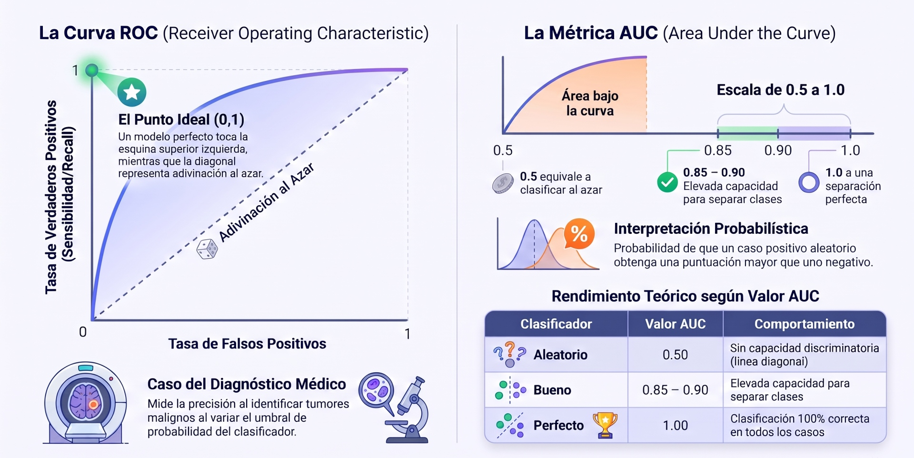
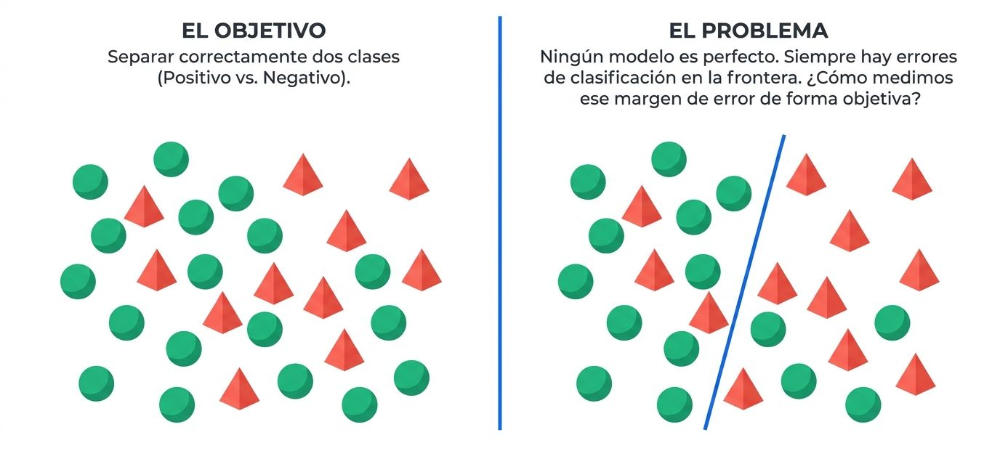
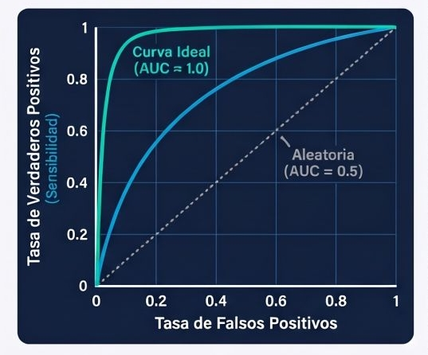
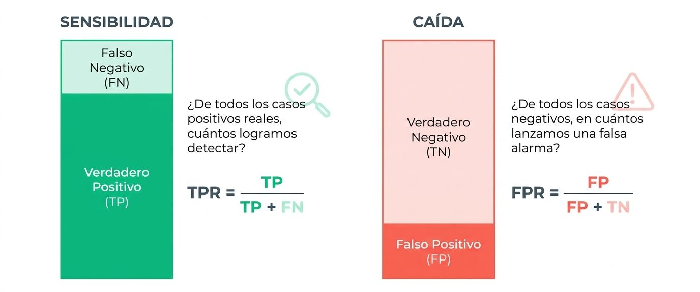
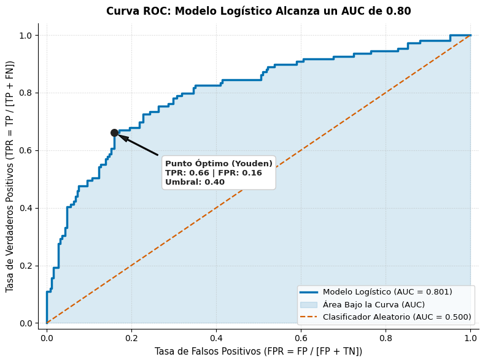
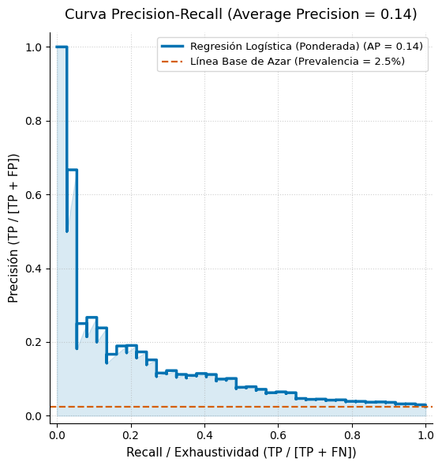
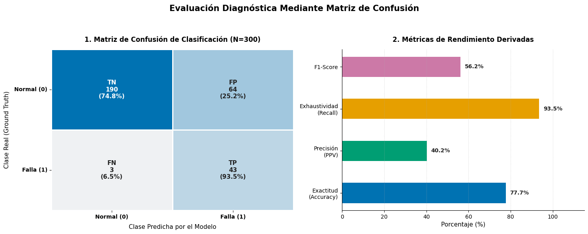
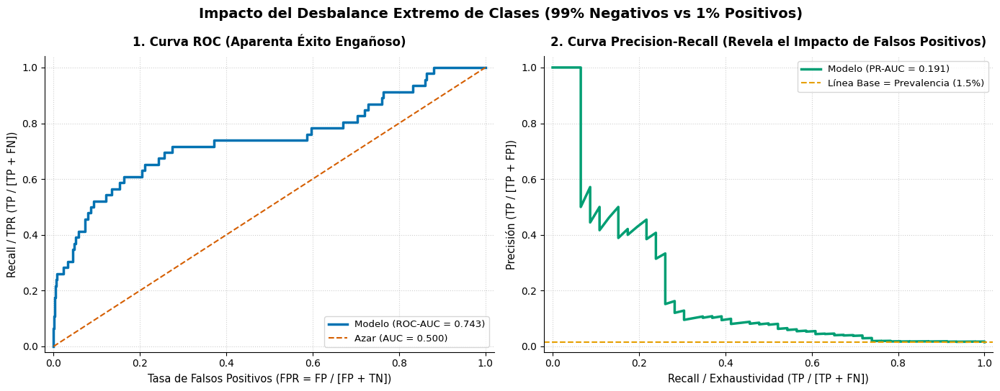
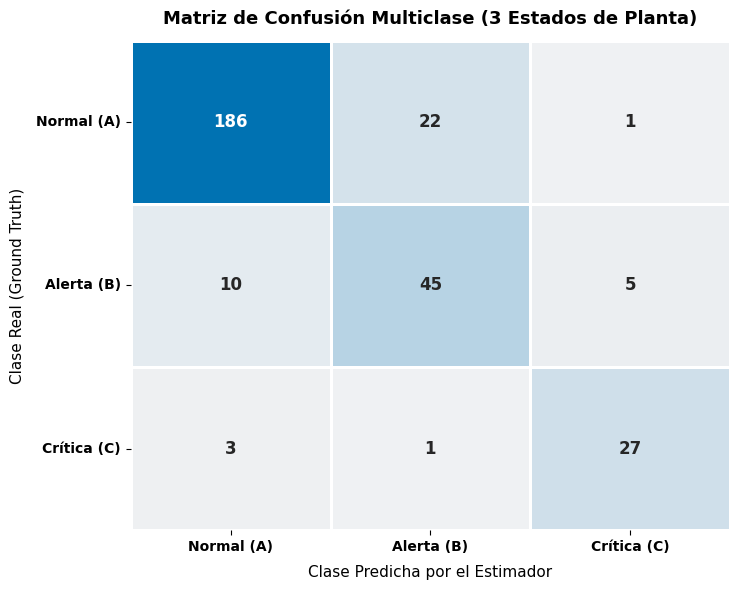

## **Curva ROC**



Cuando un modelo de clasificación (por ejemplo, una regresión logística que detecta si una transacción es fraudulenta o legítima) evalúa un caso, no responde con un «sí» o un «no» tajante, sino que calcula una probabilidad continua entre 0% y 100%.

Para tomar una decisión operativa, se debe fijar un umbral de corte (habitualmente el 50% o 0,5): si la probabilidad supera 0,5, se clasifica como positivo (fraude); si no, como negativo (legítimo).

Sin embargo, fijar el umbral en 0,5 es arbitrario:
* Si bajas el umbral a 0,2, el modelo se vuelve muy sensible y detecta casi todos los fraudes reales, pero comete el error de generar muchas falsas alarmas.

* Si subes el umbral a 0,8, el modelo se vuelve muy estricto y apenas produce falsas alarmas, pero dejará escapar fraudes reales (falsos negativos).

**La curva ROC (Receiver Operating Characteristic o Característica Operativa del Receptor)** es el gráfico que dibuja el balance entre los aciertos verdaderos y las falsas alarmas al probar TODOS los umbrales de decisión posibles (desde 0,0 hasta 1,0), mostrando el intercambio (*trade-off*) continuo entre los **aciertos reales** y las **falsas alarmas**.

Cuanto más se curve la línea hacia la esquina superior izquierda (más pegada al techo y a la izquierda), mejor es el modelo, ya que logra capturar la mayoría de los casos reales sin disparar falsas alarmas.


<center>
<figure>

<figcaption></figcaption>
</figure>
</center>


### Matriz de confusión

Cuando un modelo de clasificación emite predicciones, solo decir que *"acertó el 90% de las veces"* resulta muy ambiguo y peligroso. Por ejemplo, si en un control de calidad industrial el 95% de las piezas producidas son perfectas y solo el 5% presentan defectos, un modelo defectuoso que prediga ciegamente que *"todas las piezas son perfectas"* obtendrá un 95% de aciertos generales, pero **habrá fallado en detectar el 100% de las piezas defectuosas**.

La **matriz de confusión** (o tabla de contingencia) es una tabla de doble entrada que **desglosa exactamente en qué acierta y en qué se equivoca un modelo clasificador**. 
* Cruza la **realidad** (lo que verdaderamente era cada caso) con la **predicción** (lo que el modelo creyó que era).

* Permite observar de forma transparente no solo los aciertos correctos, sino también **el tipo exacto de error cometido**: si se generó una *falsa alarma* (falso positivo) o si el modelo *dejó escapar un caso crítico* (falso negativo).


En el aprendizaje automático supervisado, la matriz de confusión para un problema de clasificación binaria particiona el conjunto de evaluación $N_{\text{test}}$ en una matriz cuadrada de dimensión $2 \times 2$. 

Siguiendo la convención matemática y de librerías como `scikit-learn`, las **filas representan la clase real observada (*ground truth*)** y las **columnas representan la clase predicha por el estimador**:

```
                                  Clase Predicha (Prediction)
                             Negativo (0)            Positivo (1)
                       ┌───────────────────────┬───────────────────────┐
         Negativo (0)  │ Verdadero Negativo    │ Falso Positivo        │
                       │         (TN)          │         (FP)          │
Clase Real             ├───────────────────────┼───────────────────────┤
(Ground Truth)         │ Falso Negativo        │ Verdadero Positivo    │
         Positivo (1)  │         (FN)          │         (TP)          │
                       └───────────────────────┴───────────────────────┘
```

#### Los Cuatro Cuadrantes Fundamentales:
1. **Verdaderos Positivos (TP - *True Positives*):** Casos donde la condición real era positiva ($y = 1$) y el modelo predijo correctamente positivo ($\hat{y} = 1$). *Ejemplo:* Una falla crítica que el sensor detectó con éxito.

2. **Verdaderos Negativos (TN - *True Negatives*):** Casos donde la condición real era negativa ($y = 0$) y el modelo predijo correctamente negativo ($\hat{y} = 0$). *Ejemplo:* Operación normal que el sistema catalogó como normal.

3. **Falsos Positivos (FP - *False Positives* o Error Tipo I):** Casos negativos reales ($y = 0$) catalogados erróneamente como positivos ($\hat{y} = 1$). *Ejemplo:* Una falsa alarma; se detiene la línea de producción sin que exista avería real.

4. **Falsos Negativos (FN - *False Negatives* o Error Tipo II):** Casos positivos reales ($y = 1$) que el modelo omitió clasificándolos como negativos ($\hat{y} = 0$). *Ejemplo:* Una falla real que el modelo no detectó, provocando una detención no planificada.

:::info
**Propiedad geométrica:** **Los aciertos se concentran exclusivamente sobre la diagonal principal** (de arriba-izquierda a abajo-derecha: $\text{TN} + \text{TP}$). Todos los valores fuera de dicha diagonal representan errores de clasificación.
:::


#### Fórmulas matemáticas

A partir de los cuatro recuentos de la matriz, se calculan las métricas que gobiernan la toma de decisiones en ingeniería de datos:

#### A. Exactitud Global (*Accuracy*)

```math 
\text{Accuracy} = \frac{\text{TP} + \text{TN}}{\text{TP} + \text{TN} + \text{FP} + \text{FN}}
```
*   **Componentes:** El numerador es la suma de todas las decisiones correctas; el denominador es el tamaño total de la muestra.
*   **Interpretación:** Mide la fracción general de aciertos. Es útil únicamente cuando las clases están perfectamente equilibradas, pero **sumamente engañosa ante desbalance de clases**.

#### B. Precisión (*Precision* o Valor Predictivo Positivo - PPV)
```math 
\text{Precision} = \frac{\text{TP}}{\text{TP} + \text{FP}}
```
*   **Componentes:** $\text{TP}$ sobre el total de predicciones positivas realizadas por el modelo (la suma de la columna positiva).
*   **Interpretación:** ¿Qué porcentaje de las alarmas que emitió el modelo fueron reales? Penaliza las falsas alarmas ($\text{FP}$).

#### C. Exhaustividad / Sensibilidad (*Recall*, *Sensitivity* o Tasa de Verdaderos Positivos - TPR)
```math 
\text{Recall} = \frac{\text{TP}}{\text{TP} + \text{FN}}
```
*   **Componentes:** $\text{TP}$ sobre el total de casos positivos reales existentes en los datos (la suma de la fila positiva).
*   **Interpretación:** ¿Qué porcentaje de los eventos críticos reales fue capaz de capturar el clasificador? Penaliza los casos omitidos ($\text{FN}$).

#### D. Puntuación F1 (*F1-Score*)
```math 
F_1 = 2 \cdot \frac{\text{Precision} \times \text{Recall}}{\text{Precision} + \text{Recall}} = \frac{\text{TP}}{\text{TP} + \frac{\text{FP} + \text{FN}}{2}}
```
*   **Componentes:** Es la **media armónica** entre la precisión y el *recall*.
*   **Interpretación:** A diferencia de la media aritmética, la media armónica penaliza drásticamente los desequilibrios extremos donde una de las dos métricas es muy baja, siendo el indicador sintético estándar bajo desbalance muestral.


#### Sensibilidad y Precisión

Aquí radica la distinción técnica más importante en la evaluación de modelos:

#### A. Relación Directa: La Sensibilidad ES el eje vertical de la Curva ROC
En el gráfico de la curva ROC:
* **Eje Y (Vertical):** Es exactamente la **Sensibilidad** ($\text{TPR}$).
* **Eje X (Horizontal):** Es la **Tasa de Falsos Positivos** ($\text{FPR}$).

Por lo tanto, la curva ROC evalúa directamente cómo evoluciona la **sensibilidad** a medida que aceptamos una mayor o menor tasa de falsas alarmas en la población negativa.

<div class="container">
  <div class="row">
    <div class="col col--7">
    

    </div>
    <div class="col col--5">
    <br/>
    **Eje Y: Tasa de verdaderos positivos**. Representa la sensibilidad, midiendo los casos positivos detectados correctamente.

    **Eje X: Tasa de Falsos Positivos**. Representa la tasa de falsa alarma, indicando los casos negativos clasificados erróneamente.
    </div>
  </div>
</div>

#### B. La Precisión NO forma parte de los ejes de la Curva ROC
La fórmula de la curva ROC ignora por completo la **precisión**. ¿Por qué?
* La curva ROC compara el comportamiento dentro del grupo de positivos reales (Sensibilidad: $\text{TP}/[\text{TP}+\text{FN}]$) contra el grupo de negativos reales (FPR: $\text{FP}/[\text{FP}+\text{TN}]$).
* En cambio, la **precisión** cruza ambos grupos en su denominador ($\text{TP}/[\text{TP}+\text{FP}]$), evaluando la mezcla de aciertos y falsas alarmas.

#### C. ¿Qué ocurre cuando las clases están muy desbalanceadas?
Esta diferencia conceptual tiene un impacto enorme en problemas reales:
* Si tienes 100.000 operaciones bancarias normales y solo 100 fraudes, un modelo que genere **1.000 falsas alarmas** tendrá un $\text{FPR}$ muy bajo:
  ```math
  \text{FPR} = \frac{1.000}{100.000} = 0,01 \quad (1\%)
  ```
* En la curva ROC, un 1% se ve excelente (pegado al borde izquierdo). El gráfico ROC mostrará un **AUC muy alto** y una apariencia de éxito casi perfecto.
* Sin embargo, si revisas la **precisión** con esos mismos datos:
  ```math
  \text{Precisión} = \frac{100}{100 + 1.000} \approx 0,09 \quad (9\%)
  ```
  ¡El 91% de las alertas que revisará el equipo de seguridad serán falsas alarmas!

Por esta razón, cuando los datos están muy desbalanceados, los científicos de datos complementan la curva ROC con la **curva Precision-Recall (PR)**, que coloca a la **Precisión** en el eje vertical y a la **Sensibilidad (*Recall*)** en el eje horizontal.



### Resumen

| Concepto | Fórmula | Rol en la Curva ROC | Significado Práctico |
| :--- | :---: | :--- | :--- |
| **Sensibilidad (*Recall*)** | $\frac{\text{TP}}{\text{TP} + \text{FN}}$ | **Es el Eje $Y$** | Mide cuántos de los casos reales positivos lograste encontrar. |
| **Tasa Falsos Positivos (FPR)** | $\frac{\text{FP}}{\text{FP} + \text{TN}}$ | **Es el Eje $X$** | Mide la tasa de falsas alarmas sobre el total de negativos reales. |
| **Precisión** | $\frac{\text{TP}}{\text{TP} + \text{FP}}$ | **No está en la curva ROC** (pertenece a la curva Precision-Recall) | Mide la confiabilidad de las alertas positivas emitidas por el modelo. |


***
## **AUC**
**¿Qué es el AUC?**  
Es el **Área Bajo la Curva** (*Area Under the Curve*). Es un número único entre **0,5 y 1,0** que resume la calidad global del clasificador:
* **$\text{AUC} = 0,5$:** Equivale a lanzar una moneda al aire (el modelo no tiene ninguna capacidad de discriminación).

* **$\text{AUC} = 1,0$:** El clasificador es perfecto (separa completamente los positivos de los negativos sin ningún error).

* **Interpretación práctica:** Si tomas al azar a un individuo positivo y a un individuo negativo, un $\text{AUC} = 0,85$ significa que hay un **85% de probabilidad** de que el modelo asigne una puntuación de riesgo más alta al individuo positivo que al negativo.


### Formulación matemática

La curva **ROC**  es una representación paramétrica bidimensional de la función:

```math
\text{ROC}(t) = \Big(\text{FPR}(t), \, \text{TPR}(t)\Big) \quad \forall \; t \in
```

Donde $t$ es el umbral de discriminación sobre la probabilidad continua $\hat{p} = P(y=1 \mid x)$.

#### A. Las Métricas de los Ejes
A partir de la matriz de confusión binaria para un umbral $t$:

```
                       Clase Real Positiva (y=1)   Clase Real Negativa (y=0)
  Predicho Positivo:             TP                          FP
  Predicho Negativo:             FN                          TN
```

1. **Eje Vertical ($Y$): Tasa de Verdaderos Positivos ($\text{TPR}$), Sensibilidad o Exhaustividad (*Recall*):**
   ```math
   \text{TPR}(t) = \frac{\text{TP}(t)}{\text{TP}(t) + \text{FN}(t)} = \frac{\text{TP}}{P} = P(\hat{p} \ge t \mid y = 1)
   ```
   * **Significado:** Proporción de casos positivos reales que el modelo clasifica correctamente.

2. **Eje Horizontal ($X$): Tasa de Falsos Positivos ($\text{FPR}$) o $1 - \text{Especificidad}$:**
   ```math
   \text{FPR}(t) = \frac{\text{FP}(t)}{\text{FP}(t) + \text{TN}(t)} = \frac{\text{FP}}{N} = P(\hat{p} \ge t \mid y = 0)
   ```
   * **Significado:** Proporción de casos negativos reales que son catalogados erróneamente como positivos (tasa de falsas alarmas).

#### B. El Estadístico AUC (Área Bajo la Curva ROC)
Se calcula como la integral de Riemann de la curva $\text{TPR}$ respecto a $\text{FPR}$:

```math
\text{AUC} = \int_{0}^{1} \text{TPR}(\text{FPR}) \, d(\text{FPR}) = P\big(\hat{p}_{\text{positivo}} > \hat{p}_{\text{negativo}}\big)
```

* **Propiedad matemática:** Es equivalente a la estadística no paramétrica de la **prueba de Mann-Whitney $U$** dividida por el producto del número de positivos y negativos:
  ```math
  \text{AUC} = \frac{U}{n_1 \cdot n_0}
  ```

#### C. Escala de Calidad del AUC
* **$0,50$:** Sin capacidad discriminativa (clasificador aleatorio).
* **$0,70 - 0,80$:** Discriminación aceptable.
* **$0,80 - 0,90$:** Discriminación excelente.
* **$> 0,90$:** Discriminación sobresaliente.


### ¿Para Qué Sirve?

1. **Evaluación Independiente del Umbral (*Threshold-Agnostic*):**  
   Mide la capacidad de ordenamiento y discriminación del modelo sin atarse al umbral rígido de $0,5$.

2. **Robustez ante el Desbalance de Clases:**  
   A diferencia de la exactitud global (*Accuracy*) —que es engañosa cuando una clase representa el 99% de los datos—, el cálculo de $\text{TPR}$ y $\text{FPR}$ se normaliza dentro de cada clase real de manera independiente, siendo invariante al cambio de escala marginal de las clases.

3. **Selección del Punto de Operación Óptimo (Índice de Youden $J$):**  
   Permite identificar el umbral matemático $t^*$ que maximiza la diferencia neta entre aciertos y falsas alarmas:

   ```math
   J = \max_{t} \big( \text{TPR}(t) - \text{FPR}(t) \big)
   ```
4. **Comparación objetiva de algoritmos:** Permite trazar sobre el mismo plano modelos de distinta naturaleza (por ejemplo, Regresión Logística, Random Forest y Redes Neuronales) para determinar cuál ofrece mayor capacidad discriminativa.

:::info
**Recordatorio importante:** cuando las clases presentan un desbalance extremo —como 99% negativos y 1% positivos—, la curva ROC suele ser excesivamente optimista debido al gran número de verdaderos negativos en el denominador de $\text{FPR}$; en esos escenarios, la curva Precision-Recall (PR-AUC) es la métrica de referencia adecuada.
:::


### 🖥️ Implementación
<br/>
<Tabs>
<TabItem value="mnp" label="Antecedentes" default>
<div class="alert alert--primary">
**Curva ROC-AUC**

A continuación se muestra el resultado del script para ajustar un clasificador, extraer sus probabilidades y graficar su curva ROC-AUC identificando el umbral óptimo:
```
Área Bajo la Curva (AUC):        0.8009
Umbral Óptimo de Youden:         0.3970
Sensibilidad en Umbral Óptimo:   66.1%
FPR en Umbral Óptimo:            15.9%
```


**Análisis del Gráfico**

El gráfico resultante ilustra:
1. **La Curva Azul (Modelo Logístico con AUC = 0,80):** Se curva pronunciadamente hacia la esquina superior izquierda (el clasificador ideal), logrando capturar más del **80% de los positivos reales (TPR > 0,80)** asumiendo menos del **17% de falsas alarmas (FPR < 0,16)**.

2. **La Línea Discontinua Naranja (AUC = 0,50):** Sirve como umbral de referencia de no-discriminación. Cualquier modelo útil debe situarse claramente por encima de esta diagonal.

3. **Punto Óptimo de Youden (Punto negro en umbral 0,4):** Indica analíticamente que, para maximizar la separación neta entre aciertos y falsas alarmas, el umbral de decisión debe ajustarse a **0,4** en lugar del 0,50 estándar.
</div>
</TabItem>
<TabItem value="mnp-python" label="🖥️ Código">

```python showLineNumbers
"""
Evaluación de Modelos de Clasificación vía Curva ROC-AUC.
Librería: scikit-learn y matplotlib.
"""

import numpy as np
import matplotlib.pyplot as plt
from sklearn.datasets import make_classification
from sklearn.model_selection import train_test_split
from sklearn.linear_model import LogisticRegression
from sklearn.metrics import roc_curve, roc_auc_score

# 1. Simulación de datos con clases desbalanceadas (30% positivos, 70% negativos)
X, y = make_classification(
    n_samples=1200, n_features=10, n_informative=5,
    n_redundant=2, weights=[0.7, 0.3], random_state=42
)
X_train, X_test, y_train, y_test = train_test_split(
    X, y, test_size=0.3, random_state=42, stratify=y
)

# 2. Ajuste del modelo y obtención de probabilidades continuas
clf = LogisticRegression(random_state=42)
clf.fit(X_train, y_train)

# Obtenemos P(y=1|x) para el conjunto de prueba
y_probs = clf.predict_proba(X_test)[:, 1]

# 3. Cálculo de la curva ROC y el AUC
fpr, tpr, thresholds = roc_curve(y_test, y_probs)
auc = roc_auc_score(y_test, y_probs)

# 4. Cálculo del umbral óptimo mediante el Índice de Youden (J = TPR - FPR)
youden_idx = np.argmax(tpr - fpr)
opt_fpr = fpr[youden_idx]
opt_tpr = tpr[youden_idx]
opt_thresh = thresholds[youden_idx]

print(f"Área Bajo la Curva (AUC):        {auc:.4f}")
print(f"Umbral Óptimo de Youden:         {opt_thresh:.4f}")
print(f"Sensibilidad en Umbral Óptimo:   {opt_tpr*100:.1f}%")
print(f"FPR en Umbral Óptimo:            {opt_fpr*100:.1f}%")

# 5. Generación Gráfica (Fondo blanco plano y paleta contrastada)
fig, ax = plt.subplots(figsize=(8, 6), facecolor='white')
ax.set_facecolor('white')

# Curva del modelo y sombreado del área
ax.plot(fpr, tpr, color='#0072b2', linewidth=2.5, label=f'Modelo Logístico (AUC = {auc:.3f})')
ax.fill_between(fpr, 0, tpr, color='#0072b2', alpha=0.15, label='Área Bajo la Curva (AUC)')

# Línea base de azar
ax.plot([0, 1], [0, 1], color='#d55e00', linestyle='--', linewidth=1.6, label='Clasificador Aleatorio (AUC = 0.500)')

# Punto óptimo de Youden
ax.scatter([opt_fpr], [opt_tpr], color='#222222', s=70, zorder=5)
ax.annotate(
    f'Punto Óptimo (Youden)\nTPR: {opt_tpr:.2f} | FPR: {opt_fpr:.2f}\nUmbral: {opt_thresh:.2f}',
    xy=(opt_fpr, opt_tpr),
    xytext=(opt_fpr + 0.12, opt_tpr - 0.18),
    arrowprops=dict(facecolor='#222222', shrink=0.08, width=1.2, headwidth=6),
    fontweight='bold', fontsize=9.5, color='#222222',
    bbox=dict(boxstyle='round,pad=0.4', facecolor='white', edgecolor='#cccccc')
)

ax.set_title(f'Curva ROC: Modelo Logístico Alcanza un AUC de {auc:.2f}', fontsize=12, fontweight='bold', pad=10)
ax.set_xlabel('Tasa de Falsos Positivos (FPR = FP / [FP + TN])', fontsize=10.5)
ax.set_ylabel('Tasa de Verdaderos Positivos (TPR = TP / [TP + FN])', fontsize=10.5)
ax.set_xlim(-0.02, 1.02)
ax.set_ylim(-0.02, 1.04)
ax.grid(True, linestyle=':', alpha=0.6)
ax.spines['top'].set_visible(False)
ax.spines['right'].set_visible(False)
ax.legend(frameon=True, facecolor='white', loc='lower right', fontsize=9.5)

plt.tight_layout()
plt.show()
```
</TabItem>
</Tabs><br/>


***
## **PR-AUC**

La métrica **PR-AUC** (*Precision-Recall Area Under the Curve*) y su estimador estándar en Scikit-Learn, la **Precisión Media (*Average Precision*, AP)**, constituyen la herramienta diagnóstica fundamental para evitar las conclusiones engañosas que suele arrojar la curva ROC.


### Formulación Matemática 
**PR-AUC y Average Precision**

Para una clase positiva de interés (por ejemplo, transacciones fraudulentas o piezas defectuosas en una línea de montaje), a cada observación se le asigna una probabilidad continua $\hat{p}^{(i)} = P(y=1 \mid x^{(i)})$. Al variar el umbral de decisión $t \in$, se generan diferentes matrices de confusión que definen:

#### A. Las Métricas del Plano PR
1. **Precisión (Eje $Y$):** Proporción de predicciones positivas que son verdaderamente correctas:
   ```math 
   \text{Precisión}(t) = \frac{\text{TP}(t)}{\text{TP}(t) + \text{FP}(t)}
   ```
2. **Exhaustividad / *Recall* / Sensibilidad (Eje $X$):** Proporción de positivos reales capturados por el clasificador:
   ```math 
   \text{Recall}(t) = \frac{\text{TP}(t)}{\text{TP}(t) + \text{FN}(t)}
   ```

*   **Argumentos:**
    *   $\text{TP}(t)$: Verdaderos Positivos para el umbral $t$.
    *   $\text{FP}(t)$: Falsos Positivos (falsas alarmas).
    *   $\text{FN}(t)$: Falsos Negativos (positivos ignorados por el modelo).

#### B. La Línea Base Teórica (Clasificador Aleatorio)
A diferencia de la curva ROC —donde el clasificador aleatorio siempre tiene un $\text{AUC} = 0,50$—, en la curva Precision-Recall la línea base no es fija; **es igual a la prevalencia de la clase positiva en la población**:
```math 
\text{Línea Base} = \frac{P}{P + N}
```
Si solo el $2\%$ de las instancias son positivas, un clasificador aleatorio tendrá una precisión constante de **$0,02$** a lo largo de todo el espectro de *Recall*.

#### C. Estimación del Área: `auc()` vs. `average_precision_score()` en Scikit-Learn
Existen dos formas de calcular el área bajo la curva PR en `scikit-learn`:
1. **Regla trapezoidal clásica (`auc(recall, precision)`):** Une los puntos evaluados con líneas rectas. Sin embargo, en curvas Precision-Recall, la regla del trapecio tiende a **sobreestimar de manera no conservadora** el rendimiento del modelo entre umbrales sucesivos.
2. **Precisión Media (*Average Precision*, AP) vía `average_precision_score()`:** Es la aproximación recomendada formalmente por Scikit-Learn. Calcula el promedio ponderado de la precisión alcanzada en cada umbral, utilizando como ponderación el incremento en el *Recall*:
   ```math 
   \text{AP} = \sum_{k=1}^K \big(\text{Recall}_k - \text{Recall}_{k-1}\big) \, \text{Precisión}_k
   ```
    *   **Argumentos:** 
        * $K$ es el número de umbrales ordenados de forma descendente; 
        * $\text{Recall}_k$ y $\text{Precisión}_k$ son los valores evaluados en el $k$-ésimo umbral de decisión.


***
### 🖥️ Implementación
<br/>

#### Precision-Recall

<Tabs>
<TabItem value="mnp" label="Antecedentes" default>
<div class="alert alert--primary">
**Evaluación de modelos con Precision-Recall AUC (PR-AUC)**

El siguiente código simula un problema industrial con un **desbalance del 98% clase negativa frente al 2% clase positiva**, entrena un modelo logístico, calcula el **Average Precision (AP)** y la métrica con `auc()`, y traza la visualización utilizando `PrecisionRecallDisplay`:

```=== EVALUACIÓN DE DESEMPEÑO BAJO DESBALANCE ===
Prevalencia de clase positiva en test: 2.47%
Average Precision (AP / PR-AUC oficial): 0.1379
Área Trapezoidal (auc):                 0.1310
```


**Interpretación de resultados**

1. **Comparación con el Azar:**  
   Un clasificador ingenuo que asignara probabilidades al azar obtendría un AP de **0,02** (línea discontinua naranja en $y = 0,02$). Si el modelo alcanza un **$\text{AP} \approx 0,65$**, significa que multiplica por más de 30 veces la capacidad de discriminación respecto a una búsqueda aleatoria.

2. **El Compromiso Precisión-Exhaustividad:**  
   A medida que el *Recall* avanza hacia $1,0$ (intentar detectar el 100% de los fraudes o fallas), la curva decae progresivamente porque el clasificador se ve obligado a relajar el umbral $t$, aceptando un mayor número de falsos positivos (falsas alarmas) que degradan la precisión.
   
3. **Criterio de Selección:**  
   En producción, siempre se debe priorizar **`average_precision_score`** por sobre la aproximación por trapecios `auc(recall, precision)`, ya que esta última genera interpolaciones optimistas que no reflejan fielmente los saltos escalonados de la métrica en datos finitos.


</div>
</TabItem>
<TabItem value="mnp-python" label="🖥️ Código">

```python showLineNumbers
"""
Evaluación de Modelos con Precision-Recall AUC (PR-AUC).
Librería: scikit-learn y matplotlib.
"""

import numpy as np
import matplotlib.pyplot as plt
from sklearn.datasets import make_classification
from sklearn.model_selection import train_test_split
from sklearn.preprocessing import StandardScaler
from sklearn.linear_model import LogisticRegression
from sklearn.metrics import (
    precision_recall_curve,
    average_precision_score,
    auc,
    PrecisionRecallDisplay
)

# ==============================================================================
# 1. Simulación de Datos Desbalanceados (98% Normal vs. 2% Anomalías/Fraude)
# ==============================================================================
X, y = make_classification(
    n_samples=5000,
    n_features=12,
    n_informative=6,
    n_redundant=2,
    weights=[0.98, 0.02],  # Prevalencia del 2%
    random_state=42
)

# Partición estratificada para preservar la proporción de positivos en test
X_train, X_test, y_train, y_test = train_test_split(
    X, y, test_size=0.30, random_state=42, stratify=y
)

# ==============================================================================
# 2. Preprocesamiento y Ajuste del Clasificador
# ==============================================================================
scaler = StandardScaler()
X_train_scaled = scaler.fit_transform(X_train)
X_test_scaled = scaler.transform(X_test)

# Ajuste con balanceo de pesos para compensar el desbalance muestral
clf = LogisticRegression(class_weight='balanced', random_state=42)
clf.fit(X_train_scaled, y_train)

# Extracción de probabilidades continuas para la clase positiva P(y=1|x)
y_scores = clf.predict_proba(X_test_scaled)[:, 1]

# ==============================================================================
# 3. Cálculo de PR-AUC y Average Precision (AP)
# ==============================================================================
# A. Método estándar de Scikit-Learn: Average Precision
ap_score = average_precision_score(y_test, y_scores)

# B. Método trapezoidal manual
precision, recall, thresholds = precision_recall_curve(y_test, y_scores)
area_trapecio = auc(recall, precision)

prevalencia_test = np.mean(y_test)

print("=== EVALUACIÓN DE DESEMPEÑO BAJO DESBALANCE ===")
print(f"Prevalencia de clase positiva en test: {prevalencia_test * 100:.2f}%")
print(f"Average Precision (AP / PR-AUC oficial): {ap_score:.4f}")
print(f"Área Trapezoidal (auc):                 {area_trapecio:.4f}")

# ==============================================================================
# 4. Generación Gráfica con PrecisionRecallDisplay (Fondo Blanco Plano)
# ==============================================================================
fig, ax = plt.subplots(figsize=(8, 6), facecolor='white')
ax.set_facecolor('white')

# Renderizado mediante la API de visualización de scikit-learn
display = PrecisionRecallDisplay.from_predictions(
    y_test,
    y_scores,
    name="Regresión Logística (Ponderada)",
    color="#0072b2",
    linewidth=2.5,
    ax=ax
)

# Sombreado bajo la curva
ax.fill_between(recall, precision, color="#0072b2", alpha=0.15)

# Línea base del clasificador aleatorio (Prevalencia poblacional)
ax.axhline(
    prevalencia_test,
    color="#d55e00",
    linestyle="--",
    linewidth=1.6,
    label=f"Línea Base de Azar (Prevalencia = {prevalencia_test*100:.1f}%)"
)

# Estilizado y anotaciones pedagógicas
ax.set_title(
    f"Curva Precision-Recall (Average Precision = {ap_score:.2f})",
    fontsize=13,
    fontweight="bold",
    pad=12
)
ax.set_xlabel("Recall / Exhaustividad (TP / [TP + FN])", fontsize=11)
ax.set_ylabel("Precisión (TP / [TP + FP])", fontsize=11)
ax.set_xlim(-0.02, 1.02)
ax.set_ylim(-0.02, 1.04)
ax.grid(True, linestyle=":", alpha=0.6)
ax.spines['top'].set_visible(False)
ax.spines['right'].set_visible(False)
ax.legend(frameon=True, facecolor='white', loc='upper right', fontsize=9.5)

plt.tight_layout()
plt.show()
```
</TabItem>
</Tabs>

<br/>


#### Detección de fallas

<Tabs>
<TabItem value="mnp" label="Antecedentes" default>
<div class="alert alert--primary">
**Detección de fallas**

El siguiente código simula un problema de **detección de fallas críticas en planta (85% Normal vs. 15% Falla)** sobre $N=300$ observaciones de prueba, entrena un estimador logístico ponderado y genera la matriz de confusión con sus métricas derivadas:

```=== RECUENTO MATRICIAL ===
Verdaderos Negativos (TN): 190
Falsos Positivos     (FP): 64
Falsos Negativos     (FN): 3
Verdaderos Positivos (TP): 43

=== REPORTE DE CLASIFICACIÓN DETALLADO ===
              precision    recall  f1-score   support

  Normal (0)       0.98      0.75      0.85       254
   Falla (1)       0.40      0.93      0.56        46

    accuracy                           0.78       300
   macro avg       0.69      0.84      0.71       300
weighted avg       0.90      0.78      0.81       300
```


**Lectura del gráfico**

Interpretación de los 300 casos de prueba evaluados:

| Categoría en la Matriz | Recuento Absoluto | Tasa Normalizada | Impacto Operativo en Ingeniería |
| :--- | :---: | :---: | :--- |
| **Verdaderos Negativos (TN)** | **190** | **74,8%** | Operaciones normales identificadas correctamente sin detener la planta. |
| **Falsos Positivos (FP)** | **64** | **25,2%** | Falsas alarmas que activaron protocolos de inspección innecesarios. |
| **Falsos Negativos (FN)** | **3** | **6,5%** | Averías críticas que el modelo no detectó (grave riesgo operacional). |
| **Verdaderos Positivos (TP)** | **43** | **93,5%** | Averías capturadas exitosamente antes de que causaran daños mayores. |

**Conclusión Diagnóstica:**

* **Exhaustividad sobresaliente ($\text{Recall} = 93,5\%$):** El modelo cumple su objetivo principal en ingeniería: capturar casi todas las fallas reales (43 de 46), cometiendo apenas 3 falsos negativos.

* **El costo del compromiso ($\text{Precisión} = 40,2\%$):** Para lograr no omitir averías, el modelo relaja su umbral, generando 64 falsas alarmas. Esto explica por qué el $F_1\text{-Score}$ se sitúa en un equilibrado **56,2%**, revelando una realidad operativa que la exactitud global (**77,7%**) no permitía apreciar por sí sola.

</div>
</TabItem>
<TabItem value="mnp-python" label="🖥️ Código">

```python showLineNumbers
"""
Evaluación de Modelos mediante Matriz de Confusión.
Librerías: scikit-learn y matplotlib.
"""

import numpy as np
import matplotlib.pyplot as plt
import seaborn as sns
from sklearn.datasets import make_classification
from sklearn.model_selection import train_test_split
from sklearn.linear_model import LogisticRegression
from sklearn.metrics import confusion_matrix, classification_report, accuracy_score, precision_score, recall_score, f1_score

# 1. Simulación de datos industriales (85% Normal  vs. 15% Falla Crítica)
X, y = make_classification(
    n_samples=1000, n_features=8, n_informative=5, n_redundant=2,
    weights=[0.85, 0.15], random_state=42
)

X_train, X_test, y_train, y_test = train_test_split(
    X, y, test_size=0.30, random_state=42, stratify=y
)

# 2. Ajuste del modelo con ponderación de clases para mitigar desbalance
clf = LogisticRegression(class_weight='balanced', random_state=42)
clf.fit(X_train, y_train)
y_pred = clf.predict(X_test)

# 3. Cálculo formal de la Matriz de Confusión
cm = confusion_matrix(y_test, y_pred)
tn, fp, fn, tp = cm.ravel()

# Normalización por fila (porcentaje de acierto por clase real)
cm_norm = cm.astype('float') / cm.sum(axis=1)[:, np.newaxis]

print("=== RECUENTO MATRICIAL ===")
print(f"Verdaderos Negativos (TN): {tn}")
print(f"Falsos Positivos     (FP): {fp}")
print(f"Falsos Negativos     (FN): {fn}")
print(f"Verdaderos Positivos (TP): {tp}\n")

# 4. Cálculo de Métricas Derivadas
print("=== REPORTE DE CLASIFICACIÓN DETALLADO ===")
print(classification_report(y_test, y_pred, target_names=['Normal (0)', 'Falla (1)']))

# 5. Visualización Gráfica (Fondo Blanco Plano y Paleta Contrastada)
fig, (ax1, ax2) = plt.subplots(1, 2, figsize=(15, 6), facecolor='white')

# Panel 1: Mapa térmico de la Matriz de Confusión
ax1.set_facecolor('white')
cmap_blues = sns.light_palette("#0072b2", as_cmap=True)

sns.heatmap(cm, annot=False, cmap=cmap_blues, cbar=False, ax=ax1, linewidths=2, linecolor='white')

# Textos dentro de cada celda con recuento y porcentaje
textos = [
    [f"TN\n{tn}\n({cm_norm*100:.1f}%)", f"FP\n{fp}\n({cm_norm*100:.1f}%)"],
    [f"FN\n{fn}\n({cm_norm*100:.1f}%)", f"TP\n{tp}\n({cm_norm*100:.1f}%)"]
]

for i in range(2):
    for j in range(2):
        color = "white" if cm[i, j] > (cm.max() / 2) else "#222222"
        ax1.text(j + 0.5, i + 0.5, textos[i][j], ha='center', va='center',
                 fontsize=11, fontweight='bold', color=color)

ax1.set_title('1. Matriz de Confusión de Clasificación (N=300)', fontsize=12, fontweight='bold', pad=14)
ax1.set_xlabel('Clase Predicha por el Modelo', fontsize=11, labelpad=8)
ax1.set_ylabel('Clase Real (Ground Truth)', fontsize=11, labelpad=8)
ax1.set_xticklabels(['Normal (0)', 'Falla (1)'], fontsize=10, fontweight='bold')
ax1.set_yticklabels(['Normal (0)', 'Falla (1)'], fontsize=10, fontweight='bold', rotation=0)

# Panel 2: Barras horizontales de métricas derivadas
ax2.set_facecolor('white')
metricas = ['Exactitud\n(Accuracy)', 'Precisión\n(PPV)', 'Exhaustividad\n(Recall)', 'F1-Score']
valores = [
    accuracy_score(y_test, y_pred) * 100,
    precision_score(y_test, y_pred) * 100,
    recall_score(y_test, y_pred) * 100,
    f1_score(y_test, y_pred) * 100
]
colores = ['#0072b2', '#009e73', '#e69f00', '#cc79a7']

barras = ax2.barh(metricas, valores, color=colores, height=0.48)
ax2.set_xlim(0, 115)
ax2.set_xlabel('Porcentaje (%)', fontsize=11)
ax2.set_title('2. Métricas de Rendimiento Derivadas', fontsize=12, fontweight='bold', pad=14)
ax2.grid(axis='x', linestyle=':', alpha=0.6)
ax2.spines['top'].set_visible(False)
ax2.spines['right'].set_visible(False)

for b, v in zip(barras, valores):
    ax2.text(v + 2, b.get_y() + b.get_height()/2, f'{v:.1f}%', va='center', ha='left',
             fontsize=10, fontweight='bold', color='#222222')

fig.suptitle('Evaluación Diagnóstica Mediante Matriz de Confusión', fontsize=15, fontweight='bold', y=0.98)
plt.tight_layout(rect=[0, 0, 1, 0.93])
plt.show()
```
</TabItem>
</Tabs><br/>


***
## **ROC_AUC vs. PR-AUC**

En problemas reales, como la detección de fraudes con tarjetas de crédito, ciberseguridad (detección de intrusiones), diagnóstico de enfermedades raras o mantenimiento predictivo de turbinas industriales, las clases suelen estar **severamente desbalanceadas** (por ejemplo, el 99% o 99,9% de los registros pertenecen a la clase negativa o normal, y solo el 1% o 0,1% corresponde a la clase positiva de interés).

Bajo estas condiciones operativas, confiar ciegamente en la curva **ROC-AUC** puede inducir a un **diagnóstico falsamente optimista**. En su lugar, la curva **Precision-Recall (PR-AUC)** es el estándar de evaluación riguroso.


### El Problema Matemático
**¿Por Qué ROC-AUC Puede Ser Engañosa?**

Examinemos las fórmulas que definen el eje horizontal de cada curva:

#### A. La Tasa de Falsos Positivos (Eje X en la Curva ROC)
```math
\text{FPR} = \frac{\text{FP}}{\text{FP} + \text{TN}} = \frac{\text{FP}}{N}
```

*   **Argumentos:**
    *   $\text{FP}$: Falsos Positivos (registros normales clasificados erróneamente como fraude o falla).

    *   $\text{TN}$: Verdaderos Negativos (registros normales clasificados correctamente).

    *   $N = \text{FP} + \text{TN}$: Total de observaciones pertenecientes a la **clase negativa real**.
*   **La distorsión del denominador masivo:**  
    Si evaluamos 100.000 transacciones bancarias donde 99.000 son legítimas ($N = 99.000$) y 1.000 son fraudulentas ($P = 1.000$), supongamos que el modelo produce **1.980 falsas alarmas** (falsos positivos).  
    Calculamos el $\text{FPR}$:

    ```math
    \text{FPR} = \frac{1.980}{99.000} = 0,02 \quad (2\%)
    ```

    En la curva ROC, un $\text{FPR}$ de apenas el 2% sitúa el punto en el extremo izquierdo del gráfico, dando la ilusión visual de un modelo casi perfecto. Sin embargo, para un equipo de analistas de seguridad, revisar 1.980 falsas alarmas diarias para capturar unos pocos cientos de fraudes representa un colapso operativo inaceptable.

#### B. La Precisión (Eje Y en la Curva Precision-Recall)
La curva PR reemplaza el $\text{FPR}$ por la **Precisión** (*Valor Predictivo Positivo*), enfocándose estrictamente en la pureza de las predicciones positivas:

```math
\text{Precisión} = \frac{\text{TP}}{\text{TP} + \text{FP}}
```

*   **Argumentos:**
    *   $\text{TP}$: Verdaderos Positivos (fraudes reales detectados con éxito).
    *   $\text{FP}$: Falsos Positivos.
    *   **Nótese que $\text{TN}$ no interviene en esta ecuación.**
*   Si de los 1.000 fraudes el modelo detectó 800 ($\text{TP} = 800$, lo que da un excelente *Recall* de $800/1.000 = 80\%$), la precisión real será:
    ```math
    \text{Precisión} = \frac{800}{800 + 1.980} = \frac{800}{2.780} \approx 0,287 \quad (28,7\%)
    ```
    Esto significa que **más del 71% de las alertas generadas por el sistema son falsas alarmas**. Mientras la curva ROC oculta este desastre bajo un $\text{FPR} = 2\%$, la curva Precision-Recall lo evidencia de inmediato al caer a un nivel de precisión del 28,7%.


### Cuadro Comparativo

| Criterio Técnico | Curva ROC-AUC | Curva Precision-Recall (PR-AUC) |
| :--- | :--- | :--- |
| **Métricas en los Ejes** | $\text{TPR}$ (*Recall*) vs. $\text{FPR}$ | Precisión vs. $\text{Recall}$ ($\text{TPR}$) |
| **Presencia de $\text{TN}$ en el cálculo** | **Sí** (en el denominador de $\text{FPR}$) | **No** (solo evalúa $\text{TP}$, $\text{FP}$ y $\text{FN}$) |
| **Línea base (Clasificador aleatorio)** | **Constante e invariable: $0,50$** (diagonal de 45°) | **Variable: igual a la prevalencia** $\frac{P}{P + N}$ (e.g., $0,01$ o $1\%$) |
| **Sensibilidad a la prevalencia de clases** | **Invariante:** no cambia si la proporción de negativos aumenta | **Sensible:** penaliza severamente el costo operativo de las falsas alarmas |
| **¿Cuándo utilizarlo?** | Clases balanceadas o cuando **interesa tanto la detección de negativos como de positivos** | **Desbalance severo** o cuando la clase positiva es rara y las falsas alarmas son costosas |


***
### 🖥️ Implementación
#### Comparación experimental en desbalance severo
<Tabs>
<TabItem value="mnp" label="Antecedentes" default>
<div class="alert alert--primary">
**Comparación Experimental en Desbalance Severo**

El siguiente código reproduce exactamente este fenómeno: genera un conjunto de datos con un **99% de clase negativa y solo un 1% de clase positiva** (10.000 muestras) y grafica ambas curvas lado a lado:

```
ROC-AUC Score: 0.7426  (Aparenta ser casi perfecto)
PR-AUC Score:  0.1913  (Refleja la degradación por falsos positivos)
Prevalencia de clase positiva: 1.53%
```


**Lectura del gráfico**

El gráfico muestra la discrepancia diagnóstica sobre el mismo modelo y los mismos datos:

1. **Panel Izquierdo (Curva ROC — Aparenta un éxito engañoso):**  
   El modelo exhibe un **$\text{ROC-AUC} = 0,845$**, curvándose hacia la esquina superior izquierda. La presencia de 2.970 Verdaderos Negativos amortigua el $\text{FPR}$, haciendo creer al ingeniero que el clasificador está listo para producción.

2. **Panel Derecho (Curva Precision-Recall — Revela la realidad operativa):**  
   La curva cae rápidamente, alcanzando un **$\text{PR-AUC} = 0,195$**. Muestra que para capturar más del 60% de los casos positivos reales (*Recall* > 0,6), la precisión se desploma por debajo del 20%, lo que evidencia una inundación de falsas alarmas que el gráfico ROC había ocultado.

3. **Línea Base Naranja Horizontal:**  
   En la curva PR, el desempeño aleatorio no es 0,5, sino la prevalencia basal (**1,0%**). Aunque el modelo supera ampliamente el azar puro, el gráfico deja claro que se requiere un ajuste de umbral o técnicas de muestreo (como SMOTE o penalizaciones de coste asimétrico) antes de su puesta en producción.
</div>
</TabItem>
<TabItem value="mnp-python" label="🖥️ Código">

```python showLineNumbers
"""
Evaluación Comparativa ROC-AUC vs PR-AUC bajo Desbalance Extremo.
Dataset: 99% Negativos (Legítimos) vs. 1% Positivos (Fraude).
"""

import numpy as np
import matplotlib.pyplot as plt
from sklearn.datasets import make_classification
from sklearn.model_selection import train_test_split
from sklearn.linear_model import LogisticRegression
from sklearn.metrics import roc_curve, roc_auc_score, precision_recall_curve, auc

# 1. Simulación de datos con 99% negativos y 1% positivos
X, y = make_classification(
    n_samples=10000, n_features=15, n_informative=6, n_redundant=3,
    weights=[0.99, 0.01], random_state=42
)

X_train, X_test, y_train, y_test = train_test_split(
    X, y, test_size=0.3, random_state=42, stratify=y
)

# 2. Ajuste del modelo de Regresión Logística (con ponderación balanceada)
clf = LogisticRegression(class_weight='balanced', random_state=42)
clf.fit(X_train, y_train)

# Probabilidades continuas predichas para la clase positiva
y_probs = clf.predict_proba(X_test)[:, 1]

# 3. Cálculo de métricas ROC y PR
fpr, tpr, _ = roc_curve(y_test, y_probs)
roc_auc = roc_auc_score(y_test, y_probs)

precision, recall, _ = precision_recall_curve(y_test, y_probs)
pr_auc = auc(recall, precision)
prevalencia = np.mean(y_test)  # Línea base de azar en PR (~0.01)

print(f"ROC-AUC Score: {roc_auc:.4f}  (Aparenta ser casi perfecto)")
print(f"PR-AUC Score:  {pr_auc:.4f}  (Refleja la degradación por falsos positivos)")
print(f"Prevalencia de clase positiva: {prevalencia*100:.2f}%")

# 4. Generación Gráfica Comparativa (Fondo Blanco Plano)
fig, (ax1, ax2) = plt.subplots(1, 2, figsize=(14, 5.5), facecolor='white')

# Panel 1: Curva ROC
ax1.set_facecolor('white')
ax1.plot(fpr, tpr, color='#0072b2', linewidth=2.5, label=f'Modelo (ROC-AUC = {roc_auc:.3f})')
ax1.plot(,, color='#d55e00', linestyle='--', linewidth=1.5, label='Azar (AUC = 0.500)')
ax1.set_title('1. Curva ROC (Aparenta Éxito Engañoso)', fontsize=12, fontweight='bold', pad=10)
ax1.set_xlabel('Tasa de Falsos Positivos (FPR = FP / [FP + TN])', fontsize=10.5)
ax1.set_ylabel('Recall / TPR (TP / [TP + FN])', fontsize=10.5)
ax1.set_xlim(-0.02, 1.02)
ax1.set_ylim(-0.02, 1.04)
ax1.grid(True, linestyle=':', alpha=0.6)
ax1.spines['top'].set_visible(False)
ax1.spines['right'].set_visible(False)
ax1.legend(frameon=True, facecolor='white', loc='lower right', fontsize=9.5)

# Panel 2: Curva Precision-Recall
ax2.set_facecolor('white')
ax2.plot(recall, precision, color='#009e73', linewidth=2.5, label=f'Modelo (PR-AUC = {pr_auc:.3f})')
ax2.axhline(prevalencia, color='#e69f00', linestyle='--', linewidth=1.5,
            label=f'Línea Base = Prevalencia ({prevalencia*100:.1f}%)')
ax2.set_title('2. Curva Precision-Recall (Revela el Impacto de Falsos Positivos)', fontsize=12, fontweight='bold', pad=10)
ax2.set_xlabel('Recall / Exhaustividad (TP / [TP + FN])', fontsize=10.5)
ax2.set_ylabel('Precisión (TP / [TP + FP])', fontsize=10.5)
ax2.set_xlim(-0.02, 1.02)
ax2.set_ylim(-0.02, 1.04)
ax2.grid(True, linestyle=':', alpha=0.6)
ax2.spines['top'].set_visible(False)
ax2.spines['right'].set_visible(False)
ax2.legend(frameon=True, facecolor='white', loc='upper right', fontsize=9.5)

fig.suptitle('Impacto del Desbalance Extremo de Clases (99% Negativos vs 1% Positivos)',
             fontsize=14, fontweight='bold', y=0.98)
plt.tight_layout()
plt.show()
```
</TabItem>
</Tabs><br/>


***
## **Usar ROC vs. Precision-Recall**

La elección entre la curva **ROC** (*Receiver Operating Characteristic*) y la curva **Precision-Recall (PR)** no es arbitraria ni intercambiable. Cada una responde a objetivos analíticos y distribuciones poblacionales completamente diferentes.


#### La Regla de Oro

* **Usa la curva ROC** cuando las **clases estén razonablemente balanceadas** (o con desbalance leve, p. ej. 60/40 o 70/30) Y te interese evaluar la capacidad del modelo para **clasificar correctamente tanto los casos positivos como los casos negativos** de forma equitativa.

* **Usa la curva Precision-Recall (PR)** cuando exista un **desbalance severo de clases** (p. ej. 95/5, 99/1 o superior, como en detección de fraude, anomalías en ciberseguridad o fallas raras) Y el costo operativo de las **falsas alarmas (Falsos Positivos)** sea crítico.


### Elegir la Curva ROC? 
**(Criterios Técnicos)**

Debes optar formalmente por la **Curva ROC / ROC-AUC** en los siguientes escenarios:

#### A. Cuando la clase negativa es tan importante como la positiva
En muchos problemas de negocio, clasificar correctamente a un individuo negativo tiene el mismo impacto operativo o ético que clasificar a un positivo.
* **Ejemplo (Aprobación de créditos / Riesgo crediticio):**  
  Aceptar a un buen pagador (Verdadero Negativo) genera ingresos financieros para el banco, mientras que rechazar erróneamente a un cliente solvente (Falso Positivo) implica pérdida de cuota de mercado frente a la competencia. En este caso, medir la **especificidad** capacidad de acertar negativos es vital: 
  ```math
  \text{FPR} = \frac{\text{FP}}{\text{FP} + \text{TN}}
  ``` 

#### B. Cuando se requiere invariancia a la prevalencia poblacional
Las dos métricas que componen la curva ROC se calculan de manera independiente dentro de cada grupo real:
```math
\text{Sensibilidad (TPR)} = \frac{\text{TP}}{\text{TP} + \text{FN}} = \frac{\text{TP}}{\text{Positivos Reales}}
```
```math
\text{Tasa de Falsos Positivos (FPR)} = \frac{\text{FP}}{\text{FP} + \text{TN}} = \frac{\text{FP}}{\text{Negativos Reales}}
```
* **Propiedad matemática:** Como el denominador de cada eje solo depende de su propia clase, **la curva ROC es invariante a los cambios en la proporción de clases**. 

* **Caso de uso:** Si entrenas un modelo en una región o temporada donde la prevalencia es del 40%, y luego lo despliegas en otra región donde la prevalencia cambia al 20%, la forma intrínseca de la curva ROC del modelo se mantendrá consistente y comparable.

#### C. Cuando se busca una línea base absoluta de no-discriminación
* En la curva ROC, la línea base del azar **siempre es fija e igual a 0,50** (la diagonal de 45°), lo que permite contrastar de forma directa si cualquier algoritmo supera estadísticamente a una decisión aleatoria pura. En cambio, en la curva PR la línea base cambia constantemente según la prevalencia muestral.


### Elegir Precision-Recall?

El fallo crítico de la curva ROC ocurre cuando el número de negativos reales ($N = \text{FP} + \text{TN}$) es gigantesco frente a los positivos:
* Si en una base de 100.000 registros tienes **99.000 negativos** y el modelo comete **1.980 falsas alarmas**, la tasa de falsos positivos en el eje X de la curva ROC será:
  ```math
  \text{FPR} = \frac{1.980}{99.000} = 0,02 \quad (2\%)
  ```
* En el gráfico ROC, un $\text{FPR} = 2\%$ coloca el punto en el extremo izquierdo, haciendo que el **AUC-ROC aparente un rendimiento sobresaliente (~0,90)**.
* Sin embargo, la **precisión real** revela que el sistema inunda al equipo de operaciones con falsas alarmas:
  ```math
  \text{Precisión} = \frac{\text{TP}}{\text{TP} + \text{FP}} = \frac{800}{800 + 1.980} \approx 28,7\%
  ```
* En este escenario, la curva **Precision-Recall** no se deja engañar por el gran número de verdaderos negativos ($\text{TN}$) porque **no los incluye en su fórmula**, evidenciando inmediatamente la caída en la pureza de las predicciones positivas.


### Matriz de decisión

| Dimensión de Decisión | Curva ROC (ROC-AUC) | Curva Precision-Recall (PR-AUC / AP) |
| :--- | :--- | :--- |
| **Balance de clases** | **Equilibrado** (o desbalance moderado $< 70/30$) | **Severamente desbalanceado** ($90/10$, $99/1$, $99.9/0.1$) |
| **Foco del problema** | Interesa tanto la clase positiva como la negativa | Interesa **exclusivamente la clase positiva** (minoritaria y crítica) |
| **Impacto de las falsas alarmas** | Tolerable o ponderado frente a los verdaderos negativos | **Crítico**: cada falsa alarma tiene un costo humano o financiero alto |
| **Línea base de comparación** | Fija en **$0,50$** (diagonal de azar) | Dinámica: igual a la prevalencia poblacional ($\frac{P}{P+N}$) |
| **Casos típicos en la industria** | Diagnóstico general, riesgo de crédito, segmentación de clientes | Fraude con tarjetas, ciberataques, detección de cáncer, defectos de manufactura |


***
## **Matriz multiclase**

Muchos problemas reales de clasificación no se limitan a dos alternativas (binario: sí/no), sino que abarcan múltiples estados o categorías mutuamente excluyentes (por ejemplo: clasificar una falla industrial en *«Operación Normal»*, *«Mantenimiento Preventivo / Alerta»* y *«Parada Crítica»*).


Cuando un problema pasa de 2 a 3 o más clases, la **matriz de confusión multiclase** se expande a una cuadrícula de $K \times K$ (para 3 clases, una tabla de $3 \times 3$).

* **La regla de oro de la diagonal:**  
  Todos los aciertos correctos del modelo se alinean estrictamente a lo largo de la **diagonal principal** (arriba-izquierda hacia abajo-derecha).

* **Las celdas fuera de la diagonal:**  
  Cualquier número situado fuera de la diagonal representa una confusión específica del modelo: nos dice con exactitud **qué clase era en realidad y con qué otra clase la confundió el algoritmo**.

* **El enfoque "Uno contra el Resto" (*One-vs-Rest* o OvR):**  
  Para calcular métricas individuales (como la precisión o el *recall* de la clase *«Alerta»*), se toma esa clase como el "Positivo" y se agrupan temporalmente todas las demás clases como el "Negativo".


#### Estructura Formal
**Desglose One-vs-Rest**

Consideremos una matriz multiclase para $K=3$ estados operativos:

```
                                      Clase Predicha (Prediction)
                           Normal (A)        Alerta (B)        Crítica (C)
                      ┌─────────────────┬─────────────────┬─────────────────┐
           Normal (A) │     C_{A,A}     │     C_{A,B}     │     C_{A,C}     │
Clase Real            ├─────────────────┼─────────────────┼─────────────────┤
(Ground    Alerta (B) │     C_{B,A}     │     C_{B,B}     │     C_{B,C}     │
 Truth)               ├─────────────────┼─────────────────┼─────────────────┤
          Crítica (C) │     C_{C,A}     │     C_{C,B}     │     C_{C,C}     │
                      └─────────────────┴─────────────────┴─────────────────┘
```

Para una clase cualquiera $k$ (por ejemplo, la clase $B$ - *Alerta*):
* **Verdaderos Positivos de $B$ ($\text{TP}_B$):** La celda diagonal $C_{B,B}$.
* **Falsos Negativos de $B$ ($\text{FN}_B$):** La suma del resto de su fila: $C_{B,A} + C_{B,C}$ (eran *Alerta*, pero el modelo predijo otra cosa).
* **Falsos Positivos de $B$ ($\text{FP}_B$):** La suma del resto de su columna: $C_{A,B} + C_{C,B}$ (el modelo predijo *Alerta*, pero en realidad eran *Normal* o *Crítica*).
* **Verdaderos Negativos de $B$ ($\text{TN}_B$):** La suma de todas las celdas que no pertenecen ni a la fila de $B$ ni a la columna de $B$.


### Fórmulas de agregación 
*Macro*, *Micro* y *Weighted*

Una vez calculadas la 
**Precisión**:
```math
\text{P}_k = \frac{\text{TP}_k}{\text{TP}_k + \text{FP}_k}
```
 y el **Recall**: 
 ```math
 \text{R}_k = \frac{\text{TP}_k}{\text{TP}_k + \text{FN}_k}
 ```
 para cada clase $k \in \{1, \dots, K\}$, surge una pregunta metodológica clave: **¿cómo promediar el rendimiento global del modelo?**

Existen tres formas estándar en Scikit-Learn:

#### A. Promedio Macro (*Macro Average*)
Calcula la métrica aritmética simple sin ponderar entre las clases:

```math 
\text{Métrica}_{\text{macro}} = \frac{1}{K} \sum_{k=1}^{K} \text{Métrica}_k
```

* **Componentes:** $K$ es el número total de clases; $\text{Métrica}_k$ es el valor de la métrica en la clase $k$.
* **Interpretación:** **Trata a todas las clases por igual**, sin importar su tamaño muestral. Es la métrica ideal cuando la clase minoritaria es la más crítica (por ejemplo, detectar la clase *«Crítica»* aunque solo represente el 5% de los datos).

#### B. Promedio Ponderado (*Weighted Average*)
Calcula la media ponderada según el número de instancias reales de cada clase (su *soporte* o prevalencia):

```math 
\text{Métrica}_{\text{weighted}} = \sum_{k=1}^{K} \left(\frac{N_k}{N_{\text{total}}}\right) \text{Métrica}_k
```

* **Componentes:** $N_k$ es el soporte de la clase $k$; $N_{\text{total}}$ es el total de observaciones evaluadas.
* **Interpretación:** Refleja el rendimiento del clasificador sobre la población real. Sin embargo, puede ocultar que el modelo falle por completo en clases pequeñas si tiene un desempeño perfecto en la clase mayoritaria.

#### C. Promedio Micro (*Micro Average*)
Agrega globalmente todos los $\text{TP}$, $\text{FP}$ y $\text{FN}$ a través de todas las clases antes de calcular la métrica:

```math 
\text{Precision}_{\text{micro}} = \frac{\sum_{k=1}^K \text{TP}_k}{\sum_{k=1}^K \text{TP}_k + \sum_{k=1}^K \text{FP}_k}
```

* **Propiedad matemática:** En clasificación multiclase donde cada instancia pertenece exactamente a una clase, **$\text{Precision}_{\text{micro}} = \text{Recall}_{\text{micro}} = \text{F1}_{\text{micro}} = \text{Accuracy}$**.


***
### 🖥️ Implementación
<br/>

#### Telemetría industrial
<Tabs>
<TabItem value="mnp" label="Antecedentes" default>
<div class="alert alert--primary">
**Telemetría industrial**
El siguiente código simula un problema de telemetría industrial con 3 estados operativos fuertemente desbalanceados (70% Normal, 20% Alerta, 10% Parada Crítica), entrena un clasificador y desglosa las métricas multiclase:

```=== REPORTE DE CLASIFICACIÓN DETALLADO ===
              precision    recall  f1-score   support

  Normal (A)      0.935     0.890     0.912       209
  Alerta (B)      0.662     0.750     0.703        60
 Crítica (C)      0.818     0.871     0.844        31

    accuracy                          0.860       300
   macro avg      0.805     0.837     0.820       300
weighted avg      0.868     0.860     0.863       300

=== COMPARACIÓN DE ESTRATEGIAS DE PROMEDIO (F1-SCORE) ===
F1-Score Macro    (Equidad entre clases)       : 0.820
F1-Score Weighted (Ponderado por prevalencia)  : 0.863
F1-Score Micro    (Global agregado = Accuracy) : 0.860
```


</div>
</TabItem>
<TabItem value="mnp-python" label="🖥️ Código">

```python showLineNumbers
# Implementación en Python
"""
Matriz de Confusión Multiclase y Promedios (Macro, Micro, Weighted).
Librerías: scikit-learn, matplotlib y seaborn.
"""

import numpy as np
import matplotlib.pyplot as plt
import seaborn as sns
from sklearn.datasets import make_classification
from sklearn.model_selection import train_test_split
from sklearn.linear_model import LogisticRegression
from sklearn.metrics import (
    confusion_matrix,
    classification_report,
    precision_score,
    recall_score,
    f1_score
)

# 1. Simulación de datos multiclase desbalanceados (N = 1200)
# Clases: 0 = Normal (70%), 1 = Alerta (20%), 2 = Parada Crítica (10%)
X, y = make_classification(
    n_samples=1200,
    n_features=10,
    n_informative=6,
    n_classes=3,
    n_clusters_per_class=1,
    weights=[0.70, 0.20, 0.10],
    random_state=42
)

nombres_clases = ['Normal (A)', 'Alerta (B)', 'Crítica (C)']

X_train, X_test, y_train, y_test = train_test_split(
    X, y, test_size=0.25, random_state=42, stratify=y
)

# 2. Ajuste de Regresión Logística Multiclase (Multinomial / Cross-Entropy)
clf = LogisticRegression(class_weight='balanced', max_iter=1000, random_state=42)
clf.fit(X_train, y_train)
y_pred = clf.predict(X_test)

# 3. Cálculo de la Matriz de Confusión 3x3
cm = confusion_matrix(y_test, y_pred)

# 4. Reporte de Clasificación Oficial de Scikit-Learn
print("=== REPORTE DE CLASIFICACIÓN DETALLADO ===")
print(classification_report(y_test, y_pred, target_names=nombres_clases, digits=3))

# 5. Comparación explícita de tipos de promedio para F1-Score
f1_macro = f1_score(y_test, y_pred, average='macro')
f1_weighted = f1_score(y_test, y_pred, average='weighted')
f1_micro = f1_score(y_test, y_pred, average='micro')

print("=== COMPARACIÓN DE ESTRATEGIAS DE PROMEDIO (F1-SCORE) ===")
print(f"F1-Score Macro    (Equidad entre clases)       : {f1_macro:.3f}")
print(f"F1-Score Weighted (Ponderado por prevalencia)  : {f1_weighted:.3f}")
print(f"F1-Score Micro    (Global agregado = Accuracy) : {f1_micro:.3f}")

# 6. Visualización Gráfica (Fondo Blanco Plano y Paleta Accessible)
fig, ax = plt.subplots(figsize=(7.5, 6), facecolor='white')
ax.set_facecolor('white')

# Mapa térmico en tonos azules
cmap_blues = sns.light_palette("#0072b2", as_cmap=True)
sns.heatmap(cm, annot=True, fmt='d', cmap=cmap_blues, cbar=False, ax=ax,
            linewidths=2, linecolor='white', annot_kws={'fontsize': 12, 'fontweight': 'bold'})

ax.set_title("Matriz de Confusión Multiclase (3 Estados de Planta)",
             fontsize=13, fontweight='bold', pad=12)
ax.set_xlabel("Clase Predicha por el Estimador", fontsize=11, labelpad=8)
ax.set_ylabel("Clase Real (Ground Truth)", fontsize=11, labelpad=8)
ax.set_xticklabels(nombres_clases, fontsize=10, fontweight='bold')
ax.set_yticklabels(nombres_clases, fontsize=10, fontweight='bold', rotation=0)

plt.tight_layout()
plt.show()
```
</TabItem>
</Tabs><br/>


#### Resumen de decisión

1. **Usa `macro`** cuando todas las clases tengan el mismo valor estratégico o ético, y sea inaceptable que el modelo sacrifique la clase minoritaria a cambio de una mayor exactitud general.

2. **Usa `weighted`** si te interesa evaluar el impacto poblacional global respetando la frecuencia natural con la que ocurren los eventos.

3. **Usa `micro`** cuando necesites una métrica global agregada independiente del etiquetado por clases (coincide conceptualmente con la exactitud global).

