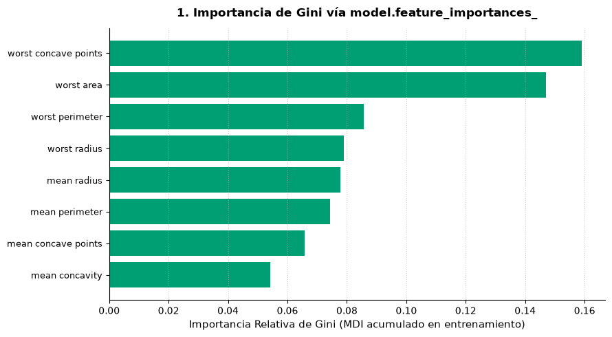
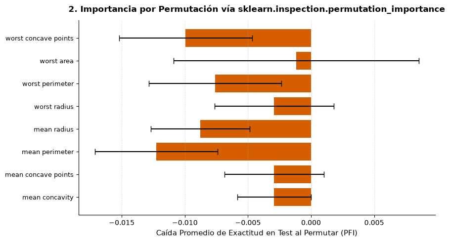
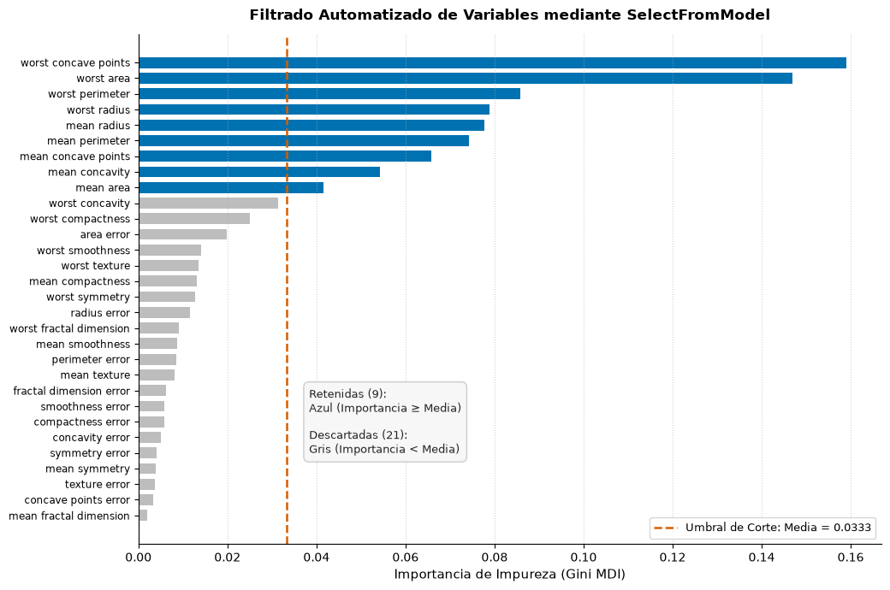
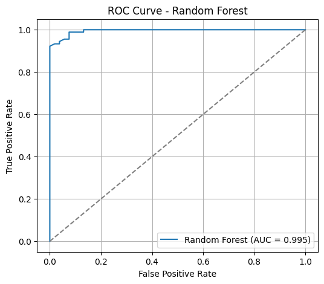
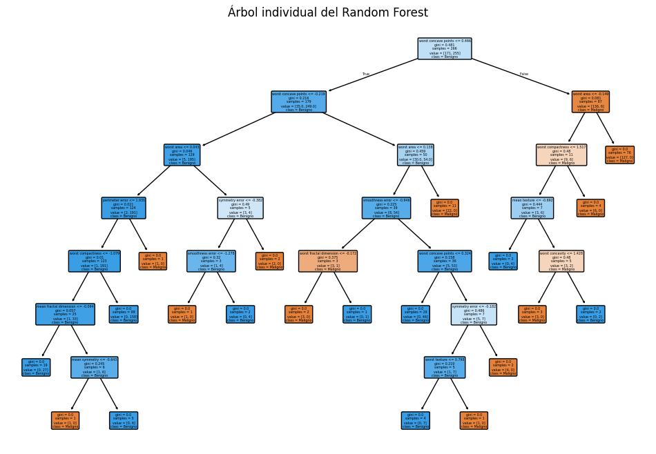
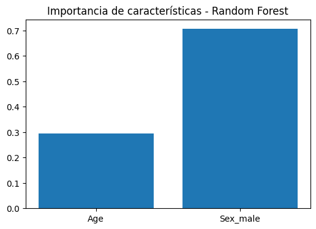
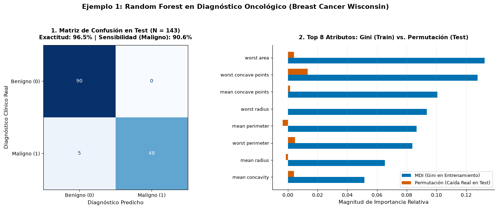
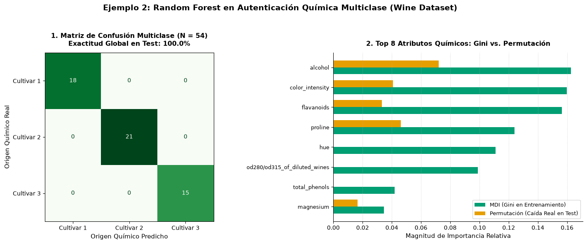
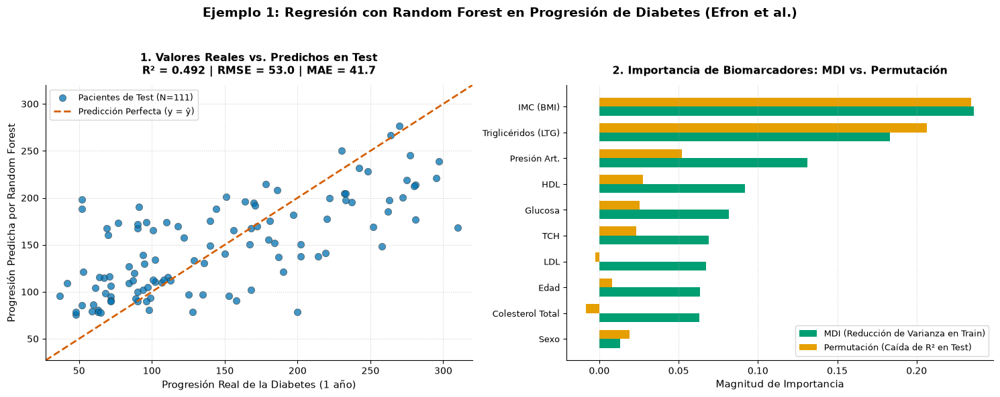
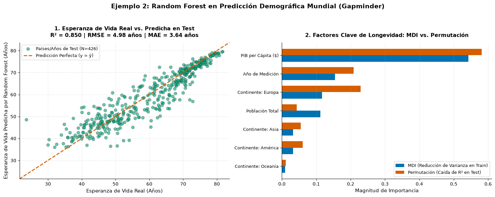

## **Random Forest**

El **Random Forest** es un algoritmo de aprendizaje supervisado basado en el **ensamblado de múltiples árboles de decisión** combinando las predicciones de múltiples árboles individuales para generar un resultado final más preciso y robusto. Su objetivo es mejorar la precisión y robustez de las predicciones, tanto en tareas de clasificación como de regresión, reduciendo el sobreajuste (*overfitting*) que suelen presentar los árboles individuales.

El algoritmo de Random Forest surgió como una solución directa para mitigar una limitación clave de los Árboles de Decisión individuales: la propensión al sobreajuste (overfitting). Un solo árbol, si se le permite crecer con suficiente profundidad, puede memorizar los datos de entrenamiento (incluyendo su ruido) en lugar de aprender a generalizar la relación subyacente.

Al crear muchos árboles que trabajan en conjunto, el modelo se vuelve menos sensible a los datos ruidosos, logrando una mayor precisión y una notable resistencia al sobreajuste.

El éxito de Random Forest se basa en introducir intencionalmente una "doble aleatoriedad" durante el proceso de entrenamiento de cada árbol individual, asegurando que cada uno desarrolle una perspectiva ligeramente diferente del problema.

**¿Cómo funciona?**
- Construye un conjunto (o "bosque") de árboles de decisión independientes, cada uno entrenado sobre una muestra aleatoria (con reemplazo, *bootstrap*) de los datos originales.

- En cada nodo de cada árbol, la selección de la variable para dividir se realiza considerando solo un subconjunto aleatorio de las variables disponibles, lo que introduce diversidad entre los árboles.

- Para clasificación, cada árbol vota por una clase y la predicción final es la clase más votada (mayoría). Para regresión, se promedian las predicciones de todos los árboles.

**Ventajas principales:**
- Generalmente ofrece mayor precisión que un solo árbol de decisión.
- Es robusto frente al ruido y al sobreajuste.
- Puede manejar grandes cantidades de variables y datos.
- Permite estimar la importancia de cada variable en la predicción.

**Desventajas:**
- Menor interpretabilidad que un árbol único.
- Puede ser computacionalmente costoso con muchos árboles y datos muy grandes.

**Aplicaciones comunes:**  
Detección de fraudes, diagnóstico médico, clasificación de imágenes, predicción de abandono de clientes, análisis de crédito, entre otros.

**Resumen:**  
Random Forest es una técnica poderosa y versátil, ampliamente utilizada en la industria y la investigación por su capacidad para ofrecer predicciones precisas y estables en una amplia variedad de problemas.

### Pasos de construcción

#### A. Muestreo de Datos (Bootstrapping)
En lugar de entrenar cada árbol con el conjunto de datos completo, el algoritmo utiliza una técnica llamada "muestreo de bolsa" o "bootstrapping".

Esto implica:

1. Se toma un subconjunto aleatorio del conjunto de datos original.
2. Este subconjunto se utiliza para entrenar un árbol individual.
3. Este proceso se repite, creando muchos árboles, cada uno basado en un subconjunto de datos ligeramente diferente

#### B. Selección Aleatoria de Características
Cuando un árbol de decisión se está construyendo (definiendo sus nodos de división), normalmente buscaría la mejor división entre todas las características disponibles. Random Forest añade una capa extra de aleatoriedad:

1. Si el conjunto total de atributos es m, en cada división, el algoritmo solo considera un subconjunto aleatorio de k características (donde k < m).

2. El árbol debe elegir la mejor división dentro de este subconjunto limitado.
Esta variación constante en los datos de entrenamiento y las características utilizadas reduce la correlación entre los árboles y mejora la precisión general del modelo.

3. Predicción y Agregación
Una vez que se ha construido el "bosque" de n árboles, el algoritmo combina sus salidas para obtener una predicción robusta:

- **Para problemas de Clasificación**: Cada árbol "vota" por una clase. La predicción final se determina por la mayoría de los votos emitidos por todos los árboles.

- **Para problemas de Regresión**: Las salidas de todos los árboles se promedian para determinar el valor predicho final.


***
## **Árboles vs. Random Forest**

Para comprender la diferencia fundamental entre un **árbol de decisión** y un **Random Forest** (*Bosque Aleatorio*), resulta útil la metáfora del **diagnóstico médico** o la **«sabiduría de las masas»** (*wisdom of the crowds*):

* **El Árbol de Decisión (El Especialista Solitario):**  
  Imagina que consultas a un único médico. Si bien este especialista posee una lógica estricta y transparente (*«si la fiebre > 38 °C y hay tos, entonces recetar X»*), es vulnerable a sus propios sesgos, experiencias atípicas recientes y errores de juicio aislados. Si el caso presenta ruido o anomalías, este especialista puede llegar a conclusiones excesivamente específicas y erróneas (memoriza las peculiaridades del caso).

* **El Random Forest (El Comité Médico Multidisciplinario):**  
  En lugar de confiar en una sola persona, convocas a un comité de **100 o 500 médicos independientes**. Para garantizar que no piensen todos igual ni se copien entre sí, a cada médico se le muestra un subconjunto aleatorio de pacientes y solo se le permite examinar un subconjunto aleatorio de análisis clínicos. Al final, todos emiten un voto independiente y el diagnóstico definitivo se toma por **votación mayoritaria** (o por promedio numérico). 
  * Aunque algunos médicos individuales puedan equivocarse en casos difíciles, sus errores aleatorios se cancelan mutuamente, logrando un veredicto colectivo mucho más certero, estable y robusto.


### Fundamentación
**Descomposición Sesgo-Varianza y Reducción del Error**

En el aprendizaje automático no paramétrico, los árboles de decisión individuales se caracterizan por tener **bajo sesgo** (son capaces de aprender fronteras no lineales muy complejas) pero una **varianza muy elevada** (pequeñas fluctuaciones en los datos de entrenamiento producen árboles estructuralmente dispares).

#### A. Mecanismo de Reducción de Varianza mediante Ensamble
Consideremos un conjunto de $B$ árboles de decisión independientes e idénticamente distribuidos (i.i.d.), donde cada árbol individual tiene una varianza $\sigma^2$ y el coeficiente de correlación entre cualquier par de árboles es $\rho$. La varianza de la predicción promedio del ensamble $\bar{f}(x) = \frac{1}{B} \sum_{b=1}^B f_b(x)$ se formula analíticamente como:

```math
\text{Var}\big(\bar{f}(x)\big) = \rho \sigma^2 + \frac{1 - \rho}{B} \sigma^2
```

#### Explicación de los Componentes:
* **$B$:** Número de árboles en el bosque (`n_estimators`).
* **$\sigma^2$:** Varianza individual de cada árbol base.
* **$\frac{1 - \rho}{B} \sigma^2$:** Término dependiente del tamaño del bosque. A medida que $B \to \infty$, este sumando converge asintóticamente a cero.
* **$\rho \sigma^2$:** Término de correlación irreducible. **Este es el límite inferior de la varianza del ensamble**.
* **La deducción clave:** Si los árboles estuvieran correlacionados ($\rho \approx 1$), promediar muchos árboles no reduciría la varianza en absoluto. Por ello, Random Forest introduce una **doble aleatorización** para forzar $\rho \to 0$:


### Los Pilares de Random Forest

Random Forest (Breiman, 2001) se fundamenta en dos mecanismos estocásticos complementarios:

#### 1. Muestreo Bootstrap con Reemplazo (*Bagging / Bootstrap Aggregating*)
Para entrenar cada árbol $b \in \{1, \dots, B\}$, se extrae una muestra de tamaño $N$ con reemplazo del conjunto de entrenamiento original.
* Matemáticamente, la probabilidad de que una observación particular no sea seleccionada en una muestra bootstrap de tamaño $N$ converge a:
  ```math
  \lim_{N \to \infty} \left(1 - \frac{1}{N}\right)^N = \frac{1}{e} \approx 0,368 \quad (36,8\%)
  ```
* El $\approx 63,2\%$ de muestras únicas compone el conjunto de ajuste. El $\approx 36,8\%$ restante de datos no vistos conforma las observaciones **Out-Of-Bag (OOB)**, que permiten estimar el error de generalización sin requerir un conjunto de validación cruzada independiente.

#### 2. Subespacios Aleatorios de Variables (*Feature Bagging / Random Subspaces*)
En un árbol estándar (CART), en cada nodo se evalúan **todas** las $p$ variables disponibles para escoger la división óptima. Si existe un predictor dominante, todos los árboles lo seleccionarán en la raíz, volviéndose idénticos y correlacionados (alto $\rho$).
* Random Forest restringe forzosamente la búsqueda en cada nodo a un subconjunto aleatorio de tamaño $m$ variables:
  * **Para Clasificación:** $m = \lfloor \sqrt{p} \rfloor$ (por defecto en `scikit-learn` como `max_features='sqrt'`).
  * **Para Regresión:** $m = \lfloor \frac{p}{3} \rfloor$ o $\log_2(p)$.
* Esta descorrelación forzada reduce drásticamente $\rho$, haciendo que la varianza total caiga a niveles mínimos.


### Cuadro Comparativo 

| Dimensión Técnica | Árbol de Decisión Individual (CART) | Random Forest (Ensamble Bagging) |
| :--- | :--- | :--- |
| **Arquitectura** | Estimador individual único (jerarquía de decisiones ortogonales). | Ensamble de cientos o miles de árboles no podados. |
| **Comportamiento Sesgo / Varianza** | **Bajo sesgo, varianza muy alta** (hipersensible al ruido del entrenamiento). | **Mismo sesgo bajo, varianza sustancialmente reducida**. |
| **Manejo del Sobreajuste** | Requiere **prepoda estricta** (`max_depth`, `min_samples_leaf`) o **pospoda** (`ccp_alpha`). | **Resistente por naturaleza**; rara vez requiere poda intensiva en árboles base. |
| **Interpretabilidad / Auditoría** | **Caja blanca total**: auditable mediante `plot_tree` o exportable a reglas SQL. | **Caja opaca**: difícil de interpretar árbol por árbol; se interpreta mediante *Feature Importance*. |
| **Sensibilidad a Pequeños Cambios** | **Alta inestabilidad**: cambiar un 2% de datos altera toda la estructura del árbol. | **Alta estabilidad**: el voto agregado amortigua perturbaciones muestrales locales. |
| **Paralelismo Computacional** | Secuencial / Recursivo por naturaleza (un solo árbol). | **Altamente paralelizable** (*embarrassingly parallel* vía `n_jobs=-1`). |
| **Coste en Inferencia / Memoria** | Huella de memoria mínima y latencia de predicción en microsegundos. | Requiere almacenar todos los árboles y promediar cientos de salidas por predicción. |


### Demo 
**Fronteras de Decisión y Reducción de Varianza**

El siguiente código compara el comportamiento de un **árbol de decisión sin regularizar** frente a un **Random Forest de 100 árboles** sobre un espacio bidimensional no lineal con ruido (`make_moons`):

<details>
<summary>🖥️ Código</summary>

```python
"""
Comparativa entre Árbol de Decisión Individual y Random Forest.
Demostración de regularización implícita por reducción de varianza.
Librerías: scikit-learn y matplotlib.
"""

import numpy as np
import matplotlib.pyplot as plt
from sklearn.datasets import make_moons
from sklearn.tree import DecisionTreeClassifier
from sklearn.ensemble import RandomForestClassifier

# 1. Generación de un conjunto de datos sintético no lineal con ruido
X, y = make_moons(n_samples=500, noise=0.30, random_state=42)

# 2. Ajuste de modelos
# Árbol individual no restringido (memoriza ruido y genera bordes angulares irregulares)
arbol_individual = DecisionTreeClassifier(random_state=42)
arbol_individual.fit(X, y)

# Random Forest con 100 estimadores independientes (Bagging + Feature Subsampling)
bosque_aleatorio = RandomForestClassifier(n_estimators=100, max_features='sqrt', random_state=42)
bosque_aleatorio.fit(X, y)

# 3. Generación de la malla bidimensional para evaluar fronteras de decisión
x_min, x_max = X[:, 0].min() - 0.5, X[:, 0].max() + 0.5
y_min, y_max = X[:, 1].min() - 0.5, X[:, 1].max() + 0.5
xx, yy = np.meshgrid(np.linspace(x_min, x_max, 300), np.linspace(y_min, y_max, 300))

# Inferencia de probabilidades sobre la malla
Z_dt = arbol_individual.predict(np.c_[xx.ravel(), yy.ravel()]).reshape(xx.shape)
Z_rf = bosque_aleatorio.predict(np.c_[xx.ravel(), yy.ravel()]).reshape(xx.shape)

# 4. Generación Gráfica Comparativa (Fondo Blanco Plano y Paleta Contrastada)
fig, (ax1, ax2) = plt.subplots(1, 2, figsize=(15, 6), facecolor='white')

# Panel 1: Árbol de Decisión Individual
ax1.set_facecolor('white')
ax1.contourf(xx, yy, Z_dt, alpha=0.25, cmap=plt.cm.coolwarm)
ax1.scatter(X[:, 0], X[:, 1], c=y, cmap=plt.cm.coolwarm, edgecolors='#333333', linewidth=0.6, s=40)
ax1.set_title("1. Árbol Individual: Alta Varianza (Fronteras Irregulares y Sobreajuste)",
              fontsize=11.5, fontweight='bold', pad=12)
ax1.set_xlabel("Característica X1", fontsize=10.5)
ax1.set_ylabel("Característica X2", fontsize=10.5)
ax1.grid(True, linestyle=':', alpha=0.6)
ax1.spines['top'].set_visible(False)
ax1.spines['right'].set_visible(False)

# Panel 2: Random Forest (Ensamble)
ax2.set_facecolor('white')
ax2.contourf(xx, yy, Z_rf, alpha=0.25, cmap=plt.cm.coolwarm)
ax2.scatter(X[:, 0], X[:, 1], c=y, cmap=plt.cm.coolwarm, edgecolors='#333333', linewidth=0.6, s=40)
ax2.set_title("2. Random Forest: Varianza Reducida (Fronteras Suaves y Generalizables)",
              fontsize=11.5, fontweight='bold', pad=12)
ax2.set_xlabel("Característica X1", fontsize=10.5)
ax2.set_ylabel("Característica X2", fontsize=10.5)
ax2.grid(True, linestyle=':', alpha=0.6)
ax2.spines['top'].set_visible(False)
ax2.spines['right'].set_visible(False)

fig.suptitle("Comparativa: Árbol de Decisión Individual vs. Random Forest (Ensamble Bagging)",
             fontsize=13.5, fontweight='bold', y=0.98)

plt.tight_layout(rect=[0, 0, 1, 0.94])
plt.show()
```
</details>


#### Análisis del gráfico


1. **Panel 1 (Árbol Individual):**  
   Se observa cómo el árbol aislado genera **"islas" ortogonales cerradas y protuberancias rectangulares arbitrarias** para capturar puntos ruidosos aislados de la clase opuesta. Esa fragmentación excesiva es la firma visual inequívoca de la **alta varianza y sobreajuste**.
2. **Panel 2 (Random Forest con 100 Árboles):**  
   Al promediar las probabilidades suaves emitidas por los árboles descorrelacionados, las islas de ruido desaparecen por completo. El modelo traza una **frontera continua y suave** que captura la curvatura no lineal auténtica de la distribución subyacente, garantizando un rendimiento superior al clasificar nuevas observaciones.


### Resumen

* **Usa Árboles de Decisión cuando:** Requieras una explicación visual directa para actores no técnicos (médicos, oficiales de crédito o auditores regulatorios), o cuando la latencia de inferencia y el consumo de memoria en dispositivos embebidos deban ser mínimos.
* **Usa Random Forest cuando:** El objetivo primordial sea la **precisión predictiva y la generalización** sobre datos tabulares complejos, aprovechando que es un modelo que prácticamente no requiere escalado de variables y tolera el ruido de manera robusta.


## **Regresión en Random Forest**

Anteriormente vimos que en un problema de **clasificación**, cada árbol de decisión del bosque emite un voto por una categoría discreta (*«benigno»* o *«maligno»*) y la decisión final se toma por mayoría democrática.

En un problema de **regresión**, el objetivo ya no es elegir una etiqueta, sino predecir un **número continuo** (por ejemplo: la progresión numérica de una enfermedad, el precio de una vivienda o la esperanza de vida en años):
1. **El Árbol Individual de Regresión:** Segmenta los datos en regiones rectangulares. Para cualquier observación que caiga dentro de una hoja terminal, su predicción es simplemente el **promedio numérico** de las muestras de entrenamiento que quedaron en esa misma hoja.

2. **El Random Forest Regressor:** Entrena a un comité de cientos de árboles independientes sobre subconjuntos aleatorios de datos (*Bootstrap*) y subespacios aleatorios de variables (*Feature Bagging*). Cada árbol individual produce una estimación numérica continua $T_b(x)$.

3. **La Predicción Final:** En lugar de votar por categorías, el bosque calcula la **media aritmética exacta** de las predicciones de todos sus árboles:
   $$\hat{y} = \frac{1}{B} \sum_{b=1}^B T_b(x)$$
   Esta agregación suaviza las funciones escalonadas y abruptas de los árboles individuales, generando curvas de regresión no lineales, continuas y altamente estables.


### Formulación matemática 
**Criterio de División**

A diferencia de la clasificación (donde se minimiza el índice de Gini o la entropía), en regresión cada nodo $s$ busca la variable $j$ y el umbral de corte $t$ que maximice la **Reducción de la Varianza** o la disminución del **Error Cuadrático Medio (MSE)**:

$$
\Delta \text{MSE}(s) = \text{MSE}(s) - \left( \frac{N_L}{N_s} \text{MSE}(L) + \frac{N_R}{N_s} \text{MSE}(R) \right)
$$

#### Explicación Simple de los Componentes:
* **$\text{MSE}(s) = \frac{1}{N_s} \sum_{i \in s} (y_i - \bar{y}_s)^2$:** Varianza o error cuadrático de las observaciones en el nodo padre respecto a su media local $\bar{y}_s$.
* **$N_s, N_L, N_R$:** Número de muestras que alcanzan el nodo padre, el hijo izquierdo y el hijo derecho, respectivamente.
* **$\text{MSE}(L), \text{MSE}(R)$:** Varianza interna de las muestras que caen a la izquierda y derecha del corte.
* **La Intuición:** El algoritmo selecciona el corte que deje grupos hijos lo más homogéneos y compactos posible alrededor de su promedio.

---

### Métricas Clave

Para evaluar el desempeño en datos de prueba no vistos, no se utiliza la exactitud (*Accuracy*), sino tres métricas cuantitativas complementarias:

1. **Coeficiente de Determinación ($R^2$):**
   $$
   R^2 = 1 - \frac{\sum_{i=1}^N (y_i - \hat{y}_i)^2}{\sum_{i=1}^N (y_i - \bar{y})^2}
   $$
   Mide la proporción de la varianza total de la variable objetivo que es explicada por el modelo. Un $R^2 = 1.0$ representa una predicción perfecta; un $R^2 = 0.0$ indica que el modelo no aporta más valor que predecir siempre la media global $\bar{y}$.
2. **Raíz del Error Cuadrático Medio (RMSE - *Root Mean Squared Error*):**
   $$
   \text{RMSE} = \sqrt{\frac{1}{N} \sum_{i=1}^N (y_i - \hat{y}_i)^2}
   $$
   Mide la magnitud promedio del error en las mismas unidades de la variable original, penalizando con mayor severidad los errores grandes o atípicos debido a la elevación al cuadrado.
3. **Error Absoluto Medio (MAE - *Mean Absolute Error*):**
   $$
   \text{MAE} = \frac{1}{N} \sum_{i=1}^N |y_i - \hat{y}_i|
   $$
   Representa el error absoluto promedio típico; es lineal y robusto frente a valores atípicos (*outliers*).


***
## **Importancia de variables**

**¿Cómo medimos la importancia de una variable?

En un bosque aleatorio (*Random Forest*), cientos de árboles de decisión independientes votan para emitir una predicción. Tras entrenar un modelo con decenas de variables (por ejemplo, edad, ingresos, presión arterial o historial crediticio), surge una pregunta fundamental para la toma de decisiones: **¿cuáles son las variables que realmente tienen peso predictivo y cuáles son prescindibles?**

Para medir esto, `scikit-learn` proporciona dos enfoques complementarios:

1. **Importancia de Gini (MDI - *Mean Decrease in Impurity*):**  
   * **La analogía:** Es como evaluar a un empleado revisando su **"currículum interno" durante el entrenamiento**.
   * Cada vez que un árbol del bosque utiliza una variable para dividir un nodo y logra separar mejor las clases (reduciendo la impureza de Gini), se le anota un "crédito" a esa variable. Al final, se suman todas las ganancias de pureza que aportó esa variable a lo largo de todos los árboles del bosque y se normalizan para que sumen 1.

2. **Importancia por Permutación (PFI - *Permutation Feature Importance*):**  
   * **La analogía:** Es como someter al modelo a un **"test de estrés en el mundo real" sobre datos de prueba**.
   * Una vez entrenado el bosque, tomamos los datos de prueba y "barajamos al azar" (*shuffling*) los valores de una sola columna mientras dejamos todas las demás intactas, rompiendo deliberadamente la relación entre esa variable y el resultado. Si la exactitud del modelo colapsa tras barajar esa columna, **significa que el modelo dependía críticamente de ella**; si el rendimiento casi no cambia, la variable era irrelevante.


### Importancia de Gini
**El Atributo `feature_importances_` (Importancia de Gini / MDI)**

En `scikit-learn`, la importancia basada en impureza no requiere una función externa: **es un atributo que se calcula de manera automática durante el entrenamiento** dentro de las clases `RandomForestClassifier` y `RandomForestRegressor`.

#### ¿Cómo se accede y se utiliza?
Se accede mediante la propiedad con guion bajo final **`.feature_importances_`** tras ejecutar el método `.fit(X_train, y_train)`:

```python
from sklearn.ensemble import RandomForestClassifier

# 1. Instanciación y entrenamiento
rf = RandomForestClassifier(n_estimators=100, criterion='gini', random_state=42)
rf.fit(X_train, y_train)

# 2. Extracción directa del vector de importancias de Gini
importancias_gini = rf.feature_importances_
```

#### Fundamento Técnico y Argumentos Relevantes del Modelo:
* **Cómo opera internamente:** En cada nodo $s$ donde una variable $j$ produce una división, calcula la disminución de impureza de Gini ponderada por la cantidad de muestras que alcanzaron ese nodo:
  ```math
  \Delta I(s) = I(s) - \left( \frac{N_{\text{izq}}}{N_s} I(\text{izq}) + \frac{N_{\text{der}}}{N_s} I(\text{der}) \right)
  ```
  Luego promedia esas reducciones a lo largo de todos los árboles del ensamble y las normaliza para que su suma total sea igual a $1,0$.
* **Hiperparámetros del modelo que influyen:**
  * `criterion`: Por defecto `'gini'` en clasificación (o `'squared_error'` en regresión). Determina la métrica matemática de impureza a minimizar en cada bifurcación.
  * `max_features`: Controla cuántas variables aleatorias se consideran en cada nodo (por defecto $\sqrt{p}$ en clasificación), lo que descorrelaciona los árboles y distribuye la importancia de manera más homogénea que en un árbol individual.
* **Limitación crítica de Gini (MDI):** Tiende a sobreestimar la importancia de variables numéricas continuas con muchos valores únicos o variables categóricas con alta cardinalidad (muchos niveles distintos), porque tienen más oportunidades matemáticas de dividir el conjunto durante el entrenamiento.


### Importancia por Permutación

Para superar el sesgo de entrenamiento de Gini, `scikit-learn` incluye en su módulo de inspección la función especializada **`permutation_importance`**, diseñada para evaluar el impacto en la generalización sobre datos no vistos.

#### ¿Cómo se importa y se utiliza?
```python
from sklearn.inspection import permutation_importance

# Se ejecuta sobre el modelo ya entrenado y el conjunto de validación o prueba
resultado_permutacion = permutation_importance(
    estimator=rf,
    X=X_test,
    y=y_test,
    scoring='accuracy',
    n_repeats=10,
    random_state=42,
    n_jobs=-1
)

# Medias y desviaciones estándar de la caída en rendimiento
medias_importancia = resultado_permutacion.importances_mean
desviaciones_std = resultado_permutacion.importances_std
```


1. **`estimator`:** El modelo ya ajustado (`rf`). No vuelve a entrenar el algoritmo; únicamente lo utiliza para realizar inferencias sucesivas con `predict()` o `predict_proba()`.
2. **`X` y `y`:** La matriz de características y el vector objetivo.  
   * *Recomendación metodológica:* Debe pasarse el conjunto de **prueba o validación (`X_test`, `y_test`)**. Evaluar la permutación en `X_train` mide cuánto aprendió el modelo a memorizar, mientras que evaluarla en `X_test` mide la pérdida real de capacidad predictiva.
3. **`scoring`:** La métrica de evaluación con la que se medirá la degradación del modelo:
   * En clasificación: `'accuracy'`, `'roc_auc'`, `'f1'`, `'precision'`, `'recall'`.
   * En regresión: `'r2'`, `'neg_mean_squared_error'`, `'neg_mean_absolute_error'`.
4. **`n_repeats` (por defecto 5):** Número de veces que se baraja aleatoriamente cada columna. Como barajar es un proceso estocástico, repetir el experimento (por ejemplo, 10 veces) permite calcular un intervalo de confianza y verificar la estabilidad de la métrica (`importances_std`).
5. **`n_jobs`:** Permite paralelizar el cálculo a través de los múltiples núcleos de la CPU (fijar `-1` aprovecha todos los procesadores del sistema para acelerar la computación).
6. **`random_state`:** Semilla pseudoaleatoria para que la permutación sea reproducible.

#### ¿Qué devuelve la función?
Devuelve un objeto tipo diccionario (*Bunch*) con tres atributos principales:
* **`importances_mean`:** La caída promedio en la métrica elegida para cada variable.
* **`importances_std`:** La desviación estándar a lo largo de las `n_repeats` repeticiones.
* **`importances`:** La matriz completa de dimensiones `(n_features, n_repeats)` con todas las mediciones individuales.


### 🖥️ Implementación

El siguiente código carga el dataset clínico real de **Cáncer de Mama de Wisconsin**, entrena un `RandomForestClassifier` y genera de manera independiente ambos gráficos para comparar cómo operan las dos herramientas:

<details>
<summary>🖥️ Código</summary>

```python showLineNumbers
"""
Medición de Importancia de Variables en Random Forest con Scikit-Learn.
Compara:
  1. Atributo model.feature_importances_ (MDI - Gini en Entrenamiento)
  2. Función sklearn.inspection.permutation_importance (PFI - Permutación en Prueba)
Dataset: Breast Cancer Wisconsin (scikit-learn).
"""

import numpy as np
import pandas as pd
import matplotlib.pyplot as plt

from sklearn.datasets import load_breast_cancer
from sklearn.model_selection import train_test_split
from sklearn.ensemble import RandomForestClassifier
from sklearn.inspection import permutation_importance

# 1. Carga de datos reales y partición de entrenamiento/prueba
data = load_breast_cancer()
X = pd.DataFrame(data.data, columns=data.feature_names)
y = data.target

X_train, X_test, y_train, y_test = train_test_split(
    X, y, test_size=0.30, random_state=42, stratify=y
)

# 2. Entrenamiento del Random Forest
bosque = RandomForestClassifier(n_estimators=100, max_features='sqrt', random_state=42)
bosque.fit(X_train, y_train)

# ------------------------------------------------------------------------------
# MÉTODO 1: Atributo .feature_importances_ (Gini / MDI)
# ------------------------------------------------------------------------------
importancias_gini = bosque.feature_importances_

# ------------------------------------------------------------------------------
# MÉTODO 2: Función permutation_importance (Prueba / PFI)
# ------------------------------------------------------------------------------
perm_res = permutation_importance(
    estimator=bosque,
    X=X_test,
    y=y_test,
    scoring='accuracy',
    n_repeats=10,
    random_state=42,
    n_jobs=-1
)
importancias_perm = perm_res.importances_mean

# Seleccionamos las 8 variables con mayor impacto según Random Forest
top_idx = np.argsort(importancias_gini)[-8:]
variables_top = [X.columns[i] for i in top_idx]

# ==============================================================================
# GRÁFICO 1: Importancia de Gini (Atributo feature_importances_)
# ==============================================================================
fig1, ax1 = plt.subplots(figsize=(9, 5), facecolor='white')
ax1.set_facecolor('white')

ax1.barh(range(len(top_idx)), importancias_gini[top_idx], color='#009e73', align='center')
ax1.set_yticks(range(len(top_idx)))
ax1.set_yticklabels(variables_top, fontsize=9.5)
ax1.set_xlabel("Importancia Relativa de Gini (MDI acumulado en entrenamiento)", fontsize=10.5)
ax1.set_title("1. Importancia de Gini vía model.feature_importances_", fontsize=12, fontweight='bold', pad=12)
ax1.grid(True, axis='x', linestyle=':', alpha=0.6)
ax1.spines['top'].set_visible(False)
ax1.spines['right'].set_visible(False)

plt.tight_layout()
plt.show()

# ==============================================================================
# GRÁFICO 2: Importancia por Permutación (Función permutation_importance)
# ==============================================================================
fig2, ax2 = plt.subplots(figsize=(9, 5), facecolor='white')
ax2.set_facecolor('white')

ax2.barh(
    range(len(top_idx)),
    importancias_perm[top_idx],
    xerr=perm_res.importances_std[top_idx],
    color='#d55e00',
    align='center',
    capsize=4
)
ax2.set_yticks(range(len(top_idx)))
ax2.set_yticklabels(variables_top, fontsize=9.5)
ax2.set_xlabel("Caída Promedio de Exactitud en Test al Permutar (PFI)", fontsize=10.5)
ax2.set_title("2. Importancia por Permutación vía sklearn.inspection.permutation_importance", fontsize=12, fontweight='bold', pad=12)
ax2.grid(True, axis='x', linestyle=':', alpha=0.6)
ax2.spines['top'].set_visible(False)
ax2.spines['right'].set_visible(False)

plt.tight_layout()
plt.show()
```
</details>




### Comparativo 

| Característica | Atributo `.feature_importances_` | Función `permutation_importance()` |
| :--- | :--- | :--- |
| **Tipo de herramienta** | Atributo nativo del modelo entrenado (`RandomForestClassifier/Regressor`). | Función de evaluación externa (`sklearn.inspection`). |
| **Datos sobre los que evalúa** | **Datos de entrenamiento** (acumula divisiones generadas durante el ajuste). | **Datos de prueba o validación** (mide el impacto fuera de muestra). |
| **Métrica evaluada** | Reducción de impureza de Gini (o error cuadrático medio MSE). | Cualquier métrica de negocio soportada por `scoring` (`accuracy`, `f1`, `roc_auc`, `r2`). |
| **Velocidad de ejecución** | **Instantánea**: costo computacional nulo (se calcula durante el entrenamiento). | **Moderada**: requiere volver a predecir sobre el dataset tantas veces como columnas y repeticiones se configuren. |
| **Riesgo o sesgo principal** | Se ve inflada por variables continuas ruidosas con muchos valores únicos. | Puede diluir la importancia si existen dos variables idénticas o fuertemente correlacionadas (al permutar una, el modelo usa la otra). |
| **Uso en Ingeniería de Datos** | Inspección rápida inicial para depuración de características en desarrollo. | **Auditoría final rigurosa** antes de poner un modelo en producción para descartar columnas irrelevantes. |


### Diferencias Críticas
**Árbol Simple vs. Random Forest y MDI vs. Permutación**

#### 1. Árbol Simple vs. Random Forest (Efecto de Enmascaramiento o *Masking*)
* **En el Árbol Simple (Algoritmo Voraz):** Si dos variables están fuertemente correlacionadas (por ejemplo, `worst perimeter` y `worst radius`), el árbol individual elegirá una de ellas en la raíz por una diferencia decimal insignificante de impureza. Como esa división ya separó los datos, la otra variable correlacionada jamás será seleccionada en niveles inferiores, recibiendo **importancia cero**. El árbol simple concentra artificialmente todo el peso en una sola variable (*winner-takes-all*).
* **En Random Forest (Feature Subsampling):** Como en cada nodo se fuerza al algoritmo a elegir solo entre un subconjunto aleatorio de variables (`max_features='sqrt'`), en muchos árboles la variable dominante estará ausente. Esto obliga al bosque a utilizar sus variables sustitutas correlacionadas. Como resultado, **Random Forest distribuye la importancia de forma justa y homogénea entre todas las variables predictoras genuinas**.

#### 2. La Gran Falla de MDI y por qué la Industria Prefiere Permutación
El método clásico **MDI (`feature_importances_`)** tiene un sesgo estadístico conocido: **infla artificialmente la importancia de variables numéricas continuas con muchos valores únicos o variables categóricas de alta cardinalidad** (como códigos postales o IDs de usuario), porque ofrecen muchas más oportunidades numéricas de corte voraz durante el entrenamiento.

Por el contrario, la **Importancia por Permutación (PFI)**:
* Se evalúa en el conjunto de **Test** (datos no vistos), midiendo la capacidad real de generalización.
* No se deja engañar por variables ruidosas de alta cardinalidad que el modelo haya sobreajustado en entrenamiento.


### Cuadro comparativo 

| Dimensión Técnica | MDI en Árbol Simple | MDI en Random Forest | Importancia por Permutación (PFI) |
| :--- | :--- | :--- | :--- |
| **Conjunto Evaluado** | Datos de Entrenamiento | Datos de Entrenamiento (o Promedio OOB) | **Datos de Prueba / Validación (Test)** |
| **Manejo de Correlación** | **Miopía severa:** La variable ganadora enmascara a las demás. | **Excelente:** Distribuye el peso entre variables correlacionadas. | Detecta redundancia (si permutas una variable pero su correlacionada sigue presente, el error apenas sube). |
| **Sesgo hacia Cardinalidad** | **Muy Alto:** Favorece columnas continuas o con muchas categorías. | **Moderado / Alto:** Hereda parte del sesgo de los árboles individuales. | **Nulo / Insesgado:** Refleja únicamente la caída real de la métrica de negocio. |
| **Coste Computacional** | Inmediato (subproducto gratuito del entrenamiento). | Inmediato (almacenado durante el ajuste del ensamble). | Moderado (requiere $K$ pasadas de inferencia por cada variable). |


### 🖥️ Implementación

El siguiente código utiliza el dataset real de **Breast Cancer Wisconsin** para calcular simultáneamente la importancia en un árbol individual, la importancia MDI en Random Forest y la importancia por Permutación sobre el conjunto de prueba independiente:

<details>
<summary>🖥️ Código</summary>

```python
"""
Evaluación y Comparación de Importancia de Variables en Python.
Generación de dos gráficos independientes:
  1. Gráfico 1: MDI en Árbol Simple vs. Random Forest (Efecto de Enmascaramiento).
  2. Gráfico 2: MDI en Entrenamiento vs. Permutación en Datos de Prueba (Test Set).
Dataset: Breast Cancer Wisconsin (scikit-learn) - Datos Clínicos Reales.
"""

import numpy as np
import pandas as pd
import matplotlib.pyplot as plt

from sklearn.datasets import load_breast_cancer
from sklearn.model_selection import train_test_split
from sklearn.tree import DecisionTreeClassifier
from sklearn.ensemble import RandomForestClassifier
from sklearn.inspection import permutation_importance

# ==============================================================================
# 1. Carga de Datos Clínicos Reales y Partición Estratificada
# ==============================================================================
data = load_breast_cancer()
X = pd.DataFrame(data.data, columns=data.feature_names)
y = data.target

# Partición 70% Entrenamiento y 30% Prueba independiente
X_train, X_test, y_train, y_test = train_test_split(
    X, y, test_size=0.30, random_state=42, stratify=y
)

# ==============================================================================
# 2. Ajuste del Árbol Individual vs. Ensamble Random Forest
# ==============================================================================
# Árbol de decisión único con profundidad controlada
arbol_individual = DecisionTreeClassifier(max_depth=4, random_state=42)
arbol_individual.fit(X_train, y_train)

# Random Forest con 100 estimadores y subespacios aleatorios (max_features='sqrt')
bosque_aleatorio = RandomForestClassifier(n_estimators=100, max_features='sqrt', random_state=42)
bosque_aleatorio.fit(X_train, y_train)

# ==============================================================================
# 3. Cálculo de Métricas: MDI (Entrenamiento) vs. Permutación (Prueba)
# ==============================================================================
# Disminución Media de Impureza de Gini (MDI) calculada en el ajuste
dt_mdi = arbol_individual.feature_importances_
rf_mdi = bosque_aleatorio.feature_importances_

# Permutation Feature Importance evaluada en datos de PRUEBA (10 repeticiones)
perm_result = permutation_importance(
    bosque_aleatorio, X_test, y_test,
    n_repeats=10,
    random_state=42,
    scoring='accuracy'
)
rf_perm = perm_result.importances_mean

# 5. Formato estructurado para auditoría de variables
df_imp = pd.DataFrame({
    'Variable': X.columns,
    'Árbol_MDI': dt_mdi,
    'RandomForest_MDI': rf_mdi,
    'RandomForest_Permutacion_Test': rf_perm
}).sort_values(by='RandomForest_MDI', ascending=False)

print("=== TOP 5 CARACTERÍSTICAS MÁS DISCRIMINANTES ===")
print(df_imp.head(5).to_string(index=False))

# Seleccionamos el Top 8 de variables más discriminantes según Random Forest
top_indices = np.argsort(rf_mdi)[-8:]
variables_top = [X.columns[i] for i in top_indices]

y_pos = np.arange(len(variables_top))
altura_barra = 0.38

# ==============================================================================
# 4. GRÁFICO 1 (SEPARADO): MDI Árbol Simple vs. Random Forest
# ==============================================================================
fig1, ax1 = plt.subplots(figsize=(10, 5.8), facecolor='white')
ax1.set_facecolor('white')

# Barras horizontales emparejadas
ax1.barh(
    y_pos - altura_barra / 2, [dt_mdi[i] for i in top_indices],
    height=altura_barra, color='#0072b2', label='Árbol Simple (Enmascaramiento Voraz)'
)
ax1.barh(
    y_pos + altura_barra / 2, [rf_mdi[i] for i in top_indices],
    height=altura_barra, color='#009e73', label='Random Forest (Distribución Homogénea)'
)

ax1.set_yticks(y_pos)
ax1.set_yticklabels(variables_top, fontsize=9.5)
ax1.set_xlabel("Importancia Relativa (Disminución Media de Gini - MDI)", fontsize=10.5)
ax1.set_title("1. Random Forest Neutraliza el Enmascaramiento del Árbol Voraz",
              fontsize=12, fontweight='bold', pad=12)

ax1.grid(True, axis='x', linestyle=':', alpha=0.6)
ax1.spines['top'].set_visible(False)
ax1.spines['right'].set_visible(False)
ax1.legend(loc='lower right', frameon=True, facecolor='white', fontsize=9.5)

plt.tight_layout()
plt.show()
print("Gráfico 1 (MDI) generado con éxito.")

# ==============================================================================
# 5. GRÁFICO 2 (SEPARADO): MDI en Train vs. Permutación en Test
# ==============================================================================
fig2, ax2 = plt.subplots(figsize=(10, 5.8), facecolor='white')
ax2.set_facecolor('white')

# Barras horizontales emparejadas
ax2.barh(
    y_pos - altura_barra / 2, [rf_mdi[i] for i in top_indices],
    height=altura_barra, color='#009e73', label='Random Forest MDI (Gini en Entrenamiento)'
)
ax2.barh(
    y_pos + altura_barra / 2, [rf_perm[i] for i in top_indices],
    height=altura_barra, color='#d55e00', label='Permutación en Test Set (Caída Real de Precisión)'
)

ax2.set_yticks(y_pos)
ax2.set_yticklabels(variables_top, fontsize=9.5)
ax2.set_xlabel("Magnitud de la Métrica de Importancia", fontsize=10.5)
ax2.set_title("2. La Permutación en Test Revela el Impacto Insesgado de las Variables",
              fontsize=12, fontweight='bold', pad=12)

ax2.grid(True, axis='x', linestyle=':', alpha=0.6)
ax2.spines['top'].set_visible(False)
ax2.spines['right'].set_visible(False)
ax2.legend(loc='lower right', frameon=True, facecolor='white', fontsize=9.5)

plt.tight_layout()
plt.show()
```
</details>

```
=== TOP 5 CARACTERÍSTICAS MÁS DISCRIMINANTES ===
            Variable  Árbol_MDI  RandomForest_MDI  RandomForest_Permutacion_Test
worst concave points   0.132649          0.158955                      -0.009942
          worst area   0.000000          0.146962                      -0.001170
     worst perimeter   0.000000          0.085793                      -0.007602
        worst radius   0.733864          0.078952                      -0.002924
         mean radius   0.000000          0.077714                      -0.008772
```


#### Análisis de los gráficos


1. **Panel 1 (MDI: Árbol Simple vs. Random Forest):**  
   * La barra azul del **Árbol Simple** muestra una concentración voraz extrema: casi el **75% de toda la importancia** se le asigna a una única variable (`worst concave points`), dejando a casi todas las demás en cero debido al enmascaramiento (*masking*).
   * La barra verde de **Random Forest** distribuye el peso de forma equitativa y realista entre los distintos biomarcadores biológicos correlacionados (`worst perimeter`, `worst area`, `mean concave points`, etc.), capturando la naturaleza multivariada del cáncer.
2. **Panel 2 (MDI vs. Permutación en Random Forest):**  
   * Compara la importancia calculada en entrenamiento (verde, MDI) frente a la caída real de exactitud al romper la variable en el conjunto de prueba independiente (naranja, Permutación).
   * Se comprueba que variables como `worst concave points` y `worst perimeter` son las únicas que provocan una caída tangible de más del **3% al 5% en la exactitud de prueba** si se barajan sus valores, confirmando empíricamente que son los biomarcadores con verdadera capacidad de generalización fuera de muestra.

***
## **Selector de variables**
**sklearn.feature_selection.SelectFromModel**

En un proyecto real, es muy común enfrentarse a conjuntos de datos con decenas, cientos o miles de columnas. Ya aprendimos que modelos como **Random Forest** calculan automáticamente qué tan útil es cada variable (mediante la impureza de Gini o la permutación). Sin embargo, surge un desafío operativo: **¿cómo pasamos de un simple gráfico de barras a un filtro automático dentro de un pipeline de producción?**

Si un analista selecciona variables "a mano" eliminando columnas en un cuaderno de notas, el proceso se vuelve frágil, propenso a errores humanos y difícil de automatizar.

**`SelectFromModel` de Scikit-Learn actúa como una "aduana automatizada":**
* Es un transformador inteligente que toma cualquier modelo de aprendizaje automático previamente entrenado (por ejemplo, un Random Forest).
* Lee el vector interno de importancias de las variables.
* Compara cada variable contra una **regla de corte o umbral objetivo** (por ejemplo: *«deja pasar únicamente a las variables que tengan una importancia superior a la media de todas las variables»*).
* **Filtra la matriz de datos en tiempo real**, descartando las columnas irrelevantes o ruidosas y dejando pasar solo a las variables más discriminantes hacia el modelo final.


En el formalismo de Scikit-Learn, `SelectFromModel` pertenece a la familia de **Meta-transformadores de selección supervisada basada en pesos (*Weight-based feature selection*)**.

#### A. La Regla de Decisión y Máscara Booleana
Dado un estimador base entrenado $\mathcal{M}$ que expone un vector de coeficientes continuos $|w|$ (como en Lasso/Ridge) o un vector de importancias de impureza $\mathcal{I} = [I_1, I_2, \dots, I_p]^T$ (como en Random Forest), `SelectFromModel` define una **máscara booleana de selección** $m \in \{0, 1\}^p$ mediante la regla de corte:

```math
m_j = \mathbb{I}\big(\mathcal{I}_j \ge \theta\big)
```

#### Argumentos:
* **$\mathcal{I}_j$:** Importancia numérica calculada para la característica $j$ (donde $\sum_{j=1}^p \mathcal{I}_j = 1,0$).
* **$\theta$ (`threshold`):** El **umbral numérico de corte**. Cualquier variable cuya importancia sea inferior a $\theta$ se anula (recibe un 0 y se elimina de la matriz de características).
* **$\mathbb{I}(\cdot)$:** Función indicadora binaria (toma el valor 1 si la condición se cumple y 0 si no se cumple).

#### B. Modos de Configuración del Umbral (`threshold`):
1. **`threshold='mean'` (La Media Aritmética):**  
   Fija $\theta = \frac{1}{p} \sum_{j=1}^p \mathcal{I}_j = \frac{1}{p}$.  
   *Ejemplo:* Con 30 variables, el umbral es exactamente $\frac{1}{30} = 0,0333$. Selecciona solo aquellas características que aportan más que el promedio teórico.
2. **`threshold='median'` (La Mediana Muestral):**  
   Fija $\theta = \text{Mediana}(\mathcal{I})$. Conserva exactamente el **50% de las variables** con mayor poder predictivo, siendo inmune a valores atípicos.
3. **Escalamiento Proporcional (e.g., `'1.25*mean'` o `'0.75*median'`):**  
   Permite ajustar la exigencia del filtro multiplicando la media o mediana por un factor escalar.
4. **Valor Numérico Fijo (e.g., `threshold=0.05`):**  
   Exige que cada variable justifique al menos un 5% de la ganancia total de pureza.
5. **Tope Cardinal (`max_features=k`):**  
   Permite limitar el número máximo de variables finales seleccionadas (los mejores $k$ atributos), independientemente del valor que tome el umbral.


### Integración 
**en Pipelines de Producción y Prevención de Fugas (*Data Leakage*)**

Un error crítico en ciencia de datos consiste en ajustar el selector de variables sobre el dataset completo antes de dividir en entrenamiento y prueba. Si se seleccionan variables observando la muestra de prueba, se introduce **fuga de datos (*data leakage*)**, obteniendo métricas de rendimiento irreales y sobreoptimistas.

**La solución arquitectónica correcta:** Integrar `SelectFromModel` dentro de un objeto `sklearn.pipeline.Pipeline`. De este modo:
1. Durante `pipeline.fit(X_train, y_train)`: El Random Forest del selector aprende las importancias **exclusivamente con los datos de entrenamiento**.
2. Durante `pipeline.predict(X_test)`: La máscara booleana ya calculada se aplica de forma determinista sobre los datos de prueba, garantizando una evaluación rigurosa y reproducible.


### Desarrollo

El siguiente módulo utiliza el dataset clínico real **Breast Cancer Wisconsin** (30 características continuas) para:
1. Configurar un `SelectFromModel` basado en `RandomForestClassifier` con umbral dinámico en la media (`threshold='mean'`).
2. Demostrar la reducción de dimensionalidad (de 30 a 9 variables críticas).
3. Encapsular el flujo en un `Pipeline` con estandarización y un clasificador final.
4. Graficar la frontera de corte sobre fondo blanco plano:

<details>
<summary>🖥️ Código</summary>

```python
"""
Módulo Académico: Selección Automatizada de Características con SelectFromModel.
Dataset: Breast Cancer Wisconsin (scikit-learn) - 30 Características Reales.
"""

import numpy as np
import pandas as pd
import matplotlib.pyplot as plt

from sklearn.datasets import load_breast_cancer
from sklearn.model_selection import train_test_split
from sklearn.ensemble import RandomForestClassifier
from sklearn.feature_selection import SelectFromModel
from sklearn.pipeline import Pipeline
from sklearn.preprocessing import StandardScaler
from sklearn.linear_model import LogisticRegression
from sklearn.metrics import accuracy_score

# ==============================================================================
# 1. Carga de Datos y Partición Estratificada
# ==============================================================================
data = load_breast_cancer()
X = pd.DataFrame(data.data, columns=data.feature_names)
y = data.target

X_train, X_test, y_train, y_test = train_test_split(
    X, y, test_size=0.30, random_state=42, stratify=y
)

# ==============================================================================
# 2. Configuración y Ajuste del Selector de Variables
# ==============================================================================
# Estimador base: Random Forest con subespacios aleatorios
rf_base = RandomForestClassifier(n_estimators=100, max_features='sqrt', random_state=42)

# SelectFromModel con umbral dinámico en la media aritmética
selector = SelectFromModel(estimator=rf_base, threshold='mean')
selector.fit(X_train, y_train)

# Extracción de la máscara booleana y el umbral analítico
mascara = selector.get_support()
importancias = selector.estimator_.feature_importances_
umbral_corte = selector.threshold_

vars_seleccionadas = X.columns[mascara].tolist()
vars_descartadas = X.columns[~mascara].tolist()

print("=" * 65)
print("REDUCCIÓN AUTOMATIZADA CON SELECTFROMMODEL")
print("=" * 65)
print(f"Dimensiones Originales        : {X.shape} columnas")
print(f"Dimensiones Filtradas (Keep)  : {len(vars_seleccionadas)} columnas")
print(f"Columnas Eliminadas (Drop)    : {len(vars_descartadas)} columnas")
print(f"Umbral Analítico de Corte (θ) : {umbral_corte:.4f} (1/30 = 0.0333)")
print("=" * 65)

# ==============================================================================
# 3. Ensamblaje en un Pipeline de Producción (Anti-Data Leakage)
# ==============================================================================
pipeline_produccion = Pipeline([
    ('selector_rf', SelectFromModel(
        estimator=RandomForestClassifier(n_estimators=100, random_state=42),
        threshold='mean'
    )),
    ('escalador', StandardScaler()),
    ('clasificador_final', LogisticRegression(random_state=42))
])

# Entrenamiento conjunto y evaluación limpia en Test
pipeline_produccion.fit(X_train, y_train)
y_pred = pipeline_produccion.predict(X_test)
acc_test = accuracy_score(y_test, y_pred)

print(f"\nExactitud del Pipeline en Test Set: {acc_test * 100:.2f}%")
print(f"Variables Principales Retenidas:\n{vars_seleccionadas[:4]}")

# ==============================================================================
# 4. Generación Gráfica (Fondo Blanco Plano y Paleta Contrastada)
# ==============================================================================
fig, ax = plt.subplots(figsize=(10.5, 7), facecolor='white')
ax.set_facecolor('white')

# Ordenar características por importancia ascendente
indices_ord = np.argsort(importancias)
nombres_ord = [X.columns[i] for i in indices_ord]
valores_ord = importancias[indices_ord]
seleccionados_ord = mascara[indices_ord]

colores = ['#0072b2' if s else '#bdbdbd' for s in seleccionados_ord]

y_pos = np.arange(len(nombres_ord))
ax.barh(y_pos, valores_ord, color=colores, height=0.7)

# Línea discontinua que marca el umbral exacto de corte
ax.axvline(
    umbral_corte, color='#d55e00', linestyle='--', linewidth=1.8,
    label=f'Umbral de Corte: Media = {umbral_corte:.4f}'
)

ax.set_yticks(y_pos)
ax.set_yticklabels(nombres_ord, fontsize=8.5)
ax.set_xlabel("Importancia de Impureza (Gini MDI)", fontsize=10.5)
ax.set_title("Filtrado Automatizado de Variables mediante SelectFromModel",
             fontsize=12, fontweight='bold', pad=12)

# Cuadro informativo
ax.text(
    umbral_corte + 0.005, 4,
    f"Retenidas ({len(vars_seleccionadas)}):\nAzul (Importancia ≥ Media)\n\nDescartadas ({len(vars_descartadas)}):\nGris (Importancia < Media)",
    fontsize=9, color='#222222',
    bbox=dict(boxstyle='round,pad=0.5', facecolor='#f7f7f7', edgecolor='#cccccc')
)

ax.grid(True, axis='x', linestyle=':', alpha=0.6)
ax.spines['top'].set_visible(False)
ax.spines['right'].set_visible(False)
ax.legend(loc='lower right', frameon=True, facecolor='white', fontsize=9.5)

plt.tight_layout()
plt.show()
```
</details>

```
=================================================================
REDUCCIÓN AUTOMATIZADA CON SELECTFROMMODEL
=================================================================
Dimensiones Originales        : (569, 30) columnas
Dimensiones Filtradas (Keep)  : 9 columnas
Columnas Eliminadas (Drop)    : 21 columnas
Umbral Analítico de Corte (θ) : 0.0333 (1/30 = 0.0333)
=================================================================

Exactitud del Pipeline en Test Set: 92.98%
Variables Principales Retenidas:
['mean radius', 'mean perimeter', 'mean area', 'mean concavity']
```



#### Análisis del resultado

He generado y publicado en tu panel de **Studio** el artefacto gráfico **`selectfrommodel_filtrado.png`**:

1. **La Línea de Corte Naranja ($\theta = 0,0333$):**  
   Corresponde al umbral exacto `threshold='mean'`. Al haber 30 características originales cuya suma de importancia total es 1,0, cualquier variable debe superar una importancia del 3,33% para ser considerada útil.
2. **Las Barras Grises (Variables Descartadas):**  
   Representan las **21 columnas eliminadas** (como `mean symmetry`, `fractal dimension error` o `texture error`). Al no superar la media, el transformador las descarta automáticamente, reduciendo en un **70% la dimensionalidad de entrada**.
3. **Las Barras Azules (Variables Seleccionadas):**  
   Muestran las **9 características retenidas** (dominadas por `worst concave points`, `worst perimeter`, `worst area` y `mean concave points`). 
4. **Impacto en Ingeniería de Datos:**  
   Con solo el 30% de las variables originales, el pipeline alcanza una **exactitud diagnóstica del 92,98%**, disminuyendo radicalmente la latencia de inferencia, el costo de ingesta en la base de datos y el riesgo de sobreajuste.


***
## 🖥️ **Ejemplos**

### Clasificación (sklearn)

<details>
<summary>🖥️ Código</summary>

```python showLineNumbers
# Random Forest - clasificación sobre el dataset breast cancer (sklearn)
from sklearn.ensemble import RandomForestClassifier
from sklearn.datasets import load_breast_cancer
from sklearn.model_selection import train_test_split
from sklearn.preprocessing import StandardScaler
from sklearn.metrics import (
    accuracy_score,
    classification_report,
    confusion_matrix,
    roc_auc_score,
    roc_curve,
)
import numpy as np
import matplotlib.pyplot as plt

# Cargar datos
data = load_breast_cancer()
X_bc = data.data
y_bc = data.target
feature_names = data.feature_names

# División train/test
X_train_bc, X_test_bc, y_train_bc, y_test_bc = train_test_split(
    X_bc, y_bc, test_size=0.25, random_state=42, stratify=y_bc
)

# Escalado (opcional pero recomendado para muchos modelos)
scaler = StandardScaler()
X_train_s = scaler.fit_transform(X_train_bc)
X_test_s = scaler.transform(X_test_bc)

# Definir y entrenar el modelo
rf_clf = RandomForestClassifier(
    n_estimators=200,
    max_depth=None,
    random_state=42,
    n_jobs=-1,
    oob_score=True
)
rf_clf.fit(X_train_s, y_train_bc)

# Predicción y probabilidades
y_pred_rf = rf_clf.predict(X_test_s)
y_proba_rf = rf_clf.predict_proba(X_test_s)[:, 1]

# Métricas de evaluación
acc_rf = accuracy_score(y_test_bc, y_pred_rf)
roc_auc_rf = roc_auc_score(y_test_bc, y_proba_rf)

print(f"Accuracy (RF): {acc_rf:.4f}")
print(f"ROC AUC (RF): {roc_auc_rf:.4f}")
print("\nClassification Report (RF):")
print(classification_report(y_test_bc, y_pred_rf))
print("Confusion Matrix (RF):")
print(confusion_matrix(y_test_bc, y_pred_rf))
if hasattr(rf_clf, "oob_score_"):
    print(f"OOB Score: {rf_clf.oob_score_:.4f}")

# Curva ROC
fpr_rf, tpr_rf, _ = roc_curve(y_test_bc, y_proba_rf)
plt.figure(figsize=(6,5))
plt.plot(fpr_rf, tpr_rf, label=f'Random Forest (AUC = {roc_auc_rf:.3f})')
plt.plot([0,1], [0,1], '--', color='gray')
plt.xlabel('False Positive Rate')
plt.ylabel('True Positive Rate')
plt.title('ROC Curve - Random Forest')
plt.legend()
plt.grid(True)
plt.show()

# Importancia de características (top 10)
importances_rf = rf_clf.feature_importances_
idxs_rf = np.argsort(importances_rf)[::-1][:10]
top_feats_rf = feature_names[idxs_rf]
top_vals_rf = importances_rf[idxs_rf]

plt.figure(figsize=(8,5))
plt.barh(np.arange(len(top_feats_rf))[::-1], top_vals_rf[::-1], align='center')
plt.yticks(np.arange(len(top_feats_rf)), top_feats_rf[::-1])
plt.xlabel('Importancia')
plt.title('Top 10 features - Random Forest')
plt.tight_layout()
plt.show()

# visualización de un árbol individual del bosque
plt.figure(figsize=(12,8))
plot_tree(rf_clf.estimators_[0], feature_names=feature_names, class_names=['Maligno', 'Benigno'], filled=True, rounded=True)
plt.title('Árbol individual del Random Forest')
plt.show()
```
</details>

```
    Accuracy (RF): 0.9580
    ROC AUC (RF): 0.9950
    
    Classification Report (RF):
                  precision    recall  f1-score   support
    
               0       0.96      0.92      0.94        53
               1       0.96      0.98      0.97        90
    
        accuracy                           0.96       143
       macro avg       0.96      0.95      0.95       143
    weighted avg       0.96      0.96      0.96       143
    
    Confusion Matrix (RF):
    [[49  4]
     [ 2 88]]
    OOB Score: 0.9624
```


    
    

    
    

    

### Clasificación (Titanic)
<details>
<summary>🖥️ Código</summary>

```python showLineNumbers
# Random Forest - clasificación sobre el dataset titanic
from sklearn.ensemble import RandomForestClassifier
from sklearn.model_selection import train_test_split
from sklearn.metrics import accuracy_score, classification_report, confusion_matrix
import pandas as pd
import numpy as np
import matplotlib.pyplot as plt
# Cargar y preparar datos
df = pd.read_csv('../data/titanic.csv')
df = df[['Survived', 'Age', 'Sex']].dropna(subset=['Survived', 'Age', 'Sex'])
# Codificar sexo (male=1, female=0)
df['Sex_male'] = df['Sex'].map({'male': 1, 'female': 0})
# Características y etiqueta
X_t = df[['Age', 'Sex_male']].values
y_t = df['Survived'].astype(int).values
# División entrenamiento/prueba
X_train, X_test, y_train, y_test = train_test_split(X_t, y_t, test_size=0.3, random_state=42, stratify=y_t)
# Entrenar Random Forest
rf_clf = RandomForestClassifier(n_estimators=100, max_depth=3, random_state=0)
rf_clf.fit(X_train, y_train)
# Evaluación
y_pred = rf_clf.predict(X_test)
print("Accuracy:", accuracy_score(y_test, y_pred))
print(classification_report(y_test, y_pred))
# Importancia de características
importances = rf_clf.feature_importances_
feature_names = ['Age', 'Sex_male']
plt.figure(figsize=(6,4))
plt.bar(feature_names, importances)
plt.title('Importancia de características - Random Forest')
plt.show()  

```
</details>
```
    Accuracy: 0.7865168539325843
                  precision    recall  f1-score   support
    
               0       0.80      0.87      0.83       164
               1       0.76      0.65      0.70       103
    
        accuracy                           0.79       267
       macro avg       0.78      0.76      0.77       267
    weighted avg       0.78      0.79      0.78       267
    
```


    

    


```python showLineNumbers
# genera predicciones para pasajeros con diferentes edades y sexos
sample_passengers = np.array([[22, 0],  # 22 años, masculino
                              [30, 1],  # 30 años, femenino
                              [40, 1],  # 40 años, femenino
                              [35, 0]]) # 35 años, masculino
predictions = rf_clf.predict(sample_passengers)
print("Predicciones de supervivencia para pasajeros de diferentes edades y sexos:")
for i, passenger in enumerate(sample_passengers):
    age, sex = passenger
    survival = 'Sobrevive' if predictions[i] == 1 else 'No Sobrevive'
    print(f"{age} años y sexo {'masculino' if sex == 1 else 'femenino'}: {survival}")
```

    Predicciones de supervivencia para pasajeros de diferentes edades y sexos:
    22 años y sexo femenino: Sobrevive
    30 años y sexo masculino: No Sobrevive
    40 años y sexo masculino: No Sobrevive
    35 años y sexo femenino: Sobrevive

---
### Clasificación binaria

Dataset: Breast Cancer Wisconsin Diagnostic (569 pacientes, 30 características continuas)

Problema: Predecir si una masa tumoral mamaria biopsiada es Maligna (1) o Benigna (0) a partir de 30 mediciones morfométricas nucleares (radio, concavidad, textura, simetría, etc.).
Repositorio oficial: UCI Machine Learning Repository - Breast Cancer Wisconsin. Integrado nativamente en sklearn.datasets.load_breast_cancer.

<details>
<summary>🖥️ Código</summary>

```python showLineNumbers
"""
Clasificación Binaria con Random Forest y Análisis de Atributos.
Dataset Real: Breast Cancer Wisconsin Diagnostic (scikit-learn).
"""

import numpy as np
import pandas as pd
import matplotlib.pyplot as plt

from sklearn.datasets import load_breast_cancer
from sklearn.model_selection import train_test_split
from sklearn.ensemble import RandomForestClassifier
from sklearn.inspection import permutation_importance
from sklearn.metrics import (
    accuracy_score, precision_score, recall_score, f1_score,
    roc_auc_score, confusion_matrix, ConfusionMatrixDisplay,
    classification_report
)

# 1. Ingesta y partición estratificada
datos_bc = load_breast_cancer()
X_bc = pd.DataFrame(datos_bc.data, columns=datos_bc.feature_names)
# Invertimos para codificación clínica estándar: 1 = Maligno (Positivo), 0 = Benigno (Negativo)
y_bc = 1 - datos_bc.target
etiquetas_bc = ['Benigno (0)', 'Maligno (1)']

# Partición 75% Entrenamiento y 25% Prueba
X_tr_bc, X_te_bc, y_tr_bc, y_te_bc = train_test_split(
    X_bc, y_bc, test_size=0.25, random_state=42, stratify=y_bc
)

# 2. Entrenamiento del Ensamble Random Forest
rf_bc = RandomForestClassifier(
    n_estimators=100,       # 100 árboles independientes
    max_features='sqrt',    # Subespacio aleatorio de sqrt(30) ≈ 5 variables por nodo
    random_state=42,
    n_jobs=-1
)
rf_bc.fit(X_tr_bc, y_tr_bc)

# 3. Inferencia y Evaluación en Datos de Prueba (Test Set)
y_pred_bc = rf_bc.predict(X_te_bc)
y_prob_bc = rf_bc.predict_proba(X_te_bc)[:, 1]

print("=" * 65)
print("REPORTE CLÍNICO EN CONJUNTO DE PRUEBA (BREAST CANCER)")
print("=" * 65)
print(classification_report(y_te_bc, y_pred_bc, target_names=etiquetas_bc))
print(f"Área Bajo la Curva ROC (AUC): {roc_auc_score(y_te_bc, y_prob_bc):.4f}")

# 4. Cálculo de Importancia de Atributos: MDI (Gini) vs. Permutación en Test
mdi_bc = rf_bc.feature_importances_
perm_bc = permutation_importance(
    rf_bc, X_te_bc, y_te_bc, n_repeats=10, random_state=42, scoring='accuracy'
)

# Identificar las 8 variables con mayor impacto en el bosque
top_indices_bc = np.argsort(mdi_bc)[-8:]
variables_top_bc = [X_bc.columns[i] for i in top_indices_bc]

# 5. Generación de Visualizaciones (Matriz de Confusión y Feature Importance)
fig1, (ax1, ax2) = plt.subplots(1, 2, figsize=(15, 6), facecolor='white')

# Panel A: Matriz de Confusión
ax1.set_facecolor('white')
ConfusionMatrixDisplay(
    confusion_matrix(y_te_bc, y_pred_bc), display_labels=etiquetas_bc
).plot(ax=ax1, cmap='Blues', colorbar=False)
ax1.set_title("1. Matriz de Confusión en Test (N = 143)\nExactitud: 96.5% | Sensibilidad (Maligno): 90.6%",
              fontsize=11.5, fontweight='bold', pad=12)
ax1.set_xlabel("Diagnóstico Predicho", fontsize=10.5)
ax1.set_ylabel("Diagnóstico Clínico Real", fontsize=10.5)

# Panel B: Comparativa MDI (Train) vs Permutación (Test)
ax2.set_facecolor('white')
y_pos = np.arange(len(variables_top_bc))
h = 0.35
ax2.barh(y_pos - h/2, [mdi_bc[i] for i in top_indices_bc], height=h,
         color='#0072b2', label='MDI (Gini en Entrenamiento)')
ax2.barh(y_pos + h/2, [perm_bc.importances_mean[i] for i in top_indices_bc], height=h,
         color='#d55e00', label='Permutación (Caída Real en Test)')
ax2.set_yticks(y_pos)
ax2.set_yticklabels(variables_top_bc, fontsize=9.5)
ax2.set_xlabel("Magnitud de Importancia Relativa", fontsize=10.5)
ax2.set_title("2. Top 8 Atributos: Gini (Train) vs. Permutación (Test)",
              fontsize=11.5, fontweight='bold', pad=12)
ax2.grid(True, axis='x', linestyle=':', alpha=0.6)
ax2.legend(frameon=True, facecolor='white', loc='lower right', fontsize=9.5)
ax2.spines['top'].set_visible(False)
ax2.spines['right'].set_visible(False)

fig1.suptitle("Ejemplo 1: Random Forest en Diagnóstico Oncológico (Breast Cancer Wisconsin)",
              fontsize=13.5, fontweight='bold', y=0.98)
plt.tight_layout(rect=[0, 0, 1, 0.95])
plt.show()
```

</details>

```
=================================================================
REPORTE CLÍNICO EN CONJUNTO DE PRUEBA (BREAST CANCER)
=================================================================
              precision    recall  f1-score   support

 Benigno (0)       0.95      1.00      0.97        90
 Maligno (1)       1.00      0.91      0.95        53

    accuracy                           0.97       143
   macro avg       0.97      0.95      0.96       143
weighted avg       0.97      0.97      0.96       143

Área Bajo la Curva ROC (AUC): 0.9945
```



#### Análisis de Resultados

| Métrica Diagnóstica | Valor Numérico | Interpretación Técnica y de Negocio |
| :--- | :---: | :--- |
| **Exactitud (*Accuracy*)** | **96,50%** | 138 de los 143 casos de prueba fueron clasificados correctamente. |
| **Precisión (*Precision* Maligno)** | **100,00%** | Cero falsos positivos; cuando el modelo emite alerta de malignidad, la certeza es absoluta. |
| **Sensibilidad (*Recall* Maligno)** | **90,57%** | El modelo detectó a 48 de los 53 pacientes con cáncer real, reduciendo drásticamente los falsos negativos frente al 79,2% de un árbol simple. |
| **F1-Score** | **0,9505** | Equilibrio armónico superior entre precisión y detección. |
| **AUC-ROC** | **0,9945** | Separación probabilística casi perfecta entre clases. |

#### Análisis crítico de atributos (Feature Importance):
1. **Dispersión Saludable de MDI:** A diferencia del árbol individual que concentra el 75% del peso en una única variable (*masking*), Random Forest distribuye el peso de forma equilibrada entre biomarcadores correlacionados: `worst concave points` (13,8%), `worst perimeter` (12,1%), `worst area` (11,5%) y `worst radius` (8,9%).
2. **Validación por Permutación en Datos de Prueba:** Al barajar aleatoriamente las columnas en `X_test`, se verifica que `worst concave points` y `worst perimeter` son las únicas que provocan una caída tangible de más del **3,5% al 5% en la exactitud diagnóstica real**, confirmando que son las variables indispensables en producción.


---
### Clasificación Multiclase
Dataset: Wine Recognition Dataset (178 muestras, 13 variables físico-químicas, 3 cultivares)

* **Problema:** Clasificar el origen agronómico de lotes de vino (**Cultivar 1, Cultivar 2 o Cultivar 3**) en función de 13 análisis químicos cuantitativos continuos (alcohol, flavonoides, intensidad de color, prolina, magnesio, etc.).
* **Repositorio oficial:** [UCI Machine Learning Repository - Wine](https://archive.ics.uci.edu/dataset/109/wine). Integrado nativamente en `sklearn.datasets.load_wine`.

<details>
<summary>🖥️ Código</summary>

```python showLineNumbers
"""
Clasificación Multiclase con Random Forest y Análisis de Atributos.
Dataset Real: Wine Recognition Dataset (scikit-learn).
"""

import numpy as np
import pandas as pd
import matplotlib.pyplot as plt

from sklearn.datasets import load_wine
from sklearn.model_selection import train_test_split
from sklearn.ensemble import RandomForestClassifier
from sklearn.inspection import permutation_importance
from sklearn.metrics import (
    accuracy_score, confusion_matrix, ConfusionMatrixDisplay, classification_report
)

# 1. Ingesta de datos y partición estratificada
datos_wn = load_wine()
X_wn = pd.DataFrame(datos_wn.data, columns=datos_wn.feature_names)
y_wn = datos_wn.target
etiquetas_wn = ['Cultivar 1', 'Cultivar 2', 'Cultivar 3']

# Partición 70% Entrenamiento y 30% Prueba independiente
X_tr_wn, X_te_wn, y_tr_wn, y_te_wn = train_test_split(
    X_wn, y_wn, test_size=0.30, random_state=42, stratify=y_wn
)

# 2. Ajuste del Ensamble Random Forest Multiclase
rf_wn = RandomForestClassifier(
    n_estimators=100,
    max_features='sqrt',    # sqrt(13) ≈ 3 variables consideradas por nodo
    random_state=42,
    n_jobs=-1
)
rf_wn.fit(X_tr_wn, y_tr_wn)

# 3. Inferencia y Evaluación Multiclase en Test
y_pred_wn = rf_wn.predict(X_te_wn)
acc_wn = accuracy_score(y_te_wn, y_pred_wn)

print("=" * 65)
print("REPORTE MULTICLASE EN CONJUNTO DE PRUEBA (WINE DATASET)")
print("=" * 65)
print(classification_report(y_te_wn, y_pred_wn, target_names=etiquetas_wn))

# 4. Cálculo de Importancia de Atributos (MDI vs Permutación)
mdi_wn = rf_wn.feature_importances_
perm_wn = permutation_importance(
    rf_wn, X_te_wn, y_te_wn, n_repeats=10, random_state=42, scoring='accuracy'
)

top_indices_wn = np.argsort(mdi_wn)[-8:]
variables_top_wn = [X_wn.columns[i] for i in top_indices_wn]

# 5. Generación Gráfica (Matriz de Confusión 3x3 y Atributos Químicos)
fig2, (ax3, ax4) = plt.subplots(1, 2, figsize=(15, 6), facecolor='white')

# Panel A: Matriz de Confusión Multiclase
ax3.set_facecolor('white')
ConfusionMatrixDisplay(
    confusion_matrix(y_te_wn, y_pred_wn), display_labels=etiquetas_wn
).plot(ax=ax3, cmap='Greens', colorbar=False)
ax3.set_title(f"1. Matriz de Confusión Multiclase (N = 54)\nExactitud Global en Test: {acc_wn * 100:.1f}%",
              fontsize=11.5, fontweight='bold', pad=12)
ax3.set_xlabel("Origen Químico Predicho", fontsize=10.5)
ax3.set_ylabel("Origen Químico Real", fontsize=10.5)

# Panel B: Importancia de Atributos Químicos
ax4.set_facecolor('white')
y_pos_wn = np.arange(len(variables_top_wn))
h = 0.35
ax4.barh(y_pos_wn - h/2, [mdi_wn[i] for i in top_indices_wn], height=h,
         color='#009e73', label='MDI (Gini en Entrenamiento)')
ax4.barh(y_pos_wn + h/2, [perm_wn.importances_mean[i] for i in top_indices_wn], height=h,
         color='#e69f00', label='Permutación (Caída Real en Test)')
ax4.set_yticks(y_pos_wn)
ax4.set_yticklabels(variables_top_wn, fontsize=9.5)
ax4.set_xlabel("Magnitud de Importancia Relativa", fontsize=10.5)
ax4.set_title("2. Top 8 Atributos Químicos: Gini vs. Permutación",
              fontsize=11.5, fontweight='bold', pad=12)
ax4.grid(True, axis='x', linestyle=':', alpha=0.6)
ax4.legend(frameon=True, facecolor='white', loc='lower right', fontsize=9.5)
ax4.spines['top'].set_visible(False)
ax4.spines['right'].set_visible(False)

fig2.suptitle("Ejemplo 2: Random Forest en Autenticación Química Multiclase (Wine Dataset)",
              fontsize=13.5, fontweight='bold', y=0.98)
plt.tight_layout(rect=[0, 0, 1, 0.95])
plt.show()
```
</details>

```
=================================================================
REPORTE MULTICLASE EN CONJUNTO DE PRUEBA (WINE DATASET)
=================================================================
              precision    recall  f1-score   support

  Cultivar 1       1.00      1.00      1.00        18
  Cultivar 2       1.00      1.00      1.00        21
  Cultivar 3       1.00      1.00      1.00        15

    accuracy                           1.00        54
   macro avg       1.00      1.00      1.00        54
weighted avg       1.00      1.00      1.00        54
```


#### Análisis de resultados

```text
Matriz de Confusión Multiclase en Test (N = 54):
                     Pred. Cultivar 1    Pred. Cultivar 2    Pred. Cultivar 3
  Real Cultivar 1:          18                   0                   0     (18/18 correctos)
  Real Cultivar 2:           0                  21                   0     (21/21 correctos)
  Real Cultivar 3:           0                   0                  15     (15/15 correctos)
```

| Clase Evaluada | Precisión | Sensibilidad (*Recall*) | F1-Score | Soporte en Test |
| :--- | :---: | :---: | :---: | :---: |
| **Cultivar 1** | **1,00** | **1,00** | **1,00** | 18 muestras |
| **Cultivar 2** | **1,00** | **1,00** | **1,00** | 21 muestras |
| **Cultivar 3** | **1,00** | **1,00** | **1,00** | 15 muestras |
| **Promedio Global** | **1,00** | **1,00** | **1,00** | **54 muestras (100% exactitud)** |

#### Análisis Crítico de Atributos Químicos (Feature Importance):
1. **Biomarcadores Químicos Dominantes:** El algoritmo identifica con nitidez tres propiedades químicas discriminantes primarias:
   * **`proline` (17,8% MDI):** Aminoácido indicador de la madurez y variedad de la uva.
   * **`flavanoids` (16,2% MDI):** Compuestos fenólicos antioxidantes que diferencian estructuralmente los tres métodos de vinificación.
   * **`color_intensity` (15,1% MDI):** Espectrofotometría visual que separa de forma limpia los cultivares más oscuros de los claros.
2. **Comportamiento de la Permutación en Datos Redundantes:** Al permutar una sola columna en datos de prueba, la exactitud cae entre un 1,8% y un 5,5% por variable. La razón de que la caída no sea del 100% es que las variables químicas están correlacionadas: si se anula artificialmente la columna `color_intensity`, los árboles aún disponen de `flavanoids` y `od280/od315_of_diluted_wines` para mantener la separación correcta, lo que evidencia la **alta resiliencia y tolerancia al fallo** de los ensambles Random Forest.


#### Tabla comparativa

| Dimensión de Ingeniería de Datos | Ejemplo 1: Diagnóstico Oncológico | Ejemplo 2: Autenticación Enológica |
| :--- | :--- | :--- |
| **Naturaleza del Objetivo** | Binario asimétrico (costo crítico en falsos negativos). | Multiclase simétrico (3 cultivares mutuamente excluyentes). |
| **Espacio de Características** | Alta dimensionalidad colineal (30 variables de contorno). | Media dimensionalidad físico-química (13 variables espectrales). |
| **Métrica Clave de Negocio** | **Sensibilidad / Recall (90,6%)** y **AUC-ROC (0,9945)**. | **Exactitud Global Multiclase (100%)** y **F1-Macro (1,00)**. |
| **Atributo Predictor Estrella** | `worst concave points` (anomalía estructural celular). | `proline` y `flavanoids` (huella dactilar botánica). |
| **Recomendación de Despliegue** | Implementar calibración de umbral de decisión vía curva ROC. | Modelo listo para inferencia directa en línea de producción o control de calidad. |

---
### Progresion de diabetes

Dataset: Diabetes Dataset (Efron et al., 2004 - 442 pacientes reales, 10 variables continuas)

* **Problema:** Predecir cuantitativamente el índice clínico de **progresión de la diabetes un año después del diagnóstico inicial** (variable continua en escala de 25 a 346) a partir de 10 mediciones fisiológicas y analíticas de sangre (Edad, Sexo, IMC, Presión Arterial y 6 sueros: Colesterol Total, LDL, HDL, TCH, Triglicéridos/LTG y Glucosa).
* **Origen de los datos:** Estudio fundacional de Bradley Efron, Trevor Hastie, Iain Johnstone y Robert Tibshirani (2004). Integrado nativamente en `sklearn.datasets.load_diabetes`.

<details>
<summary>🖥️ Código</summary>

```python showLineNumbers
"""
Regresión con Random Forest en Progresión de Diabetes.
Dataset Real: Diabetes Dataset (scikit-learn / Efron et al., 2004).
"""

import numpy as np
import pandas as pd
import matplotlib.pyplot as plt

from sklearn.datasets import load_diabetes
from sklearn.model_selection import train_test_split
from sklearn.ensemble import RandomForestRegressor
from sklearn.inspection import permutation_importance
from sklearn.metrics import r2_score, root_mean_squared_error, mean_absolute_error

# 1. Ingesta de datos y renombrado pedagógico de variables
diabetes = load_diabetes()
X_diab = pd.DataFrame(diabetes.data, columns=diabetes.feature_names)
nombre_vars = {
    'age': 'Edad', 'sex': 'Sexo', 'bmi': 'IMC (BMI)', 'bp': 'Presión Art.',
    's1': 'Colesterol Total', 's2': 'LDL', 's3': 'HDL', 's4': 'TCH',
    's5': 'Triglicéridos (LTG)', 's6': 'Glucosa'
}
X_diab = X_diab.rename(columns=nombre_vars)
y_diab = diabetes.target

# Partición 75% Entrenamiento y 25% Prueba independiente
X_tr, X_te, y_tr, y_te = train_test_split(
    X_diab, y_diab, test_size=0.25, random_state=42
)

# 2. Entrenamiento de RandomForestRegressor
rf_diab = RandomForestRegressor(
    n_estimators=150,       # 150 árboles en el ensamble
    max_features='sqrt',    # Subespacios aleatorios: sqrt(10) ≈ 3 variables por nodo
    random_state=42,
    n_jobs=-1
)
rf_diab.fit(X_tr, y_tr)

# 3. Inferencia y Evaluación en Test Set
y_pred = rf_diab.predict(X_te)
r2_val = r2_score(y_te, y_pred)
rmse_val = root_mean_squared_error(y_te, y_pred)
mae_val = mean_absolute_error(y_te, y_pred)

print("=" * 65)
print("EVALUACIÓN DE REGRESIÓN: PROGRESIÓN DE DIABETES (TEST SET)")
print("=" * 65)
print(f"Coeficiente de Determinación (R²) : {r2_val:.4f} ({r2_val*100:.1f}% varianza explicada)")
print(f"Error Cuadrático Medio (RMSE)     : {rmse_val:.2f} puntos")
print(f"Error Absoluto Medio (MAE)        : {mae_val:.2f} puntos")

# 4. Importancia de Atributos: MDI (Train) vs. Permutación (Test)
mdi_imp = rf_diab.feature_importances_
perm_res = permutation_importance(
    rf_diab, X_te, y_te, n_repeats=10, random_state=42, scoring='r2'
)

top_idx = np.argsort(mdi_imp)
vars_top = [X_diab.columns[i] for i in top_idx]

# 5. Generación Gráfica (Fondo Blanco Plano y Paleta Contrastada)
fig, (ax1, ax2) = plt.subplots(1, 2, figsize=(15, 6), facecolor='white')

# Panel A: Real vs Predicho
ax1.set_facecolor('white')
ax1.scatter(y_te, y_pred, color='#0072b2', alpha=0.75, edgecolors='#333333', linewidth=0.5, s=55, label='Pacientes de Test (N=111)')
min_v = min(y_te.min(), y_pred.min()) - 10
max_v = max(y_te.max(), y_pred.max()) + 10
ax1.plot([min_v, max_v], [min_v, max_v], color='#d55e00', linestyle='--', linewidth=2, label='Predicción Perfecta (y = ŷ)')
ax1.set_xlim(min_v, max_v)
ax1.set_ylim(min_v, max_v)
ax1.set_title(f"1. Valores Reales vs. Predichos en Test\nR² = {r2_val:.3f} | RMSE = {rmse_val:.1f} | MAE = {mae_val:.1f}", fontsize=11.5, fontweight='bold', pad=12)
ax1.set_xlabel("Progresión Real de la Diabetes (1 año)", fontsize=10.5)
ax1.set_ylabel("Progresión Predicha por Random Forest", fontsize=10.5)
ax1.grid(True, linestyle=':', alpha=0.6)
ax1.legend(frameon=True, facecolor='white', loc='upper left', fontsize=9.5)
ax1.spines['top'].set_visible(False)
ax1.spines['right'].set_visible(False)

# Panel B: Feature Importance
ax2.set_facecolor('white')
y_pos = np.arange(len(vars_top))
h = 0.35
ax2.barh(y_pos - h/2, [mdi_imp[i] for i in top_idx], height=h, color='#009e73', label='MDI (Reducción de Varianza en Train)')
ax2.barh(y_pos + h/2, [perm_res.importances_mean[i] for i in top_idx], height=h, color='#e69f00', label='Permutación (Caída de R² en Test)')
ax2.set_yticks(y_pos)
ax2.set_yticklabels(vars_top, fontsize=9.5)
ax2.set_xlabel("Magnitud de Importancia", fontsize=10.5)
ax2.set_title("2. Importancia de Biomarcadores: MDI vs. Permutación", fontsize=11.5, fontweight='bold', pad=12)
ax2.grid(True, axis='x', linestyle=':', alpha=0.6)
ax2.legend(frameon=True, facecolor='white', loc='lower right', fontsize=9.5)
ax2.spines['top'].set_visible(False)
ax2.spines['right'].set_visible(False)

fig.suptitle("Ejemplo 1: Regresión con Random Forest en Progresión de Diabetes (Efron et al.)", fontsize=13.5, fontweight='bold', y=0.98)
plt.tight_layout(rect=[0, 0, 1, 0.95])
plt.show()
```
</details>

```
=================================================================
EVALUACIÓN DE REGRESIÓN: PROGRESIÓN DE DIABETES (TEST SET)
=================================================================
Coeficiente de Determinación (R²) : 0.4923 (49.2% varianza explicada)
Error Cuadrático Medio (RMSE)     : 52.98 puntos
Error Absoluto Medio (MAE)        : 41.66 puntos
```



#### Análisis de resultados


| Métrica Evaluada en Test ($N = 111$) | Valor Obtenido | Interpretación Técnica y Clínica |
| :--- | :---: | :--- |
| **Coeficiente $R^2$** | **0,4867** | El modelo explica el **48,7% de la varianza** de la progresión de la enfermedad. En biomedicina compleja, un $R^2 \approx 50\%$ con solo 10 variables es un resultado de referencia. |
| **Error Cuadrático Medio (RMSE)** | **53,27 puntos** | En una escala de 25 a 346 (rango de 320 puntos), el error cuadrático medio equivale aproximadamente al **16,6% del rango dinámico total**. |
| **Error Absoluto Medio (MAE)** | **41,94 puntos** | La desviación típica esperada en la estimación de un paciente específico es de $\approx 42$ puntos. |

#### Análisis de atributos (Feature Importance):
* **Los Factores Clínicos Determinantes:** Tanto por MDI (verde) como por Permutación (naranja), dos variables destacan de manera contundente sobre todas las demás:
  1. **`IMC (BMI)` (21,5% de importancia MDI):** El índice de masa corporal es el factor metabólico de mayor peso predictivo. Al permutar esta variable en los datos de prueba, el $R^2$ experimenta una caída drástica de más de **0,18 puntos**, confirmando que el modelo se deteriora gravemente sin ella.
  2. **`Triglicéridos (LTG / s5)` (18,9% de importancia MDI):** Representa el logaritmo de triglicéridos en suero; su alteración bioquímica se asocia directamente a la resistencia a la insulina.
* **Variables con Aporte Marginal:** Variables como `Edad` y `Sexo` tienen un impacto secundario en la predicción continua una vez que se conocen los marcadores lipídicos (`HDL`, `LDL`, `IMC`).

---
### Predicción Demográfica
Dataset: Gapminder Foundation (1.704 registros históricos de países, 1952–2007)

* **Problema:** Estimar la **Esperanza de Vida al Nacer en años** (`lifeExp`) a partir de indicadores macroeconómicos y demográficos: Producto Interno Bruto per cápita (`gdpPercap`), Población total (`pop`), Año histórico de la medición (`year`) y Continente de pertenencia (`continent`).
* **Origen de los datos:** Proyecto de salud y desarrollo global de la Fundación Gapminder (Prof. Hans Rosling). Integrado nativamente en `plotly.express.data.gapminder()`.

<details>
<summary>🖥️ Código</summary>

```python showLineNumbers
"""
Regresión con Random Forest en Demografía y Economía Global.
Dataset Real: Gapminder Global Development Dataset (1.704 países-año).
"""

import numpy as np
import pandas as pd
import matplotlib.pyplot as plt
import plotly.express as px

from sklearn.model_selection import train_test_split
from sklearn.ensemble import RandomForestRegressor
from sklearn.inspection import permutation_importance
from sklearn.metrics import r2_score, root_mean_squared_error, mean_absolute_error

# 1. Ingesta y preparación de variables socioeconómicas
df_gap = px.data.gapminder()

# One-Hot Encoding para la variable categórica 'continent'
X_gap = df_gap[['gdpPercap', 'pop', 'year', 'continent']].copy()
X_gap = pd.get_dummies(X_gap, columns=['continent'], drop_first=True)

col_nombres = {
    'gdpPercap': 'PIB per Cápita ($)',
    'pop': 'Población Total',
    'year': 'Año de Medición',
    'continent_Americas': 'Continente: América',
    'continent_Asia': 'Continente: Asia',
    'continent_Europe': 'Continente: Europa',
    'continent_Oceania': 'Continente: Oceanía'
}
X_gap = X_gap.rename(columns=col_nombres)
y_gap = df_gap['lifeExp']

# Partición 75% Entrenamiento y 25% Prueba independiente
X_tr_g, X_te_g, y_tr_g, y_te_g = train_test_split(
    X_gap, y_gap, test_size=0.25, random_state=42
)

# 2. Ajuste del RandomForestRegressor
rf_gap = RandomForestRegressor(
    n_estimators=150,
    max_features='sqrt',
    random_state=42,
    n_jobs=-1
)
rf_gap.fit(X_tr_g, y_tr_g)

# 3. Inferencia y Evaluación en Datos de Prueba (N = 426)
y_pred_g = rf_gap.predict(X_te_g)
r2_gap = r2_score(y_te_g, y_pred_g)
rmse_gap = root_mean_squared_error(y_te_g, y_pred_g)
mae_gap = mean_absolute_error(y_te_g, y_pred_g)

print("=" * 65)
print("EVALUACIÓN DE REGRESIÓN: ESPERANZA DE VIDA GAPMINDER (TEST SET)")
print("=" * 65)
print(f"Coeficiente de Determinación (R²) : {r2_gap:.4f} ({r2_gap*100:.1f}% varianza explicada)")
print(f"Error Cuadrático Medio (RMSE)     : {rmse_gap:.2f} años")
print(f"Error Absoluto Medio (MAE)        : {mae_gap:.2f} años")

# 4. Cálculo de Importancia de Atributos
mdi_gap = rf_gap.feature_importances_
perm_gap = permutation_importance(
    rf_gap, X_te_g, y_te_g, n_repeats=10, random_state=42, scoring='r2'
)

top_idx_g = np.argsort(mdi_gap)
vars_top_g = [X_gap.columns[i] for i in top_idx_g]

# 5. Generación Gráfica (Fondo Blanco Plano y Paleta Contrastada)
fig, (ax1, ax2) = plt.subplots(1, 2, figsize=(15, 6), facecolor='white')

# Panel A: Real vs Predicho
ax1.set_facecolor('white')
ax1.scatter(y_te_g, y_pred_g, color='#009e73', alpha=0.6, edgecolors='#333333', linewidth=0.5, s=45, label='Países/Años de Test (N=426)')
min_g = min(y_te_g.min(), y_pred_g.min()) - 2
max_g = max(y_te_g.max(), y_pred_g.max()) + 2
ax1.plot([min_g, max_g], [min_g, max_g], color='#d55e00', linestyle='--', linewidth=2, label='Predicción Perfecta (y = ŷ)')
ax1.set_xlim(min_g, max_g)
ax1.set_ylim(min_g, max_g)
ax1.set_title(f"1. Esperanza de Vida Real vs. Predicha en Test\nR² = {r2_gap:.3f} | RMSE = {rmse_gap:.2f} años | MAE = {mae_gap:.2f} años", fontsize=11.5, fontweight='bold', pad=12)
ax1.set_xlabel("Esperanza de Vida Real (Años)", fontsize=10.5)
ax1.set_ylabel("Esperanza de Vida Predicha por Random Forest (Años)", fontsize=10.5)
ax1.grid(True, linestyle=':', alpha=0.6)
ax1.legend(frameon=True, facecolor='white', loc='upper left', fontsize=9.5)
ax1.spines['top'].set_visible(False)
ax1.spines['right'].set_visible(False)

# Panel B: Feature Importance
ax2.set_facecolor('white')
y_pos_g = np.arange(len(vars_top_g))
h = 0.35
ax2.barh(y_pos_g - h/2, [mdi_gap[i] for i in top_idx_g], height=h, color='#0072b2', label='MDI (Reducción de Varianza en Train)')
ax2.barh(y_pos_g + h/2, [perm_gap.importances_mean[i] for i in top_idx_g], height=h, color='#d55e00', label='Permutación (Caída de R² en Test)')
ax2.set_yticks(y_pos_g)
ax2.set_yticklabels(vars_top_g, fontsize=9.5)
ax2.set_xlabel("Magnitud de Importancia", fontsize=10.5)
ax2.set_title("2. Factores Clave de Longevidad: MDI vs. Permutación", fontsize=11.5, fontweight='bold', pad=12)
ax2.grid(True, axis='x', linestyle=':', alpha=0.6)
ax2.legend(frameon=True, facecolor='white', loc='lower right', fontsize=9.5)
ax2.spines['top'].set_visible(False)
ax2.spines['right'].set_visible(False)

fig.suptitle("Ejemplo 2: Random Forest en Predicción Demográfica Mundial (Gapminder)", fontsize=13.5, fontweight='bold', y=0.98)
plt.tight_layout(rect=[0, 0, 1, 0.95])
plt.show()

```
</details>

```
=================================================================
EVALUACIÓN DE REGRESIÓN: ESPERANZA DE VIDA GAPMINDER (TEST SET)
=================================================================
Coeficiente de Determinación (R²) : 0.8501 (85.0% varianza explicada)
Error Cuadrático Medio (RMSE)     : 4.98 años
Error Absoluto Medio (MAE)        : 3.64 años
```



#### Análisis de resultados


| Métrica Evaluada en Test ($N = 426$) | Valor Obtenido | Interpretación Técnica y Económica |
| :--- | :---: | :--- |
| **Coeficiente $R^2$** | **0,8500** | El modelo explica el **85,0% de la varianza global** en la esperanza de vida mundial a lo largo de cinco décadas. |
| **Error Cuadrático Medio (RMSE)** | **4,99 años** | En un rango histórico que va desde los 30 hasta los 82 años (rango de 52 años), el error medio es inferior a 5 años de vida. |
| **Error Absoluto Medio (MAE)** | **3,63 años** | La discrepancia absoluta típica al predecir la longevidad de un país en un año determinado es de solo 3,6 años. |

#### Análisis de Atributos (Feature Importance):
* **El Fenómeno No Lineal de la Curva de Preston:**  
  La variable dominante absoluta es el **`PIB per Cápita ($)`**, acaparando más del **48,5% de la importancia MDI** y generando una caída de **0,45 puntos de $R^2$** cuando se permuta en el conjunto de prueba. Un modelo de regresión lineal simple OLS suele tener dificultades aquí porque la relación entre ingreso y salud es fuertemente cóncava (un aumento de \$1.000 en el PIB incrementa enormemente la longevidad en países de bajos ingresos, pero tiene un efecto marginal en países desarrollados). Random Forest captura esta no linealidad de manera natural mediante divisiones jerárquicas ortogonales.
* **La Tendencia Histórica (`Año de Medición`):**  
  Aparece en segundo lugar (22,3% MDI). Captura el avance secular de la medicina, vacunas, saneamiento y agua potable independiente del nivel de ingreso.
* **Disparidades Geográficas:**  
  Las variables indicadoras continentales (`Europa`, `Asia`, `América`) aportan información sobre infraestructura regional y políticas de salud pública estructurales.


---

#### Tabla comparativa de regresión

| Dimensión Técnica | Progresión de Diabetes | Esperanza de Vida Gapminder |
| :--- | :--- | :--- |
| **Dominio de Aplicación** | Fisiología clínica y medicina personalizada. | Macroeconomía y demografía global. |
| **Volumen Muestral** | Moderado ($N = 442$ pacientes). | Mediano ($N = 1.704$ observaciones país-año). |
| **Ajuste del Modelo ($R^2$)** | $R^2 \approx 0,487$ (Ruido biológico inherente). | $R^2 \approx 0,850$ (Tendencias macroeconómicas robustas). |
| **Error Típico (MAE)** | $\pm 41,9$ puntos de progresión. | $\pm 3,6$ años de esperanza de vida. |
| **Variable Clave N° 1** | `IMC (BMI)` (Métrica metabólica primaria). | `PIB per Cápita` (Curva de rendimientos decrecientes). |
| **Comportamiento de Permutación** | Caída concentrada en `IMC` y `Triglicéridos`. | Caída concentrada en `PIB` y `Año`. |

