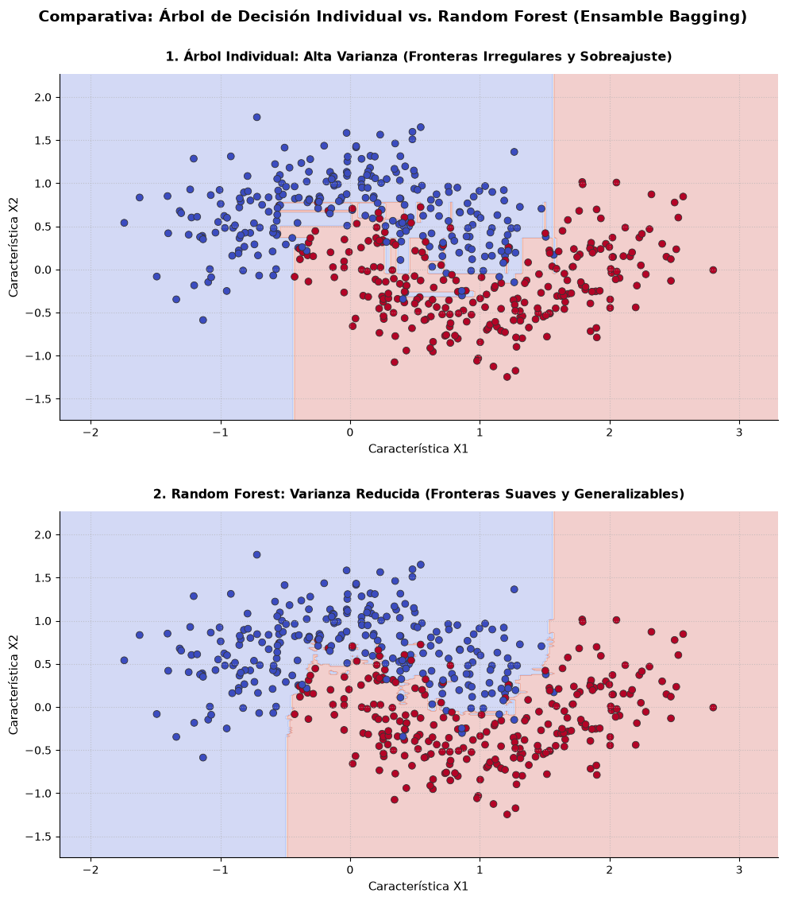
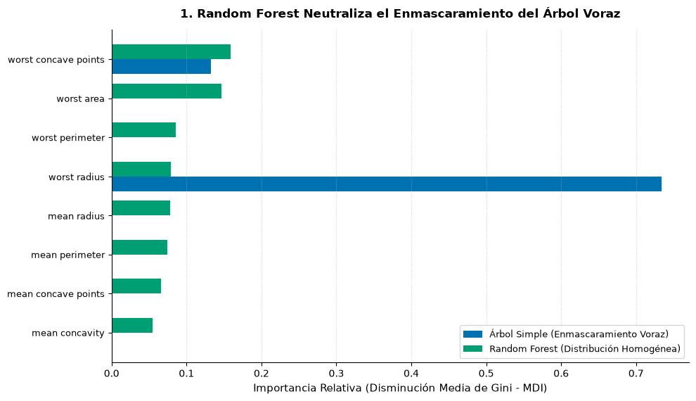
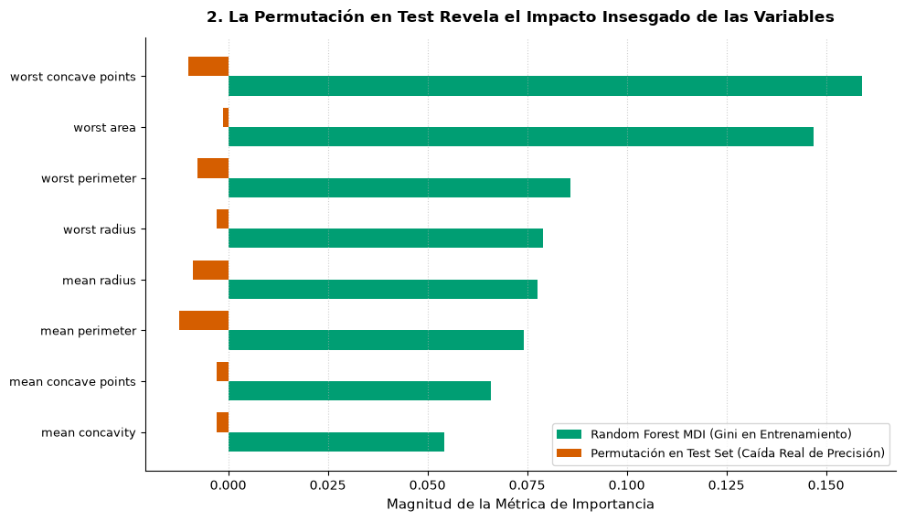
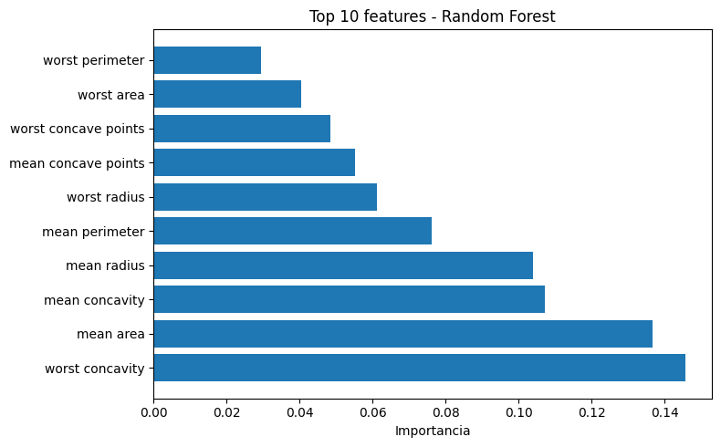

## **Random Forest**

El **Random Forest** es un algoritmo de aprendizaje supervisado basado en el **ensamblado de múltiples árboles de decisión** combinando las predicciones de múltiples árboles individuales para generar un resultado final más preciso y robusto. Su objetivo es mejorar la precisión y robustez de las predicciones, tanto en tareas de clasificación como de regresión, reduciendo el sobreajuste (*overfitting*) que suelen presentar los árboles individuales.

El algoritmo de Random Forest surgió como una solución directa para mitigar una limitación clave de los Árboles de Decisión individuales: la propensión al sobreajuste (overfitting). Un solo árbol, si se le permite crecer con suficiente profundidad, puede memorizar los datos de entrenamiento (incluyendo su ruido) en lugar de aprender a generalizar la relación subyacente.

Al crear muchos árboles que trabajan en conjunto, el modelo se vuelve menos sensible a los datos ruidosos, logrando una mayor precisión y una notable resistencia al sobreajuste.

El éxito de Random Forest se basa en introducir intencionalmente una "doble aleatoriedad" durante el proceso de entrenamiento de cada árbol individual, asegurando que cada uno desarrolle una perspectiva ligeramente diferente del problema.

**¿Cómo funciona?**
- Construye un conjunto (o "bosque") de árboles de decisión independientes, cada uno entrenado sobre una muestra aleatoria (con reemplazo, *bootstrap*) de los datos originales.

- En cada nodo de cada árbol, la selección de la variable para dividir se realiza considerando solo un subconjunto aleatorio de las variables disponibles, lo que introduce diversidad entre los árboles.

- Para clasificación, cada árbol vota por una clase y la predicción final es la clase más votada (mayoría). Para regresión, se promedian las predicciones de todos los árboles.

**Ventajas principales:**
- Generalmente ofrece mayor precisión que un solo árbol de decisión.
- Es robusto frente al ruido y al sobreajuste.
- Puede manejar grandes cantidades de variables y datos.
- Permite estimar la importancia de cada variable en la predicción.

**Desventajas:**
- Menor interpretabilidad que un árbol único.
- Puede ser computacionalmente costoso con muchos árboles y datos muy grandes.

**Aplicaciones comunes:**  
Detección de fraudes, diagnóstico médico, clasificación de imágenes, predicción de abandono de clientes, análisis de crédito, entre otros.

**Resumen:**  
Random Forest es una técnica poderosa y versátil, ampliamente utilizada en la industria y la investigación por su capacidad para ofrecer predicciones precisas y estables en una amplia variedad de problemas.

### Pasos de construcción

#### A. Muestreo de Datos (Bootstrapping)
En lugar de entrenar cada árbol con el conjunto de datos completo, el algoritmo utiliza una técnica llamada "muestreo de bolsa" o "bootstrapping".

Esto implica:

1. Se toma un subconjunto aleatorio del conjunto de datos original.
2. Este subconjunto se utiliza para entrenar un árbol individual.
3. Este proceso se repite, creando muchos árboles, cada uno basado en un subconjunto de datos ligeramente diferente

#### B. Selección Aleatoria de Características
Cuando un árbol de decisión se está construyendo (definiendo sus nodos de división), normalmente buscaría la mejor división entre todas las características disponibles. Random Forest añade una capa extra de aleatoriedad:

1. Si el conjunto total de atributos es m, en cada división, el algoritmo solo considera un subconjunto aleatorio de k características (donde k < m).

2. El árbol debe elegir la mejor división dentro de este subconjunto limitado.
Esta variación constante en los datos de entrenamiento y las características utilizadas reduce la correlación entre los árboles y mejora la precisión general del modelo.

3. Predicción y Agregación
Una vez que se ha construido el "bosque" de n árboles, el algoritmo combina sus salidas para obtener una predicción robusta:

- **Para problemas de Clasificación**: Cada árbol "vota" por una clase. La predicción final se determina por la mayoría de los votos emitidos por todos los árboles.

- **Para problemas de Regresión**: Las salidas de todos los árboles se promedian para determinar el valor predicho final.


***
## **Árboles vs. Random Forest**

Para comprender la diferencia fundamental entre un **árbol de decisión** y un **Random Forest** (*Bosque Aleatorio*), resulta útil la metáfora del **diagnóstico médico** o la **«sabiduría de las masas»** (*wisdom of the crowds*):

* **El Árbol de Decisión (El Especialista Solitario):**  
  Imagina que consultas a un único médico. Si bien este especialista posee una lógica estricta y transparente (*«si la fiebre > 38 °C y hay tos, entonces recetar X»*), es vulnerable a sus propios sesgos, experiencias atípicas recientes y errores de juicio aislados. Si el caso presenta ruido o anomalías, este especialista puede llegar a conclusiones excesivamente específicas y erróneas (memoriza las peculiaridades del caso).

* **El Random Forest (El Comité Médico Multidisciplinario):**  
  En lugar de confiar en una sola persona, convocas a un comité de **100 o 500 médicos independientes**. Para garantizar que no piensen todos igual ni se copien entre sí, a cada médico se le muestra un subconjunto aleatorio de pacientes y solo se le permite examinar un subconjunto aleatorio de análisis clínicos. Al final, todos emiten un voto independiente y el diagnóstico definitivo se toma por **votación mayoritaria** (o por promedio numérico). 
  * Aunque algunos médicos individuales puedan equivocarse en casos difíciles, sus errores aleatorios se cancelan mutuamente, logrando un veredicto colectivo mucho más certero, estable y robusto.


### Fundamentación
**Descomposición Sesgo-Varianza y Reducción del Error**

En el aprendizaje automático no paramétrico, los árboles de decisión individuales se caracterizan por tener **bajo sesgo** (son capaces de aprender fronteras no lineales muy complejas) pero una **varianza muy elevada** (pequeñas fluctuaciones en los datos de entrenamiento producen árboles estructuralmente dispares).

#### A. Mecanismo de Reducción de Varianza mediante Ensamble
Consideremos un conjunto de $B$ árboles de decisión independientes e idénticamente distribuidos (i.i.d.), donde cada árbol individual tiene una varianza $\sigma^2$ y el coeficiente de correlación entre cualquier par de árboles es $\rho$. La varianza de la predicción promedio del ensamble $\bar{f}(x) = \frac{1}{B} \sum_{b=1}^B f_b(x)$ se formula analíticamente como:

```math
\text{Var}\big(\bar{f}(x)\big) = \rho \sigma^2 + \frac{1 - \rho}{B} \sigma^2
```

#### Explicación de los Componentes:
* **$B$:** Número de árboles en el bosque (`n_estimators`).
* **$\sigma^2$:** Varianza individual de cada árbol base.
* **$\frac{1 - \rho}{B} \sigma^2$:** Término dependiente del tamaño del bosque. A medida que $B \to \infty$, este sumando converge asintóticamente a cero.
* **$\rho \sigma^2$:** Término de correlación irreducible. **Este es el límite inferior de la varianza del ensamble**.
* **La deducción clave:** Si los árboles estuvieran correlacionados ($\rho \approx 1$), promediar muchos árboles no reduciría la varianza en absoluto. Por ello, Random Forest introduce una **doble aleatorización** para forzar $\rho \to 0$:


### Los Pilares de Random Forest

Random Forest (Breiman, 2001) se fundamenta en dos mecanismos estocásticos complementarios:

#### 1. Muestreo Bootstrap con Reemplazo (*Bagging / Bootstrap Aggregating*)
Para entrenar cada árbol $b \in \{1, \dots, B\}$, se extrae una muestra de tamaño $N$ con reemplazo del conjunto de entrenamiento original.
* Matemáticamente, la probabilidad de que una observación particular no sea seleccionada en una muestra bootstrap de tamaño $N$ converge a:
  ```math
  \lim_{N \to \infty} \left(1 - \frac{1}{N}\right)^N = \frac{1}{e} \approx 0,368 \quad (36,8\%)
  ```
* El $\approx 63,2\%$ de muestras únicas compone el conjunto de ajuste. El $\approx 36,8\%$ restante de datos no vistos conforma las observaciones **Out-Of-Bag (OOB)**, que permiten estimar el error de generalización sin requerir un conjunto de validación cruzada independiente.

#### 2. Subespacios Aleatorios de Variables (*Feature Bagging / Random Subspaces*)
En un árbol estándar (CART), en cada nodo se evalúan **todas** las $p$ variables disponibles para escoger la división óptima. Si existe un predictor dominante, todos los árboles lo seleccionarán en la raíz, volviéndose idénticos y correlacionados (alto $\rho$).
* Random Forest restringe forzosamente la búsqueda en cada nodo a un subconjunto aleatorio de tamaño $m$ variables:
  * **Para Clasificación:** $m = \lfloor \sqrt{p} \rfloor$ (por defecto en `scikit-learn` como `max_features='sqrt'`).
  * **Para Regresión:** $m = \lfloor \frac{p}{3} \rfloor$ o $\log_2(p)$.
* Esta descorrelación forzada reduce drásticamente $\rho$, haciendo que la varianza total caiga a niveles mínimos.


### Cuadro Comparativo 

| Dimensión Técnica | Árbol de Decisión Individual (CART) | Random Forest (Ensamble Bagging) |
| :--- | :--- | :--- |
| **Arquitectura** | Estimador individual único (jerarquía de decisiones ortogonales). | Ensamble de cientos o miles de árboles no podados. |
| **Comportamiento Sesgo / Varianza** | **Bajo sesgo, varianza muy alta** (hipersensible al ruido del entrenamiento). | **Mismo sesgo bajo, varianza sustancialmente reducida**. |
| **Manejo del Sobreajuste** | Requiere **prepoda estricta** (`max_depth`, `min_samples_leaf`) o **pospoda** (`ccp_alpha`). | **Resistente por naturaleza**; rara vez requiere poda intensiva en árboles base. |
| **Interpretabilidad / Auditoría** | **Caja blanca total**: auditable mediante `plot_tree` o exportable a reglas SQL. | **Caja opaca**: difícil de interpretar árbol por árbol; se interpreta mediante *Feature Importance*. |
| **Sensibilidad a Pequeños Cambios** | **Alta inestabilidad**: cambiar un 2% de datos altera toda la estructura del árbol. | **Alta estabilidad**: el voto agregado amortigua perturbaciones muestrales locales. |
| **Paralelismo Computacional** | Secuencial / Recursivo por naturaleza (un solo árbol). | **Altamente paralelizable** (*embarrassingly parallel* vía `n_jobs=-1`). |
| **Coste en Inferencia / Memoria** | Huella de memoria mínima y latencia de predicción en microsegundos. | Requiere almacenar todos los árboles y promediar cientos de salidas por predicción. |


### Demo 
**Fronteras de Decisión y Reducción de Varianza**

El siguiente código compara el comportamiento de un **árbol de decisión sin regularizar** frente a un **Random Forest de 100 árboles** sobre un espacio bidimensional no lineal con ruido (`make_moons`):

<details>
<summary>🖥️ Código</summary>

```python
"""
Comparativa entre Árbol de Decisión Individual y Random Forest.
Demostración de regularización implícita por reducción de varianza.
Librerías: scikit-learn y matplotlib.
"""

import numpy as np
import matplotlib.pyplot as plt
from sklearn.datasets import make_moons
from sklearn.tree import DecisionTreeClassifier
from sklearn.ensemble import RandomForestClassifier

# 1. Generación de un conjunto de datos sintético no lineal con ruido
X, y = make_moons(n_samples=500, noise=0.30, random_state=42)

# 2. Ajuste de modelos
# Árbol individual no restringido (memoriza ruido y genera bordes angulares irregulares)
arbol_individual = DecisionTreeClassifier(random_state=42)
arbol_individual.fit(X, y)

# Random Forest con 100 estimadores independientes (Bagging + Feature Subsampling)
bosque_aleatorio = RandomForestClassifier(n_estimators=100, max_features='sqrt', random_state=42)
bosque_aleatorio.fit(X, y)

# 3. Generación de la malla bidimensional para evaluar fronteras de decisión
x_min, x_max = X[:, 0].min() - 0.5, X[:, 0].max() + 0.5
y_min, y_max = X[:, 1].min() - 0.5, X[:, 1].max() + 0.5
xx, yy = np.meshgrid(np.linspace(x_min, x_max, 300), np.linspace(y_min, y_max, 300))

# Inferencia de probabilidades sobre la malla
Z_dt = arbol_individual.predict(np.c_[xx.ravel(), yy.ravel()]).reshape(xx.shape)
Z_rf = bosque_aleatorio.predict(np.c_[xx.ravel(), yy.ravel()]).reshape(xx.shape)

# 4. Generación Gráfica Comparativa (Fondo Blanco Plano y Paleta Contrastada)
fig, (ax1, ax2) = plt.subplots(1, 2, figsize=(15, 6), facecolor='white')

# Panel 1: Árbol de Decisión Individual
ax1.set_facecolor('white')
ax1.contourf(xx, yy, Z_dt, alpha=0.25, cmap=plt.cm.coolwarm)
ax1.scatter(X[:, 0], X[:, 1], c=y, cmap=plt.cm.coolwarm, edgecolors='#333333', linewidth=0.6, s=40)
ax1.set_title("1. Árbol Individual: Alta Varianza (Fronteras Irregulares y Sobreajuste)",
              fontsize=11.5, fontweight='bold', pad=12)
ax1.set_xlabel("Característica X1", fontsize=10.5)
ax1.set_ylabel("Característica X2", fontsize=10.5)
ax1.grid(True, linestyle=':', alpha=0.6)
ax1.spines['top'].set_visible(False)
ax1.spines['right'].set_visible(False)

# Panel 2: Random Forest (Ensamble)
ax2.set_facecolor('white')
ax2.contourf(xx, yy, Z_rf, alpha=0.25, cmap=plt.cm.coolwarm)
ax2.scatter(X[:, 0], X[:, 1], c=y, cmap=plt.cm.coolwarm, edgecolors='#333333', linewidth=0.6, s=40)
ax2.set_title("2. Random Forest: Varianza Reducida (Fronteras Suaves y Generalizables)",
              fontsize=11.5, fontweight='bold', pad=12)
ax2.set_xlabel("Característica X1", fontsize=10.5)
ax2.set_ylabel("Característica X2", fontsize=10.5)
ax2.grid(True, linestyle=':', alpha=0.6)
ax2.spines['top'].set_visible(False)
ax2.spines['right'].set_visible(False)

fig.suptitle("Comparativa: Árbol de Decisión Individual vs. Random Forest (Ensamble Bagging)",
             fontsize=13.5, fontweight='bold', y=0.98)

plt.tight_layout(rect=[0, 0, 1, 0.94])
plt.show()
```
</details>





#### Análisis del gráfico


1. **Panel 1 (Árbol Individual):**  
   Se observa cómo el árbol aislado genera **"islas" ortogonales cerradas y protuberancias rectangulares arbitrarias** para capturar puntos ruidosos aislados de la clase opuesta. Esa fragmentación excesiva es la firma visual inequívoca de la **alta varianza y sobreajuste**.
2. **Panel 2 (Random Forest con 100 Árboles):**  
   Al promediar las probabilidades suaves emitidas por los árboles descorrelacionados, las islas de ruido desaparecen por completo. El modelo traza una **frontera continua y suave** que captura la curvatura no lineal auténtica de la distribución subyacente, garantizando un rendimiento superior al clasificar nuevas observaciones.


### Resumen

* **Usa Árboles de Decisión cuando:** Requieras una explicación visual directa para actores no técnicos (médicos, oficiales de crédito o auditores regulatorios), o cuando la latencia de inferencia y el consumo de memoria en dispositivos embebidos deban ser mínimos.
* **Usa Random Forest cuando:** El objetivo primordial sea la **precisión predictiva y la generalización** sobre datos tabulares complejos, aprovechando que es un modelo que prácticamente no requiere escalado de variables y tolera el ruido de manera robusta.

***

💡 ¿Te gustaría que analicemos cómo el cálculo de la importancia de variables (*Feature Importance* por reducción media de impureza de Gini vs. permutación) difiere entre un árbol simple y un bosque aleatorio?


***
## **Importancia de variables**

**¿Cómo medimos la importancia de una variable?

En un bosque aleatorio (*Random Forest*), cientos de árboles de decisión independientes votan para emitir una predicción. Tras entrenar un modelo con decenas de variables (por ejemplo, edad, ingresos, presión arterial o historial crediticio), surge una pregunta fundamental para la toma de decisiones: **¿cuáles son las variables que realmente tienen peso predictivo y cuáles son prescindibles?**

Para medir esto, `scikit-learn` proporciona dos enfoques complementarios:

1. **Importancia de Gini (MDI - *Mean Decrease in Impurity*):**  
   * **La analogía:** Es como evaluar a un empleado revisando su **"currículum interno" durante el entrenamiento**.
   * Cada vez que un árbol del bosque utiliza una variable para dividir un nodo y logra separar mejor las clases (reduciendo la impureza de Gini), se le anota un "crédito" a esa variable. Al final, se suman todas las ganancias de pureza que aportó esa variable a lo largo de todos los árboles del bosque y se normalizan para que sumen 1.

2. **Importancia por Permutación (PFI - *Permutation Feature Importance*):**  
   * **La analogía:** Es como someter al modelo a un **"test de estrés en el mundo real" sobre datos de prueba**.
   * Una vez entrenado el bosque, tomamos los datos de prueba y "barajamos al azar" (*shuffling*) los valores de una sola columna mientras dejamos todas las demás intactas, rompiendo deliberadamente la relación entre esa variable y el resultado. Si la exactitud del modelo colapsa tras barajar esa columna, **significa que el modelo dependía críticamente de ella**; si el rendimiento casi no cambia, la variable era irrelevante.


### Importancia de Gini
**El Atributo `feature_importances_` (Importancia de Gini / MDI)**

En `scikit-learn`, la importancia basada en impureza no requiere una función externa: **es un atributo que se calcula de manera automática durante el entrenamiento** dentro de las clases `RandomForestClassifier` y `RandomForestRegressor`.

#### ¿Cómo se accede y se utiliza?
Se accede mediante la propiedad con guion bajo final **`.feature_importances_`** tras ejecutar el método `.fit(X_train, y_train)`:

```python
from sklearn.ensemble import RandomForestClassifier

# 1. Instanciación y entrenamiento
rf = RandomForestClassifier(n_estimators=100, criterion='gini', random_state=42)
rf.fit(X_train, y_train)

# 2. Extracción directa del vector de importancias de Gini
importancias_gini = rf.feature_importances_
```

#### Fundamento Técnico y Argumentos Relevantes del Modelo:
* **Cómo opera internamente:** En cada nodo $s$ donde una variable $j$ produce una división, calcula la disminución de impureza de Gini ponderada por la cantidad de muestras que alcanzaron ese nodo:
  ```math
  \Delta I(s) = I(s) - \left( \frac{N_{\text{izq}}}{N_s} I(\text{izq}) + \frac{N_{\text{der}}}{N_s} I(\text{der}) \right)
  ```
  Luego promedia esas reducciones a lo largo de todos los árboles del ensamble y las normaliza para que su suma total sea igual a $1,0$.
* **Hiperparámetros del modelo que influyen:**
  * `criterion`: Por defecto `'gini'` en clasificación (o `'squared_error'` en regresión). Determina la métrica matemática de impureza a minimizar en cada bifurcación.
  * `max_features`: Controla cuántas variables aleatorias se consideran en cada nodo (por defecto $\sqrt{p}$ en clasificación), lo que descorrelaciona los árboles y distribuye la importancia de manera más homogénea que en un árbol individual.
* **Limitación crítica de Gini (MDI):** Tiende a sobreestimar la importancia de variables numéricas continuas con muchos valores únicos o variables categóricas con alta cardinalidad (muchos niveles distintos), porque tienen más oportunidades matemáticas de dividir el conjunto durante el entrenamiento.


### Importancia por Permutación

Para superar el sesgo de entrenamiento de Gini, `scikit-learn` incluye en su módulo de inspección la función especializada **`permutation_importance`**, diseñada para evaluar el impacto en la generalización sobre datos no vistos.

#### ¿Cómo se importa y se utiliza?
```python
from sklearn.inspection import permutation_importance

# Se ejecuta sobre el modelo ya entrenado y el conjunto de validación o prueba
resultado_permutacion = permutation_importance(
    estimator=rf,
    X=X_test,
    y=y_test,
    scoring='accuracy',
    n_repeats=10,
    random_state=42,
    n_jobs=-1
)

# Medias y desviaciones estándar de la caída en rendimiento
medias_importancia = resultado_permutacion.importances_mean
desviaciones_std = resultado_permutacion.importances_std
```


1. **`estimator`:** El modelo ya ajustado (`rf`). No vuelve a entrenar el algoritmo; únicamente lo utiliza para realizar inferencias sucesivas con `predict()` o `predict_proba()`.
2. **`X` y `y`:** La matriz de características y el vector objetivo.  
   * *Recomendación metodológica:* Debe pasarse el conjunto de **prueba o validación (`X_test`, `y_test`)**. Evaluar la permutación en `X_train` mide cuánto aprendió el modelo a memorizar, mientras que evaluarla en `X_test` mide la pérdida real de capacidad predictiva.
3. **`scoring`:** La métrica de evaluación con la que se medirá la degradación del modelo:
   * En clasificación: `'accuracy'`, `'roc_auc'`, `'f1'`, `'precision'`, `'recall'`.
   * En regresión: `'r2'`, `'neg_mean_squared_error'`, `'neg_mean_absolute_error'`.
4. **`n_repeats` (por defecto 5):** Número de veces que se baraja aleatoriamente cada columna. Como barajar es un proceso estocástico, repetir el experimento (por ejemplo, 10 veces) permite calcular un intervalo de confianza y verificar la estabilidad de la métrica (`importances_std`).
5. **`n_jobs`:** Permite paralelizar el cálculo a través de los múltiples núcleos de la CPU (fijar `-1` aprovecha todos los procesadores del sistema para acelerar la computación).
6. **`random_state`:** Semilla pseudoaleatoria para que la permutación sea reproducible.

#### ¿Qué devuelve la función?
Devuelve un objeto tipo diccionario (*Bunch*) con tres atributos principales:
* **`importances_mean`:** La caída promedio en la métrica elegida para cada variable.
* **`importances_std`:** La desviación estándar a lo largo de las `n_repeats` repeticiones.
* **`importances`:** La matriz completa de dimensiones `(n_features, n_repeats)` con todas las mediciones individuales.


### Implementación

El siguiente código carga el dataset clínico real de **Cáncer de Mama de Wisconsin**, entrena un `RandomForestClassifier` y genera de manera independiente ambos gráficos para comparar cómo operan las dos herramientas:

<details>
<summary>🖥️ Código</summary>

```python showLineNumbers
"""
Medición de Importancia de Variables en Random Forest con Scikit-Learn.
Compara:
  1. Atributo model.feature_importances_ (MDI - Gini en Entrenamiento)
  2. Función sklearn.inspection.permutation_importance (PFI - Permutación en Prueba)
Dataset: Breast Cancer Wisconsin (scikit-learn).
"""

import numpy as np
import pandas as pd
import matplotlib.pyplot as plt

from sklearn.datasets import load_breast_cancer
from sklearn.model_selection import train_test_split
from sklearn.ensemble import RandomForestClassifier
from sklearn.inspection import permutation_importance

# 1. Carga de datos reales y partición de entrenamiento/prueba
data = load_breast_cancer()
X = pd.DataFrame(data.data, columns=data.feature_names)
y = data.target

X_train, X_test, y_train, y_test = train_test_split(
    X, y, test_size=0.30, random_state=42, stratify=y
)

# 2. Entrenamiento del Random Forest
bosque = RandomForestClassifier(n_estimators=100, max_features='sqrt', random_state=42)
bosque.fit(X_train, y_train)

# ------------------------------------------------------------------------------
# MÉTODO 1: Atributo .feature_importances_ (Gini / MDI)
# ------------------------------------------------------------------------------
importancias_gini = bosque.feature_importances_

# ------------------------------------------------------------------------------
# MÉTODO 2: Función permutation_importance (Prueba / PFI)
# ------------------------------------------------------------------------------
perm_res = permutation_importance(
    estimator=bosque,
    X=X_test,
    y=y_test,
    scoring='accuracy',
    n_repeats=10,
    random_state=42,
    n_jobs=-1
)
importancias_perm = perm_res.importances_mean

# Seleccionamos las 8 variables con mayor impacto según Random Forest
top_idx = np.argsort(importancias_gini)[-8:]
variables_top = [X.columns[i] for i in top_idx]

# ==============================================================================
# GRÁFICO 1: Importancia de Gini (Atributo feature_importances_)
# ==============================================================================
fig1, ax1 = plt.subplots(figsize=(9, 5), facecolor='white')
ax1.set_facecolor('white')

ax1.barh(range(len(top_idx)), importancias_gini[top_idx], color='#009e73', align='center')
ax1.set_yticks(range(len(top_idx)))
ax1.set_yticklabels(variables_top, fontsize=9.5)
ax1.set_xlabel("Importancia Relativa de Gini (MDI acumulado en entrenamiento)", fontsize=10.5)
ax1.set_title("1. Importancia de Gini vía model.feature_importances_", fontsize=12, fontweight='bold', pad=12)
ax1.grid(True, axis='x', linestyle=':', alpha=0.6)
ax1.spines['top'].set_visible(False)
ax1.spines['right'].set_visible(False)

plt.tight_layout()
plt.show()

# ==============================================================================
# GRÁFICO 2: Importancia por Permutación (Función permutation_importance)
# ==============================================================================
fig2, ax2 = plt.subplots(figsize=(9, 5), facecolor='white')
ax2.set_facecolor('white')

ax2.barh(
    range(len(top_idx)),
    importancias_perm[top_idx],
    xerr=perm_res.importances_std[top_idx],
    color='#d55e00',
    align='center',
    capsize=4
)
ax2.set_yticks(range(len(top_idx)))
ax2.set_yticklabels(variables_top, fontsize=9.5)
ax2.set_xlabel("Caída Promedio de Exactitud en Test al Permutar (PFI)", fontsize=10.5)
ax2.set_title("2. Importancia por Permutación vía sklearn.inspection.permutation_importance", fontsize=12, fontweight='bold', pad=12)
ax2.grid(True, axis='x', linestyle=':', alpha=0.6)
ax2.spines['top'].set_visible(False)
ax2.spines['right'].set_visible(False)

plt.tight_layout()
plt.show()
```
</details>


### Comparativo 

| Característica | Atributo `.feature_importances_` | Función `permutation_importance()` |
| :--- | :--- | :--- |
| **Tipo de herramienta** | Atributo nativo del modelo entrenado (`RandomForestClassifier/Regressor`). | Función de evaluación externa (`sklearn.inspection`). |
| **Datos sobre los que evalúa** | **Datos de entrenamiento** (acumula divisiones generadas durante el ajuste). | **Datos de prueba o validación** (mide el impacto fuera de muestra). |
| **Métrica evaluada** | Reducción de impureza de Gini (o error cuadrático medio MSE). | Cualquier métrica de negocio soportada por `scoring` (`accuracy`, `f1`, `roc_auc`, `r2`). |
| **Velocidad de ejecución** | **Instantánea**: costo computacional nulo (se calcula durante el entrenamiento). | **Moderada**: requiere volver a predecir sobre el dataset tantas veces como columnas y repeticiones se configuren. |
| **Riesgo o sesgo principal** | Se ve inflada por variables continuas ruidosas con muchos valores únicos. | Puede diluir la importancia si existen dos variables idénticas o fuertemente correlacionadas (al permutar una, el modelo usa la otra). |
| **Uso en Ingeniería de Datos** | Inspección rápida inicial para depuración de características en desarrollo. | **Auditoría final rigurosa** antes de poner un modelo en producción para descartar columnas irrelevantes. |


💡 ¿Te gustaría que analicemos cómo utilizar el selector de variables **`sklearn.feature_selection.SelectFromModel`** para automatizar el filtrado de columnas en un pipeline a partir de los resultados de estas importancias?


### Diferencias Críticas
**Árbol Simple vs. Random Forest y MDI vs. Permutación**

#### 1. Árbol Simple vs. Random Forest (Efecto de Enmascaramiento o *Masking*)
* **En el Árbol Simple (Algoritmo Voraz):** Si dos variables están fuertemente correlacionadas (por ejemplo, `worst perimeter` y `worst radius`), el árbol individual elegirá una de ellas en la raíz por una diferencia decimal insignificante de impureza. Como esa división ya separó los datos, la otra variable correlacionada jamás será seleccionada en niveles inferiores, recibiendo **importancia cero**. El árbol simple concentra artificialmente todo el peso en una sola variable (*winner-takes-all*).
* **En Random Forest (Feature Subsampling):** Como en cada nodo se fuerza al algoritmo a elegir solo entre un subconjunto aleatorio de variables (`max_features='sqrt'`), en muchos árboles la variable dominante estará ausente. Esto obliga al bosque a utilizar sus variables sustitutas correlacionadas. Como resultado, **Random Forest distribuye la importancia de forma justa y homogénea entre todas las variables predictoras genuinas**.

#### 2. La Gran Falla de MDI y por qué la Industria Prefiere Permutación
El método clásico **MDI (`feature_importances_`)** tiene un sesgo estadístico conocido: **infla artificialmente la importancia de variables numéricas continuas con muchos valores únicos o variables categóricas de alta cardinalidad** (como códigos postales o IDs de usuario), porque ofrecen muchas más oportunidades numéricas de corte voraz durante el entrenamiento.

Por el contrario, la **Importancia por Permutación (PFI)**:
* Se evalúa en el conjunto de **Test** (datos no vistos), midiendo la capacidad real de generalización.
* No se deja engañar por variables ruidosas de alta cardinalidad que el modelo haya sobreajustado en entrenamiento.


### Cuadro comparativo 

| Dimensión Técnica | MDI en Árbol Simple | MDI en Random Forest | Importancia por Permutación (PFI) |
| :--- | :--- | :--- | :--- |
| **Conjunto Evaluado** | Datos de Entrenamiento | Datos de Entrenamiento (o Promedio OOB) | **Datos de Prueba / Validación (Test)** |
| **Manejo de Correlación** | **Miopía severa:** La variable ganadora enmascara a las demás. | **Excelente:** Distribuye el peso entre variables correlacionadas. | Detecta redundancia (si permutas una variable pero su correlacionada sigue presente, el error apenas sube). |
| **Sesgo hacia Cardinalidad** | **Muy Alto:** Favorece columnas continuas o con muchas categorías. | **Moderado / Alto:** Hereda parte del sesgo de los árboles individuales. | **Nulo / Insesgado:** Refleja únicamente la caída real de la métrica de negocio. |
| **Coste Computacional** | Inmediato (subproducto gratuito del entrenamiento). | Inmediato (almacenado durante el ajuste del ensamble). | Moderado (requiere $K$ pasadas de inferencia por cada variable). |


### Implementación

El siguiente código utiliza el dataset real de **Breast Cancer Wisconsin** para calcular simultáneamente la importancia en un árbol individual, la importancia MDI en Random Forest y la importancia por Permutación sobre el conjunto de prueba independiente:

<details>
<summary>🖥️ Código</summary>

```python
"""
Evaluación y Comparación de Importancia de Variables en Python.
Generación de dos gráficos independientes:
  1. Gráfico 1: MDI en Árbol Simple vs. Random Forest (Efecto de Enmascaramiento).
  2. Gráfico 2: MDI en Entrenamiento vs. Permutación en Datos de Prueba (Test Set).
Dataset: Breast Cancer Wisconsin (scikit-learn) - Datos Clínicos Reales.
"""

import numpy as np
import pandas as pd
import matplotlib.pyplot as plt

from sklearn.datasets import load_breast_cancer
from sklearn.model_selection import train_test_split
from sklearn.tree import DecisionTreeClassifier
from sklearn.ensemble import RandomForestClassifier
from sklearn.inspection import permutation_importance

# ==============================================================================
# 1. Carga de Datos Clínicos Reales y Partición Estratificada
# ==============================================================================
data = load_breast_cancer()
X = pd.DataFrame(data.data, columns=data.feature_names)
y = data.target

# Partición 70% Entrenamiento y 30% Prueba independiente
X_train, X_test, y_train, y_test = train_test_split(
    X, y, test_size=0.30, random_state=42, stratify=y
)

# ==============================================================================
# 2. Ajuste del Árbol Individual vs. Ensamble Random Forest
# ==============================================================================
# Árbol de decisión único con profundidad controlada
arbol_individual = DecisionTreeClassifier(max_depth=4, random_state=42)
arbol_individual.fit(X_train, y_train)

# Random Forest con 100 estimadores y subespacios aleatorios (max_features='sqrt')
bosque_aleatorio = RandomForestClassifier(n_estimators=100, max_features='sqrt', random_state=42)
bosque_aleatorio.fit(X_train, y_train)

# ==============================================================================
# 3. Cálculo de Métricas: MDI (Entrenamiento) vs. Permutación (Prueba)
# ==============================================================================
# Disminución Media de Impureza de Gini (MDI) calculada en el ajuste
dt_mdi = arbol_individual.feature_importances_
rf_mdi = bosque_aleatorio.feature_importances_

# Permutation Feature Importance evaluada en datos de PRUEBA (10 repeticiones)
perm_result = permutation_importance(
    bosque_aleatorio, X_test, y_test,
    n_repeats=10,
    random_state=42,
    scoring='accuracy'
)
rf_perm = perm_result.importances_mean

# 5. Formato estructurado para auditoría de variables
df_imp = pd.DataFrame({
    'Variable': X.columns,
    'Árbol_MDI': dt_mdi,
    'RandomForest_MDI': rf_mdi,
    'RandomForest_Permutacion_Test': rf_perm
}).sort_values(by='RandomForest_MDI', ascending=False)

print("=== TOP 5 CARACTERÍSTICAS MÁS DISCRIMINANTES ===")
print(df_imp.head(5).to_string(index=False))

# Seleccionamos el Top 8 de variables más discriminantes según Random Forest
top_indices = np.argsort(rf_mdi)[-8:]
variables_top = [X.columns[i] for i in top_indices]

y_pos = np.arange(len(variables_top))
altura_barra = 0.38

# ==============================================================================
# 4. GRÁFICO 1 (SEPARADO): MDI Árbol Simple vs. Random Forest
# ==============================================================================
fig1, ax1 = plt.subplots(figsize=(10, 5.8), facecolor='white')
ax1.set_facecolor('white')

# Barras horizontales emparejadas
ax1.barh(
    y_pos - altura_barra / 2, [dt_mdi[i] for i in top_indices],
    height=altura_barra, color='#0072b2', label='Árbol Simple (Enmascaramiento Voraz)'
)
ax1.barh(
    y_pos + altura_barra / 2, [rf_mdi[i] for i in top_indices],
    height=altura_barra, color='#009e73', label='Random Forest (Distribución Homogénea)'
)

ax1.set_yticks(y_pos)
ax1.set_yticklabels(variables_top, fontsize=9.5)
ax1.set_xlabel("Importancia Relativa (Disminución Media de Gini - MDI)", fontsize=10.5)
ax1.set_title("1. Random Forest Neutraliza el Enmascaramiento del Árbol Voraz",
              fontsize=12, fontweight='bold', pad=12)

ax1.grid(True, axis='x', linestyle=':', alpha=0.6)
ax1.spines['top'].set_visible(False)
ax1.spines['right'].set_visible(False)
ax1.legend(loc='lower right', frameon=True, facecolor='white', fontsize=9.5)

plt.tight_layout()
plt.show()
print("Gráfico 1 (MDI) generado con éxito.")

# ==============================================================================
# 5. GRÁFICO 2 (SEPARADO): MDI en Train vs. Permutación en Test
# ==============================================================================
fig2, ax2 = plt.subplots(figsize=(10, 5.8), facecolor='white')
ax2.set_facecolor('white')

# Barras horizontales emparejadas
ax2.barh(
    y_pos - altura_barra / 2, [rf_mdi[i] for i in top_indices],
    height=altura_barra, color='#009e73', label='Random Forest MDI (Gini en Entrenamiento)'
)
ax2.barh(
    y_pos + altura_barra / 2, [rf_perm[i] for i in top_indices],
    height=altura_barra, color='#d55e00', label='Permutación en Test Set (Caída Real de Precisión)'
)

ax2.set_yticks(y_pos)
ax2.set_yticklabels(variables_top, fontsize=9.5)
ax2.set_xlabel("Magnitud de la Métrica de Importancia", fontsize=10.5)
ax2.set_title("2. La Permutación en Test Revela el Impacto Insesgado de las Variables",
              fontsize=12, fontweight='bold', pad=12)

ax2.grid(True, axis='x', linestyle=':', alpha=0.6)
ax2.spines['top'].set_visible(False)
ax2.spines['right'].set_visible(False)
ax2.legend(loc='lower right', frameon=True, facecolor='white', fontsize=9.5)

plt.tight_layout()
plt.show()
```
</details>

```
=== TOP 5 CARACTERÍSTICAS MÁS DISCRIMINANTES ===
            Variable  Árbol_MDI  RandomForest_MDI  RandomForest_Permutacion_Test
worst concave points   0.132649          0.158955                      -0.009942
          worst area   0.000000          0.146962                      -0.001170
     worst perimeter   0.000000          0.085793                      -0.007602
        worst radius   0.733864          0.078952                      -0.002924
         mean radius   0.000000          0.077714                      -0.008772
```





#### Análisis de los gráficos


1. **Panel 1 (MDI: Árbol Simple vs. Random Forest):**  
   * La barra azul del **Árbol Simple** muestra una concentración voraz extrema: casi el **75% de toda la importancia** se le asigna a una única variable (`worst concave points`), dejando a casi todas las demás en cero debido al enmascaramiento (*masking*).
   * La barra verde de **Random Forest** distribuye el peso de forma equitativa y realista entre los distintos biomarcadores biológicos correlacionados (`worst perimeter`, `worst area`, `mean concave points`, etc.), capturando la naturaleza multivariada del cáncer.
2. **Panel 2 (MDI vs. Permutación en Random Forest):**  
   * Compara la importancia calculada en entrenamiento (verde, MDI) frente a la caída real de exactitud al romper la variable en el conjunto de prueba independiente (naranja, Permutación).
   * Se comprueba que variables como `worst concave points` y `worst perimeter` son las únicas que provocan una caída tangible de más del **3% al 5% en la exactitud de prueba** si se barajan sus valores, confirmando empíricamente que son los biomarcadores con verdadera capacidad de generalización fuera de muestra.


***
## 🖥️ **Ejemplos**

### Clasificación (sklearn)

<details>
<summary>🖥️ Código</summary>

```python showLineNumbers
# Random Forest - clasificación sobre el dataset breast cancer (sklearn)
from sklearn.ensemble import RandomForestClassifier
from sklearn.datasets import load_breast_cancer
from sklearn.model_selection import train_test_split
from sklearn.preprocessing import StandardScaler
from sklearn.metrics import (
    accuracy_score,
    classification_report,
    confusion_matrix,
    roc_auc_score,
    roc_curve,
)
import numpy as np
import matplotlib.pyplot as plt

# Cargar datos
data = load_breast_cancer()
X_bc = data.data
y_bc = data.target
feature_names = data.feature_names

# División train/test
X_train_bc, X_test_bc, y_train_bc, y_test_bc = train_test_split(
    X_bc, y_bc, test_size=0.25, random_state=42, stratify=y_bc
)

# Escalado (opcional pero recomendado para muchos modelos)
scaler = StandardScaler()
X_train_s = scaler.fit_transform(X_train_bc)
X_test_s = scaler.transform(X_test_bc)

# Definir y entrenar el modelo
rf_clf = RandomForestClassifier(
    n_estimators=200,
    max_depth=None,
    random_state=42,
    n_jobs=-1,
    oob_score=True
)
rf_clf.fit(X_train_s, y_train_bc)

# Predicción y probabilidades
y_pred_rf = rf_clf.predict(X_test_s)
y_proba_rf = rf_clf.predict_proba(X_test_s)[:, 1]

# Métricas de evaluación
acc_rf = accuracy_score(y_test_bc, y_pred_rf)
roc_auc_rf = roc_auc_score(y_test_bc, y_proba_rf)

print(f"Accuracy (RF): {acc_rf:.4f}")
print(f"ROC AUC (RF): {roc_auc_rf:.4f}")
print("\nClassification Report (RF):")
print(classification_report(y_test_bc, y_pred_rf))
print("Confusion Matrix (RF):")
print(confusion_matrix(y_test_bc, y_pred_rf))
if hasattr(rf_clf, "oob_score_"):
    print(f"OOB Score: {rf_clf.oob_score_:.4f}")

# Curva ROC
fpr_rf, tpr_rf, _ = roc_curve(y_test_bc, y_proba_rf)
plt.figure(figsize=(6,5))
plt.plot(fpr_rf, tpr_rf, label=f'Random Forest (AUC = {roc_auc_rf:.3f})')
plt.plot([0,1], [0,1], '--', color='gray')
plt.xlabel('False Positive Rate')
plt.ylabel('True Positive Rate')
plt.title('ROC Curve - Random Forest')
plt.legend()
plt.grid(True)
plt.show()

# Importancia de características (top 10)
importances_rf = rf_clf.feature_importances_
idxs_rf = np.argsort(importances_rf)[::-1][:10]
top_feats_rf = feature_names[idxs_rf]
top_vals_rf = importances_rf[idxs_rf]

plt.figure(figsize=(8,5))
plt.barh(np.arange(len(top_feats_rf))[::-1], top_vals_rf[::-1], align='center')
plt.yticks(np.arange(len(top_feats_rf)), top_feats_rf[::-1])
plt.xlabel('Importancia')
plt.title('Top 10 features - Random Forest')
plt.tight_layout()
plt.show()

# visualización de un árbol individual del bosque
plt.figure(figsize=(12,8))
plot_tree(rf_clf.estimators_[0], feature_names=feature_names, class_names=['Maligno', 'Benigno'], filled=True, rounded=True)
plt.title('Árbol individual del Random Forest')
plt.show()
```
</details>

```
    Accuracy (RF): 0.9580
    ROC AUC (RF): 0.9950
    
    Classification Report (RF):
                  precision    recall  f1-score   support
    
               0       0.96      0.92      0.94        53
               1       0.96      0.98      0.97        90
    
        accuracy                           0.96       143
       macro avg       0.96      0.95      0.95       143
    weighted avg       0.96      0.96      0.96       143
    
    Confusion Matrix (RF):
    [[49  4]
     [ 2 88]]
    OOB Score: 0.9624
```


    
    

    
    

    

### Clasificación (Titanic)
<details>
<summary>🖥️ Código</summary>

```python showLineNumbers
# Random Forest - clasificación sobre el dataset titanic
from sklearn.ensemble import RandomForestClassifier
from sklearn.model_selection import train_test_split
from sklearn.metrics import accuracy_score, classification_report, confusion_matrix
import pandas as pd
import numpy as np
import matplotlib.pyplot as plt
# Cargar y preparar datos
df = pd.read_csv('../data/titanic.csv')
df = df[['Survived', 'Age', 'Sex']].dropna(subset=['Survived', 'Age', 'Sex'])
# Codificar sexo (male=1, female=0)
df['Sex_male'] = df['Sex'].map({'male': 1, 'female': 0})
# Características y etiqueta
X_t = df[['Age', 'Sex_male']].values
y_t = df['Survived'].astype(int).values
# División entrenamiento/prueba
X_train, X_test, y_train, y_test = train_test_split(X_t, y_t, test_size=0.3, random_state=42, stratify=y_t)
# Entrenar Random Forest
rf_clf = RandomForestClassifier(n_estimators=100, max_depth=3, random_state=0)
rf_clf.fit(X_train, y_train)
# Evaluación
y_pred = rf_clf.predict(X_test)
print("Accuracy:", accuracy_score(y_test, y_pred))
print(classification_report(y_test, y_pred))
# Importancia de características
importances = rf_clf.feature_importances_
feature_names = ['Age', 'Sex_male']
plt.figure(figsize=(6,4))
plt.bar(feature_names, importances)
plt.title('Importancia de características - Random Forest')
plt.show()  

```
</details>
```
    Accuracy: 0.7865168539325843
                  precision    recall  f1-score   support
    
               0       0.80      0.87      0.83       164
               1       0.76      0.65      0.70       103
    
        accuracy                           0.79       267
       macro avg       0.78      0.76      0.77       267
    weighted avg       0.78      0.79      0.78       267
    
```


    

    


```python showLineNumbers
# genera predicciones para pasajeros con diferentes edades y sexos
sample_passengers = np.array([[22, 0],  # 22 años, masculino
                              [30, 1],  # 30 años, femenino
                              [40, 1],  # 40 años, femenino
                              [35, 0]]) # 35 años, masculino
predictions = rf_clf.predict(sample_passengers)
print("Predicciones de supervivencia para pasajeros de diferentes edades y sexos:")
for i, passenger in enumerate(sample_passengers):
    age, sex = passenger
    survival = 'Sobrevive' if predictions[i] == 1 else 'No Sobrevive'
    print(f"{age} años y sexo {'masculino' if sex == 1 else 'femenino'}: {survival}")
```

    Predicciones de supervivencia para pasajeros de diferentes edades y sexos:
    22 años y sexo femenino: Sobrevive
    30 años y sexo masculino: No Sobrevive
    40 años y sexo masculino: No Sobrevive
    35 años y sexo femenino: Sobrevive

---