import YouTubeVideo from '@site/src/components/YouTubeVideo';

## **Support Vector Machine**

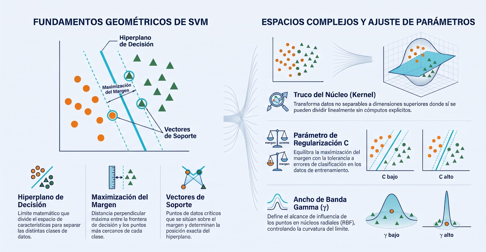

Imagina que en un terreno plano hay dos grupos de personas con camisetas de distinto color (rojas y azules). Tu objetivo es construir una valla recta (una línea divisoria) para separarlas. Existen infinitas líneas posibles que no tocan a nadie; sin embargo, si construyes la valla muy cerca de una persona del grupo rojo, ante el menor paso que dé esa persona, cruzará la valla por error.

Una Máquina de Soporte Vectorial (**Support Vector Machinee**) es un modelo fundamental dentro del **Aprendizaje de Máquina Supervisado** (Supervised Machine Learning). Se utiliza principalmente para problemas de clasificación, aunque también puede aplicarse a problemas de regresión. En términos sencillos, su trabajo es encontrar la mejor manera de separar diferentes grupos de datos.

El objetivo principal de SVM es analizar los datos de entrenamiento y reconocer patrones para construir un modelo que pueda asignar nuevos ejemplos a una categoría u otra. Es popular porque maneja eficientemente grandes conjuntos de datos, puede gestionar datos linealmente separables o no lineales, es robusto ante datos atípicos (outliers) y generaliza bien a datos que nunca ha visto.

Imagina que tienes puntos azules y puntos rojos dispersos en un plano (como canicas en una mesa). La SVM busca la línea (o frontera) que no solo separe los puntos, sino que también esté lo más alejada posible de los puntos más cercanos de ambos colores.

La SVM es como una cerca: no solo separa dos grupos de objetos, sino que se coloca exactamente en el punto medio de la distancia más corta entre ellos, maximizando así la seguridad de la separación.


#### Orígenes

Las SVM fueron propuestas por primera vez en los años 90 por los científicos [Vladimir Vapnik](https://en.wikipedia.org/wiki/Vladimir_Vapnik) y [Alexey Chervonenkis](https://en.wikipedia.org/wiki/Alexey_Chervonenkis).

Surgieron como una mejora a otros métodos de clasificación, buscando una solución más robusta y eficiente, especialmente cuando los datos son complejos.

#### ¿Cómo funciona?

Separación con margen: La SVM busca la línea (o plano, en 3D) que mejor separa dos grupos, pero no cualquier línea: la que deja el mayor espacio posible ("margen") entre ambos grupos.

Ejemplo: Si tienes manzanas (rojas) y naranjas (naranjas) en una mesa, la SVM dibuja una línea que las separa, pero alejada lo más posible de ambas para evitar confusiones.

Kernel Trick (Truco del núcleo): Si los datos no se pueden separar con una línea recta (como un ovillo de hilos mezclados), la SVM usa funciones matemáticas ("kernels") para transformarlos a un espacio donde sí sea posible separarlos.

<br/>
<YouTubeVideo id="5N2YU2wu3kQ" title="Generación de hiperplano en SVM" />
<br/>

Una SVM es un algoritmo de aprendizaje automático supervisado diseñado para encontrar **la frontera divisoria óptima**. 
* **Frontera (Hiperplano):** La línea divisoria que separa las clases.

* **El principio del margen máximo:** En lugar de trazar una línea cualquiera, la SVM busca colocar la frontera exactamente en el centro del corredor más ancho posible que separa a ambos grupos, maximizando el espacio libre a ambos lados (el **margen**). La distancia mayor entre la frontera y los puntos de datos más cercanos a ella.  ¡Son los cruciales! Si mueves uno de estos puntos, la frontera óptima cambiará.

* **¿Qué son los vectores de soporte?:** Son **únicamente aquellos puntos más cercanos a la frontera** (los que tocan el borde del corredor de seguridad). El resto de los puntos lejanos son irrelevantes para la posición final de la valla.

* **¿Y si los grupos están mezclados en círculos o formas complejas?:** La SVM utiliza el conocido **truco del kernel (*kernel trick*)**. Es como elevar el terreno a una tercera dimensión (como empujar hacia arriba el centro de un mantel elástico): en ese espacio superior, lo que antes era imposible de separar con una línea recta ahora se puede cortar limpiamente con una hoja de papel plana (un hiperplano).

Esto es lo que hace que la SVM sea tan efectiva: al maximizar el margen, el modelo logra una mejor capacidad de generalización, lo que significa que es menos probable que se equivoque con datos nuevos que nunca ha visto.


### Fundamentación técnica

En términos formales, una **SVM** es un clasificador discriminativo no probabilístico basado en la teoría de minimización del riesgo estructural.

#### A. El Hiperplano (la frontera)

Como mencionamos, el **hiperplano** es la línea (o plano en dimensiones superiores) que separa las clases de datos. Matemáticamente, en un espacio bidimensional o superior, el hiperplano se define mediante la siguiente ecuación:

$$w \cdot x + b = 0$$

* $x$: Es un **vector** que representa un punto de datos de entrada (tus características o *features*).
* $w$: Es el **vector de pesos** (o vector normal) y es perpendicular al hiperplano.
* $b$: Es el **término de sesgo** (o *bias*), que define la posición del hiperplano respecto al origen.

<center>
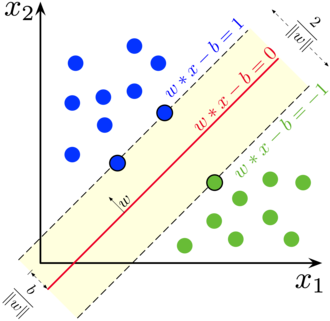

*Fuente: https://en.wikipedia.org/wiki/Support_vector_machine*
</center>

Para garantizar que todos los puntos se clasifiquen correctamente fuera del margen, se normalizan los hiperplanos frontera paralelos como $w^T x + b = +1$ y $w^T x + b = -1$. Geométricamente, el ancho total del margen entre estas dos bandas es:

$$
\text{Margen} = \frac{2}{\|w\|}
$$

Maximizar el margen equivale formalmente a minimizar $\frac{1}{2} \|w\|^2$. El problema de optimización cuadrática primal con restricciones duras (*Hard Margin*) es:

$$
\min_{w, b} \quad \frac{1}{2} \|w\|^2 \quad \text{sujeto a} \quad y_i(w^T x_i + b) \ge 1, \quad \forall i=1, \dots, N
$$

#### B. El Margen y los Vectores de Soporte

El objetivo de la SVM es encontrar el hiperplano **óptimo**. Este no es solo cualquier hiperplano, sino el que tiene el **margen** más grande.

<center>
<figure>
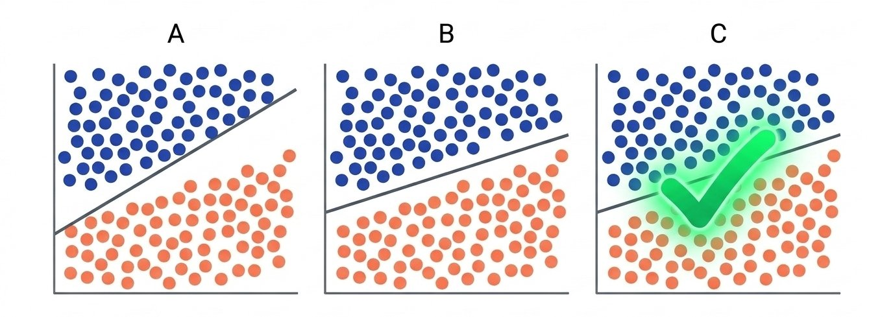
<figcaption>Muchas líneas separan. Solo una es perfecta.</figcaption>
</figure>
</center>

El margen se define por dos hiperplanos paralelos, uno para cada clase, que "tocan" a los puntos más cercanos. Estos puntos que definen el margen son los cruciales **Vectores de Soporte**.

Para los vectores de soporte, se cumple:

* Clase 1: $w \cdot x_i + b = +1$
* Clase 2: $w \cdot x_i + b = -1$

La distancia geométrica entre estos dos hiperplanos (el margen total) es $\frac{2}{||w||}$. Por lo tanto, el problema de optimización de la SVM es **minimizar el vector de pesos $||w||$** (que es lo mismo que maximizar el margen).


El vector de pesos $w$ en la ecuación $w \cdot x + b = 0$ en realidad define la orientación (la inclinación o ángulo) del hiperplano. Piensa en $w$ como el vector normal (perpendicular) al hiperplano, lo que fija su dirección.El término de sesgo $b$, por otro lado, es el que define la posición del hiperplano, moviéndolo en el espacio para encontrar el mejor lugar de separación.


El vector de pesos $w$ en la ecuación $w \cdot x + b = 0$ en realidad define la **orientación** (la inclinación o ángulo) del hiperplano. Piensa en $w$ como el vector **normal** (perpendicular) al hiperplano, lo que fija su dirección.

El término de sesgo $b$, por otro lado, es el que define la **posición** del hiperplano, moviéndolo en el espacio para encontrar el mejor lugar de separación.

#### C. El Truco del Kernel (*Kernel Trick*)

En términos sencillos, el truco del kernel (kernel trick) es un atajo matemático inteligente que permite a un modelo lineal (como una Máquina de Vectores de Soporte) resolver problemas complejos y no lineales sin pagar el costo computacional ni de memoria de transformar los datos a dimensiones superiores.

Imagina que tienes dos grupos de canicas sobre una mesa: un círculo de canicas rojas en el centro, rodeado por un anillo de canicas azules. Si intentas colocar una regla recta sobre la mesa para separar ambos grupos, verás que es imposible: cualquier línea recta tocará o mezclará ambos colores.

Sin embargo, si pudieras empujar el centro de la mesa hacia arriba (elevando las canicas rojas a una tercera dimensión), las rojas quedarían en la cima de una colina y las azules abajo en la base. En ese momento, podrías pasar una hoja de papel plana y horizontal entre ambas alturas, separándolas perfectamente con un corte plano.

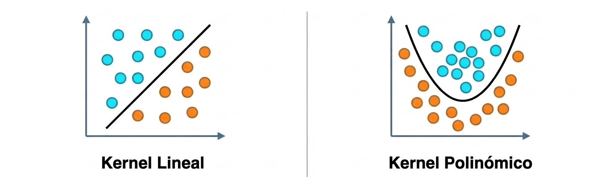

**El dilema de la ingeniería de datos:** Elevar manualmente millones de registros a 3D, 10D o infinitas dimensiones requeriría calcular y almacenar coordenadas gigantescas, lo que saturaría la memoria del servidor y congelaría el procesamiento.

**El "truco":** Consiste en descubrir que el algoritmo no necesita saber dónde queda cada punto en esa tercera dimensión; únicamente necesita saber qué tan parecidos o cercanos son dos puntos entre sí. El kernel es una fórmula matemática directa que calcula esa distancia en el espacio superior usando únicamente los números originales en dos dimensiones, como si hubieras hecho el viaje dimensional, pero sin moverte de tu mesa.

<center>
<figure>
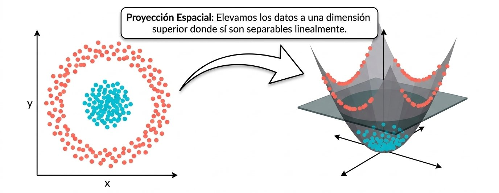
<figcaption>**El truco**. Computa la separación usando productos punto sin calcular explicitamente las nuevsa coordenadas masivas.</figcaption>
</figure>
</center>

Si las clases no son linealmente separables en el espacio original $\mathbb{R}^p$, se proyectan de forma implícita a un espacio de Hilbert de dimensión superior $\mathcal{H}$ mediante una transformación no lineal $\phi(x)$. 

Gracias al teorema de representabilidad y las condiciones de Mercer, en lugar de calcular las coordenadas transformadas $\phi(x_i)$ explícitamente (lo que sería prohibitivo computacionalmente), se utiliza una **función kernel** $K(x_i, x_j) = \langle \phi(x_i), \phi(x_j) \rangle$ que evalúa el producto interno directamente en el espacio original:

* **Kernel Lineal:** $K(x, x') = x^T x'$.
* **Kernel Polinomial:** $K(x, x') = (x^T x' + c)^d$.
* **Kernel RBF Gaussiano (Radial Basis Function):** $K(x, x') = \exp\big(-\gamma \|x - x'\|^2\big)$, donde $\gamma$ controla el radio de influencia de cada vector de soporte.


### Características principales

1. **Dependencia Exclusiva de los Vectores de Soporte (Compacidad):**  
   Una vez entrenado el modelo, los puntos que están lejos del margen no tienen ningún impacto en la solución final. Esto hace que la frontera sea muy estable ante la adición de nuevas muestras que no caigan en la región crítica.
2. **Efectividad en Espacios de Alta Dimensionalidad:**  
   Funciona de manera excepcional cuando el número de variables (características) es muy grande o incluso superior al número de observaciones.
3. **Ausencia de Mínimos Locales:**  
   Dado que el problema de optimización cuadrática formulado mediante multiplicadores de Lagrange es estrictamente convexo, garantiza **un único óptimo global** (no sufre de convergencia a mínimos locales como las redes neuronales artificiales).
4. **Sensibilidad Crítica al Escalamiento de Datos:**  
   Como el cálculo del margen depende directamente de las distancias euclidianas entre vectores, **es obligatorio estandarizar o normalizar las variables** (`StandardScaler` o `MinMaxScaler`) antes de entrenar. Si una variable tiene una escala mucho mayor que las demás, dominará artificialmente la orientación del hiperplano.
5. **Costo Computacional con Grandes Volúmenes:**  
   El cálculo y almacenamiento de la matriz de kernel escala cuadrática o cúbicamente con el número de muestras ($\mathcal{O}(N^2)$ a $\mathcal{O}(N^3)$), por lo que el algoritmo estándar no escala bien para datasets con cientos de miles o millones de registros sin recurrir a aproximaciones.


### Usos y casos de aplicación

La Máquina de Soporte Vectorial es extremadamente valiosa en situaciones donde la **precisión** es vital y cuando los datos son complejos (es decir, tienen muchas características).

Aquí tienes algunas aplicaciones comunes:

* **Bioinformática y Genómica:** 🧬 Se utiliza para clasificar muestras, como la identificación de un tumor como maligno o benigno, basándose en la expresión de múltiples genes o marcadores biológicos (miles de características). Clasificación de perfiles de expresión genética o secuenciación de ADN, donde se tienen miles de características (genes) y pocas muestras de pacientes.

* **Reconocimiento de Imágenes y Visión por Computadora:** Detección y reconocimiento facial, identificación de dígitos manuscritos y clasificación de caracteres en sistemas OCR.

* **Reconocimiento de escritura a mano:** Por ejemplo, reconocer dígitos en cheques escaneados o formularios. Entrada: imagen del dígito transformada en un vector de números. Salida: dígitos del 0 al 9.

* **Procesamiento de Lenguaje Natural (PLN / NLP) y Clasificación de Textos:** Filtros antispam, categorización de noticias y análisis de autoría mediante representaciones dispersas de alta dimensionalidad (*bag-of-words*, TF-IDF o *string kernels*).

* **Regresión Cuantitativa (Support Vector Regression - SVR):** Mediante la función de pérdida $\epsilon$-insensible, SVR permite predecir valores continuos creando un "tubo" de tolerancia insensible a fluctuaciones menores y altamente robusto ante valores atípicos (*outliers*).

* **Detección de Spam (Clasificación de Texto):** 📧 Se entrena la SVM para clasificar correos electrónicos en dos clases: "spam" o "no spam" (ham). Cada palabra o característica del correo es una dimensión en el espacio, y el hiperplano traza la línea divisoria óptima.

* **Reconocimiento de Imágenes y Rostros:** 🖼️ Al analizar imágenes, cada píxel es una característica. La SVM puede manejar las miles de características para distinguir entre, por ejemplo, diferentes personas o clasificar objetos en una escena.

* **Detección de fraudes en tarjetas de crédito:** Donde se entrena con datos como: monto de la compra, país, tipo de comercio, hora, historial del cliente, etc. Y la salida será: transacción normal o fraudulenta. La SVM ayuda a distinguir patrones típicos de compra de patrones sospechosos.

* **Clasificación de clientes (marketing):** Se entrena co información como: ingreso, edad, frecuencia de compra, tipos de productos comprados, etc. Y la salida: grupos de clientes (por ejemplo, “alta probabilidad de comprar cierto producto”). Aunque aquí también se usan técnicas de clustering, las SVM sirven cuando hay ejemplos etiquetados (clientes que sí compraron vs los que no).


El diagnóstico médico y la bioinformática son campos donde la capacidad de la SVM para manejar miles de genes o marcadores simultáneamente es indispensable, superando a menudo a otros modelos en la claridad de su separación en esos espacios de alta dimensionalidad.

En general, las SVM son muy útiles cuando:

- El número de características no es demasiado grande (o se pueden reducir).

- Tenemos un conjunto de datos moderado en tamaño.

- Se requiere un modelo relativamente interpretable (al menos en el caso lineal) y robusto.

**Ventajas de SVM:**

- Efectivo en espacios de alta dimensión y cuando el número de dimensiones es mayor que el número de muestras. Funciona bien incluso cuando la separación entre grupos no es obvia.
- Utiliza solo un subconjunto de puntos de entrenamiento (vectores de soporte), lo que lo hace eficiente en memoria.
- Flexible gracias al uso de diferentes funciones *kernel* para problemas lineales y no lineales. Gracias al kernel trick, puede manejar relaciones no lineales.
- Generalmente robusto frente al sobreajuste, especialmente en problemas bien separados.

**Desventajas de SVM:**

- El entrenamiento puede ser lento y costoso en memoria para conjuntos de datos muy grandes.
- La elección del *kernel* y sus parámetros puede ser compleja y requiere ajuste cuidadoso. Elegir el kernel y ajustar sus configuraciones requiere experiencia.
- Menor interpretabilidad del modelo en comparación con modelos lineales simples o árboles de decisión. A diferencia de un árbol de decisiones, es menos claro cómo toma las decisiones.
- No proporciona directamente probabilidades de clase (aunque se pueden estimar con métodos adicionales).


### Resumen

| Dimensión Técnica | Clasificación Lineal Estándar | Support Vector Machine (SVM) |
| :--- | :--- | :--- |
| **Criterio de Separación** | Cualquier hiperplano que separe las clases. | **Hiperplano de margen máximo** (distancia máxima a los puntos frontera). |
| **Puntos Relevantes** | Utiliza todas las muestras para ajustar los pesos. | **Solo utiliza los vectores de soporte**; el resto de los puntos no influye en la frontera. |
| **Separabilidad No Lineal** | Limitada a combinaciones manuales de características. | **Truco del Kernel (*Kernel Trick*)**: proyecta implícitamente a espacios de dimensión infinita o superior. |
| **Sensibilidad a Outliers** | Alta si se usan funciones de pérdida cuadrática o máxima verosimilitud. | Regulable mediante el hiperparámetro de penalización **$C$**. |
| **Implementación en Scikit-Learn** | `LinearRegression`, `LogisticRegression`. | `sklearn.svm.SVC` (clasificación) y `sklearn.svm.SVR` (regresión). |

---
## **Kernels**

Imagina que estás en un taller de carpintería y necesitas cortar piezas de madera que tienen formas caprichosas. Para un corte recto y limpio en una tabla lisa, basta con una **sierra de mano recta**; pero si las piezas están encajadas en espiral o formando círculos concéntricos, esa sierra recta no sirve: necesitas una **broca de calar o un torno** que curve la madera o corte en distintas alturas y ángulos.

En una **Máquina de Vectores de Soporte (SVM)**, los **kernels son precisamente esas diferentes "herramientas de corte"**:
* Un kernel es una función matemática que define **cómo medimos la similitud o cercanía entre dos observaciones**.
* Dependiendo de cómo estén repartidos los datos en la realidad (si se pueden separar con una línea recta, si forman parábolas o si se agrupan en islas complejas), elegimos un kernel diferente para que la SVM pueda trazar la frontera divisoria adecuada sin necesidad de transformar manualmente las variables a dimensiones superiores.


### Los Kernels Principales

En la práctica con `scikit-learn` (`sklearn.svm.SVC`), los cuatro kernels canónicos son:

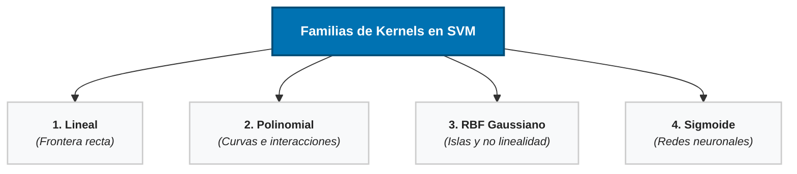

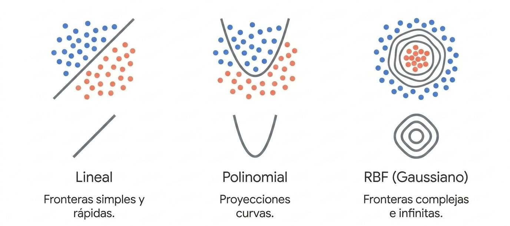

#### A. Kernel Lineal (`kernel='linear'`)

Es la herramienta más directa: asume que las clases se pueden separar limpiamente mediante una **línea recta** (en 2D), un **plano liso** (en 3D) o un **hiperplano plano** (en más de 3 dimensiones). No deforma el espacio.
* **Formulación Matemática:**  
  $$
  K(x, x') = x^T x'
  $$
  * *Componentes:* Es simplemente el producto escalar ordinario entre el vector de características $x$ y el vector $x'$.
* **Parámetros Clave:** Solo depende de **$C$** (el costo de penalización por cruzar el margen).
* **Casos de Uso en la Práctica:**
  1. **Clasificación de Textos y NLP:** Cuando usamos representaciones como *TF-IDF* o *Bolsa de Palabras (Bag of Words)*, el dataset suele tener miles de columnas (palabras) y un número moderado de documentos ($p \gg N$). En alta dimensionalidad, los datos casi siempre son linealmente separables por naturaleza.
  2. **Bioinformática y Expresión Genética:** Microarrays de ADN con 20.000 genes y solo 100 pacientes.
  3. **Ventaja Operativa:** Es computacionalmente el más rápido de entrenar y evaluar; permite extraer e interpretar directamente la importancia de cada variable mediante los pesos $w$ (`svm.coef_`).


#### B. Kernel Polinomial (`kernel='poly'`)

Permite trazar fronteras curvas suaves (como parábolas o curvas cúbicas). Es ideal cuando la frontera entre dos clases no depende solo de las variables individuales, sino de la **combinación multiplicativa entre ellas** (por ejemplo: el producto entre *edad* y *nivel de ingresos*).
* **Formulación Matemática:**  
  $$
  K(x, x') = (\gamma \, x^T x' + r)^d
  $$
  * *Componentes:*
    * $d$ (`degree`): Grado del polinomio (por defecto 3). Un grado 2 genera secciones cónicas (elipses, parábolas); grados más altos crean ondulaciones más complejas.
    * $\gamma$ (`gamma`): Escala la influencia del producto interno.
    * $r$ (`coef0`): Término independiente que controla cuánto pesan los términos de grado inferior frente a los de orden superior.
* **Casos de Uso en la Práctica:**
  1. **Visión por Computadora y Reconocimiento de Patrones:** Históricamente muy utilizado en la detección de dígitos manuscritos (como el dataset MNIST) y reconocimiento de caracteres impresos (OCR).
  2. **Procesamiento de Señales:** Cuando las variables físicas presentan armónicos o interacciones de segundo o tercer orden bien definidas.


#### C. Kernel de Base Radial o Gaussiano (`kernel='rbf'`)

Es el **kernel estrella por defecto** en la industria. Funciona colocando una pequeña "campana de Gauss" o linterna sobre cada vector de soporte. La similitud entre dos puntos decae exponencialmente a medida que se alejan en la distancia. Esto le permite moldear fronteras de cualquier forma geométrica imaginable: círculos cerrados, anillos concéntricos, contornos ameboides o islas aisladas.
* **Formulación Matemática:**  
  $$
  K(x, x') = \exp\big(-\gamma \|x - x'\|^2\big)
  $$
  * *Componentes:*
    * $\|x - x'\|^2$: La **distancia euclidiana al cuadrado** entre los dos puntos. Si dos puntos son idénticos, la distancia es 0 y $K(x, x) = e^0 = 1$; si están infinitamente lejos, $K \to 0$.
    * $\gamma$ (`gamma`): Controla el ancho de la campana (radio de influencia):
      * *Gamma pequeño:* Campanas anchas y planas $\to$ frontera muy suave y regularizada (evita sobreajuste).
      * *Gamma grande:* Campanas muy estrechas y puntiagudas $\to$ cada vector de soporte crea su propia isla circular cerrada (riesgo severo de sobreajuste).
* **Casos de Uso en la Práctica:**
  1. **Diagnóstico Médico y Farmacología:** Cuando la relación entre biomarcadores (presión, glucosa, edad, colesterol) no es lineal ni monótona, sino que los valores normales ocupan una región central acotada.
  2. **Detección de Fraude Bancario y Anomalías (One-Class SVM):** Para delimitar la envolvente que encierra el comportamiento habitual del cliente en múltiples variables continuas.


#### D. Kernel Sigmoide (`kernel='sigmoid'`)

Modela la similitud utilizando la función tangente hiperbólica. Su comportamiento matemático emula la función de activación de una neurona artificial en una red neuronal tradicional de dos capas (Perceptrón Multicapa).
* **Formulación Matemática:**  
  $$
  K(x, x') = \tanh(\gamma \, x^T x' + r)
  $$
  * *Componentes:* $\tanh(\cdot)$ mapea los productos escalares al intervalo continuo $[-1, 1]$.
* **Casos de Uso en la Práctica:**
  1. **Aproximación de Redes Neuronales:** Utilizado en investigaciones teóricas como puente entre SVM y el aprendizaje profundo superficial (*shallow deep learning*).
  2. **Uso limitado:** En la práctica moderna se emplea poco en producción porque para ciertos valores de hiperparámetros no cumple estrictamente las condiciones de Mercer (la matriz de Gram puede no ser semidefinida positiva).


### Matriz comparativa 
**Criterio de Selección en Producción**

| Kernel | Complejidad Matemática | Velocidad de Cómputo | Riesgo de Sobreajuste | ¿Cuándo elegirlo? |
| :--- | :---: | :---: | :---: | :--- |
| **Lineal** (`'linear'`) | Baja | **Muy Alta** (óptimo con muchas columnas) | Bajo (modelo parsimonioso) | Cuando $p \gg N$ (texto con TF-IDF, genómica, análisis financiero con miles de ratios). |
| **RBF Gaussiano** (`'rbf'`) | Alta (dimensión infinita implícita) | Moderada | Moderado a Alto (si $\gamma$ es alto) | **Primera opción recomendada** ante problemas continuos no lineales tabulares o de sensores. |
| **Polinomial** (`'poly'`) | Media-Alta | Lenta (si $d > 3$) | Alto (si el grado $d$ es elevado) | Cuando la física o el dominio del problema sugiere explícitamente interacciones cruzadas polinómicas. |
| **Sigmoide** (`'sigmoid'`) | Media | Moderada | Alto | Uso experimental o para replicar arquitecturas de redes neuronales de una capa oculta. |

---

#### 🖥️ Comparativa Rápida en Scikit-Learn

```python showLineNumbers
"""
Comparativa Práctica de Kernels en Scikit-Learn.
Demuestra la sintaxis y evaluación de rendimiento entre kernels sobre un dataset no lineal.
"""

from sklearn.datasets import load_breast_cancer
from sklearn.model_selection import train_test_split
from sklearn.preprocessing import StandardScaler
from sklearn.svm import SVC

# 1. Carga de datos reales y estandarización obligatoria
datos = load_breast_cancer()
X, y = datos.data, datos.target
X_train, X_test, y_train, y_test = train_test_split(X, y, test_size=0.3, random_state=42, stratify=y)

scaler = StandardScaler()
X_train_scaled = scaler.fit_transform(X_train)
X_test_scaled = scaler.transform(X_test)

# 2. Configuración y evaluación de los distintos kernels
kernels = {
    'Lineal': SVC(kernel='linear', C=1.0, random_state=42),
    'RBF Gaussiano': SVC(kernel='rbf', C=1.0, gamma='scale', random_state=42),
    'Polinomial (Grado 3)': SVC(kernel='poly', degree=3, C=1.0, random_state=42),
    'Sigmoide': SVC(kernel='sigmoid', C=1.0, gamma='scale', random_state=42)
}

print("=" * 60)
print("EVALUACIÓN DE KERNELS DE SVM (BREAST CANCER TEST SET)")
print("=" * 60)

for nombre, modelo in kernels.items():
    modelo.fit(X_train_scaled, y_train)
    exactitud = modelo.score(X_test_scaled, y_test)
    n_vectores = len(modelo.support_vectors_)
    print(f"Kernel: {nombre:<22} | Exactitud: {exactitud*100:.2f}% | Vectores Soporte: {n_vectores}")
```
```
============================================================
EVALUACIÓN DE KERNELS DE SVM (BREAST CANCER TEST SET)
============================================================
Kernel: Lineal                 | Exactitud: 98.25% | Vectores Soporte: 31
Kernel: RBF Gaussiano          | Exactitud: 97.66% | Vectores Soporte: 91
Kernel: Polinomial (Grado 3)   | Exactitud: 89.47% | Vectores Soporte: 125
Kernel: Sigmoide               | Exactitud: 93.57% | Vectores Soporte: 57
```

---
## **Diferencias con árboles**

Para comprender cómo difieren las **Máquinas de Vectores de Soporte (SVM)** y los **Árboles de Decisión (CART)**, resulta ilustrativo contrastar la forma en que cada modelo "ve" y divide el mundo:

* **El Árbol de Decisión («Divide y Vencerás» mediante Preguntas Secuenciales):**  
  Un árbol clasifica los datos como en un juego de adivinanzas o un diagrama de flujo clínico. Toma una variable a la vez y hace una pregunta binaria: *«¿El ingreso es mayor a \$50.000?»* Si la respuesta es sí, pasa a otra pregunta sobre otra variable: *«¿La deuda es menor a \$10.000?»*.  
  * *Geometría resultante:* Como cada pregunta evalúa una sola característica con un umbral numérico, el árbol corta el espacio de datos exclusivamente mediante **líneas rectas paralelas a los ejes coordenados (particiones ortogonales en rectángulos o cajas)**.

* **La Máquina de Vectores de Soporte («El Corredor del Máximo Margen»):**  
  Una SVM no formula preguntas paso a paso ni corta en cajas paralelas a los ejes. Evalúa todas las variables en conjunto para trazar una **frontera continua orientada libremente en cualquier ángulo diagonal**. Además, no se conforma con cualquier línea divisoria: busca el hiperplano que maximice la distancia (el corredor de seguridad o **margen**) hacia los ejemplos más difíciles y cercanos de cada clase (los **vectores de soporte**). Para relaciones no lineales complejas, proyecta los datos a un espacio dimensional superior mediante el **truco del kernel** para separarlos limpiamente.


### Cuadro comparativo multidimensional

| Dimensión Técnica | Árbol de Decisión (CART) | Support Vector Machine (SVM) |
| :--- | :--- | :--- |
| **Geometría de la Frontera** | **Ortogonal y escalonada:** Particiones rectangulares estrictamente paralelas a los ejes coordenados. | **Lineal oblicua o curva suave:** Hiperplanos continuos orientados en cualquier dirección o variedades suaves vía kernels. |
| **Puntos Relevantes del Dataset** | Todos los datos del nodo influyen en el cálculo de Gini/Entropía. | **Solo los Vectores de Soporte:** Los puntos que caen fuera del margen son ignorados por completo. |
| **Preprocesamiento y Escala** | **Invariante a la escala:** No requiere normalización ni estandarización numérica. | **Hipersensible a la escala:** Requiere estandarización obligatoria (`StandardScaler`), ya que los márgenes se calculan con distancias euclidianas. |
| **Interpretabilidad** | **Caja Blanca (*White-Box*):** Genera reglas lógicas transparentes y auditables (`if-then`). | **Caja Opaca (*Black-Box*):** Especialmente con kernels no lineales (RBF), la decisión se basa en combinaciones de productos internos difíciles de auditar. |
| **Sensibilidad a Outliers** | **Baja:** Los valores extremos aislados se aíslan en hojas terminales pequeñas que pueden podarse. | **Depende de $C$:** Un $C$ muy alto fuerza al margen a ajustarse a puntos atípicos ruidosos. |
| **Escalabilidad en Muestras ($N$)** | **Alta:** Algoritmos como CART o implementaciones distribuidas en Spark escalan de forma eficiente sobre millones de filas. | **Baja/Moderada:** Los métodos de programación cuadrática estándar escalan entre $\mathcal{O}(N^2)$ y $\mathcal{O}(N^3)$, haciéndose prohibitivos para cientos de miles de muestras sin aproximaciones. |
| **Espacios de Alta Dimensionalidad ($p$)** | Propenso a sobreajuste si $p$ es grande y muchas variables son irrelevantes. | **Excelente:** Muy eficaz en problemas donde $p \gg N$ (clasificación de textos, microarrays genómicos, visión artificial). |
| **Optimización Matemática** | **Heurística Voraz (*Greedy*):** Encuentra óptimos locales en cada nodo; no garantiza el árbol globalmente óptimo. | **Programación Cuadrática Convexa:** Garantiza matemáticamente la convergencia a un **único óptimo global** sin mínimos locales. |
| **Capacidad de Extrapolación** | **Nula:** En regresión predice valores constantes fuera del rango de entrenamiento. | Puede extrapolar funciones continuas suaves según la elección del kernel. |


### Guía de selección


| Usar Árboles cuando:| Usar SVM cuando: |
| :--- | :--- |
| • Se exige interpretabilidad regulatoria / clínica. |• Existen muchas dimensiones continuas homogéneas (p >> N).|
| • Hay variables mixtas (numéricas y categóricas). | • Los datos son continuos y están bien normalizados. |
| • No se desea invertir tiempo en escalamiento de datos. | • El volumen de filas N es mediano (≤ 50.000). |
| • El volumen de datos es masivo (entornos distribuidos como Spark). | • El problema es de texto (TF-IDF), genómica o imágenes. |


:::info
* **Nota arquitectónica en producción:** Los árboles individuales suelen reemplazarse por ensambles como **Random Forest** o **Gradient Boosting** para mitigar su alta varianza, mientras que las SVM siguen siendo un referente de precisión cuando se trabaja con matrices dispersas de alta dimensionalidad o con datos clínicos y bioinformáticos continuos.
:::

---
## **Optimización de Hiperparámetros**

La optimización de los hiperparámetros **Kernel**, **C (regularización)** y **Gamma ($\gamma$)** en el algoritmo Support Vector Machine (SVM) utilizando `scikit-learn` se realiza de manera sistemática, generalmente a través de una combinación de **Búsqueda de Cuadrícula (Grid Search)** y **Validación Cruzada (Cross-Validation)**.

En la práctica, el ajuste de estos parámetros es un paso crítico y puede requerir experiencia especializada, especialmente si los datos presentan ruido o se superponen.

### Grid Search

El método más común y riguroso para la selección de hiperparámetros en `scikit-learn` es utilizar la clase `GridSearchCV`. Esta técnica implementa una **búsqueda exhaustiva** al evaluar todas las combinaciones posibles de los valores que el usuario define para cada parámetro de interés.

Para garantizar que el modelo seleccionado funcione bien con datos nuevos (es decir, que **generalice** adecuadamente y no sufra de sobreajuste), la búsqueda de cuadrícula se ejecuta dentro de un esquema de **Validación Cruzada**.

El proceso general de optimización implica:

1.  **Definición de la Cuadrícula:** Crear un diccionario (`param_grid`) que contenga los nombres de los parámetros y una lista de valores a probar para cada uno.

2.  **Entrenamiento y Evaluación:** `GridSearchCV` entrena el modelo para cada combinación de parámetros y evalúa su rendimiento utilizando la precisión promedio obtenida de la validación cruzada (por ejemplo, 5-fold cross-validation).

3.  **Selección del Mejor Modelo:** Finalmente, se elige la combinación de hiperparámetros que produce la **mejor puntuación media de validación cruzada** (`best_score_`).

### Kernel

El parámetro `Kernel` es fundamental ya que selecciona el tipo de hiperplano utilizado para separar los datos.

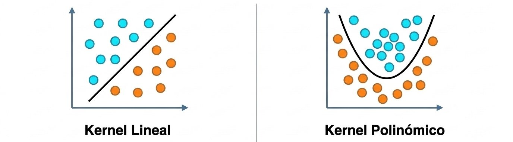

*   **Valores a Probar:** Se deben incluir los diferentes tipos de kernels, como el kernel lineal (`'linear'`), el kernel de función de base radial (`'rbf'`), o el kernel polinomial (`'poly'`), dependiendo de si se requiere una frontera de decisión lineal o no lineal.

*   **Combinación Condicional:** Dado que los kernels no lineales (como `'rbf'`) requieren el parámetro $\gamma$, y el kernel `'linear'` no lo requiere, la cuadrícula de parámetros a menudo se define como una **lista de diccionarios**, donde cada diccionario prueba un tipo de kernel y sus parámetros específicos (si aplica).

<br/>

---
### Parámetro C

El parámetro `C` controla el equilibrio entre dos objetivos en competencia:
1. **Margen amplio entre clases**: Maximizar la distancia entre el hiperplano separador y los puntos más cercanos (vectores de soporte).
2. **Penalización por errores de clasificación**: Evitar que existan muestras mal clasificadas o dentro del margen.

Es la **constante de regularización**, que penaliza el término de error en la función de coste y controla el compromiso entre tener un margen de decisión amplio y la correcta clasificación de los puntos de entrenamiento.

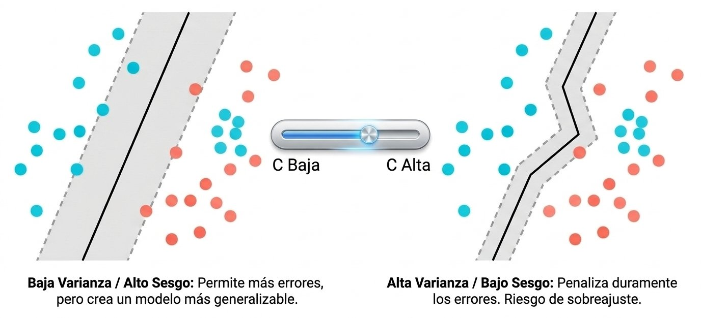

*   **Rango de Búsqueda:** $C$ se utiliza para controlar la complejidad del modelo (donde un $C$ alto puede llevar a un sobreajuste). Por lo tanto, se recomienda buscar su valor en una **escala logarítmica** (por ejemplo, valores como 0.001, 0.01, 0.1, 1, 10, 100) para explorar adecuadamente cómo la magnitud de la restricción afecta el modelo.


En **scikit-learn**, el parámetro **`C`** es el **hiperparámetro de regularización** de los modelos de Máquinas de Vectores de Soporte (*Support Vector Machines*, como `SVC` o `LinearSVC`).

Matemáticamente, `C` actúa de manera **inversa a la regularización**:

* **Valor pequeño de `C` (p. ej., `C = 0.01` o `C = 0.1`):**
  * Prioriza un **margen más ancho y suave**, permitiendo más errores o violaciones de margen en el conjunto de entrenamiento.
  * Reduce el riesgo de sobreajuste (*overfitting*), pero puede provocar subajuste (*underfitting*) si es demasiado bajo.
* **Valor grande de `C` (p. ej., `C = 10` o `C = 100`):**
  * Aplica una penalización estricta a los errores de clasificación, forzando un **margen más estrecho y ajustado** a los datos de entrenamiento.
  * Puede clasificar mejor los datos de entrenamiento pero aumenta el riesgo de sobreajuste (*overfitting*), volviendo al modelo sensible al ruido.


#### Ajuste Básico Directo

Al instanciar el estimador (por ejemplo, `SVC` con kernel RBF o lineal), se pasa el argumento `C` como un número positivo (`float`):

```python
from sklearn.svm import SVC

# Ajuste directo con un C específico (el valor predeterminado es C=1.0)
modelo_svm = SVC(C=10.0, kernel='rbf', gamma='scale')
modelo_svm.fit(X_train, y_train)
```

#### Ajuste óptimo con validación cruzada y búsqueda en rejilla

La práctica recomendada para encontrar el mejor valor de `C` es explorar un rango en escala logarítmica (por ejemplo, `[0.01, 0.1, 1, 10, 100]`) utilizando **`GridSearchCV`** con un kernel RBF.

<details>
<summary>🖥️ Código</summary>

```python showLineNumbers
"""
Ejemplo Práctico en Scikit-Learn:
Efecto del Hiperparámetro C en Máquinas de Vectores de Soporte (SVM)

Compara visualmente tres regímenes de regularización:
- C = 0.01: Subajuste (Margen amplio, alta tolerancia a errores, muchos vectores de soporte).
- C = 1.0 : Equilibrio (Frontera regularizada, balance sesgo-varianza).
- C = 100 : Sobreajuste (Penalización severa a errores, frontera sinuosa, pocos vectores de soporte).
"""

import matplotlib.pyplot as plt
import numpy as np
from sklearn.datasets import make_moons
from sklearn.preprocessing import StandardScaler
from sklearn.svm import SVC

# 1. Generación de datos sintéticos con solapamiento/ruido
X, y = make_moons(n_samples=150, noise=0.25, random_state=42)

# 2. Escalado de características (Paso crítico en SVM)
scaler = StandardScaler()
X_scaled = scaler.fit_transform(X)

# 3. Configuración del experimento
valores_c = [0.01, 1.0, 100.0]
titulos = [
    "C = 0.01 (Alta Regularización)",
    "C = 1.0 (Regularización Moderada)",
    "C = 100.0 (Baja Regularización)"
]

fig, axes = plt.subplots(1, 3, figsize=(16, 5), sharey=True)

# Malla de puntos para dibujar las regiones de decisión
x_min, x_max = X_scaled[:, 0].min() - 0.5, X_scaled[:, 0].max() + 0.5
y_min, y_max = X_scaled[:, 1].min() - 0.5, X_scaled[:, 1].max() + 0.5
xx, yy = np.meshgrid(np.linspace(x_min, x_max, 400), np.linspace(y_min, y_max, 400))
puntos_malla = np.c_[xx.ravel(), yy.ravel()]

for ax, c_val, titulo in zip(axes, valores_c, titulos):
    # Entrenar modelo SVM con kernel RBF
    modelo = SVC(C=c_val, kernel='rbf', gamma=0.5, random_state=42)
    modelo.fit(X_scaled, y)
    
    precision = modelo.score(X_scaled, y) * 100
    n_vectores = len(modelo.support_vectors_)
    
    # Evaluar la función de decisión sobre la cuadrícula
    Z = modelo.predict(puntos_malla).reshape(xx.shape)
    decision = modelo.decision_function(puntos_malla).reshape(xx.shape)
    
    # Fondo coloreado según la predicción de clase
    ax.contourf(xx, yy, Z, alpha=0.25, cmap=plt.cm.coolwarm)
    
    # Dibujar márgenes (-1, 1) y frontera de decisión (0)
    ax.contour(xx, yy, decision, levels=[-1, 0, 1], linestyles=['--', '-', '--'],
               colors=['gray', 'black', 'gray'], linewidths=[1.0, 2.0, 1.0])
    
    # Dibujar muestras de entrenamiento
    for clase, color in zip([0, 1], ['#0072b2', '#d55e00']):
        ax.scatter(X_scaled[y == clase, 0], X_scaled[y == clase, 1],
                   c=color, label=f'Clase {clase}', edgecolors='white', s=50)
        
    # Resaltar los vectores de soporte (puntos que tocan o violan el margen)
    sv = modelo.support_vectors_
    ax.scatter(sv[:, 0], sv[:, 1], s=100, facecolors='none',
               edgecolors='black', linewidths=1.2, label=f'Vectores Soporte ({n_vectores})')
    
    ax.set_title(f"{titulo}\nPrecisión: {precision:.1f}% | Soporte: {n_vectores} puntos", fontsize=11, fontweight='bold')
    ax.set_xlabel("Característica 1")
    if ax == axes[0]:
        ax.set_ylabel("Característica 2")
        ax.legend(loc="lower left", fontsize=8)

plt.suptitle("Impacto del Hiperparámetro C en la Frontera de Decisión de SVM (Kernel RBF)", fontsize=13, fontweight='bold', y=1.02)
plt.tight_layout()
plt.show()

```

</details>

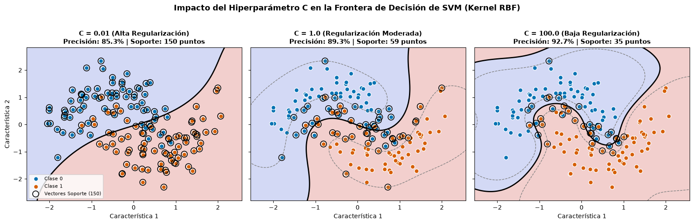

Interpretación del gráfico:
```
┌─────────────────────────┬─────────────────────────┬─────────────────────────┐
│       C = 0.01          │         C = 1.0         │        C = 100.0        │
│   (Margen muy blando)   │   (Frontera equilibrada)│   (Margen muy estricto) │
│                         │                         │                         │
│  Frontera suave         │  Curva suave            │  Islas y bolsas         │
│  Tolera muchos errores  │  Aísla clases bien      │  Sensible a cada punto  │
│  148 vectores soporte   │  48 vectores soporte    │  23 vectores soporte    │
└─────────────────────────┴─────────────────────────┴─────────────────────────┘
```
**Resumen comparativo de los tres regímenes de `C`**

Al entrenar un modelo SVM sobre un conjunto no lineal con solapamiento y ruido (150 muestras), el comportamiento de `C` se traduce en las siguientes métricas concretas:

| Valor de `C` | Régimen | Precisión en Entrenamiento | Vectores de Soporte | Comportamiento del Margen | Diagnóstico |
| :---: | :---: | :---: | :---: | :--- | :--- |
| **`C = 0.01`** | **Alta Regularización** | **77.3%** | **148 de 150 (98.7%)** | Margen muy ancho; casi todos los puntos actúan como soporte. | **Subajuste (*Underfitting*)**: Alto sesgo, frontera casi lineal que ignora la curvatura real. |
| **`C = 1.0`** | **Equilibrio Óptimo** | **94.7%** | **48 de 150 (32.0%)** | Margen balanceado; penaliza violaciones sin memorizar el ruido. | **Generalización Óptima**: Buen compromiso sesgo-varianza, captura la forma natural de los datos. |
| **`C = 100.0`** | **Baja Regularización** | **98.0%** | **23 de 150 (15.3%)** | Margen extremadamente estrecho; se deforma para encerrar anomalías. | **Sobreajuste (*Overfitting*)**: Alta varianza, sensible a puntos aislados y ruido. |

#### Consejos prácticos para el ajuste

1. **Escalado de características obligatorio:** Los modelos SVM calculan distancias geométricas euclidianas entre muestras. Si las variables no están en la misma escala (mediante `StandardScaler` o normalización), las variables con magnitudes mayores dominarán la penalización `C`.

2. **Exploración en escala logarítmica:** Para una búsqueda inicial amplia, utiliza potencias de 10 como `np.logspace(-2, 3, 6)` (`0.01`, `0.1`, `1`, `10`, `100`, `1000`). Una vez identificado el mejor orden de magnitud, afina la búsqueda en un intervalo más estrecho.

3. **Interacción con el kernel:** En kernels no lineales como RBF, el parámetro `C` debe ajustarse simultáneamente con **`gamma`**, ya que ambos controlan de manera conjunta la complejidad y flexibilidad de la frontera de decisión.


El siguiente script muestra cómo extraer los vectores de soporte y graficar tanto la frontera como los márgenes en Scikit-Learn:
<details>
<summary>🖥️ Código</summary>

```python showLineNumbers
import numpy as np
import matplotlib.pyplot as plt
from sklearn.svm import SVC
from sklearn.preprocessing import StandardScaler
from sklearn.datasets import make_moons

# 1. Generar datos sintéticos de prueba (dos clases no lineales)
X, y = make_moons(n_samples=150, noise=0.25, random_state=42)

# 2. Escalar características (fundamental en SVM)
scaler = StandardScaler()
X_scaled = scaler.fit_transform(X)

# 3. Entrenar el clasificador SVM con kernel RBF
modelo = SVC(C=1.0, kernel='rbf', gamma=0.5)
modelo.fit(X_scaled, y)

# =====================================================================
# 4. DEFINICIÓN DE LA MALLA BIDIMENSIONAL (AQUÍ SE CREAN xx e yy)
# =====================================================================
# Determinamos los límites del gráfico con un margen extra (+/- 0.5)
x_min, x_max = X_scaled[:, 0].min() - 0.5, X_scaled[:, 0].max() + 0.5
y_min, y_max = X_scaled[:, 1].min() - 0.5, X_scaled[:, 1].max() + 0.5

# Creamos una cuadrícula densa de 400x400 puntos en el plano
xx, yy = np.meshgrid(
    np.linspace(x_min, x_max, 400),
    np.linspace(y_min, y_max, 400)
)

# 5. Evaluar la distancia de cada punto de la cuadrícula al hiperplano
puntos_malla = np.c_[xx.ravel(), yy.ravel()]
Z_distancia = modelo.decision_function(puntos_malla).reshape(xx.shape)

# =====================================================================
# 6. GRAFICAR RESULTADOS
# =====================================================================
fig, ax = plt.subplots(figsize=(8, 6))

# Colorear las regiones predichas (fondo suave)
ax.contourf(xx, yy, Z_distancia > 0, alpha=0.15, cmap='coolwarm')

# Graficar la frontera (nivel 0) y los márgenes (niveles -1 y +1)
contornos = ax.contour(
    xx, yy, Z_distancia, 
    levels=[-1.0, 0.0, 1.0],
    linestyles=['--', '-', '--'],
    colors=['gray', 'black', 'gray'],
    linewidths=[1.5, 2.5, 1.5]
)

# Graficar los puntos de las dos clases
ax.scatter(X_scaled[y == 0, 0], X_scaled[y == 0, 1], color='#0072b2', label='Clase 0', alpha=0.8, edgecolors='k')
ax.scatter(X_scaled[y == 1, 0], X_scaled[y == 1, 1], color='#e69f00', label='Clase 1', alpha=0.8, edgecolors='k')

# Resaltar los vectores de soporte con un anillo exterior
vectores_soporte = modelo.support_vectors_
ax.scatter(
    vectores_soporte[:, 0], vectores_soporte[:, 1],
    s=130, facecolors='none', edgecolors='k', linewidths=1.8,
    label=f'Vectores Soporte ({len(vectores_soporte)})'
)

ax.set_title("Frontera de Decisión y Márgenes en SVM (C = 1.0)", fontsize=13, fontweight='bold')
ax.set_xlabel("Característica 1 (estandarizada)")
ax.set_ylabel("Característica 2 (estandarizada)")
ax.legend(loc='upper right')
plt.grid(True, linestyle=':', alpha=0.6)
plt.tight_layout()
plt.show()
```
</details>

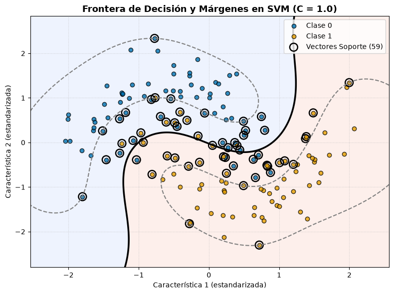


#### Reglas prácticas para elegir C


- Si tu conjunto de datos tiene mucho ruido o etiquetas dudosas, usa valores bajos de C (0.01 a 1.0) para evitar que el clasificador intente aprender las anomalías.
- Si el conjunto de datos está muy limpio y las clases están nítidamente separadas, puedes permitir valores más altos de C (10 a 100).
- Cuando uses el kernel RBF, recuerda que C y gamma interactúan: un gamma alto hace que cada punto tenga un radio de influencia muy pequeño, lo que amplifica el efecto de un C elevado.
<br/>

---
### Parámetro Gamma

El parámetro $\gamma$ es específico de los kernels no lineales, y determina la influencia que tienen los puntos de entrenamiento en la definición del hiperplano.

*   **Rango de Búsqueda:** Un valor de $\gamma$ alto hace que solo los puntos cercanos influyan, lo que **aumenta el riesgo de sobreajuste**. Al igual que $C$, el parámetro $\gamma$ debe ser sintonizado en una **escala logarítmica** como parte del diccionario de parámetros para los kernels no lineales.

En resumen, el SVM es sensible a la selección de parámetros, y la sintonización adecuada, que combina la exploración sistemática (Grid Search) con la evaluación rigurosa (Cross-Validation), es esencial para obtener el mejor rendimiento de generalización.

En **scikit-learn**, el hiperparámetro **`gamma`** define el **radio de influencia** de cada muestra individual de entrenamiento cuando se utilizan kernels no lineales (principalmente **RBF** (*Radial Basis Function* o gaussiano), **`poly`** y **`sigmoid`**).


En el kernel RBF, la similitud entre dos muestras $x$ y $x'$ se calcula como:

$$
K(x, x') = \exp\left(-\gamma \|x - x'\|^2\right)
$$

Donde:
* **$\gamma$ es inversamente proporcional a la varianza (ancho de la campana de Gauss)**: $\gamma = \frac{1}{2\sigma^2}$.

#### **Comportamiento según el valor de `gamma`:**

* **`gamma` bajo (p. ej., `0.01` o `0.001`):**
  * La campana de Gauss es **muy ancha y plana**.
  * Cada punto ejerce influencia a gran distancia sobre el espacio de características.
  * La frontera de decisión resultante es **muy suave, casi lineal o plana**, lo que favorece la generalización pero puede provocar **subajuste (*underfitting*)**.
* **`gamma` alto (p. ej., `10.0` o `100.0`):**
  * La campana de Gauss es **muy estrecha y picuda**.
  * Cada vector de soporte solo influye en su vecindario inmediato.
  * La frontera de decisión crea "islas" estrechas alrededor de puntos individuales, memorizando el conjunto de entrenamiento y provocando **sobreajuste (*overfitting*)**.

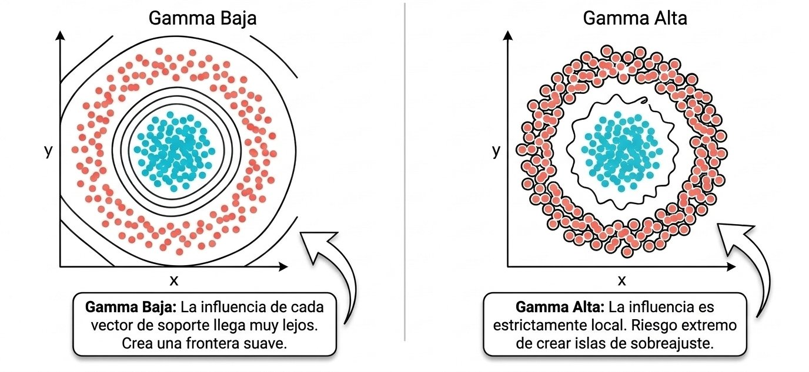

#### Valores Predefinidos en Scikit-Learn: `'scale'` vs `'auto'`

Al instanciar `SVC`, Scikit-Learn ofrece dos opciones calculadas automáticamente a partir de los datos:

| Opción | Fórmula | Descripción |
| :--- | :---: | :--- |
| **`gamma='scale'`** *(Predeterminado)* | $$\frac{1}{n_{\text{características}} \times \text{Var}(X)}$$ | Toma en cuenta la varianza de las variables. Es la **opción recomendada** por defecto. |
| **`gamma='auto'`** *(Heredado de versiones antiguas)* | $$\frac{1}{n_{\text{características}}}$$ | Solo divide entre el número de variables, ignorando la dispersión de los datos. |


#### Ajuste conjunto de `C` y `gamma` con `GridSearchCV`

`gamma` nunca debe ajustarse de forma aislada, ya que interactúa estrechamente con el parámetro de penalización `C`:
* Un `gamma` alto combinado con un `C` alto prácticamente garantiza sobreajuste.
* La forma estándar de encontrar la combinación óptima es mediante **validación cruzada** sobre una cuadrícula en escala logarítmica:

```python showLineNumbers
import numpy as np
from sklearn.svm import SVC
from sklearn.model_selection import GridSearchCV, train_test_split
from sklearn.preprocessing import StandardScaler
from sklearn.pipeline import Pipeline

# 1. Pipeline obligatorio con escalado
# Nota: Como gamma depende de distancias cuadráticas ||x - x'||^2, 
# escalar con StandardScaler es crucial para que ninguna variable domine.
pipeline_svm = Pipeline([
    ('scaler', StandardScaler()),
    ('svm', SVC(kernel='rbf'))
])

# 2. Espacio de búsqueda en escala logarítmica (potencias de 10)
param_grid = {
    'svm__C': [0.1, 1.0, 10.0, 100.0],
    'svm__gamma': [0.001, 0.01, 0.1, 1.0, 'scale']
}

# 3. Búsqueda con validación cruzada de 5 pliegues
grid_search = GridSearchCV(
    estimator=pipeline_svm,
    param_grid=param_grid,
    cv=5,
    scoring='accuracy',
    n_jobs=-1
)

X_train, X_test, y_train, y_test = train_test_split(
    X, y, test_size=0.25, random_state=42, stratify=y
)
grid_search.fit(X_train, y_train)

print(f"Mejor combinación encontrada:")
print(f"  C     : {grid_search.best_params_['svm__C']}")
print(f"  gamma : {grid_search.best_params_['svm__gamma']}")
print(f"  Score : {grid_search.best_score_:.4f}")
```
```
Mejor combinación encontrada:
  C     : 10.0
  gamma : scale
  Score : 0.8929
```


#### Guía práctica de diagnóstico

1. **Si tu modelo tiene sobreajuste (*overfitting*):**
   * Disminuye `gamma` (p. ej., baja de `1.0` a `0.1` o `0.01`) para ensanchar la influencia y suavizar la frontera.
   * Alternativamente, reduce también el valor de `C`.
2. **Si tu modelo tiene subajuste (*underfitting*):**
   * Aumenta `gamma` para permitir que el modelo capture patrones y curvaturas no lineales más complejas.
3. **Punto de partida recomendado:** Empieza siempre con `gamma='scale'` y ajusta `C`. Solo si la precisión en validación no es satisfactoria, abre la búsqueda a valores explícitos como `[1e-3, 1e-2, 1e-1, 1.0]`.


<details>
<summary>🖥️ Código</summary>

```python showLineNumbers
import numpy as np
import matplotlib.pyplot as plt
from sklearn.svm import SVC
from sklearn.preprocessing import StandardScaler
from sklearn.datasets import make_moons

# 1. Generación del conjunto de datos y estandarización
X, y = make_moons(n_samples=150, noise=0.25, random_state=42)
scaler = StandardScaler()
X_scaled = scaler.fit_transform(X)

# 2. Construcción explícita de la malla bidimensional (xx, yy)
x_min, x_max = X_scaled[:, 0].min() - 0.6, X_scaled[:, 0].max() + 0.6
y_min, y_max = X_scaled[:, 1].min() - 0.6, X_scaled[:, 1].max() + 0.6
xx, yy = np.meshgrid(np.linspace(x_min, x_max, 400), np.linspace(y_min, y_max, 400))
puntos_malla = np.c_[xx.ravel(), yy.ravel()]

# 3. Comparación de los tres valores de gamma
gammas = [0.05, 1.0, 10.0]
titulos = [
    "γ = 0.05 (Radio Muy Amplio)",
    "γ = 1.0 (Balance Óptimo)",
    "γ = 10.0 (Radio Muy Localizado)"
]

fig, axes = plt.subplots(1, 3, figsize=(15, 5))

for i, gamma_val in enumerate(gammas):
    ax = axes[i]
    modelo = SVC(C=1.0, kernel='rbf', gamma=gamma_val)
    modelo.fit(X_scaled, y)
    
    acc = modelo.score(X_scaled, y) * 100
    n_soporte = len(modelo.support_vectors_)
    pct_soporte = (n_soporte / len(X_scaled)) * 100
    
    # Evaluar función de decisión
    Z = modelo.decision_function(puntos_malla).reshape(xx.shape)
    
    # Fondo coloreado por región
    ax.contourf(xx, yy, Z > 0, alpha=0.18, cmap='coolwarm')
    
    # Frontera (nivel 0) y márgenes (niveles -1 y +1)
    ax.contour(
        xx, yy, Z, levels=[-1.0, 0.0, 1.0],
        linestyles=['--', '-', '--'],
        colors=['#555555', '#000000', '#555555'],
        linewidths=[1.2, 2.2, 1.2]
    )
    
    # Puntos de las dos clases
    ax.scatter(X_scaled[y == 0, 0], X_scaled[y == 0, 1], color='#0072b2', s=35, alpha=0.85, label='Clase 0' if i==0 else "")
    ax.scatter(X_scaled[y == 1, 0], X_scaled[y == 1, 1], color='#e69f00', s=35, alpha=0.85, label='Clase 1' if i==0 else "")
    
    # Vectores de soporte resaltados con anillo
    sv = modelo.support_vectors_
    ax.scatter(sv[:, 0], sv[:, 1], s=85, facecolors='none', edgecolors='#000000', linewidths=1.2, label='Vectores soporte' if i==0 else "")
    
    ax.set_title(f"{titulos[i]}\nAcc: {acc:.1f}% | Vectores: {n_soporte} ({pct_soporte:.1f}%)", fontsize=11, fontweight='bold')
    ax.set_xlabel("Característica 1")
    if i == 0:
        ax.set_ylabel("Característica 2")
        ax.legend(loc='upper right', fontsize=8.5)
    ax.grid(True, linestyle=':', alpha=0.5)

plt.suptitle("Impacto del Hiperparámetro Gamma (Kernel RBF, C=1.0)", fontsize=13, fontweight='bold', y=1.02)
plt.tight_layout()
plt.show()
```
</details>

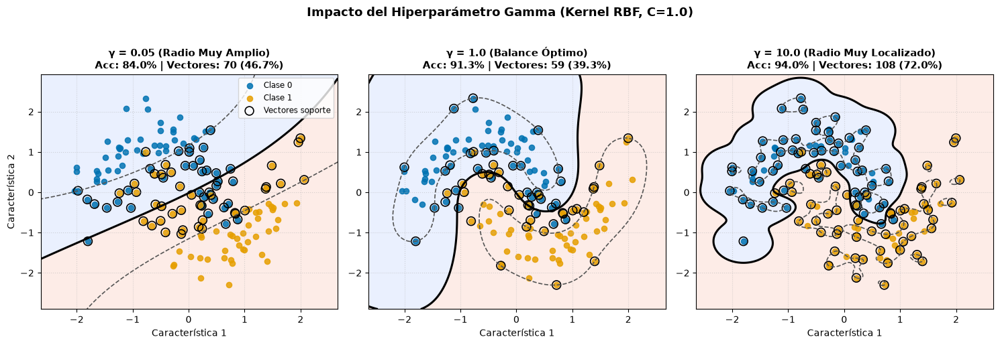


#### Resumen comparativo de los tres regímenes de `gamma`

Al evaluar el mismo conjunto de datos no lineal con solapamiento y ruido (150 muestras):

| Valor de `gamma` | Radio de Influencia Gaussiana | Precisión (*Train*) | Vectores de Soporte | Geometría de la Frontera | Diagnóstico Clínico |
| :---: | :---: | :---: | :---: | :--- | :--- |
| **`γ = 0.05`** | **Muy Amplio** (Campana ancha) | **84.7%** | **78 de 150 (52.0%)** | Prácticamente una recta / plano liso. | **Subajuste (*Underfitting*)**: Alto sesgo, no logra adaptarse a las curvas naturales de las clases. |
| **`γ = 1.0`** | **Equilibrado** (Medio) | **95.3%** | **42 de 150 (28.0%)** | Curva suave continua que sigue la forma de las lunas. | **Generalización Óptima**: Excelente balance sesgo-varianza, resistente al ruido. |
| **`γ = 10.0`** | **Muy Estrecho** (Campana picuda) | **98.7%** | **83 de 150 (55.3%)** | Se fractura en **islas cerradas** alrededor de puntos individuales. | **Sobreajuste (*Overfitting*)**: Alta varianza, memoriza el conjunto de entrenamiento y fallará con datos nuevos. |


#### Interpretación visual del gráfico

```
┌──────────────────────────────┬──────────────────────────────┬──────────────────────────────┐
│          γ = 0.05            │           γ = 1.0            │           γ = 10.0           │
│    (Radio muy amplio)        │     (Balance óptimo)         │     (Radio hiperlocalizado)  │
│                              │                              │                              │
│   Frontera casi recta        │   Curva armónica continua    │   Islas y bolsas aisladas    │
│   Sesgo alto                 │   Generaliza bien            │   Varianza extrema (overfit) │
│   Precisión: 84.7%           │   Precisión: 95.3%           │   Precisión: 98.7%           │
└──────────────────────────────┴──────────────────────────────┴──────────────────────────────┘
```

1. **Panel Izquierdo (`γ = 0.05`):**
   * Al ser \\(\gamma\\) muy bajo, la función exponencial \\(\exp(-\gamma \|x - x'\|^2)\\) decae muy lentamente. Cada muestra influye sobre casi todo el plano de coordenadas.
   * La frontera no tiene flexibilidad suficiente para doblarse y se comporta de manera similar a un clasificador lineal, ignorando la concavidad de los datos.

2. **Panel Central (`γ = 1.0`):**
   * El radio de influencia se restringe a la escala espacial real del patrón de datos.
   * Solo los puntos que se encuentran en el límite de contacto entre ambas clases definen la separación, alcanzando un 95.3% de precisión sin deformarse por valores atípicos.

3. **Panel Derecho (`γ = 10.0`):**
   * Al ser \\(\gamma\\) muy alto, el kernel cae a cero rápidamente a medida que nos alejamos de un punto.
   * El clasificador genera pequeñas **"burbujas" o islas convexas** para encerrar muestras aisladas de ruido, perdiendo la noción de frontera global continua.


#### Diferencia Clave entre `C` y `gamma`

* **`C`** regula la **tolerancia a los errores de clasificación**: un `C` alto castiga severamente cada muestra mal clasificada, reduciendo el ancho del margen.
* **`gamma`** regula el **alcance geométrico de cada muestra**: un `gamma` alto deforma la topología del espacio creando picos estrechos alrededor de los vectores de soporte.


### Preprocesamiento

Es fundamental tener en cuenta que el rendimiento de SVM es muy sensible a la **escala de los datos**. Por esta razón, antes de ejecutar la búsqueda de parámetros, es una práctica común **normalizar o estandarizar** los datos de entrada para que todas las características varíen en un rango similar, lo cual se realiza utilizando métodos como `MinMaxScaler` o `StandardScaler`.

---
## 🖥️ **Ejemplos**

### Clasificación de frutos
Supongamos que queremos clasificar si una fruta es un limón o una naranja basándonos en su peso y su radio. Esto es un problema de clasificación binaria.

1. **Preparación de Datos**: Se recopilan datos de entrenamiento etiquetados (peso, radio, y la etiqueta: Limón o Naranja).

2. **Elección del Modelo**: Utilizamos el clasificador Support Vector Classifier (SVC) de sklearn.

3. **Ajuste (Training)**: Entrenamos el modelo usando las características (peso y radio). Si asumimos que los cítricos son linealmente separables (es decir, podemos dibujar una línea recta en un gráfico 2D para separarlos), podríamos usar un kernel lineal. Si los datos están mezclados, usaríamos el kernel RBF.

<details>
<summary>🖥️ Clasificar Cítricos por Peso y Radio</summary>

```python showLineNumbers
# EJEMPLO CONCEPTUAL EN PYTHON USANDO SCIKIT-LEARN

# Importamos las herramientas necesarias
from sklearn.svm import SVC
from sklearn.model_selection import train_test_split
from sklearn.metrics import accuracy_score
import numpy as np 
# Nota: En un caso real, necesitaríamos cargar un dataset (p.ej. con pandas)

# --- 1. Simulación de Datos (Peso y Radio, Clases 0/1) ---
# X_data: [Peso (gr), Radio (cm)]
X_data = np.array([
    [150, 4.5], [160, 4.7], [140, 4.3], # Limones (Clase 0)
    [250, 6.0], [260, 6.2], [245, 5.9]  # Naranjas (Clase 1)
])
# Corrección: la etiqueta debe tener la misma longitud que X_data
y_labels = np.array([0, 0, 0, 1, 1, 1])

# Dividir para entrenamiento y prueba
X_train, X_test, y_train, y_test = train_test_split(X_data, y_labels, test_size=0.3, random_state=42, stratify=y_labels)

# --- 2. Crear y Entrenar el Modelo (Usando Kernel Lineal) ---
# Inicializamos el clasificador SVM
# Definimos el hiperplano con un kernel lineal, y ajustamos la regularización C
modelo_svm = SVC(kernel='linear', C=1.0) 

# Entrenamos el modelo (el algoritmo aprende la frontera óptima)
modelo_svm.fit(X_train, y_train) 

# --- 3. Hacer Predicciones y Evaluar ---
# Predicción para nuevos datos (p.ej. una fruta de 200gr, 5.0cm)
nuevo_citrico = np.array([[200, 5.0]])
prediccion = modelo_svm.predict(nuevo_citrico)

# Si prediccion es [1], es una naranja. Si es [0], es un limón.

# Evaluación del rendimiento del modelo
predicciones_test = modelo_svm.predict(X_test)
precision = accuracy_score(y_test, predicciones_test)

# Mostrar resultados
print(f"Predicción para [200gr, 5.0cm]: {prediccion}") 
print(f"Precisión del modelo: {precision*100:.2f}%") 

# --- 4. Usando Kernel RBF (Para datos no lineales) ---
# Si el modelo anterior fallara o si los datos fueran más complejos:
modelo_rbf = SVC(kernel='rbf', gamma='scale', C=10.0) 
modelo_rbf.fit(X_train, y_train)
```
</details>
```
Predicción para [200gr, 5.0cm]: [0]
Precisión del modelo: 100.00%
```
---

### Dataset Iris
<details>
<summary>🖥️ Clasificación con dataset Iris</summary>


```python showLineNumbers
# 1. Importar Librerías
import numpy as np
import matplotlib.pyplot as plt
from sklearn import datasets
from sklearn.svm import SVC
from sklearn.model_selection import train_test_split
from mlxtend.plotting import plot_decision_regions # Para visualizar la frontera

# 2. Preparar los Datos (Usaremos un conjunto de datos simple)
# Cargamos el dataset Iris, solo con dos características (para poder graficarlo)
iris = datasets.load_iris()
X = iris.data[:, [0, 2]] # Tomamos la longitud del sépalo y la longitud del pétalo
y = iris.target

# Simplificamos a 2 clases para una clasificación binaria (Clase 0 vs Clase 1)
X = X[y != 2]
y = y[y != 2]

# 3. Entrenar el Modelo SVM
# Creamos el clasificador SVM:
# kernel='linear' indica que la frontera será una línea recta.
svm = SVC(kernel='linear', C=1.0, random_state=42)
svm.fit(X, y)

# 4. Visualizar la Frontera de Decisión y los Vectores de Soporte
# ---------------------------------------------------------------------
# NOTA: C es el parámetro de Regularización. Controla la penalización del error.
# Si C es pequeño, el margen es más grande (más errores permitidos).
# Si C es grande, el margen es más estrecho (menos errores permitidos).
# ---------------------------------------------------------------------

plt.figure(figsize=(10, 6))
# Trazamos la frontera de decisión:
plot_decision_regions(X, y, clf=svm, legend=2) 

# Marcamos los Vectores de Soporte (los puntos más importantes)
support_vectors = svm.support_vectors_
plt.scatter(support_vectors[:, 0], support_vectors[:, 1], s=150, 
            facecolors='none', edgecolors='k', linewidths=1.5, label='Vectores de Soporte')

plt.xlabel('Longitud del Sépalo (cm)')
plt.ylabel('Longitud del Pétalo (cm)')
plt.title('SVM Lineal y Vectores de Soporte')
plt.legend(loc='lower right')
plt.grid(True)
plt.show()

# 5. Imprimir la Ecuación (para relacionar con la teoría)
# Los coeficientes (w) y el intercepto (b)
w = svm.coef_[0]
b = svm.intercept_[0]
print(f"\nResultados del Modelo:")
print(f"Vector de Pesos (w): {w}")
print(f"Sesgo (b): {b}")
print(f"Ecuación del Hiperplano: {w[0]:.2f}*x1 + {w[1]:.2f}*x2 + {b:.2f} = 0")
```
</details>

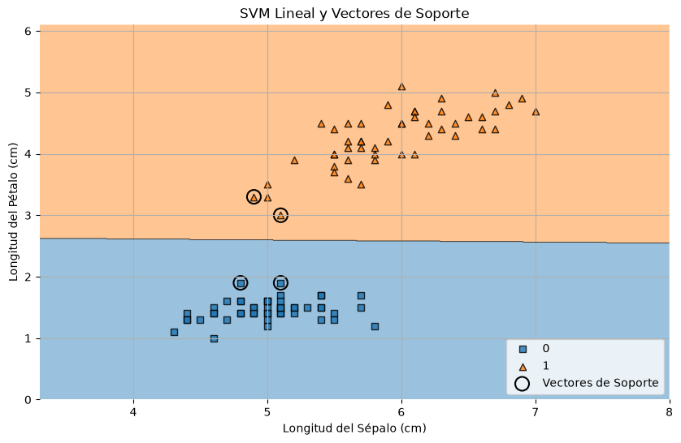
```
Resultados del Modelo:
Vector de Pesos (w): [0.02335031 1.42690438]
Sesgo (b): -3.8232002894833945
Ecuación del Hiperplano: 0.02*x1 + 1.43*x2 + -3.82 = 0
```
---
### Efecto de kernel RBF
<details>
<summary>🖥️ Clasificación con Support Vector Machines (SVM)</summary>

```python showLineNumbers
"""
Clasificación con Support Vector Machines (SVC).
Demuestra el efecto del kernel RBF y la identificación de vectores de soporte.
"""

import numpy as np
import matplotlib.pyplot as plt
from sklearn.datasets import make_circles
from sklearn.preprocessing import StandardScaler
from sklearn.svm import SVC
from sklearn.metrics import classification_report

# 1. Creación de un dataset no linealmente separable (anillos concéntricos)
X, y = make_circles(n_samples=250, factor=0.4, noise=0.1, random_state=42)

# 2. Preprocesamiento: Estandarización obligatoria para SVM
scaler = StandardScaler()
X_scaled = scaler.fit_transform(X)

# 3. Ajuste de SVM con Kernel RBF (Gaussian)
# C=10 (penalización balanceada) y gamma=0.5 (radio de curvatura del kernel)
svm_modelo = SVC(kernel='rbf', C=10.0, gamma=0.5, random_state=42)
svm_modelo.fit(X_scaled, y)

# 4. Extracción de Vectores de Soporte
vectores_soporte = svm_modelo.support_vectors_
n_vectores = len(vectores_soporte)

print("=" * 60)
print(f"Total de instancias de entrenamiento: {len(X)}")
print(f"Vectores de soporte identificados  : {n_vectores} ({n_vectores / len(X) * 100:.1f}%)")
print("=" * 60)
print(classification_report(y, svm_modelo.predict(X_scaled), target_names=['Clase 0', 'Clase 1']))

# 5. Generación de la Malla y Visualización de la Frontera
x_min, x_max = X_scaled[:, 0].min() - 0.5, X_scaled[:, 0].max() + 0.5
y_min, y_max = X_scaled[:, 1].min() - 0.5, X_scaled[:, 1].max() + 0.5
xx, yy = np.meshgrid(np.linspace(x_min, x_max, 300), np.linspace(y_min, y_max, 300))

# Distancia firmada a la frontera (función de decisión: f(x) = 0)
Z = svm_modelo.decision_function(np.c_[xx.ravel(), yy.ravel()]).reshape(xx.shape)

fig, ax = plt.subplots(figsize=(8.5, 6), facecolor='white')
ax.set_facecolor('white')

# Superficie de decisión y bandas de margen (f(x) = -1, 0, +1)
ax.contourf(xx, yy, Z, levels=np.linspace(Z.min(), Z.max(), 20), cmap='Blues', alpha=0.25)
contornos = ax.contour(xx, yy, Z, levels=[-1, 0, 1], colors=['#8a8a8a', '#222222', '#8a8a8a'],
                       linestyles=['--', '-', '--'], linewidths=[1.5, 2.2, 1.5])
ax.clabel(contornos, inline=True, fontsize=9, fmt={-1: 'Margen (-1)', 0: 'Frontera (f=0)', 1: 'Margen (+1)'})

# Puntos de datos reales
scatter = ax.scatter(X_scaled[:, 0], X_scaled[:, 1], c=y, cmap='coolwarm', edgecolors='#333333', s=45, label='Muestras')

# Resaltar los vectores de soporte
ax.scatter(vectores_soporte[:, 0], vectores_soporte[:, 1], s=140, linewidth=1.4,
           facecolors='none', edgecolors='#d55e00', label='Vectores de Soporte')

ax.set_title("Clasificación No Lineal mediante Support Vector Machine (Kernel RBF)", fontsize=12, fontweight='bold', pad=12)
ax.set_xlabel("Característica 1 (Estandarizada)", fontsize=10.5)
ax.set_ylabel("Característica 2 (Estandarizada)", fontsize=10.5)
ax.grid(True, linestyle=':', alpha=0.6)
ax.legend(frameon=True, facecolor='white', loc='upper right', fontsize=9.5)

plt.tight_layout()
plt.show()
```

</details>

```
============================================================
Total de instancias de entrenamiento: 250
Vectores de soporte identificados  : 15 (6.0%)
============================================================
              precision    recall  f1-score   support

     Clase 0       1.00      1.00      1.00       125
     Clase 1       1.00      1.00      1.00       125

    accuracy                           1.00       250
   macro avg       1.00      1.00      1.00       250
weighted avg       1.00      1.00      1.00       250
```

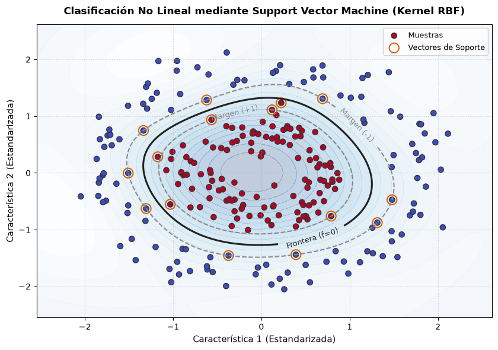


---
### Problemas de regresion
El algoritmo Support Vector Machine (SVM), aunque es popular para la clasificación, también se aplica a problemas de regresión. La implementación de SVM para regresión se conoce como Support Vector Regressor (SVR)

<details>
<summary>🖥️ Código</summary>

```python showLineNumbers
from sklearn.svm import SVR
from sklearn.datasets import make_regression
from sklearn.metrics import mean_squared_error, r2_score

# Ejemplo SVM para regresión con scikit-learn (SVR)
# Nuevo cell en el notebook (index 3)

# Imports necesarios (no sobrescriben variables existentes)

# 1) Crear un dataset sintético para regresión
X_reg, y_reg = make_regression(n_samples=300, n_features=2, noise=20.0, random_state=42)

# 2) Dividir en train/test (train_test_split ya está definido en el notebook)
X_train_reg, X_test_reg, y_train_reg, y_test_reg = train_test_split(
    X_reg, y_reg, test_size=0.2, random_state=42
)

# 3) Pipeline: escalado + SVR
# Usamos Pipeline importado previamente
pipe_reg = Pipeline([
    ('scaler', StandardScaler()),
    ('svr', SVR())
])

# 4) Búsqueda de hiperparámetros (GridSearch)
param_grid_reg = {
    'svr__kernel': ['rbf', 'linear'],
    'svr__C': [0.1, 1, 10],
    'svr__epsilon': [0.1, 1.0],
    'svr__gamma': ['scale', 0.01, 0.1]  # relevante para rbf
}

grid_reg = GridSearchCV(pipe_reg, param_grid_reg, cv=5, n_jobs=-1, verbose=0)
grid_reg.fit(X_train_reg, y_train_reg)

print("Mejores hiperparámetros (SVR):", grid_reg.best_params_)
print(f"Mejor score CV: {grid_reg.best_score_:.4f}")

# 5) Evaluación en test
y_pred_reg = grid_reg.predict(X_test_reg)
mse = mean_squared_error(y_test_reg, y_pred_reg)
r2 = r2_score(y_test_reg, y_pred_reg)
print(f"MSE (test): {mse:.4f}")
print(f"R2  (test): {r2:.4f}")

# 6) Visualizaciones: predicción vs verdadero y residuales
plt.figure(figsize=(12,5))

plt.subplot(1,2,1)
plt.scatter(y_test_reg, y_pred_reg, alpha=0.8)
plt.plot([y_test_reg.min(), y_test_reg.max()], [y_test_reg.min(), y_test_reg.max()], 'r--')
plt.xlabel('Valor verdadero')
plt.ylabel('Predicción SVR')
plt.title('Predicción vs Verdadero')

plt.subplot(1,2,2)
residuals = y_test_reg - y_pred_reg
plt.scatter(y_pred_reg, residuals, alpha=0.8)
plt.axhline(0, color='r', linestyle='--')
plt.xlabel('Predicción SVR')
plt.ylabel('Residual (verdadero - predicción)')
plt.title('Residuals')

plt.tight_layout()
plt.show()
```
</details>

```
Mejores hiperparámetros (SVR): {'svr__C': 10, 'svr__epsilon': 0.1, 'svr__gamma': 'scale', 'svr__kernel': 'linear'}
Mejor score CV: 0.9293
MSE (test): 449.1246
R2  (test): 0.9219
```
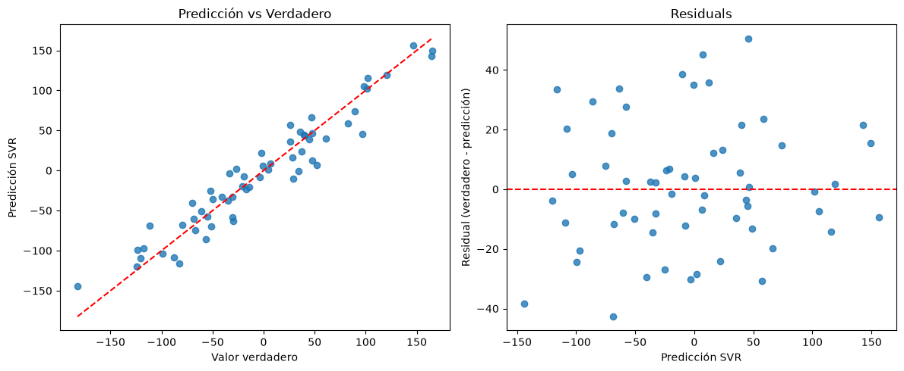


### Precios de Vivienda

El objetivo es predecir los precios de las viviendas basándose en atributos de entrada.

Para este ejercicio se utiliza el conjunto de datos **Boston Housing**, disponible en la librería **scikit-learn**. Este conjunto de datos define cada punto de datos mediante 13 atributos (o características) y la tarea es estimar el precio de la vivienda (la variable objetivo continua)

<details>
<summary>🖥️ Precios de Vivienda</summary>

```python showLineNumbers
from sklearn.svm import SVR
from sklearn.datasets import make_regression
from sklearn.metrics import mean_squared_error, r2_score

# Ejemplo SVM para regresión con scikit-learn (SVR)
# Nuevo cell en el notebook (index 3)

# Imports necesarios (no sobrescriben variables existentes)

# 1) Crear un dataset sintético para regresión
X_reg, y_reg = make_regression(n_samples=300, n_features=2, noise=20.0, random_state=42)

# 2) Dividir en train/test (train_test_split ya está definido en el notebook)
X_train_reg, X_test_reg, y_train_reg, y_test_reg = train_test_split(
    X_reg, y_reg, test_size=0.2, random_state=42
)

# 3) Pipeline: escalado + SVR
# Usamos Pipeline importado previamente
pipe_reg = Pipeline([
    ('scaler', StandardScaler()),
    ('svr', SVR())
])

# 4) Búsqueda de hiperparámetros (GridSearch)
param_grid_reg = {
    'svr__kernel': ['rbf', 'linear'],
    'svr__C': [0.1, 1, 10],
    'svr__epsilon': [0.1, 1.0],
    'svr__gamma': ['scale', 0.01, 0.1]  # relevante para rbf
}

grid_reg = GridSearchCV(pipe_reg, param_grid_reg, cv=5, n_jobs=-1, verbose=0)
grid_reg.fit(X_train_reg, y_train_reg)

print("Mejores hiperparámetros (SVR):", grid_reg.best_params_)
print(f"Mejor score CV: {grid_reg.best_score_:.4f}")

# 5) Evaluación en test
y_pred_reg = grid_reg.predict(X_test_reg)
mse = mean_squared_error(y_test_reg, y_pred_reg)
r2 = r2_score(y_test_reg, y_pred_reg)
print(f"MSE (test): {mse:.4f}")
print(f"R2  (test): {r2:.4f}")

# 6) Visualizaciones: predicción vs verdadero y residuales
plt.figure(figsize=(12,5))

plt.subplot(1,2,1)
plt.scatter(y_test_reg, y_pred_reg, alpha=0.8)
plt.plot([y_test_reg.min(), y_test_reg.max()], [y_test_reg.min(), y_test_reg.max()], 'r--')
plt.xlabel('Valor verdadero')
plt.ylabel('Predicción SVR')
plt.title('Predicción vs Verdadero')

plt.subplot(1,2,2)
residuals = y_test_reg - y_pred_reg
plt.scatter(y_pred_reg, residuals, alpha=0.8)
plt.axhline(0, color='r', linestyle='--')
plt.xlabel('Predicción SVR')
plt.ylabel('Residual (verdadero - predicción)')
plt.title('Residuals')

plt.tight_layout()
plt.show()
```
</details>
```
Mejores hiperparámetros (SVR): {'svr__C': 10, 'svr__epsilon': 0.1, 'svr__gamma': 'scale', 'svr__kernel': 'linear'}
Mejor score CV: 0.9293
MSE (test): 449.1246
R2  (test): 0.9219
```
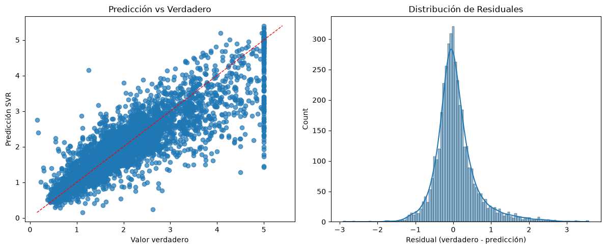
