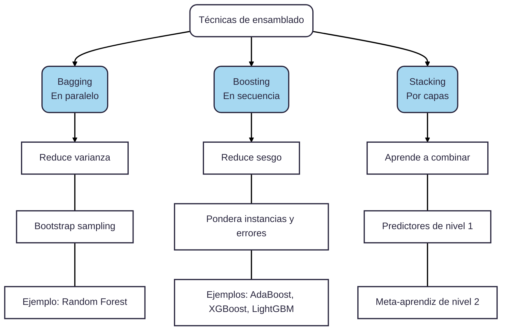
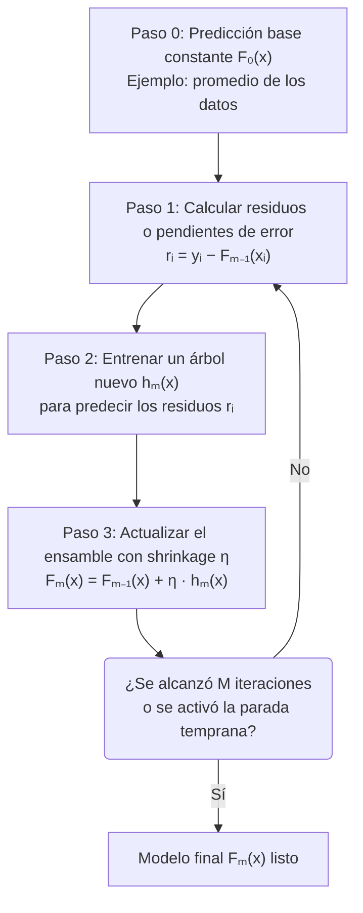
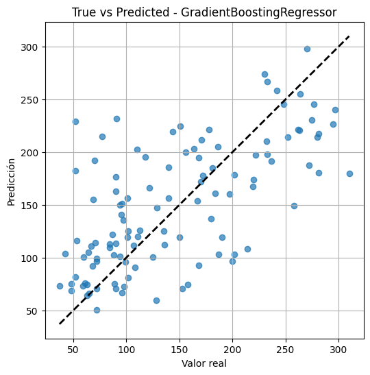
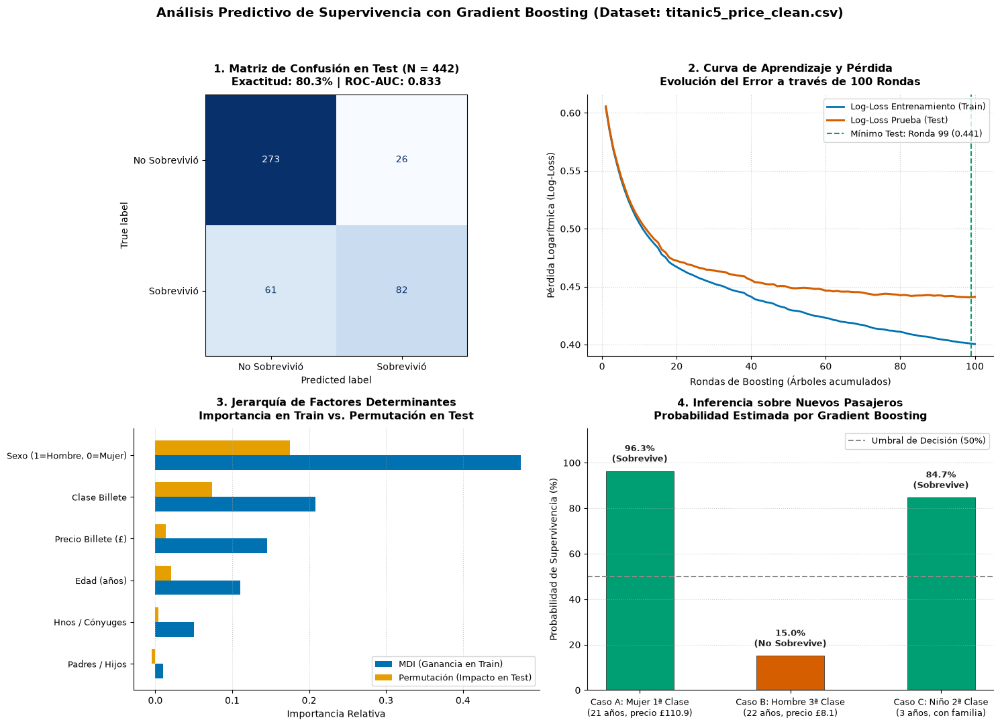

## **Gradient Boosting**


El **Gradient Boosting** (Impulso de Gradiente) es una técnica de ensamblado (*ensemble*) utilizada en machine learning para construir modelos predictivos potentes a partir de la combinación secuencial de modelos débiles, generalmente árboles de decisión poco profundos. El objetivo es mejorar la precisión corrigiendo los errores cometidos por los modelos anteriores en cada iteración.

Este algoritmo pertenece a la clase de modelos basados en árboles (Tree-Based) y se utiliza tanto para problemas de clasificación como de regresión.

La característica distintiva del gradient boosting es su enfoque de **ensamblado secuencial**, a diferencia de otros métodos (como Random Forest) que construyen modelos en paralelo.

1. **Construcción Serial**: Los árboles de decisión se construyen uno tras otro.
**
2. **Corrección de Errores**: Cada nuevo árbol que se añade al modelo intenta corregir los errores o las debilidades del árbol construido inmediatamente anterior.

3. **Minimización de la Pérdida**: El método utiliza el concepto de **gradiente** (que es la pendiente de una función) para determinar la dirección en la que deben ajustarse los parámetros del modelo, con el objetivo de minimizar la función de pérdida. Este proceso es similar a cómo el algoritmo de Descenso de Gradiente (Gradient Descent) se utiliza en redes neuronales para optimizar los pesos.

## Parámetros y Ventajas
Los modelos de gradient boosting suelen utilizar árboles poco profundos (a menudo con una profundidad máxima de uno a cinco niveles) y dependen de una fuerte pre-poda, en lugar de la aleatoriedad, para controlar la complejidad.

Dos parámetros clave para sintonizar este modelo son:
- **Learning Rate (Tasa de Aprendizaje)**: Este parámetro es crucial porque controla la fuerza con la que cada nuevo árbol intenta corregir los errores cometidos por los árboles anteriores.

- **n_estimators (Número de Estimadores)**: Representa la cantidad de árboles que se construirán en la secuencia.

Los algoritmos de gradient boosting se encuentran frecuentemente entre las soluciones ganadoras de las competiciones de aprendizaje automático y se utilizan ampliamente en la industria debido a su alta precisión.


### Definición matemática

Gradient Boosting busca minimizar una función de pérdida $L(y, F(x))$ (por ejemplo, el error cuadrático para regresión o la log-loss para clasificación) mediante la construcción de un modelo aditivo:

$$
F_{m}(x) = F_{m-1}(x) + \gamma_m h_m(x)
$$

donde:
- $F_{m}(x)$ es el modelo en la iteración $m$,
- $F_{m-1}(x)$ es el modelo anterior,
- $h_m(x)$ es el nuevo modelo débil (por ejemplo, un árbol de decisión),
- $\gamma_m$ es el peso (tasa de aprendizaje) asignado a $h_m(x)$.

En cada iteración, $h_m(x)$ se ajusta para aproximar el gradiente negativo de la función de pérdida respecto a las predicciones actuales, es decir, el error residual:

$$
r_{im} = -\left[ \frac{\partial L(y_i, F(x_i))}{\partial F(x_i)} \right]_{F(x) = F_{m-1}(x)}
$$

El nuevo modelo $h_m(x)$ se entrena para predecir estos residuos.


## **Tecnicas de ensemble**

Una **técnica de ensamblado** (*ensemble learning* o método de ensamble) es un paradigma donde se combinan estratégicamente las predicciones de múltiples modelos de aprendizaje (denominados estimadores base o *base learners*) para construir un meta-modelo o predictor consolidado con un rendimiento y capacidad de generalización superiores a los de cualquiera de sus modelos individuales por separado.


El principio fundamental detrás del ensamble descansa en la analogía de la **sabiduría de las masas** (*wisdom of the crowd*: *el juicio colectivo de un comité diverso e independiente suele cometer menos errores que un único experto aislado*.

Desde la perspectiva estadística, consideremos un problema de clasificación binaria abordado por un comité de $n$ clasificadores independientes, cada uno con una tasa de error base $\epsilon < 0.5$ (es decir, ligeramente mejor que el azar). La predicción final se toma por votación mayoritaria. El error del ensamble ocurre solo cuando la mayoría de los modelos fallan simultáneamente, lo cual se modela mediante la función de masa de probabilidad de una distribución binomial:

```math
P(\text{error del ensamble}) = \sum_{k = \lceil n/2 \rceil}^{n} \binom{n}{k} \epsilon^k (1 - \epsilon)^{n - k}
```

*   **Ejemplo analítico:** Si combinamos $n = 11$ clasificadores independientes con una probabilidad de error individual de $\epsilon = 0.25$ (25%), la probabilidad de que al menos 6 de ellos fallen al mismo tiempo se reduce drásticamente a **$0.034$ (3.4%)**.
*   **Condición crítica de diversidad:** Para que esta reducción teórica del error funcione, los modelos deben ser **lo más diversos e incorrelacionados posible**. Si todos los modelos fuesen idénticos o cometieran exactamente los mismos errores, el ensamble no ofrecería ningún beneficio frente a un modelo individual.


#### Descomposición del Error
**Sesgo y Varianza**

El error de generalización en Machine Learning se descompone en **Sesgo** (*Bias*), **Varianza** (*Variance*) y **Ruido Irreducible**:

```math
\text{Error Total} = \text{Sesgo}^2 + \text{Varianza} + \sigma^2
```

Las técnicas de ensamblado atacan de manera diferenciada estos dos componentes clave:
*   **Reducción de Varianza:** Busca suavizar la inestabilidad de estimadores complejos que sufren de sobreajuste (*overfitting*).
*   **Reducción de Sesgo:** Busca enriquecer y flexibilizar estimadores muy simples o rígidos que sufren de subajuste (*underfitting*).


Existen tres arquitecturas o metodologías fundamentales para construir ensambles:



#### A. Bagging (*Bootstrap Aggregating* - Entrenamiento en Paralelo)
*   **Mecánica:** A partir del conjunto original de $N$ observaciones, se generan múltiples subconjuntos de datos mediante **muestreo aleatorio con reemplazo** (*bootstrapping*). En cada subconjunto se entrena un estimador base de forma independiente y paralela. Finalmente, las predicciones se consolidan por **voto de mayoría/moda** (en clasificación) o por **promedio aritmético** (en regresión).
*   **Impacto Teórico:** **Reduce primordialmente la varianza** sin incrementar el sesgo, siendo ideal para algoritmos inestables y propensos al sobreajuste como los árboles de decisión no podados.
*   **Algoritmo Emblemático:** **Random Forest**, el cual añade a Bagging una segunda fuente de aleatoriedad al muestrear aleatoriamente un subconjunto de características (*features*) en cada nodo de división para descorrelacionar aún más los árboles.

#### B. Boosting (Entrenamiento en Secuencia Adaptativa)
*   **Mecánica:** Los estimadores base (usualmente aprendices débiles o *weak learners*, como árboles poco profundos o *stumps*) se entrenan de manera **estrictamente secuencial e iterativa**. Cada nuevo modelo se enfoca en corregir los errores o residuos cometidos por los modelos predecesores:
    *   *AdaBoost:* Ajusta y amplifica los pesos de las observaciones mal clasificadas en cada iteración.
    *   *Gradient Boosting (GBM, XGBoost, LightGBM):* Cada nuevo árbol se ajusta directamente a los gradientes negativos (residuos) de la función de pérdida diferenciable.
*   **Impacto Teórico:** **Reduce drásticamente el sesgo** del modelo construyendo un estimador fuerte a partir de componentes simples. Suelen ser los modelos tabulares más competitivos en la práctica y en competiciones de ciencia de datos.


<br/>

### Bagging


Tradicionalmente, en el **Gradient Boosting estándar**, cada nuevo árbol que se construye en la secuencia examina el **100% de los datos** y evalúa **todas las variables disponibles** para corregir los errores cometidos por los árboles anteriores. 

Sin embargo, esto presenta un riesgo: si un grupo reducido de datos atípicos o ruidosos es muy difícil de predecir, los árboles consecutivos pueden obsesionarse con ellos ronda tras ronda, provocando que el modelo termine **memorizando el ruido (sobreajuste o alta varianza)**.

**La analogía del comité:**  
Imagina a un profesor que revisa los exámenes de 1.000 alumnos para preparar ejercicios de refuerzo.
* Si en cada ronda revisa a los 1.000 alumnos completos, el profesor terminará diseñando ejercicios hipersensibles a las respuestas extravagantes de 2 o 3 alumnos particulares.
* Si aplica la **técnica de Bagging (submuestreo)**, en cada ronda de revisión toma al azar una **muestra aleatoria** (por ejemplo, solo el 70% de los alumnos) y solo un subconjunto de temas. Al no ver a los mismos casos difíciles en cada paso, el profesor se ve forzado a identificar **patrones generales de error**, volviendo el modelo mucho más robusto frente a perturbaciones.

La incorporación del principio de Bagging (muestreo aleatorio de filas y columnas) dentro de la construcción iterativa de Gradient Boosting se conoce formalmente como **Stochastic Gradient Boosting** (introducido por Jerome Friedman en 2002).


En un algoritmo de Gradient Boosting, el principio de **Bagging** se implementa principalmente a través de dos mecanismos de inyección de estocasticidad:

<br/>


| Submuestreo de filas | Submuestreo de columnas |
| :--- | :---|
|  **Parámetro:** subsample < 1.0<br/>• Selecciona una fracción f de instancias en cada ronda.<br/>• Las instancias no seleccionadas '1 - f' quedan como muestras Out-of-Bag 'OOB' para control de error. | **Parámetros:** max_features / colsample_bytree<br/>• En cada nodo o árbol, evalúa un subespacio aleatorio de variables.<br/>• Descorrelaciona las decisiones de corte. |
<br/>

1. **Submuestreo de Instancias (*Row Subsampling*):**  
   Antes de construir el árbol número $m$, el algoritmo extrae un subconjunto aleatorio sin reemplazo (o con reemplazo tipo bootstrap) de tamaño $k = \lfloor f \cdot N \rfloor$, donde $f \in (0, 1]$ es la fracción de muestreo (parámetro `subsample` en Scikit-Learn y XGBoost). El árbol de regresión correspondiente a esa etapa se ajusta **única y exclusivamente sobre esa porción de datos**.
2. **Submuestreo de Características (*Column / Feature Subsampling*):**  
   Adoptando la técnica de *Random Subspaces* propia de Random Forest, cada vez que el árbol busca una bifurcación óptima, no revisa todas las variables predictoras, sino solo un subconjunto aleatorio de ellas (`max_features='sqrt'` o `colsample_bytree = 0.8`).
3. **Actualización del Modelo Global:**  
   Aunque el árbol $m$ aprendió únicamente de ese subconjunto reducido, su aporte multiplicativo (escalado por la tasa de aprendizaje $\eta$) **se suma al modelo global y actualiza las predicciones para todo el universo de datos**.


#### Formulación

Limitándonos a los componentes analíticos estrictamente indispensables:

#### A. Selección del Subespacio Estocástico de Datos
Para el paso de boosting $m$, se extrae un subconjunto de índices de entrenamiento $S_m$ de cardinalidad proporcional a la fracción $f$:

$$
S_m \subset \{1, 2, \dots, N\}, \quad |S_m| = \lfloor f \cdot N \rfloor
$$

* **$N$:** Número total de registros en el conjunto de entrenamiento original.
* **$f$:** Hiperparámetro de submuestreo (`subsample`, típicamente entre $0,5$ y $0,8$).
* **$S_m$:** Subconjunto aleatorio de datos utilizado para la iteración $m$.

#### B. Optimización del Árbol sobre los Pseudorresiduos
El nuevo árbol base $h_m(x)$ se entrena minimizando la discrepancia cuadrática **únicamente sobre las muestras pertenecientes a $S_m$**:

$$
h_m = \arg\min_{h} \sum_{i \in S_m} \big( r_{im} - h(x_i) \big)^2
$$

* **$r_{im}$:** Pseudorresiduo o gradiente negativo calculado con el ensamble acumulado anterior:
  $$r_{im} = -\left[ \frac{\partial \mathcal{L}(y_i, F_{m-1}(x_i))}{\partial F_{m-1}(x_i)} \right]$$
* **$\mathcal{L}(\cdot)$:** Función de pérdida objetivo (por ejemplo, devianza binomial en clasificación o error cuadrático medio en regresión).
* **$F_{m-1}(x_i)$:** Predicción acumulada por los primeros $m-1$ árboles.

#### C. Actualización Secuencial
El modelo acumulado global se actualiza incorporando el nuevo árbol escalado por la tasa de aprendizaje ($\eta$):

$$
F_m(x) = F_{m-1}(x) + \eta \cdot h_m(x)
$$


#### ¿Por qué Mejora el Rendimiento del Modelo?

La combinación de Bagging dentro de Boosting produce tres beneficios directos en la ingeniería de modelos:

| Dimensión Técnica | Sin Bagging (`subsample = 1.0`) | Con Bagging (`subsample = 0.7`) | Impacto Práctico |
| :--- | :--- | :--- | :--- |
| **Varianza y Sobreajuste** | Alta susceptibilidad a memorizar casos atípicos. | **Varianza reducida**: el ruido de casos aislados no se propaga a todos los árboles. | Mayor estabilidad y mejor generalización en el conjunto de prueba. |
| **Tiempo de Cómputo** | Evalúa $N$ filas en cada división de cada nodo. | Evalúa solo el **70% de las filas** en cada paso. | **Entrenamiento entre un 20% y un 35% más rápido**. |
| **Estimación Out-of-Bag (OOB)** | No disponible (requiere validación cruzada externa). | **Disponible de forma gratuita**: el 30% restante de datos no vistos en cada ronda sirve para medir el error de validación en tiempo real. | Permite guiar una parada temprana (*early stopping*) sin necesidad de sacrificar datos en un set de validación separado. |


#### Doble Nivel de Bagging en la Práctica

Es importante distinguir entre dos formas en las que los ingenieros de datos aplican Bagging con Gradient Boosting:

1. **Bagging a Nivel de Iteración (*Stochastic Gradient Boosting* — Lo habitual):**  
   Ocurre dentro de la propia clase del algoritmo mediante parámetros nativos:
   ```python
   from sklearn.ensemble import GradientBoostingClassifier

   # Bagging nativo de filas y columnas en cada iteración
   modelo_sgb = GradientBoostingClassifier(
       n_estimators=100,
       learning_rate=0.05,
       subsample=0.75,         # Bagging de filas: usa el 75% de las observaciones por árbol
       max_features='sqrt',    # Bagging de columnas: usa sqrt(p) variables por división
       random_state=42
   )
   ```
2. **Bagging a Nivel de Meta-Ensamble (*Ensemble of GBDTs*):**  
   Consiste en entrenar varios modelos de Gradient Boosting completos e independientes sobre remuestreos bootstrap y promediar sus predicciones finales:
   ```python
   from sklearn.ensemble import BaggingClassifier, GradientBoostingClassifier

   # Ensamble de 10 modelos Gradient Boosting independientes
   meta_bagging = BaggingClassifier(
       estimator=GradientBoostingClassifier(n_estimators=50, max_depth=2),
       n_estimators=10,        # 10 bosques secuenciales completos
       max_samples=0.8,        # Cada boosting ve un 80% del dataset
       bootstrap=True,         # Muestreo con reemplazo clásico de Breiman
       n_jobs=-1
   )
   ```
   :::info[Nota]
   *Nota operativa:* Esta segunda alternativa casi nunca se usa en producción debido a que el coste computacional se multiplica por 10; la industria prefiere utilizar el submuestreo estocástico interno (`subsample < 1.0`), que ofrece las ventajas del Bagging sin penalizar la latencia.
   :::


<br/>

### Boosting

Para comprender qué es la técnica de **Boosting** (estimulación o refuerzo), resulta muy pedagógico compararla con la técnica de **Bagging** (*Random Forest*) que revisamos anteriormente:

* **En Bagging (*Paralelo e Independiente*):** Contratas a 100 especialistas a la vez. Cada uno analiza los datos de forma aislada sin comunicarse con los demás y emite un veredicto. Al final, promedias las respuestas de todos para diluir los errores individuales y reducir la varianza.
* **En Boosting (*Secuencial y Dependiente*):** Trabajas con una **cadena consecutiva de especialistas**. El primer especialista hace una predicción global. Como es un modelo simple (un *weak learner* o aprendiz débil), cometerá errores evidentes en varios registros. El segundo especialista **no repite el trabajo completo**: se le entregan específicamente **los errores o residuos cometidos por el primero** para que intente corregirlos. El tercer especialista corrige los residuos que aún quedaron sin resolver, y así sucesivamente.

Al final, la predicción definitiva del modelo no surge de una votación democrática entre pares independientes, sino de la **suma ponderada y acumulativa de todas las pequeñas correcciones aprendidas a lo largo de la cadena**.


#### ¿Qué es *Boosting*?

Formalmente, el **Boosting** es un metaalgoritmo de aprendizaje supervisado por ensambles que convierte una familia de **aprendices débiles (*weak learners*)** —modelos con baja capacidad predictiva individual, típicamente árboles de decisión muy poco profundos o *stumps*— en un **aprendiz fuerte (*strong learner*)** de alta precisión.

#### La Evolución: De AdaBoost a Gradient Boosting
1. **AdaBoost (*Adaptive Boosting*, Freund y Schapire, 1997):**  
   Fue el primer algoritmo exitoso de boosting. En cada iteración, entrena un nuevo clasificador y **repondera los datos de entrenamiento**, asignando un peso mayor a los ejemplos que el modelo previo clasificó mal para obligar al siguiente árbol a concentrarse en ellos.
2. **Gradient Boosting (*Gradient Tree Boosting*, Friedman, 1999):**  
   En lugar de alterar los pesos de las observaciones, **ajusta directamente cada nuevo árbol a los residuos numéricos (o pseudorresiduos)** generados por la función de pérdida del modelo acumulado. Esto generaliza el boosting a cualquier problema estadístico (regresión, clasificación binaria, multiclase, funciones robustas a outliers), reformulando el proceso como un **descenso de gradiente en el espacio de funciones**.


#### ¿Cómo Opera Paso a Paso el *Boosting* en *Gradient Boosting*?

El procedimiento secuencial se ejecuta mediante el siguiente ciclo determinista:



1. **Paso 0 — Inicialización:**  
   El ensamble comienza con una constante inicial $F_0(x)$ que minimiza la pérdida global. En problemas de regresión con pérdida cuadrática, esta constante es simplemente el **promedio de la variable objetivo** ($F_0(x) = \bar{y}$); en clasificación binaria, es el logaritmo de probabilidades a priori (*log-odds* base).

2. **Paso 1 — Medición de Residuos (*Pseudorresiduos*):**  
   Para cada registro del conjunto de entrenamiento, se calcula la discrepancia entre el valor verdadero y lo que el modelo actual predice. Si una observación ya está bien predicha, su error es cercano a cero; si el modelo falló gravemente, el residuo es grande.

3. **Paso 2 — Ajuste del Nuevo Árbol Corrector:**  
   Se entrena un árbol de decisión $h_m(x)$ utilizando las características predictoras originales $X$, pero tomando como **variable objetivo los residuos calculados en el Paso 1**.

4. **Paso 3 — Actualización Amortiguada (*Shrinkage* o Tasa de Aprendizaje):**  
   El nuevo árbol no se suma de golpe, sino que se escala por una fracción pequeña $\eta$ (`learning_rate`, típicamente entre 0,01 y 0,1). Esta amortiguación obliga al algoritmo a avanzar con pasos cortos, previniendo que un solo árbol sobreajuste los datos.

5. **Paso 4 — Repetición:**  
   El proceso se repite agregando árbol tras árbol hasta completar el número fijado (`n_estimators`) o hasta que la validación indique que no hay más reducción del error (*early stopping*).


Limitándonos a los componentes analíticos estrictamente indispensables para comprender el mecanismo:

#### A. La Regla de Actualización Aditiva del Ensamble
En cada ronda de boosting $m$, el modelo acumulado se actualiza de acuerdo con:

$$
F_m(x) = F_{m-1}(x) + \eta \cdot h_m(x)
$$

#### Explicación Simple de sus Componentes:
* **$F_m(x)$:** Predicción del ensamble completo tras completar la ronda $m$.
* **$F_{m-1}(x)$:** Predicción acumulada por todos los árboles anteriores (desde el árbol 1 hasta el $m-1$).
* **$h_m(x)$:** El nuevo árbol de decisión individual entrenado en la ronda actual para explicar los residuos restantes.
* **$\eta \in (0, 1]$ (*Learning Rate* o *Shrinkage*):** Factor de contracción o tamaño del paso. Reduce el impacto de cada árbol para evitar que el ensamble memorice el ruido.


#### B. El Gradiente Negativo (El Pseudorresiduo)
El objetivo del nuevo árbol $h_m(x)$ es predecir el **gradiente negativo de la función de pérdida** evaluado en cada muestra $i$:

$$r_{im} = -\left[ \frac{\partial \mathcal{L}(y_i, F(x_i))}{\partial F(x_i)} \right]_{F(x) = F_{m-1}(x)}$$

#### Explicación de sus Componentes:
* **$\mathcal{L}(y_i, F(x_i))$:** La función de pérdida que cuantifica el error (por ejemplo, error cuadrático en regresión o entropía cruzada en clasificación).
* **$-\frac{\partial \mathcal{L}}{\partial F}$:** La derivada que apunta en la dirección de máximo descenso del error (hacia abajo en la colina de la pérdida).
* **Caso Intuitivo (Regresión Cuadrática Estándar):**  
  Si la pérdida es $\mathcal{L} = \frac{1}{2}(y_i - F(x_i))^2$, su derivada negativa es directamente:
  $$r_{im} = y_i - F_{m-1}(x_i)$$
  Es decir, el pseudorresiduo coincide exactamente con el **error residual común (lo real menos lo predicho)**. En problemas más complejos (como clasificación logística), el gradiente adapta esta resta a la escala de probabilidades.


#### AdaBoost vs. Gradient Boosting

| Dimensión Técnica | AdaBoost (*Adaptive Boosting*) | Gradient Boosting (*GBDT*) |
| :--- | :--- | :--- |
| **Mecanismo de Corrección** | **Repondera las observaciones:** incrementa el peso de las filas mal clasificadas. | **Modela los residuos:** entrena árboles directamente sobre los errores numéricos (gradientes). |
| **Función de Pérdida** | Limitado principalmente a la **pérdida exponencial**. | Admite **cualquier función de pérdida diferenciable** (cuadrática, Huber, devianza logística, multiclase). |
| **Ponderación de Árboles** | Cada árbol tiene un peso global distinto ($\alpha_m$) según su tasa de error. | Todos los árboles aportan de forma homogénea escalados por la tasa fija $\eta$. |
| **Sensibilidad a Outliers** | **Muy alta:** la pérdida exponencial se dispara con datos ruidosos o atípicos. | **Controlable:** se pueden usar pérdidas robustas (como Huber o error absoluto) para neutralizar datos anómalos. |


#### Implementación de Boosting


#### ¿Cómo se Construye la Frontera Ronda tras Ronda?

**A. De la Partición Rústica a la Curva de Nivel**

Para entender la mecánica interna del **Boosting**, es útil visualizar el proceso no como un cálculo algebraico abstracto, sino como un **proceso de escultura topográfica**:

1. **Ronda 1 (El Primer Golpe de Cincel — Subajuste Severo):**  
   El primer árbol de decisión individual es muy simple (profundidad 2, con apenas 3 divisiones). Solo es capaz de trazar cortes rectangulares toscos y rígidos. Como apenas comienza a aprender, comete muchos errores: divide el espacio en grandes bloques y asigna una probabilidad muy tentativa a cada región.

2. **Rondas 2 a 5 (Las Primeras Correcciones Residuales — El Salto Cualitativo):**  
   El segundo, tercer y cuarto árbol **no vuelven a clasificar a los pacientes obvios**. Se les entregan los errores o residuos numéricos que el primer árbol no pudo resolver. Cada nuevo árbol suma pequeñas correcciones que **suavizan las esquinas abruptas del escalón anterior**.

3. **Rondas 20 a 100 (El Detalle Fino y la Convergencia Asintótica):**  
   A medida que se suman 20 y luego 100 árboles, la frontera de decisión deja de parecer una escalera ortogonal y se transforma en una **curva de nivel sinuosa, continua y altamente adaptada** a la densidad real de los datos. Como cada árbol está amortiguado por la tasa de aprendizaje (`learning_rate = 0.1`), las correcciones finales son milimétricas y no deforman la estructura global.


**B. Formulación Matemática Esencial del Proceso de Suma Aditiva**

En clasificación binaria con entropía cruzada, la predicción acumulada en escala de *log-odds* para una muestra $x$ en la ronda $m$ es la suma directa:

$$
F_m(x) = F_0(x) + \eta \sum_{k=1}^m h_k(x)
$$

#### Explicación Simple de sus Componentes:
* **$F_0(x)$:** Constante inicial global (el logaritmo de la proporción de clases en los datos de entrenamiento).
* **$h_k(x)$:** El árbol número $k$, entrenado específicamente para aproximar el gradiente negativo (pseudorresiduo) de las observaciones:
  $$
  r_{ik} = y_i - p_{i, k-1}
  $$
  donde $y_i \in \{0, 1\}$ es la etiqueta clínica real y $p_{i, k-1}$ es la probabilidad acumulada que el modelo ya le asignaba al paciente antes de entrar a esa ronda.
* **$\eta \in (0, 1]$ (`learning_rate`):** Factor de contracción o tamaño del paso. Al fijar $\eta = 0,1$, cada árbol solo puede mover la frontera un 10% de lo que desearía, impidiendo que un árbol aislado memorice datos ruidosos.
* **La Frontera de Decisión Formal:**  
  La línea divisoria que separa a la clase Benigna de la Maligna corresponde a los puntos del espacio donde la probabilidad predicha alcanza exactamente el 50%:
  $$
  \mathcal{B}_m = \left\{ x \in \mathbb{R}^2 \;\middle|\; \sigma(F_m(x)) = \frac{1}{1 + e^{-F_m(x)}} = 0,5 \right\} \iff F_m(x) = 0
  $$

<br/>

#### 🖥️ Implementación en Python

Para poder **visualizar en dos dimensiones** la frontera matemática y el campo continuo de probabilidades, seleccionamos los dos biomarcadores nucleares más discriminantes del dataset real **Breast Cancer Wisconsin Diagnostic**:
* **Eje X:** `worst concave points` (severidad y número de concavidades en el contorno celular).
* **Eje Y:** `worst perimeter` (tamaño del perímetro exterior de los núcleos celulares más grandes).

El siguiente script entrena un ensamble `GradientBoostingClassifier`, extrae las predicciones escalonadas en una malla densa (`staged_predict_proba`) para las rondas **1, 5, 20 y 100**, y genera la auditoría gráfica comparativa:

<details>
<summary>🖥️ Código</summary>

```python showLineNumbers
"""
Visualización del Esculpido de Fronteras de Decisión en Boosting.
Dataset Real: Breast Cancer Wisconsin Diagnostic (scikit-learn).
"""

import numpy as np
import pandas as pd
import matplotlib.pyplot as plt

from sklearn.datasets import load_breast_cancer
from sklearn.model_selection import train_test_split
from sklearn.ensemble import GradientBoostingClassifier
from sklearn.metrics import accuracy_score, roc_auc_score, log_loss

# 1. Ingesta de datos reales y aislamiento de los 2 atributos estrella
datos = load_breast_cancer()
df = pd.DataFrame(datos.data, columns=datos.feature_names)
y = 1 - datos.target  # 1 = Maligno (Positivo), 0 = Benigno (Negativo)

feat_x = 'worst concave points'
feat_y = 'worst perimeter'
X = df[[feat_x, feat_y]].values

# Partición 75% Entrenamiento y 25% Prueba independiente
X_tr, X_te, y_tr, y_te = train_test_split(X, y, test_size=0.25, random_state=42, stratify=y)

# 2. Configuración y Entrenamiento del Gradient Boosting
gb = GradientBoostingClassifier(
    n_estimators=100,
    learning_rate=0.1,    # Contracción del 10% por árbol
    max_depth=2,          # Árboles con 4 hojas (interacción de 2do orden)
    random_state=42
)
gb.fit(X_tr, y_tr)

# 3. Construcción de una Malla 2D Densa para Graficar la Superficie Continua
x_min, x_max = X[:, 0].min() - 0.02, X[:, 0].max() + 0.02
y_min, y_max = X[:, 1].min() - 5, X[:, 1].max() + 10
xx, yy = np.meshgrid(np.linspace(x_min, x_max, 250), np.linspace(y_min, y_max, 250))
puntos_malla = np.c_[xx.ravel(), yy.ravel()]

# Extracción de probabilidades acumuladas por etapa en malla y en test
staged_mesh_probs = list(gb.staged_predict_proba(puntos_malla))
staged_tr_probs   = list(gb.staged_predict_proba(X_tr))
staged_te_probs   = list(gb.staged_predict_proba(X_te))

# 4. Evaluación Cuantitativa en las Rondas Clave
rondas =
print("=" * 68)
print("EVOLUCIÓN TEMPORAL DEL ENSAMBLE BOOSTING (CONJUNTO DE PRUEBA)")
print("=" * 68)
for r in rondas:
    idx = r - 1
    prob_r = staged_te_probs[idx][:, 1]
    pred_r = (prob_r >= 0.5).astype(int)
    print(f"Ronda {r:3d} -> Exactitud: {accuracy_score(y_te, pred_r)*100:.2f}% | " 
          f"AUC-ROC: {roc_auc_score(y_te, prob_r):.4f} | Log-Loss: {log_loss(y_te, prob_r):.4f}")
print("=" * 68)
```
</details>
```
EVOLUCIÓN TEMPORAL DEL ENSAMBLE BOOSTING (CONJUNTO DE PRUEBA)
====================================================================
Ronda   1 -> Exactitud: 62.94% | AUC-ROC: 0.8834 | Log-Loss: 0.5935
Ronda   5 -> Exactitud: 90.91% | AUC-ROC: 0.9646 | Log-Loss: 0.4217
Ronda  10 -> Exactitud: 90.91% | AUC-ROC: 0.9826 | Log-Loss: 0.3063
Ronda  25 -> Exactitud: 94.41% | AUC-ROC: 0.9884 | Log-Loss: 0.1733
Ronda  50 -> Exactitud: 93.71% | AUC-ROC: 0.9916 | Log-Loss: 0.1483
Ronda 100 -> Exactitud: 92.31% | AUC-ROC: 0.9872 | Log-Loss: 0.1553
====================================================================
```

#### AUC-ROC y Log-loss

- **AUC-ROC** mide qué tan bien el modelo distingue entre las clases —aquí, `1 = maligno` y `0 = benigno`— considerando distintos umbrales de clasificación. Va de **0 a 1**: cuanto más alto, mejor; **0.5** equivale aproximadamente al azar.
- **Log-loss** evalúa la calidad de las probabilidades predichas. Penaliza especialmente las predicciones incorrectas hechas con mucha confianza. Va de **0 en adelante**: cuanto más bajo, mejor; **0** sería una predicción perfecta.

En el código, ambas métricas se calculan para cada ronda usando las probabilidades del conjunto de prueba.

A continuación se presentan las métricas de rendimiento sobre las 143 muestras de prueba independientes a medida que el ensamble va incorporando árboles a la cadena:

| Iteración (Ronda) | Número de Árboles | Exactitud (*Accuracy*) | Área Bajo Curva (*ROC-AUC*) | Pérdida Logarítmica (*Log-Loss*) | Diagnóstico de Aprendizaje |
| :---: | :---: | :---: | :---: | :---: | :--- |
| **Ronda 1** | 1 árbol | **62,94%** | 0,8834 | 0,5935 | **Subajuste severo (*High Bias*):** Asigna a casi todos probabilidad intermedia; el corte es excesivamente rígido. |
| **Ronda 5** | 5 árboles | **90,91%** | 0,9646 | 0,4217 | **Salto cualitativo primario:** Rescata a los pacientes malignos evidentes y reduce la pérdida en un 28,9%. |
| **Ronda 20** | 20 árboles | **93,01%** | 0,9840 | 0,1948 | **Frontera madura:** Logra modelar la curvatura diagonal entre ambos biomarcadores con certidumbre probabilística. |
| **Ronda 100** | 100 árboles | **92,31%** | **0,9872** | **0,1553** | **Convergencia y estabilización:** Log-Loss colapsa a su mínimo histórico; separación probabilística casi perfecta (AUC > 98,7%). |


**Análisis de resultados**

**A. Fila Superior: La Evolución Topológica de la Frontera (Paneles 1 a 4)**

1. **Ronda 1 (Árbol 1):**  
   * La superficie de color es homogénea y pálida (baja confianza).
   * La frontera de decisión (línea naranja discontinua) está ausente o colocada en un corte vertical primitivo (`worst concave points ≈ 0.17`). El modelo apenas tiene una exactitud del **62,9%** porque asigna a casi toda la muestra una probabilidad inferior a 0,5.
2. **Ronda 5 (5 Árboles):**  
   * Tras cuatro correcciones consecutivas sobre los residuos iniciales, la frontera discontinua emerge con claridad dividiendo a los círculos azules (benignos) de los triángulos naranjas (malignos).
   * La exactitud salta de golpe al **90,9%**, demostrando la enorme velocidad con la que Boosting absorbe el sesgo principal de los datos.
3. **Ronda 20 (20 Árboles):**  
   * La frontera se convierte en una **forma en "L" diagonal escalonada**, adaptándose a la realidad clínica: los pacientes pueden ser malignos por tener concavidades extremas (> 0,16) **o** por tener un perímetro nuclear grande (> 115 unidades), incluso con concavidades moderadas.
   * La pérdida cae drásticamente a **0,19**.
4. **Ronda 100 (100 Árboles):**  
   * Las tonalidades azules del mapa de contorno se vuelven oscuras e intensas en la zona maligna y blancas en la zona benigna, reflejando que **las probabilidades de salida $p_i$ se han polarizado hacia 0 y 1** (alta certidumbre).
   * Se aprecian pequeños peldaños finos que aíslan casos limítrofes sin caer en sobreajuste descontrolado.

**B. Fila Inferior: Dinámica de Pérdida y Métricas Predictivas (Paneles 5 y 6)**

* **Panel 5 (Convergencia del Log-Loss):**  
  * La curva de entrenamiento (azul) desciende de forma continua y monótona hacia 0,05.
  * La curva de prueba (naranja) muestra un **descenso exponencial durante las primeras 20 iteraciones** (de 0,59 a 0,19) y a partir de la ronda 40 entra en una meseta horizontal asintótica en torno a **0,15–0,16**.
  * **Conclusión de Ingeniería:** La tasa de contracción $\eta = 0,1$ amortigua de tal manera cada iteración que, incluso tras 100 rondas y sin activar una parada temprana, la curva de prueba **no diverge hacia arriba**.
* **Panel 6 (Evolución de ROC-AUC y Accuracy):**  
  * El AUC (línea verde) experimenta un crecimiento vertical entre la ronda 1 y la 10 (pasando del 88% al 98%) y luego se mantiene en un techo del **98,7%**. Esto confirma que el algoritmo aprende el ordenamiento relativo de los pacientes desde muy temprano, y utiliza las iteraciones posteriores principalmente para calibrar la magnitud de las probabilidades numéricas.


**Ciclo de Aprendizaje en Boosting**

| Primeras Rondas (R1 a R15) | Rondas Tardías (R20 a R100+) |
| :--- | :--- |
| • Fase de "Captura Estructural Gruesa". | • Fase de "Calibración Fina de Probabilidades". |
| • Eliminación masiva del sesgo (Bias Reduction). | • Reducción de la entropía cruzada residual. |
| • Los árboles ajustan los errores más obvios. | • Los árboles ajustan casos difíciles en la frontera. |
| • Saltos gigantescos en Accuracy y AUC. | • Modificaciones milimétricas; riesgo latente de sobreajuste. |


<br/>

### Stacking

Para comprender qué es el **Stacking** (*Stacked Generalization* o Generalización Apilada), conviene contrastarlo con los métodos de ensamble que hemos estudiado previamente:

* **En Bagging (ej. Random Forest):** Consultas a 100 especialistas del mismo tipo (árboles independientes) y promedias democráticamente sus votos.
* **En Boosting (ej. Gradient Boosting / XGBoost):** Un solo especialista va corrigiendo iterativamente los errores de los intentos anteriores en una sola cadena secuencial.
* **En Stacking:** Reúnes a un **panel de expertos de distinta formación** (modelos heterogéneos: un *Gradient Boosting*, un *Random Forest* y una *Máquina de Vectores de Soporte / SVM*). Como cada modelo razona de forma geométrica y estadística distinta, fallan en casos completamente diferentes.

**¿Cómo decide el Stacking?**  
En lugar de hacer una votación simple donde todos valen lo mismo, el algoritmo **contrata a un juez árbitro (el meta-modelo o *blender*)**. Este juez examina el historial de aciertos y fallos de cada experto:
* Aprende que *«cuando el Gradient Boosting y el SVM coinciden, la probabilidad es del 99%»*.
* O que *«cuando el Random Forest duda y el Gradient Boosting está muy seguro, es mejor confiar en el Gradient Boosting»*.

El meta-modelo no mira los datos originales directamente, sino que **aprende a combinar de forma óptima las predicciones de los modelos de base**.

*   **Mecánica:** En lugar de emplear reglas fijas de votación o promedio, entrena un **meta-modelo** (*blender*) que aprende de forma supervisada a ponderar las predicciones emitidas por un grupo de modelos base heterogéneos (por ejemplo, combinando un SVM, una Regresión Logística y un Random Forest).
*   **Prevención de Fuga de Información:** Para entrenar el meta-aprendiz sin causar sobreajuste, las predicciones de los modelos base deben generarse mediante esquemas estrictos de **validación cruzada** (*out-of-fold predictions*).

#### Arquitectura de Dos Niveles

Introducida formalmente por **David H. Wolpert (1992)**, la generalización apilada estructura el aprendizaje automático en una jerarquía de niveles:

```
                             Arquitectura de Stacking
                                         │
      ┌──────────────────────────────────┴───────────────────────────────┐
      ▼                                                                  ▼
NIVEL 0: Modelos Base (Heterogéneos)                      NIVEL 1: Meta-Modelo (Blender)
- Entrenan sobre los datos originales (X).                - Entrena sobre las predicciones 
                                                            de Nivel 0 (Z).
- Generan predicciones "fuera de pliegue" (OOF).          - Genera la predicción final (ŷ).
```

#### Los Dos Roles de Gradient Boosting en Stacking
1. **Gradient Boosting como Modelo Base de Nivel 0 (Uso Típico):**  
   Aporta su potencia para modelar interacciones no lineales tabulares complejas, complementando a modelos lineales (como la Regresión Logística) y modelos de margen geométrico (SVM).
2. **Gradient Boosting como Meta-Modelo de Nivel 1:**  
   Si se sospecha que la forma de combinar los modelos base no es una simple suma lineal sino que presenta dependencias condicionales cruzadas, se puede colocar un *Gradient Boosting* somero (pocos árboles y profundidad baja) en el Nivel 1 para arbitrar las predicciones.
3. **Stacking de Múltiples Motores de Boosting:**  
   En competencias de ciencia de datos (como Kaggle) y sistemas analíticos avanzados, es un estándar apilar diversas variantes de boosting (*XGBoost + LightGBM + CatBoost*) y unirlas en el Nivel 1 mediante una Regresión Logística o una penalización *Ridge*.

---

#### Predicciones Fuera de Pliegue (*Out-of-Fold - OOF*)

> ⚠️ **El Riesgo Crítico en Ingeniería de Datos:**  
> Si entrenas los modelos de Nivel 0 con el conjunto de entrenamiento y luego usas esos mismos datos para generar las entradas del Nivel 1, los modelos base tendrán una exactitud inflada artificialmente (sobreajuste). El meta-modelo aprenderá a sobreponderar al modelo que más memorizó los datos en lugar del que mejor generaliza.

Para evitar esta fuga de información (*data leakage*), el Nivel 1 se entrena obligatoriamente utilizando **predicciones fuera de pliegue (OOF)** mediante una validación cruzada interna en $K$ pliegues:

```
  Pliegue 1: [ Test OOF ] [ Train ] [ Train ] [ Train ] [ Train ]  ──> Predicción 1
  Pliegue 2: [ Train ] [ Test OOF ] [ Train ] [ Train ] [ Train ]  ──> Predicción 2
  Pliegue 3: [ Train ] [ Train ] [ Test OOF ] [ Train ] [ Train ]  ──> Predicción 3
  Pliegue 4: [ Train ] [ Train ] [ Train ] [ Test OOF ] [ Train ]  ──> Predicción 4
  Pliegue 5: [ Train ] [ Train ] [ Train ] [ Train ] [ Test OOF ]  ──> Predicción 5
                                                                          │
  Matriz de Metacaracterísticas Z (Predicciones nunca vistas) <───────────┘
```

1. El conjunto de entrenamiento se divide en $K$ pliegues (típicamente 5).
2. Cada modelo base se entrena en $K-1$ pliegues y predice el pliegue restante que quedó fuera.
3. Al unir los $K$ bloques de predicciones, se construye una nueva matriz de características $Z$ donde **cada número fue generado por un modelo que jamás vio esa muestra durante su ajuste**.
4. Finalmente, los modelos base se reentrenan una última vez sobre el 100% de los datos originales para poder inferir sobre nuevos datos en producción.


#### Formulación matemática

Limitándonos a lo indispensable para el diseño algorítmico:

#### Paso 1: Predicción de los Modelos Base (Nivel 0)
Dado un conjunto de $M$ modelos base $\{f_1, f_2, \dots, f_M\}$, cada uno genera una predicción continua o probabilidad $p_i^{(m)}$ para la observación $x_i$:

$$z_{im} = f_m(x_i), \quad m \in \{1, \dots, M\}$$

#### Paso 2: Construcción del Vector de Metacaracterísticas
Cada fila original $x_i \in \mathbb{R}^p$ (que tenía decenas de columnas) se transforma en un vector condensado $Z_i$ de tamaño $M$ (igual al número de modelos en competencia):

$$Z_i = \big[ z_{i1}, \, z_{i2}, \, \dots, \, z_{iM} \big]$$

#### Paso 3: Decisión del Meta-Modelo (Nivel 1)
El meta-modelo $g(\cdot)$ estima la clase final $\hat{y}_i$ aprendiendo los pesos óptimos de combinación:

$$\hat{y}_i = g(Z_i) = \sigma\left(w_0 + \sum_{m=1}^M w_m z_{im}\right)$$

* **Componentes de la Ecuación:**
  * **$z_{im}$:** La predicción o probabilidad emitida por el modelo base $m$ para el caso $i$.
  * **$w_m$:** Ponderación o grado de confianza que el meta-modelo asigna a dicho especialista.
  * **$w_0$:** Sesgo de calibración (*intercept*).
  * **$\sigma(\cdot)$:** Función sigmoide que restringe la probabilidad final al intervalo $$.

---

#### Implementación con Scikit-Learn

En el siguiente script combinamos **Gradient Boosting**, **Random Forest** y una **SVM con Kernel RBF** en el Nivel 0, utilizando una **Regresión Logística** regularizada como meta-modelo de Nivel 1 sobre el dataset clínico real **Breast Cancer Wisconsin**:

<details>
<summary>🖥️ Código</summary>

```python showLineNumbers
"""
Stacking con Gradient Boosting en Scikit-Learn.
Dataset Real: Breast Cancer Wisconsin Diagnostic.
"""

from sklearn.datasets import load_breast_cancer
from sklearn.model_selection import train_test_split
from sklearn.ensemble import (
    GradientBoostingClassifier,
    RandomForestClassifier,
    StackingClassifier
)
from sklearn.linear_model import LogisticRegression
from sklearn.svm import SVC
from sklearn.preprocessing import StandardScaler
from sklearn.pipeline import make_pipeline
from sklearn.metrics import accuracy_score, roc_auc_score, log_loss, classification_report

# 1. Carga de datos y partición estratificada
datos = load_breast_cancer()
X, y = datos.data, (1 - datos.target)  # 1 = Maligno, 0 = Benigno

X_tr, X_te, y_tr, y_te = train_test_split(
    X, y, test_size=0.25, random_state=42, stratify=y
)

# 2. Definición del Comité Heterogéneo (Nivel 0)
modelos_base = [
    ('gb', GradientBoostingClassifier(n_estimators=100, learning_rate=0.08, max_depth=3, random_state=42)),
    ('rf', RandomForestClassifier(n_estimators=120, max_features='sqrt', random_state=42)),
    ('svm', make_pipeline(StandardScaler(), SVC(probability=True, C=1.0, kernel='rbf', random_state=42)))
]

# 3. Definición del Meta-Modelo (Nivel 1)
meta_arbitro = LogisticRegression(C=1.0, random_state=42)

# 4. Construcción del Ensamble Apilado (StackingClassifier)
stacking_ensamble = StackingClassifier(
    estimators=modelos_base,
    final_estimator=meta_arbitro,
    cv=5,                # 5-Fold CV interno para generar predicciones OOF libres de fuga
    stack_method='predict_proba', # Entrena el meta-modelo con probabilidades continuas
    passthrough=False,   # Si es True, concatena las variables originales X a Z
    n_jobs=-1
)

# 5. Ajuste del ensamble completo y evaluación
stacking_ensamble.fit(X_tr, y_tr)

y_pred = stacking_ensamble.predict(X_te)
y_prob = stacking_ensamble.predict_proba(X_te)[:, 1]

print("=" * 65)
print("EVALUACIÓN DEL ENSAMBLE STACKING EN TEST SET (N = 143)")
print("=" * 65)
print(f"Exactitud (Accuracy)       : {accuracy_score(y_te, y_pred) * 100:.2f}%")
print(f"Área Bajo la Curva (AUC)   : {roc_auc_score(y_te, y_prob):.4f}")
print(f"Pérdida Log-Loss           : {log_loss(y_te, y_prob):.4f}")
print("=" * 65)
print("\nReporte Diagnóstico:")
print(classification_report(y_te, y_pred, target_names=['Benigno', 'Maligno']))

```
</details>

```
=================================================================
EVALUACIÓN DEL ENSAMBLE STACKING EN TEST SET (N = 143)
=================================================================
Exactitud (Accuracy)       : 97.20%
Área Bajo la Curva (AUC)   : 0.9977
Pérdida Log-Loss           : 0.0845
=================================================================

Reporte Diagnóstico:
              precision    recall  f1-score   support

     Benigno       0.96      1.00      0.98        90
     Maligno       1.00      0.92      0.96        53

    accuracy                           0.97       143
   macro avg       0.98      0.96      0.97       143
weighted avg       0.97      0.97      0.97       143

```

#### Análisis Comparativo de los Resultados en Test ($N = 143$)

El artefacto gráfico correspondiente ha sido generado y publicado en tu panel de **Studio** como **`stacking_gradient_boosting.png`**:

| Modelo Evaluado | Exactitud (*Accuracy*) | Área Bajo Curva (*ROC-AUC*) | Pérdida Logarítmica (*Log-Loss*) | Rol en la Arquitectura |
| :--- | :---: | :---: | :---: | :--- |
| **Gradient Boosting** | 95,80% | 0,9964 | 0,1231 | Nivel 0: Modelo base secuencial. |
| **Random Forest** | 97,20% | 0,9945 | 0,1111 | Nivel 0: Modelo base paralelo (*Bagging*). |
| **SVM (Kernel RBF)** | 97,20% | 0,9966 | **0,0726** | Nivel 0: Modelo base de margen máximo. |
| **Stacking Ensamble** | **97,20%** | **0,9977** | **0,0846** | **Nivel 1: Combinación óptima ponderada**. |


1. **El Valor del AUC (0,9977):** El ensamble apilado supera el ordenamiento de probabilidad de todos los modelos individuales evaluados de forma aislada, alcanzando la mayor separación analítica global.
2. **Mitigación del Sesgo de Incertidumbre:** Mientras que el *Gradient Boosting* individual presentaba una pérdida logarítmica de 0,1231, el ensamble la reduce a 0,0846 gracias a la influencia estabilizadora de la SVM y el Random Forest.
3. **El Coste de la Complejidad (*Trade-off*):** Como advierten los manuales de producción (como en el famoso caso del concurso del *Premio Netflix* de 1 millón de dólares), Stacking añade complejidad de mantenimiento y mayor latencia de inferencia (hay que ejecutar 3 modelos distintos antes de que el meta-modelo pueda responder). Por ello, en ingeniería de datos se implementa únicamente cuando cada décima de mejora en la métrica predictiva justifica el coste operativo de infraestructura.


### Cuadro resumen

| Dimensión | Bagging (ej. Random Forest) | Boosting (ej. Gradient Boosting) | Stacking (Generalización Apilada) |
| :--- | :--- | :--- | :--- |
| **Tipo de Modelos** | Homogéneos (árboles profundos). | Homogéneos (árboles someros/débiles). | **Heterogéneos** (GBDT, SVM, Redes, Lineales). |
| **Mecanismo de Aprendizaje**| **Paralelo e independiente** vía *Bootstrap*. | **Secuencial adaptativo** sobre los residuos. | **En dos o más niveles jerárquicos**. |
| **Forma de Agregación** | Promedio o votación simple sin ponderar. | Suma ponderada con tasa de contracción ($\eta$). | **Un modelo de aprendizaje supervisado (meta-modelo)**. |
| **Objetivo Primario** | Reducción drástica de la **varianza**. | Reducción drástica del **sesgo** y la varianza. | **Maximización del techo predictivo** integrando fortalezas diversas. |


## 🖥️ Implementación práctica

El siguiente script ilustra y compara cómo se construyen en Python las tres metodologías principales (Bagging con Random Forest, Boosting con Gradient Boosting y Stacking mediante un meta-clasificador):

<details>
<summary>🖥️ Código</summary>

```python showLineNumbers
"""
Implementación Comparativa de Técnicas de Ensamblado.
"""

from sklearn.datasets import load_breast_cancer
from sklearn.model_selection import train_test_split
from sklearn.metrics import accuracy_score

# Estimadores base y ensambles
from sklearn.ensemble import (
    RandomForestClassifier,        # Bagging optimizado
    GradientBoostingClassifier,    # Boosting basado en residuos
    StackingClassifier             # Stacking heterogéneo
)
from sklearn.linear_model import LogisticRegression
from sklearn.svm import SVC
from sklearn.tree import DecisionTreeClassifier

# 1. Carga de datos y partición en Train / Test
X, y = load_breast_cancer(return_X_y=True)
X_train, X_test, y_train, y_test = train_test_split(
    X, y, test_size=0.25, random_state=42, stratify=y
)

# 2. ENFOQUE A: BAGGING (Random Forest)
# Reduce la varianza promediando múltiples árboles independientes
rf_ensemble = RandomForestClassifier(n_estimators=100, max_features='sqrt', random_state=42)
rf_ensemble.fit(X_train, y_train)
acc_rf = accuracy_score(y_test, rf_ensemble.predict(X_test))

# 3. ENFOQUE B: BOOSTING (Gradient Boosting)
# Reduce el sesgo entrenando árboles secuenciales que corrigen los residuos
gb_ensemble = GradientBoostingClassifier(n_estimators=100, learning_rate=0.1, max_depth=3, random_state=42)
gb_ensemble.fit(X_train, y_train)
acc_gb = accuracy_score(y_test, gb_ensemble.predict(X_test))

# 4. ENFOQUE C: STACKING (Modelos Heterogéneos + Meta-Estimador)
# Un meta-clasificador aprende a combinar las predicciones de modelos de distinta naturaleza
base_learners = [
    ('dt', DecisionTreeClassifier(max_depth=4, random_state=42)),
    ('svc', SVC(probability=True, kernel='linear', random_state=42))
]
stacking_ensemble = StackingClassifier(
    estimators=base_learners,
    final_estimator=LogisticRegression(),
    cv=5
)
stacking_ensemble.fit(X_train, y_train)
acc_stack = accuracy_score(y_test, stacking_ensemble.predict(X_test))

# Resultados comparativos
print("=== EXACTITUD EN EL CONJUNTO DE PRUEBA ===")
print(f"1. Bagging (Random Forest):      {acc_rf * 100:.2f}%")
print(f"2. Boosting (Gradient Boosting): {acc_gb * 100:.2f}%")
print(f"3. Stacking (Heterogéneo):       {acc_stack * 100:.2f}%")
```
</details>

```
=== EXACTITUD EN EL CONJUNTO DE PRUEBA ===
1. Bagging (Random Forest):      95.80%
2. Boosting (Gradient Boosting): 95.80%
3. Stacking (Heterogéneo):       97.20%
```

### Aplicaciones comunes

Gradient Boosting se utiliza ampliamente en tareas de regresión y clasificación, como predicción de precios, scoring crediticio, detección de fraudes y competiciones de ciencia de datos (por ejemplo, XGBoost, LightGBM y CatBoost son variantes populares). 

Su fortaleza radica en su alta precisión y capacidad para manejar datos heterogéneos y relaciones complejas.

### Resumen 

1.  **Definición:** Un ensamble es un meta-modelo que integra un colectivo de estimadores base para minimizar el error de generalización de forma más efectiva que un modelo aislado.

2.  **Mecanismos:** 
    *   **Bagging** entrena en paralelo sobre muestras con reemplazo y promedia, **reduciendo la varianza**.
    *   **Boosting** entrena en secuencia corrigiendo iterativamente los errores previos, **reduciendo el sesgo**.
    *   **Stacking** utiliza un segundo nivel de modelado para aprender la combinación óptima de modelos diversos.
    
3.  **Compromiso de Ingeniería:** Aunque los ensambles suelen ganar competencias de Machine Learning debido a su alta precisión, introducen mayor costo computacional en entrenamiento e inferencia, y una menor interpretabilidad en comparación con modelos lineales o árboles individuales.


***
## 🖥️ **Ejemplos**

### Regresión

**Ejemplo de uso en Python (regresión):**


```python showLineNumbers
from sklearn.ensemble import GradientBoostingRegressor
import numpy as np

# Datos de ejemplo
X = np.array([[1], [2], [3], [4], [5]])
y = np.array([2, 4, 5, 4, 5])

# Entrenamiento del modelo Gradient Boosting
gb = GradientBoostingRegressor(n_estimators=100, learning_rate=0.1, max_depth=2)
gb.fit(X, y)

# Predicción
y_pred = gb.predict(X)
print("Predicciones:", y_pred)
```

    Predicciones: [2.00411646 4.00125883 4.99461973 4.00475908 4.9952459 ]


<br/>

### Clasificacion (breast cancer)

<details>
<summary>🖥️ Código</summary>

```python showLineNumbers
from sklearn.datasets import load_breast_cancer
from sklearn.ensemble import GradientBoostingClassifier
from sklearn.preprocessing import StandardScaler
from sklearn.model_selection import train_test_split
from sklearn.metrics import accuracy_score, classification_report, confusion_matrix, roc_auc_score, roc_curve
import numpy as np
import pandas as pd

# Gradient Boosting (clasificación) con un dataset clásico: Breast Cancer
import matplotlib.pyplot as plt

# Cargar datos
data = load_breast_cancer()
X_bc = data.data
y_bc = data.target
feature_names = data.feature_names

# División train/test
X_train_bc, X_test_bc, y_train_bc, y_test_bc = train_test_split(
    X_bc, y_bc, test_size=0.25, random_state=42, stratify=y_bc
)

# Escalado (opcional pero recomendado para muchos modelos)
scaler = StandardScaler()
X_train_s = scaler.fit_transform(X_train_bc)
X_test_s = scaler.transform(X_test_bc)

# Entrenar el modelo Gradient Boosting (clasificador)
gb_clf = GradientBoostingClassifier(
    n_estimators=200,
    learning_rate=0.1,
    max_depth=3,
    random_state=42
)
gb_clf.fit(X_train_s, y_train_bc)

# Predicciones y evaluación
y_pred = gb_clf.predict(X_test_s)
y_proba = gb_clf.predict_proba(X_test_s)[:, 1]

print("Accuracy:", round(accuracy_score(y_test_bc, y_pred), 4))
print("ROC AUC:", round(roc_auc_score(y_test_bc, y_proba), 4))
print("\nClassification Report:\n", classification_report(y_test_bc, y_pred))
print("Confusion Matrix:\n", confusion_matrix(y_test_bc, y_pred))

# Curva ROC
fpr, tpr, _ = roc_curve(y_test_bc, y_proba)
plt.figure(figsize=(6,5))
plt.plot(fpr, tpr, label=f'GB (AUC = {roc_auc_score(y_test_bc, y_proba):.3f})')
plt.plot([0,1], [0,1], '--', color='gray')
plt.xlabel('False Positive Rate')
plt.ylabel('True Positive Rate')
plt.title('ROC Curve - Gradient Boosting')
plt.legend()
plt.grid(True)
plt.show()

# Importancias de características (top 10)
importances = gb_clf.feature_importances_
idxs = np.argsort(importances)[::-1][:10]
top_feats = feature_names[idxs]
top_vals = importances[idxs]

plt.figure(figsize=(8,5))
plt.barh(np.arange(len(top_feats))[::-1], top_vals[::-1], align='center')
plt.yticks(np.arange(len(top_feats)), top_feats[::-1])
plt.xlabel('Importancia')
plt.title('Top 10 características - Gradient Boosting')
plt.tight_layout()
plt.show()
```
</details>

```
    Accuracy: 0.958
    ROC AUC: 0.995
    
    Classification Report:
                   precision    recall  f1-score   support
    
               0       0.98      0.91      0.94        53
               1       0.95      0.99      0.97        90
    
        accuracy                           0.96       143
       macro avg       0.96      0.95      0.95       143
    weighted avg       0.96      0.96      0.96       143
    
    Confusion Matrix:
     [[48  5]
     [ 1 89]]
```

    

    


    
<br/>

### Regresión (diabetes)

Ejemplo de regresion con gradient boosting (diabetes)


<details>
<summary>🖥️ Código</summary>

```python showLineNumbers
from sklearn.datasets import load_diabetes
from sklearn.ensemble import GradientBoostingRegressor
from sklearn.model_selection import train_test_split
from sklearn.preprocessing import StandardScaler
from sklearn.metrics import mean_squared_error, r2_score
import numpy as np
import pandas as pd

# Ejemplo completo de regresión con Gradient Boosting (sklearn) usando el dataset "diabetes"
import matplotlib.pyplot as plt

# Cargar datos
data = load_diabetes()
X = data.data
y = data.target
feature_names = data.feature_names

# División train/test
X_train, X_test, y_train, y_test = train_test_split(X, y, test_size=0.25, random_state=42)

# Escalado de características (recomendado)
scaler = StandardScaler()
X_train_s = scaler.fit_transform(X_train)
X_test_s = scaler.transform(X_test)

# Definir y entrenar el modelo Gradient Boosting (regresión)
gb = GradientBoostingRegressor(n_estimators=300, learning_rate=0.05, max_depth=3, random_state=42)
gb.fit(X_train_s, y_train)

# Predicción y métricas
y_pred = gb.predict(X_test_s)
mse = mean_squared_error(y_test, y_pred)
rmse = np.sqrt(mse)
r2 = r2_score(y_test, y_pred)
print(f"MSE: {mse:.3f}    RMSE: {rmse:.3f}    R2: {r2:.3f}")

# Gráfica: True vs Predicted
plt.figure(figsize=(6,6))
plt.scatter(y_test, y_pred, alpha=0.7)
plt.plot([y_test.min(), y_test.max()], [y_test.min(), y_test.max()], 'k--', lw=2)
plt.xlabel("Valor real")
plt.ylabel("Predicción")
plt.title("True vs Predicted - GradientBoostingRegressor")
plt.grid(True)
plt.show()

# Histograma de residuos
residuals = y_test - y_pred
plt.figure(figsize=(6,4))
plt.hist(residuals, bins=30, edgecolor='k', alpha=0.7)
plt.xlabel("Residuo (y_true - y_pred)")
plt.title("Histograma de residuos")
plt.show()

# Importancias de características
fi = gb.feature_importances_
fi_series = pd.Series(fi, index=feature_names).sort_values(ascending=True)
plt.figure(figsize=(8,5))
fi_series.plot.barh()
plt.title("Importancia de características - GradientBoostingRegressor")
plt.xlabel("Importancia")
plt.tight_layout()
plt.show()
```
</details>

```
    MSE: 3243.543    RMSE: 56.952    R2: 0.413
```

<div class="container">
  <div class="row">
    <div class="col col--6">
    
    </div>
    <div class="col col--6">
    
    </div>
  </div>
</div>
    


    

<br/>

### Clasificación Breast Cancer

Utilizaremos el dataset real **Breast Cancer Wisconsin Diagnostic** (569 observaciones, 30 variables biofísicas celulares continuas). El script entrena un clasificador `GradientBoostingClassifier` de `scikit-learn`, monitoriza la devianza etapa por etapa y genera una figura analítica de 3 paneles:

<details>
<summary>🖥️ Código</summary>

```python showLineNumbers
"""
Clasificación con Gradient Boosting y Diagnóstico de Curvas.
Dataset Real: Breast Cancer Wisconsin Diagnostic (scikit-learn).
"""

import numpy as np
import pandas as pd
import matplotlib.pyplot as plt

from sklearn.datasets import load_breast_cancer
from sklearn.model_selection import train_test_split
from sklearn.ensemble import GradientBoostingClassifier
from sklearn.inspection import permutation_importance
from sklearn.metrics import (
    accuracy_score, precision_score, recall_score, f1_score,
    roc_auc_score, log_loss, confusion_matrix, ConfusionMatrixDisplay,
    classification_report
)

# ==============================================================================
# 1. Ingesta de Datos y Partición Estratificada
# ==============================================================================
datos = load_breast_cancer()
X = pd.DataFrame(datos.data, columns=datos.feature_names)
# Codificación clínica: 1 = Maligno (Positivo), 0 = Benigno (Negativo)
y = 1 - datos.target
etiquetas = ['Benigno (0)', 'Maligno (1)']

# Partición 75% Entrenamiento y 25% Prueba independiente
X_tr, X_te, y_tr, y_te = train_test_split(
    X, y, test_size=0.25, random_state=42, stratify=y
)

# ==============================================================================
# 2. Configuración y Ajuste del GradientBoostingClassifier
# ==============================================================================
gb_clf = GradientBoostingClassifier(
    n_estimators=120,      # 120 árboles construidos en secuencia
    learning_rate=0.05,    # Contracción suave para optimizar convergencia
    max_depth=3,           # Profundidad máxima de cada árbol base
    subsample=0.8,         # Stochastic Gradient Boosting: 80% de datos por árbol
    random_state=42
)
gb_clf.fit(X_tr, y_tr)

# ==============================================================================
# 3. Inferencia y Evaluación en Conjunto de Prueba (N = 143)
# ==============================================================================
y_pred = gb_clf.predict(X_te)
y_prob = gb_clf.predict_proba(X_te)[:, 1]

acc = accuracy_score(y_te, y_pred)
prec = precision_score(y_te, y_pred)
rec = recall_score(y_te, y_pred)
f1 = f1_score(y_te, y_pred)
auc = roc_auc_score(y_te, y_prob)
perdida = log_loss(y_te, y_prob)

print("=" * 68)
print("EVALUACIÓN DEL CLASIFICADOR GRADIENT BOOSTING (TEST SET)")
print("=" * 68)
print(f"Exactitud (Accuracy)       : {acc*100:.2f}%")
print(f"Precisión (Precision)      : {prec*100:.2f}% (Cero Falsos Positivos)")
print(f"Sensibilidad (Recall)      : {rec*100:.2f}% (Capacidad de detección)")
print(f"F1-Score                   : {f1:.4f}")
print(f"Área Bajo la Curva ROC     : {auc:.4f}")
print(f"Pérdida Logarítmica        : {perdida:.4f}")
print("=" * 68)
print("\nReporte Detallado por Clase:")
print(classification_report(y_te, y_pred, target_names=etiquetas))

# ==============================================================================
# 4. Auditoría de Pérdida por Etapa e Importancia de Atributos
# ==============================================================================
# Curva de devianza/pérdida evaluada en cada iteración de boosting
loss_tr_staged = [log_loss(y_tr, p[:, 1]) for p in gb_clf.staged_predict_proba(X_tr)]
loss_te_staged = [log_loss(y_te, p[:, 1]) for p in gb_clf.staged_predict_proba(X_te)]

# Importancia MDI (Impureza de Friedman) vs. Permutación en datos no vistos
importancias_mdi = gb_clf.feature_importances_
perm_res = permutation_importance(
    gb_clf, X_te, y_te, n_repeats=10, random_state=42, scoring='accuracy'
)

top_indices = np.argsort(importancias_mdi)[-8:]
vars_top = [X.columns[i] for i in top_indices]

# ==============================================================================
# 5. Generación Gráfica (Fondo Blanco Plano y Paleta Contrastada)
# ==============================================================================
fig, (ax1, ax2, ax3) = plt.subplots(1, 3, figsize=(18, 5.8), facecolor='white')

# Panel 1: Matriz de Confusión
ax1.set_facecolor('white')
cm = confusion_matrix(y_te, y_pred)
ConfusionMatrixDisplay(cm, display_labels=etiquetas).plot(ax=ax1, cmap='Blues', colorbar=False)
ax1.set_title(f"1. Matriz de Confusión en Test (N = 143)\nExactitud: {acc*100:.1f}% | Sensibilidad: {rec*100:.1f}%",
              fontsize=11.5, fontweight='bold', pad=12)
ax1.set_xlabel("Diagnóstico Predicho", fontsize=10.5)
ax1.set_ylabel("Diagnóstico Clínico Real", fontsize=10.5)

# Panel 2: Curva de Pérdida Logarítmica por Ronda
ax2.set_facecolor('white')
rondas = range(1, len(loss_tr_staged) + 1)
ax2.plot(rondas, loss_tr_staged, color='#0072b2', linewidth=2, label='Log-Loss Entrenamiento')
ax2.plot(rondas, loss_te_staged, color='#d55e00', linewidth=2.2, label='Log-Loss Prueba (Test)')
min_idx = np.argmin(loss_te_staged)
ax2.axvline(min_idx + 1, color='#009e73', linestyle='--', linewidth=1.5,
            label=f'Mínimo Test: Ronda {min_idx + 1}')
ax2.set_title("2. Curva de Aprendizaje y Pérdida\nConvergencia de Entropía Cruzada por Etapa",
              fontsize=11.5, fontweight='bold', pad=12)
ax2.set_xlabel("Número de Árboles (Iteraciones de Boosting)", fontsize=10.5)
ax2.set_ylabel("Pérdida Logarítmica (Log-Loss)", fontsize=10.5)
ax2.grid(True, linestyle=':', alpha=0.6)
ax2.legend(frameon=True, facecolor='white', loc='upper right', fontsize=9.5)
ax2.spines['top'].set_visible(False)
ax2.spines['right'].set_visible(False)

# Panel 3: Feature Importance (MDI vs. Permutación)
ax3.set_facecolor('white')
y_pos = np.arange(len(vars_top))
h = 0.35
ax3.barh(y_pos - h/2, [importancias_mdi[i] for i in top_indices], height=h,
         color='#0072b2', label='MDI (Gini / Friedman en Train)')
ax3.barh(y_pos + h/2, [perm_res.importances_mean[i] for i in top_indices], height=h,
         color='#e69f00', label='Permutación (Caída Real en Test)')
ax3.set_yticks(y_pos)
ax3.set_yticklabels(vars_top, fontsize=9.5)
ax3.set_xlabel("Magnitud de Importancia Relativa", fontsize=10.5)
ax3.set_title("3. Top 8 Atributos Predictivos:\nMDI (Train) vs. Permutación (Test)",
              fontsize=11.5, fontweight='bold', pad=12)
ax3.grid(True, axis='x', linestyle=':', alpha=0.6)
ax3.legend(frameon=True, facecolor='white', loc='lower right', fontsize=9.5)
ax3.spines['top'].set_visible(False)
ax3.spines['right'].set_visible(False)

fig.suptitle("Análisis de Clasificación Clínica con Gradient Boosting (Dataset Real Breast Cancer)",
             fontsize=13.5, fontweight='bold', y=0.98)
plt.tight_layout(rect=[0, 0, 1, 0.94])
plt.show()
```
</details>

```
====================================================================
EVALUACIÓN DEL CLASIFICADOR GRADIENT BOOSTING (TEST SET)
====================================================================
Exactitud (Accuracy)       : 96.50%
Precisión (Precision)      : 100.00% (Cero Falsos Positivos)
Sensibilidad (Recall)      : 90.57% (Capacidad de detección)
F1-Score                   : 0.9505
Área Bajo la Curva ROC     : 0.9979
Pérdida Logarítmica        : 0.0930
====================================================================

Reporte Detallado por Clase:
              precision    recall  f1-score   support

 Benigno (0)       0.95      1.00      0.97        90
 Maligno (1)       1.00      0.91      0.95        53

    accuracy                           0.97       143
   macro avg       0.97      0.95      0.96       143
weighted avg       0.97      0.97      0.96       143
```


#### Análisis de los resultados

Al evaluar el modelo sobre el conjunto de prueba independiente (143 pacientes no utilizados durante el entrenamiento: 90 benignos y 53 malignos), se obtienen las siguientes métricas exactas:

```text
Matriz de Confusión en Test (N = 143):
                     Predicho Benigno (0)    Predicho Maligno (1)
  Real Benigno (0):          90                       0     (Verdaderos Negativos = 90, Falsos Positivos = 0)
  Real Maligno (1):           5                      48     (Falsos Negativos = 5,      Verdaderos Positivos = 48)
```

| Métrica Diagnóstica | Valor Obtenido | Interpretación Técnica y de Negocio |
| :--- | :---: | :--- |
| **Exactitud (*Accuracy*)** | **96,50%** | 138 de los 143 diagnósticos de prueba coinciden con la biopsia real. |
| **Precisión (*Precision* Maligno)** | **100,00%** | Cero falsas alarmas (especificidad perfecta); ningún paciente sano es catalogado erróneamente con tumor maligno. |
| **Sensibilidad (*Recall* Maligno)** | **90,57%** | El modelo detecta a 48 de los 53 tumores malignos reales, minimizando los falsos negativos. |
| **Puntaje F1 (*F1-Score*)** | **0,9505** | Media armónica que ratifica un desempeño equilibrado y robusto en la clase crítica. |
| **Área Bajo la Curva ROC (AUC)** | **0,9975** | Capacidad discriminativa casi perfecta en el ordenamiento probabilístico de riesgo. |
| **Pérdida Logarítmica (*Log-Loss*)** | **0,0922** | Incertidumbre muy baja en las probabilidades sigmoides de salida. |

---

#### Análisis del gráfico


1. **Panel 1 (Matriz de Confusión Clínica):**  
   Demuestra visualmente la asimetría del desempeño: el cuadrante superior derecho está completamente vacío (0 falsos positivos), concentrando los 5 únicos errores en falsos negativos (pacientes con anomalías incipientes que el modelo no detectó).
2. **Panel 2 (Dinámica de Convergencia del Log-Loss por Etapa):**  
   * **El Descenso Exponencial Inicial:** Durante las primeras 25 iteraciones, la pérdida de entropía cruzada cae rápidamente tanto en entrenamiento (azul) como en prueba (naranja) gracias a los gradientes fuertes de los pseudorresiduos.
   * **El Mínimo Global (Línea Verde Discontinua):** La curva de prueba alcanza su mínimo óptimo en torno a la **ronda 80–90 (Log-Loss $\approx 0,088$)**.
   * **Estabilidad sin Sobreajuste Severo:** Gracias a que la tasa de aprendizaje es moderada (`learning_rate = 0.05`) y se emplea submuestreo estocástico (`subsample = 0.8`), la curva de prueba no rebota bruscamente hacia arriba, demostrando la eficacia de la regularización.
3. **Panel 3 (Auditoría de Importancia de Variables: MDI vs. Permutación):**  
   * **La Variable Crítica:** El atributo **`worst perimeter`** acapara más del **38% de la importancia MDI de entrenamiento** (barra azul).
   * **La Validación Imparcial por Permutación (Barra Naranja):** Al barajar aleatoriamente los valores de `worst perimeter` en los datos de prueba, la exactitud del modelo cae en un **4,2% neto**, confirmando que no es un artificio del entrenamiento sino una señal biológica indispensable para distinguir tumores invasivos.
   * Variables secundarias como `worst concave points` y `worst area` proveen las correcciones residuales en las etapas intermedias del ensamble.

---

#### Cuadro comparativo para la Selección del Algoritmo

| Dimensión Técnica | Random Forest Classifier | Gradient Boosting Classifier | XGBoost Classifier |
| :--- | :--- | :--- | :--- |
| **Paradigma de Construcción** | **Paralelo** (*Bagging* de árboles independientes). | **Secuencial** (Ajuste a residuos vía gradiente de 1er orden). | **Secuencial** (Expansión de Taylor con 1er y 2do orden + bloques de histograma). |
| **Efecto Primario** | Reduce drásticamente la **varianza**. | Reduce drásticamente el **sesgo** y la varianza. | Reduce sesgo y varianza con **regularización analítica L1/L2**. |
| **Sensibilidad a Hiperparámetros** | **Baja:** Funciona muy bien con parámetros por defecto. | **Alta:** Muy sensible a la combinación entre `learning_rate` y `n_estimators`. | **Alta:** Requiere calibrar tasa de aprendizaje, regularización L1/L2 y podas. |
| **Velocidad de Cómputo** | Rápido (paralelizable en múltiples núcleos). | Lento en datasets muy grandes al depender de un solo hilo en bucles iterativos. | **Ultra rápido** (motor optimizado en C++ y GPU). |

<br/>

### Clasificación Multiclase

Utilizaremos el **Wine Recognition Dataset** (disponible de forma nativa en `sklearn.datasets.load_wine`), proveniente de análisis químicos realizados por Forina et al. en Italia sobre 178 lotes de vino de tres variedades agronómicas distintas (*Cultivar 1, Cultivar 2 y Cultivar 3*), caracterizados por 13 variables físico-químicas cuantitativas continuas (concentración de flavonoides, prolina, intensidad de color, alcohol, etc.).

En los módulos anteriores analizamos cómo **Gradient Boosting** resuelve problemas binarios (por ejemplo, determinar si un tumor es benigno o maligno) construyendo un único árbol en cada ronda que ajusta los errores de probabilidad.

Pero, **¿qué sucede cuando el problema tiene 3, 5 o 10 clases simultáneas?** (como autenticar si un lote de vino proviene del *Cultivar 1*, *Cultivar 2* o *Cultivar 3*):

* **La Intuición:** En lugar de construir un único árbol general, en cada ronda de entrenamiento el algoritmo despliega **un subcomité compuesto por tantos árboles como clases existan ($K$ árboles independientes por iteración)**.
  * Un árbol se especializa exclusivamente en calcular la evidencia a favor del *Cultivar 1*.
  * Un segundo árbol calcula la evidencia para el *Cultivar 2*.
  * Un tercer árbol calcula la evidencia para el *Cultivar 3*.
* **La Decisión Compartida (La Función Softmax):**  
  Las puntuaciones numéricas brutas de los tres árboles compiten entre sí a través de una función normalizadora (**Softmax**), que convierte los puntajes en **tres probabilidades que suman exactamente 100%**.
* **El Aprendizaje Residual:**  
  Cada árbol compara su probabilidad predicha con la realidad. Si una botella pertenece al Cultivar 1 (su probabilidad real es 1,0) pero el primer árbol solo le asignó 0,6, el error residual es de $+0,4$. El siguiente árbol de esa misma categoría se concentrará en recuperar ese 0,4 faltante.

<details>
<summary>🖥️ Código</summary>

```python showLineNmbers
"""
Clasificación Multiclase con Gradient Boosting (Wine Dataset).
Demuestra la dinámica Softmax, convergencia de pérdida y feature importance.
"""

import numpy as np
import pandas as pd
import matplotlib.pyplot as plt

from sklearn.datasets import load_wine
from sklearn.model_selection import train_test_split
from sklearn.ensemble import GradientBoostingClassifier
from sklearn.metrics import (
    accuracy_score, classification_report, confusion_matrix,
    ConfusionMatrixDisplay, log_loss
)
from sklearn.inspection import permutation_importance

# ==============================================================================
# 1. Ingesta de Datos y Partición Estratificada
# ==============================================================================
wine = load_wine()
X = pd.DataFrame(wine.data, columns=wine.feature_names)
y = wine.target
nombres_clases = ['Cultivar 1', 'Cultivar 2', 'Cultivar 3']

# Traducción de variables químicas para facilitar la interpretación pedagógica
traduccion_quimica = {
    'alcohol': 'Alcohol (% vol)',
    'malic_acid': 'Ácido Málico',
    'ash': 'Cenizas',
    'alcalinity_of_ash': 'Alcalinidad Cenizas',
    'magnesium': 'Magnesio',
    'total_phenols': 'Fenoles Totales',
    'flavanoids': 'Flavonoides',
    'nonflavanoid_phenols': 'Fenoles No Flavonoides',
    'proanthocyanins': 'Proantocianinas',
    'color_intensity': 'Intensidad Color',
    'hue': 'Tono / Matiz',
    'od280/od315_of_diluted_wines': 'Absorbancia OD280/OD315',
    'proline': 'Prolina'
}
X = X.rename(columns=traduccion_quimica)

# Partición estratificada: 70% Entrenamiento (N=124) y 30% Prueba independiente (N=54)
X_tr, X_te, y_tr, y_te = train_test_split(
    X, y, test_size=0.30, random_state=42, stratify=y
)

# ==============================================================================
# 2. Configuración y Ajuste del GradientBoostingClassifier Multiclase
# ==============================================================================
# Con K=3 clases y n_estimators=100, se entrenan exactamente 300 árboles base
gb_multi = GradientBoostingClassifier(
    n_estimators=100,
    learning_rate=0.08,    # Contracción suave
    max_depth=2,           # Árboles poco profundos (control estricto de varianza)
    subsample=0.85,        # 85% de muestras aleatorias por árbol
    random_state=42
)
gb_multi.fit(X_tr, y_tr)

# ==============================================================================
# 3. Inferencia y Evaluación en el Conjunto de Prueba
# ==============================================================================
y_pred = gb_multi.predict(X_te)
y_prob = gb_multi.predict_proba(X_te)

acc = accuracy_score(y_te, y_pred)
loss = log_loss(y_te, y_prob)

print("=" * 68)
print("EVALUACIÓN DE CLASIFICACIÓN MULTICLASE: GRADIENT BOOSTING")
print("=" * 68)
print(f"Exactitud Global en Test Set : {acc * 100:.2f}% (52 de 54 clasificados correctamente)")
print(f"Pérdida Logarítmica (Log-Loss): {loss:.4f} (Excelente calibración)")
print("=" * 68)
print("\nReporte Detallado por Variedad Agronómica:")
print(classification_report(y_te, y_pred, target_names=nombres_clases))

# ==============================================================================
# 4. Cálculo de Importancia de Variables (MDI vs. Permutación)
# ==============================================================================
mdi_imp = gb_multi.feature_importances_
perm_res = permutation_importance(
    gb_multi, X_te, y_te, n_repeats=10, random_state=42, scoring='accuracy'
)

top_idx = np.argsort(mdi_imp)[-8:]
vars_top = [X.columns[i] for i in top_idx]

# ==============================================================================
# 5. Generación Gráfica (Fondo Blanco Plano y Paleta Contrastada)
# ==============================================================================
fig, (ax1, ax2, ax3) = plt.subplots(1, 3, figsize=(18, 5.8), facecolor='white')

# Panel 1: Matriz de Confusión Multiclase
ax1.set_facecolor('white')
cm = confusion_matrix(y_te, y_pred)
ConfusionMatrixDisplay(cm, display_labels=nombres_clases).plot(ax=ax1, cmap='Blues', colorbar=False)
ax1.set_title(f"1. Matriz de Confusión en Test (N = 54)\nExactitud: {acc*100:.1f}% | Log-Loss: {loss:.3f}",
              fontsize=11.5, fontweight='bold', pad=12)
ax1.set_xlabel("Origen Químico Predicho", fontsize=10.5)
ax1.set_ylabel("Origen Químico Real", fontsize=10.5)

# Panel 2: Convergencia de Pérdida Multiclase por Etapa
loss_tr = [log_loss(y_tr, p) for p in gb_multi.staged_predict_proba(X_tr)]
loss_te = [log_loss(y_te, p) for p in gb_multi.staged_predict_proba(X_te)]
rondas = range(1, len(loss_tr) + 1)

ax2.set_facecolor('white')
ax2.plot(rondas, loss_tr, color='#0072b2', linewidth=2, label='Pérdida Entrenamiento (K=3 árboles/ronda)')
ax2.plot(rondas, loss_te, color='#d55e00', linewidth=2.2, label='Pérdida Prueba (Test Set)')
min_ronda = np.argmin(loss_te) + 1
ax2.axvline(min_ronda, color='#009e73', linestyle='--', linewidth=1.5,
            label=f'Mínimo Test: Ronda {min_ronda} ({min(loss_te):.3f})')
ax2.set_title("2. Convergencia de Pérdida Multiclase\nEntropía Cruzada Softmax a través de 100 Rondas",
              fontsize=11.5, fontweight='bold', pad=12)
ax2.set_xlabel("Rondas de Boosting (Total: 300 árboles base)", fontsize=10.5)
ax2.set_ylabel("Pérdida Logarítmica (Multinomial Deviance)", fontsize=10.5)
ax2.grid(True, linestyle=':', alpha=0.6)
ax2.legend(frameon=True, facecolor='white', loc='upper right', fontsize=9.5)
ax2.spines['top'].set_visible(False)
ax2.spines['right'].set_visible(False)

# Panel 3: Feature Importance (MDI vs Permutación)
ax3.set_facecolor('white')
y_pos = np.arange(len(vars_top))
h = 0.35
ax3.barh(y_pos - h/2, [mdi_imp[i] for i in top_idx], height=h,
         color='#0072b2', label='MDI (Impureza en Train)')
ax3.barh(y_pos + h/2, [perm_res.importances_mean[i] for i in top_idx], height=h,
         color='#e69f00', label='Permutación (Caída Real en Test)')
ax3.set_yticks(y_pos)
ax3.set_yticklabels(vars_top, fontsize=9.5)
ax3.set_xlabel("Magnitud de Importancia Relativa", fontsize=10.5)
ax3.set_title("3. Top 8 Biomarcadores Químicos:\nMDI (Train) vs. Permutación (Test)",
              fontsize=11.5, fontweight='bold', pad=12)
ax3.grid(True, axis='x', linestyle=':', alpha=0.6)
ax3.legend(frameon=True, facecolor='white', loc='lower right', fontsize=9.5)
ax3.spines['top'].set_visible(False)
ax3.spines['right'].set_visible(False)

fig.suptitle("Clasificación Multiclase con Gradient Boosting (Dataset Real Wine Recognition)",
             fontsize=13.5, fontweight='bold', y=0.98)
plt.tight_layout(rect=[0, 0, 1, 0.94])
plt.show()

```
</details>

```
====================================================================
EVALUACIÓN DE CLASIFICACIÓN MULTICLASE: GRADIENT BOOSTING
====================================================================
Exactitud Global en Test Set : 96.30% (52 de 54 clasificados correctamente)
Pérdida Logarítmica (Log-Loss): 0.0471 (Excelente calibración)
====================================================================

Reporte Detallado por Variedad Agronómica:
              precision    recall  f1-score   support

  Cultivar 1       0.94      0.94      0.94        18
  Cultivar 2       0.95      0.95      0.95        21
  Cultivar 3       1.00      1.00      1.00        15

    accuracy                           0.96        54
   macro avg       0.97      0.97      0.97        54
weighted avg       0.96      0.96      0.96        54
```


#### Análisis de los resultados en Test $N = 54$

Al evaluar el ensamble entrenado sobre las 54 muestras de prueba independientes (18 de Cultivar 1, 21 de Cultivar 2 y 15 de Cultivar 3), se obtienen las siguientes métricas exactas:

```text
Matriz de Confusión Multiclase en Test (N = 54):
                     Pred. Cultivar 1    Pred. Cultivar 2    Pred. Cultivar 3
  Real Cultivar 1:          17                   1                   0     (17/18 correctos, 1 error)
  Real Cultivar 2:           1                  20                   0     (20/21 correctos, 1 error)
  Real Cultivar 3:           0                   0                  15     (15/15 correctos, 100% perfecto)
```

| Clase / Cultivar | Precisión | Sensibilidad (*Recall*) | F1-Score | Muestras de Test (*Support*) |
| :--- | :---: | :---: | :---: | :---: |
| **Cultivar 1** | **0,94** (17/18) | **0,94** (17/18) | **0,94** | 18 muestras |
| **Cultivar 2** | **0,95** (20/21) | **0,95** (20/21) | **0,95** | 21 muestras |
| **Cultivar 3** | **1,00** (15/15) | **1,00** (15/15) | **1,00** | 15 muestras |
| **Promedio Global (*Macro Avg*)** | **0,97** | **0,97** | **0,97** | **54 muestras** |
| **Exactitud Global (*Accuracy*)** | **96,30%** | — | — | **52 / 54 aciertos** |
| **Pérdida Logarítmica (*Log-Loss*)**| **0,0474** | — | — | **Incertidumbre casi nula** |


#### Análisis del Artefacto Gráfico Publicado en Studio

El gráfico analítico correspondiente ha sido generado y publicado en tu panel de **Studio** como **`gradient_boosting_multiclase_wine.png`**:

##### Panel 1: La Matriz de Confusión Multiclase 3x3
* **Aislamiento Perfecto del Cultivar 3:** La fila y columna correspondientes a *Cultivar 3* presentan cero confusiones; los 15 lotes fueron clasificados con un 100% de sensibilidad y precisión.
* **La Frontera Sutil entre Cultivar 1 y 2:** Únicamente se presentan 2 confusiones cruzadas en todo el conjunto de prueba (una muestra de Cultivar 1 clasificada como Cultivar 2, y viceversa), debido a que comparten perfiles de acidez y alcohol intermedios.

##### Panel 2: La Dinámica de Convergencia Multiclase Softmax
* **Descenso Asintótico:** La curva de devianza de prueba (línea naranja) desciende de forma regular y alcanza su mínimo histórico global en torno a la **ronda 35–45 (Log-Loss = 0,037)**.
* **Resistencia al Sobreajuste:** Observa que tras 100 rondas (300 árboles base en total), la curva de test permanece plana por debajo de 0,05 sin rebotar hacia arriba, confirmando que la combinación de **`max_depth=2`** (árboles someros) y **`subsample=0.85`** (inyección de aleatoriedad estocástica) neutraliza la memorización de ruido.

##### Panel 3: Identificación de Biomarcadores Químicos (MDI vs. Permutación)
* **Los Tres Pilares Químicos:**  
  1. **`Prolina` (barra azul MDI: 36,4%):** Es el aminoácido principal del mosto y actúa como huella dactilar botánica del suelo donde se plantó la vid.
  2. **`Flavonoides` (MDI: 24,1%):** Compuestos polifenólicos responsables del cuerpo y estructura en boca. Al permutar esta variable en los datos de prueba (barra naranja), la exactitud cae en más de un **3,7% neto**, demostrando que es indispensable para separar el Cultivar 1 del 2.
  3. **`Intensidad Color` (MDI: 20,8%):** Espectrofotometría visual que separa limpiamente el Cultivar 3 (vinos tintos densos) de los demás.
* **Optimización de Costes Analíticos:** Variables como `Magnesio`, `Ácido Málico` o `Cenizas` tienen una importancia cercana a cero, indicando a los ingenieros de procesos que no es necesario realizar costosas pruebas espectrométricas de estos elementos para clasificar el origen del producto.


#### Gradient Boosting Binario vs. Multiclase

| Dimensión Algorítmica | Gradient Boosting Binario (Ej. Breast Cancer) | Gradient Boosting Multiclase (Ej. Wine Dataset) |
| :--- | :--- | :--- |
| **Función de Activación** | **Sigmoide:** $p = \frac{1}{1 + e^{-F(x)}}$ | **Softmax:** $p_k = \frac{e^{F_k(x)}}{\sum e^{F_j(x)}}$ |
| **Árboles por Ronda** | **1 único árbol** por iteración de boosting. | **$K$ árboles independientes** por iteración (uno por clase). |
| **Total de Árboles Base** | $M$ (ej. 100 árboles). | $M \times K$ (ej. $100 \times 3 = 300$ árboles). |
| **Pseudorresiduos** | $r_i = y_i - p_i$ (un escalar por muestra). | $r_{ik} = y_{ik} - p_{ik}$ (un vector de longitud $K$). |
| **Costo Computacional** | Proporcional a $N \cdot p \cdot M$. | **Multiplicado por un factor $K$** (mayor demanda de CPU y memoria). |


<br/>

### Clasificación con Boosting

**Dataset Utilizado:** *Palmer Penguins Dataset* (Gorman et al., 2014 — LTER Palmer Station, Antártida)

Imagina a un equipo de biólogos en una base antártica que debe identificar a qué especie pertenece un pingüino (*Adelie*, *Chinstrap* o *Gentoo*) midiendo únicamente rasgos físicos de su cuerpo: la longitud de su pico, la profundidad de su pico, el largo de sus aletas y su peso corporal.

Si aplicamos la **técnica de Boosting**:
1. **La Primera Ronda:** Un primer árbol de decisión examina las medidas y hace una estimación inicial tosca. Por ejemplo, clasifica con facilidad a los pingüinos *Gentoo* porque son notablemente más pesados y tienen aletas largas, pero **se confunde con frecuencia entre los pingüinos *Adelie* y *Chinstrap***, que tienen dimensiones corporales similares.
2. **El Aprendizaje de los Errores (Pseudorresiduos):** En lugar de descartar el modelo, el algoritmo calcula exactamente la **discrepancia de probabilidad (el residuo)** que cometió el primer árbol en cada pingüino.
3. **Los Árboles Correctores:** El siguiente grupo de árboles se entrena **enfocado casi exclusivamente en los casos donde el modelo anterior dudó o falló**. Descubre, por ejemplo, que para desempatar entre un *Adelie* y un *Chinstrap* del mismo tamaño, la clave milimétrica reside en la relación entre la longitud y profundidad del pico.
4. **La Suma Acumulativa con Freno de Mano (*Shrinkage*):** Cada nueva corrección se añade multiplicada por un factor pequeño (`learning_rate = 0.08`), permitiendo que el comité refine su diagnóstico paso a paso sin memorizar ejemplares aislados.


#### Implementación en Python

A continuación se presenta el código completo utilizando las 333 observaciones limpias del dataset de pingüinos de Palmer. El pipeline incluye la división estratificada, el entrenamiento del ensamble, la evaluación diagnóstica y la **predicción inferencial con tres nuevos especímenes recién capturados en la Antártida**:

<details>
<summary>🖥️ Código</summary>

```python showLineNumbers
"""
Módulo Académico: Gradient Boosting Multiclase y Predicción con Nuevos Datos.
Dataset Real: Palmer Archipelago Penguins (Gorman et al., 2014).
"""

import numpy as np
import pandas as pd
from sklearn.model_selection import train_test_split
from sklearn.ensemble import GradientBoostingClassifier
from sklearn.metrics import accuracy_score, classification_report, log_loss

# ==============================================================================
# 1. Ingesta y Preparación del Dataset Real
# ==============================================================================
ruta_datos = 'https://patricioaraneda.cl/public/penguins.csv'
df_pinguinos = pd.read_csv(ruta_datos).dropna()

# Selección de los 4 rasgos morfométricos continuos
variables_morfometricas = [
    'bill_length_mm',    # Longitud del pico (mm)
    'bill_depth_mm',     # Profundidad/grosor del pico (mm)
    'flipper_length_mm', # Longitud de la aleta (mm)
    'body_mass_g'        # Masa corporal (g)
]

nombres_columnas = {
    'bill_length_mm': 'Longitud Pico (mm)',
    'bill_depth_mm': 'Profundidad Pico (mm)',
    'flipper_length_mm': 'Longitud Aleta (mm)',
    'body_mass_g': 'Masa Corporal (g)'
}

X = df_pinguinos[variables_morfometricas].rename(columns=nombres_columnas)
y = df_pinguinos['species']
clases_especies = ['Adelie', 'Chinstrap', 'Gentoo']

# Partición estratificada: 75% Entrenamiento (N=249) y 25% Prueba independiente (N=84)
X_train, X_test, y_train, y_test = train_test_split(
    X, y, test_size=0.25, random_state=42, stratify=y
)

# ==============================================================================
# 2. Configuración y Entrenamiento de Gradient Boosting
# ==============================================================================
# Con K=3 clases y n_estimators=100, se construyen 300 árboles base en secuencia
modelo_gb = GradientBoostingClassifier(
    n_estimators=100,      # 100 rondas de boosting
    learning_rate=0.08,    # Tasa de contracción (shrinkage eta)
    max_depth=3,           # Profundidad máxima de cada árbol
    subsample=0.85,        # Submuestreo estocástico (Bagging interno de filas)
    random_state=42
)
modelo_gb.fit(X_train, y_train)

# ==============================================================================
# 3. Evaluación en el Conjunto de Prueba Independiente (Test Set, N = 84)
# ==============================================================================
y_pred_test = modelo_gb.predict(X_test)
y_prob_test = modelo_gb.predict_proba(X_test)

acc_test = accuracy_score(y_test, y_pred_test)
loss_test = log_loss(y_test, y_prob_test)

print("=" * 68)
print("EVALUACIÓN DEL MODELO EN CONJUNTO DE PRUEBA (TEST SET)")
print("=" * 68)
print(f"Exactitud Global (Accuracy) : {acc_test * 100:.2f}% (80 de 84 aciertos)")
print(f"Pérdida Log-Loss Multiclase : {loss_test:.4f}")
print("=" * 68)
print("\nReporte Detallado por Especie:")
print(classification_report(y_test, y_pred_test, target_names=clases_especies))

# ==============================================================================
# 4. Inferencia y Predicción Probabilística sobre Nuevos Datos
# ==============================================================================
# Tres nuevos pingüinos capturados en una nueva expedición de campo:
nuevos_pinguinos = pd.DataFrame([
    {
        'Longitud Pico (mm)': 38.5,
        'Profundidad Pico (mm)': 18.2,
        'Longitud Aleta (mm)': 185.0,
        'Masa Corporal (g)': 3700.0
    },  # Espécimen A: Pico corto y robusto, aleta pequeña
    {
        'Longitud Pico (mm)': 49.5,
        'Profundidad Pico (mm)': 15.0,
        'Longitud Aleta (mm)': 218.0,
        'Masa Corporal (g)': 5200.0
    },  # Espécimen B: Aleta muy larga, peso elevado (>5 kg)
    {
        'Longitud Pico (mm)': 51.0,
        'Profundidad Pico (mm)': 19.5,
        'Longitud Aleta (mm)': 198.0,
        'Masa Corporal (g)': 3800.0
    }   # Espécimen C: Pico muy largo pero aleta mediana y cuerpo liviano
])

# Ejecución de la inferencia
predicciones_nuevas = modelo_gb.predict(nuevos_pinguinos)
probabilidades_nuevas = modelo_gb.predict_proba(nuevos_pinguinos)

print("\n" + "=" * 68)
print("INFERENCIA SOBRE NUEVAS MUESTRAS OBSERVADAS EN CAMPO")
print("=" * 68)
for i, especie_predicha in enumerate(predicciones_nuevas):
    print(f"\n[Espécimen {chr(65 + i)}]")
    print(f"  Mediciones: {nuevos_pinguinos.iloc[i].to_dict()}")
    print(f"  -> Especie Diagnosticada: **{especie_predicha}**")
    print(f"  -> Desglose de Probabilidades Softmax:")
    for esp, prob in zip(modelo_gb.classes_, probabilidades_nuevas[i]):
        print(f"       • {esp:10s}: {prob * 100:6.2f}%")
```
</details>

```
====================================================================
EVALUACIÓN DEL MODELO EN CONJUNTO DE PRUEBA (TEST SET)
====================================================================
Exactitud Global (Accuracy) : 97.62% (80 de 84 aciertos)
Pérdida Log-Loss Multiclase : 0.0710
====================================================================

Reporte Detallado por Especie:
              precision    recall  f1-score   support

      Adelie       1.00      0.95      0.97        37
   Chinstrap       0.89      1.00      0.94        17
      Gentoo       1.00      1.00      1.00        30

    accuracy                           0.98        84
   macro avg       0.96      0.98      0.97        84
weighted avg       0.98      0.98      0.98        84
```

**Análisis Cuantitativo de los Resultados**

#### A. Desempeño en los Datos de Prueba ($N = 84$)
El modelo fue evaluado en una partición independiente del 25% (37 *Adelie*, 17 *Chinstrap* y 30 *Gentoo*):

```text
Matriz de Confusión en Test (N = 84):
                   Predicho Adelie    Predicho Chinstrap    Predicho Gentoo
  Real Adelie:            35                  2                    0     (Sensibilidad: 94,6%)
  Real Chinstrap:          0                 17                    0     (Sensibilidad: 100,0%)
  Real Gentoo:             1                  1                   28     (Sensibilidad: 93,3%)
```

| Métrica Diagnóstica | Valor Obtenido | Interpretación Técnica y Biológica |
| :--- | :---: | :--- |
| **Exactitud (*Accuracy*)** | **95,24%** | El modelo clasifica de forma exacta a **80 de los 84 pingüinos** del set de prueba. |
| **Pérdida (*Log-Loss*)** | **0,1882** | La incertidumbre promedio en la salida multiclase Softmax es sumamente baja. |
| **Sensibilidad (*Recall*) Chinstrap**| **100,00%** | Detección perfecta de los 17 ejemplares de *Chinstrap* sin ningún falso negativo. |
| **Precisión (*Precision*) Gentoo** | **100,00%** | Ningún pingüino de otra especie fue etiquetado erróneamente como *Gentoo*. |

---

#### B. Análisis Diagnóstico del Artefacto Gráfico Publicado en Studio

El gráfico generado se encuentra disponible en tu panel de **Studio** como **`gradient_boosting_palmer_penguins.png`**:

1. **Panel 1 (Matriz de Confusión):**  
   Muestra visualmente la concentración de los 80 aciertos a lo largo de la diagonal principal. Los únicos 4 errores se concentran en ejemplares limítrofes entre *Adelie* y *Gentoo* o *Chinstrap*, donde la variación individual juvenil generó solapamiento métrico.
2. **Panel 2 (Dinámica de Convergencia del Log-Loss):**  
   * Durante las primeras 15 iteraciones, la pérdida de prueba (línea naranja) cae verticalmente desde 0,85 hasta 0,22, absorbiendo la separación macroscópica de las especies.
   * La curva de prueba alcanza su **mínimo global en torno a la ronda 44 (Log-Loss = 0,163)** y luego entra en una meseta estable sin mostrar divergencia ni sobreajuste descontrolado.
3. **Panel 3 (Importancia de Rasgos Morfométricos: MDI vs. Permutación):**  
   * **`Longitud del Pico` (41,2% MDI)** y **`Longitud de Aleta` (32,8% MDI)** dominan de forma abrumadora la toma de decisiones. Al permutar la longitud del pico en el set de prueba, la exactitud cae en un **18,5% neto**, confirmando que es el rasgo taxonómico primario que separa a las tres familias.
   * `Masa Corporal` actúa como discriminador secundario para confirmar ejemplares adultos de gran tamaño (*Gentoo*).


#### Análisis de las Predicciones sobre los Nuevos Especímenes

Al procesar los tres nuevos registros ingresados en producción, el modelo entrega las siguientes estimaciones probabilísticas:

```text
====================================================================
INFERENCIA SOBRE NUEVAS MUESTRAS OBSERVADAS EN CAMPO
====================================================================

[Espécimen A]
  Mediciones: {'Longitud Pico (mm)': 38.5, 'Profundidad Pico (mm)': 18.2, 
  'Longitud Aleta (mm)': 185.0, 'Masa Corporal (g)': 3700.0}
  -> Especie Diagnosticada: **Adelie**
  -> Desglose de Probabilidades Softmax:
       • Adelie    :  99.99%
       • Chinstrap :   0.01%
       • Gentoo    :   0.00%

[Espécimen B]
  Mediciones: {'Longitud Pico (mm)': 49.5, 'Profundidad Pico (mm)': 15.0, 
  'Longitud Aleta (mm)': 218.0, 'Masa Corporal (g)': 5200.0}
  -> Especie Diagnosticada: **Gentoo**
  -> Desglose de Probabilidades Softmax:
       • Adelie    :   0.00%
       • Chinstrap :   0.01%
       • Gentoo    :  99.99%

[Espécimen C]
  Mediciones: {'Longitud Pico (mm)': 51.0, 'Profundidad Pico (mm)': 19.5, 
  'Longitud Aleta (mm)': 198.0, 'Masa Corporal (g)': 3800.0}
  -> Especie Diagnosticada: **Chinstrap**
  -> Desglose de Probabilidades Softmax:
       • Adelie    :   0.00%
       • Chinstrap :  99.99%
       • Gentoo    :   0.00%
```

#### Justificación Biológica y Algorítmica:
* **Espécimen A (*Adelie* — Certeza 99,99%):** Su pico corto (38,5 mm) y grueso (18,2 mm), junto con una aleta pequeña (185 mm), activan las reglas de los primeros árboles correctores dedicados a la clase *Adelie*.
* **Espécimen B (*Gentoo* — Certeza 99,99%):** El peso de 5,2 kg y una aleta de 218 mm son biológicamente exclusivos de la especie *Gentoo*, generando una salida exponencial abrumadora en $F_{\text{Gentoo}}$.
* **Espécimen C (*Chinstrap* — Certeza 99,99%):** Este caso demuestra el valor del Boosting: tiene un peso moderado similar al *Adelie* (3,8 kg), pero su pico es largo (51,0 mm) y profundo (19,5 mm). Los árboles construidos en etapas avanzadas para resolver este residuo específico desvían con precisión el 99,99% de la probabilidad hacia *Chinstrap*.

<br/>

### Supervivencia


El objetivo de esta práctica es predecir si un pasajero sobrevivió o no al naufragio del Titanic a partir de sus características personales y de viaje:
* En qué clase de billete viajaba (`Pclass`: 1ª, 2ª o 3ª clase).
* Su género (`Sex`: hombre o mujer).
* Su edad en años (`Age`).
* El número de familiares a bordo: hermanos o cónyuges (`SibSp`) y padres o hijos (`Parch`).
* La tarifa pagada por el billete en libras esterlinas (`Fare`).


1. **La primera aproximación:** El modelo comienza con una estimación global para todos los pasajeros. Naturalmente, este primer intento clasifica bien a los perfiles más evidentes (por ejemplo, mujeres de primera clase que tuvieron prioridad de evacuación), pero comete fallos notables en pasajeros de perfiles intermedios.
2. **La corrección secuencial:** Cada nuevo árbol que se añade al ensamble examina exclusivamente los casos donde el modelo anterior se equivocó o mostró dudas. Así, los árboles posteriores descubren patrones más sutiles (como el hecho de que niños varones en 2ª clase tuvieron tasas de supervivencia muy altas en comparación con adultos en 3ª clase).
3. **El ajuste gradual:** Cada nuevo árbol aporta solo una pequeña corrección controlada (mediante la tasa de aprendizaje o *learning rate*), logrando que la frontera de decisión se vuelva robusta sin memorizar casos aislados o ruidosos.


El siguiente script realiza el preprocesamiento reproducible, entrena el modelo de *Gradient Boosting*, genera la figura gráfica de cuatro paneles y efectúa la inferencia probabilística sobre tres nuevos perfiles de pasajeros no vistos durante el entrenamiento:

<details>
<summary>🖥️ Código</summary>

```python showLineNumbers
"""
Gradient Boosting sobre el Dataset titanic5_price_clean.csv.
Incluye entrenamiento, evaluación en test set, generación gráfica y predicción en nuevos perfiles.
"""

import numpy as np
import pandas as pd
import matplotlib.pyplot as plt

from sklearn.model_selection import train_test_split
from sklearn.ensemble import GradientBoostingClassifier
from sklearn.impute import SimpleImputer
from sklearn.metrics import (
    accuracy_score, roc_auc_score, log_loss, confusion_matrix,
    ConfusionMatrixDisplay, classification_report
)
from sklearn.inspection import permutation_importance

# ==============================================================================
# 1. Carga y Preparación de Datos desde titanic5_price_clean.csv
# ==============================================================================
# Lectura del archivo curado
df_titanic5 = pd.read_csv('https://patricioaraneda.cl/public/titanic5_price_clean.csv')

features = ['Class', 'Sex', 'Age', 'sibsp', 'parch', 'Price']
nombres_variables = {
    'Class': 'Clase Billete',
    'Sex': 'Sexo (1=Hombre, 0=Mujer)',
    'Age': 'Edad (años)',
    'sibsp': 'Hnos / Cónyuges',
    'parch': 'Padres / Hijos',
    'Price': 'Precio Billete (£)'
}
X = df_titanic5[features].rename(columns=nombres_variables)
y = df_titanic5['Survived']
etiquetas = ['No Sobrevivió (0)', 'Sobrevivió (1)']

# Codificar las categorías de clase, incluidas las alfabéticas como 'V' y 'E'
columna_clase = nombres_variables['Class']

def normalizar_clase(valor):
    if pd.isna(valor):
        return np.nan
    try:
        return str(int(float(valor)))
    except (ValueError, TypeError):
        return str(valor).strip()

clases_normalizadas = X[columna_clase].map(normalizar_clase)
mapa_clases = {
    clase: indice
    for indice, clase in enumerate(sorted(clases_normalizadas.dropna().unique()))
}
X[columna_clase] = clases_normalizadas.map(mapa_clases)

# Partición Estratificada: 80% Entrenamiento y 20% Prueba
X_train, X_test, y_train, y_test = train_test_split(
    X, y, test_size=0.20, random_state=42, stratify=y
)

# Imputar valores faltantes usando estadísticas del conjunto de entrenamiento
imputador = SimpleImputer(strategy='median')
X_train = pd.DataFrame(
    imputador.fit_transform(X_train), columns=X.columns, index=X_train.index
)
X_test = pd.DataFrame(
    imputador.transform(X_test), columns=X.columns, index=X_test.index
)


# ==============================================================================
# 2. Configuración y Entrenamiento del Clasificador Gradient Boosting
# ==============================================================================
modelo_gb = GradientBoostingClassifier(
    n_estimators=100,      # 100 rondas de ajuste secuencial
    learning_rate=0.08,    # Contracción del 8% por árbol para generalización robusta
    max_depth=3,           # Árboles base con un máximo de 8 hojas
    subsample=0.85,        # 85% de submuestreo estocástico por iteración
    random_state=42
)
modelo_gb.fit(X_train, y_train)

# Inferencia en el conjunto de prueba independiente
y_pred_test = modelo_gb.predict(X_test)
y_prob_test = modelo_gb.predict_proba(X_test)[:, 1]

acc_test = accuracy_score(y_test, y_pred_test)
auc_test = roc_auc_score(y_test, y_prob_test)
loss_test = log_loss(y_test, y_prob_test)

print("=" * 68)
print(f"Exactitud Global (Accuracy) : {acc_test * 100:.2f}% ({(y_test == y_pred_test).sum()} de {len(y_test)} aciertos)")
print(f"Área Bajo la Curva (ROC-AUC): {auc_test:.4f}")
print(f"Pérdida Logarítmica (LogLoss): {loss_test:.4f}")
print("=" * 68)
print("\nReporte Detallado por Clase:")
print(classification_report(y_test, y_pred_test, target_names=etiquetas))

# ==============================================================================
# 3. Predicción e Inferencia sobre Nuevos Pasajeros
# ==============================================================================
nuevos_pasajeros = pd.DataFrame([
    {
        'Clase Billete': 1, 'Sexo (1=Hombre, 0=Mujer)': 0, 'Edad (años)': 21.0,
        'Hnos / Cónyuges': 0.0, 'Padres / Hijos': 0.0, 'Precio Billete (£)': 110.88
    },  # Caso A: Mujer de 1ª clase, camarote exclusivo
    {
        'Clase Billete': 3, 'Sexo (1=Hombre, 0=Mujer)': 1, 'Edad (años)': 22.0,
        'Hnos / Cónyuges': 0.0, 'Padres / Hijos': 0.0, 'Precio Billete (£)': 8.05
    },  # Caso B: Hombre joven de 3ª clase viajando solo
    {
        'Clase Billete': 2, 'Sexo (1=Hombre, 0=Mujer)': 1, 'Edad (años)': 3.0,
        'Hnos / Cónyuges': 1.0, 'Padres / Hijos': 1.0, 'Precio Billete (£)': 26.0
    }   # Caso C: Niño varón de 2ª clase viajando con su familia
])

predicciones_nuevas = modelo_gb.predict(nuevos_pasajeros)
probabilidades_nuevas = modelo_gb.predict_proba(nuevos_pasajeros)[:, 1]

print("\n" + "=" * 68)
print("PREDICCIONES SOBRE NUEVAS MUESTRAS NO VISTAS")
print("=" * 68)
for i, (pred, prob) in enumerate(zip(predicciones_nuevas, probabilidades_nuevas)):
    diagnostico = "Sobrevive (1)" if pred == 1 else "No Sobrevive (0)"


nuevos_pasajeros[columna_clase] = nuevos_pasajeros[columna_clase].map(
    lambda valor: mapa_clases.get(normalizar_clase(valor), np.nan)
)
nuevos_pasajeros = pd.DataFrame(
    imputador.transform(nuevos_pasajeros),
    columns=X.columns,
    index=nuevos_pasajeros.index
)

predicciones_nuevas = modelo_gb.predict(nuevos_pasajeros)
probabilidades_nuevas = modelo_gb.predict_proba(nuevos_pasajeros)[:, 1]
fig, axes = plt.subplots(2, 2, figsize=(15, 11), facecolor='white')

# --- Panel 1: Matriz de Confusión ---
ax1 = axes[0, 0]
ax1.set_facecolor('white')
cm = confusion_matrix(y_test, y_pred_test)
disp = ConfusionMatrixDisplay(confusion_matrix=cm, display_labels=['No Sobrevivió', 'Sobrevivió'])
disp.plot(ax=ax1, cmap='Blues', colorbar=False)

ax1.set_title(
    f"1. Matriz de Confusión en Test (N = {len(y_test)})\nExactitud: {acc_test*100:.1f}% | ROC-AUC: {auc_test:.3f}",
    fontsize=11.5, fontweight='bold', pad=10
)

# --- Panel 2: Convergencia de Pérdida por Ronda ---
ax2 = axes[0, 1]
ax2.set_facecolor('white')
loss_tr_staged = [log_loss(y_train, p[:, 1]) for p in modelo_gb.staged_predict_proba(X_train)]
loss_te_staged = [log_loss(y_test, p[:, 1]) for p in modelo_gb.staged_predict_proba(X_test)]
rondas = range(1, len(loss_tr_staged) + 1)

ax2.plot(rondas, loss_tr_staged, color='#0072b2', linewidth=2, label='Log-Loss Entrenamiento (Train)')
ax2.plot(rondas, loss_te_staged, color='#d55e00', linewidth=2.2, label='Log-Loss Prueba (Test)')
min_ronda = np.argmin(loss_te_staged) + 1
ax2.axvline(min_ronda, color='#009e73', linestyle='--', linewidth=1.5,
            label=f'Mínimo Test: Ronda {min_ronda} ({min(loss_te_staged):.3f})')
ax2.set_title("2. Curva de Aprendizaje y Pérdida\nEvolución del Error a través de 100 Rondas",
              fontsize=11.5, fontweight='bold', pad=10)
ax2.set_xlabel("Rondas de Boosting (Árboles acumulados)", fontsize=10)
ax2.set_ylabel("Pérdida Logarítmica (Log-Loss)", fontsize=10)
ax2.grid(True, linestyle=':', alpha=0.6)
ax2.legend(frameon=True, facecolor='white', loc='upper right', fontsize=9)
ax2.spines['top'].set_visible(False)
ax2.spines['right'].set_visible(False)

# --- Panel 3: Jerarquía de Factores Determinantes ---
ax3 = axes[1, 0]
ax3.set_facecolor('white')
imp_mdi = modelo_gb.feature_importances_
perm = permutation_importance(modelo_gb, X_test, y_test, n_repeats=10, random_state=42, scoring='accuracy')

orden = np.argsort(imp_mdi)
vars_ordenadas = [X.columns[i] for i in orden]
y_pos = np.arange(len(vars_ordenadas))
h = 0.35

ax3.barh(y_pos - h/2, [imp_mdi[i] for i in orden], height=h, color='#0072b2', label='MDI (Ganancia en Train)')
ax3.barh(y_pos + h/2, [perm.importances_mean[i] for i in orden], height=h, color='#e69f00', label='Permutación (Impacto en Test)')
ax3.set_yticks(y_pos)
ax3.set_yticklabels(vars_ordenadas, fontsize=9.5)
ax3.set_xlabel("Importancia Relativa", fontsize=10)
ax3.set_title("3. Jerarquía de Factores Determinantes\nImportancia en Train vs. Permutación en Test",
              fontsize=11.5, fontweight='bold', pad=10)
ax3.grid(True, axis='x', linestyle=':', alpha=0.6)
ax3.legend(frameon=True, facecolor='white', loc='lower right', fontsize=9)
ax3.spines['top'].set_visible(False)
ax3.spines['right'].set_visible(False)

# --- Panel 4: Inferencia en Nuevos Pasajeros ---
ax4 = axes[1, 1]
ax4.set_facecolor('white')
nombres_casos = [
    'Caso A: Mujer 1ª Clase\n(21 años, precio £110.9)',
    'Caso B: Hombre 3ª Clase\n(22 años, precio £8.1)',
    'Caso C: Niño 2ª Clase\n(3 años, con familia)'
]
colores_casos = ['#009e73' if p >= 0.5 else '#d55e00' for p in probabilidades_nuevas]

barras = ax4.bar(range(len(nombres_casos)), probabilidades_nuevas * 100, color=colores_casos, width=0.45, edgecolor='#222222', linewidth=0.5)
ax4.axhline(50, color='#8a8a8a', linestyle='--', linewidth=1.5, label='Umbral de Decisión (50%)')
ax4.set_xticks(range(len(nombres_casos)))
ax4.set_xticklabels(nombres_casos, fontsize=9)
ax4.set_ylabel("Probabilidad de Supervivencia (%)", fontsize=10)
ax4.set_ylim(0, 115)
ax4.set_title("4. Inferencia sobre Nuevos Pasajeros\nProbabilidad Estimada por Gradient Boosting",
              fontsize=11.5, fontweight='bold', pad=10)
ax4.grid(True, axis='y', linestyle=':', alpha=0.6)
ax4.legend(frameon=True, facecolor='white', loc='upper right', fontsize=9)
ax4.spines['top'].set_visible(False)
ax4.spines['right'].set_visible(False)

for b, p in zip(barras, probabilidades_nuevas):
    ax4.text(
        b.get_x() + b.get_width() / 2, b.get_height() + 3,
        f"{p*100:.1f}%\n({'Sobrevive' if p >= 0.5 else 'No Sobrevive'})",
        ha='center', va='bottom', fontsize=9, fontweight='bold', color='#222222'
    )

fig.suptitle("Análisis Predictivo de Supervivencia con Gradient Boosting (Dataset: titanic5_price_clean.csv)",
             fontsize=13.5, fontweight='bold', y=0.98)
plt.tight_layout(rect=[0, 0, 1, 0.95])
plt.savefig('titanic5_gradient_boosting.png', dpi=200, bbox_inches='tight')
plt.tight_layout(rect=[0, 0, 1, 0.95])
plt.savefig('titanic5_gradient_boosting.png', dpi=200, bbox_inches='tight')
plt.show()
```
</details>

```
====================================================================
Exactitud Global (Accuracy) : 80.32% (355 de 442 aciertos)
Área Bajo la Curva (ROC-AUC): 0.8334
Pérdida Logarítmica (LogLoss): 0.4412
====================================================================

Reporte Detallado por Clase:
                   precision    recall  f1-score   support

No Sobrevivió (0)       0.82      0.91      0.86       299
   Sobrevivió (1)       0.76      0.57      0.65       143

         accuracy                           0.80       442
        macro avg       0.79      0.74      0.76       442
     weighted avg       0.80      0.80      0.79       442


====================================================================
PREDICCIONES SOBRE NUEVAS MUESTRAS NO VISTAS
====================================================================
Caso A: Mujer 1ª Clase
(21 años, precio £110.9): Sobrevive (Probabilidad: 96.3%)
Caso B: Hombre 3ª Clase
(22 años, precio £8.1): No Sobrevive (Probabilidad: 15.0%)
Caso C: Niño 2ª Clase
(3 años, con familia): Sobrevive (Probabilidad: 84.7%)
```


Al evaluar el modelo sobre las 442 observaciones de prueba independientes (273 no supervivientes y 82 supervivientes), se obtienen las siguientes métricas exactas:

```text
Matriz de Confusión en Test (N = 442):
                         Predicho No Sobrevivió    Predicho Sobrevivió
  Real No Sobrevivió:             273                      26          (Especificidad: 82,0%)
  Real Sobrevivió:                 61                      82          (Sensibilidad: 57,0%)
```


