## **Extreme Gradient Boosting**

Para comprender qué es **XGBoost** (*eXtreme Gradient Boosting*), resulta útil compararlo con el enfoque de **Random Forest**:
* En un **Random Forest**, cientos de árboles de decisión se entrenan en paralelo de forma independiente sobre subconjuntos aleatorios de datos y luego votan democráticamente.
* En **XGBoost**, los árboles no se entrenan en paralelo ni de forma aislada, sino de manera **secuencial e iterativa (*Boosting*)**.

Este algoritmo combina muchos modelos sencillos llamados árboles de decisión para crear una predicción más fuerte y precisa.

Funciona como un diagrama de flujo de preguntas de sí/no (por ejemplo, decidir si salir a jugar según si llueve o hace demasiado frío) hasta llegar a una respuesta.

Aprendizaje por corrección de errores (gradient boosting): En lugar de usar un solo árbol, construye un grupo (ensemble) de árboles de forma secuencial. Cada nuevo árbol revisa los errores del anterior y se enfoca en corregirlos, mejorando paso a paso.

Este proceso iterativo lo hace rápido, eficiente y versátil para distintos tipos de datos y problemas, como predecir la pérdida de clientes (customer churn) o ayudar a diagnosticar enfermedades.


<center>
<figure>
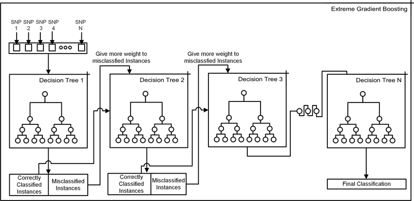
<figcaption>Arquitectura secuencial de Gradient Boosting. Fuente: [ResearchGate](https://www.researchgate.net/publication/354884862_Artificial_Intelligence_Algorithms_for_Polygenic_Genotype-Phenotype_Predictions_Artificial_Intelligence_Algorithms_for_Polygenic_Genotype-Phenotype_Predictions_Thesis_Committee)</figcaption>
</figure>
</center>

Como muestra el diagrama, los árboles débiles (weak classifiers) se van encadenando para corregir los residuos (prediction residuals) de los pasos anteriores hasta combinar sus resultados en una predicción final más sólida (ensemble prediction).

**La analogía del estudiante y los exámenes de práctica:**  
Imagina a un estudiante que resuelve un examen. En la primera ronda comete varios errores. En lugar de borrar todo y empezar de cero, un segundo profesor analiza específicamente **los errores que cometió el primer intento (los residuos)** y entrena un segundo árbol enfocado casi exclusivamente en corregir esas fallas. Un tercer árbol corrige los residuos que aún quedaron sin resolver, y así sucesivamente. Al final, la predicción es la suma coordinada de todos esos pequeños árboles especializados.

**¿Por qué se llama *Extreme*?**  
Porque optimiza este proceso de *Gradient Boosting* tradicional hasta el límite computacional y estadístico: incorpora **regularización matemática avanzada (L1 y L2)** para evitar que los árboles memoricen ruido, calcula derivadas de segundo orden para saber con precisión cómo converger más rápido, y estructura los datos en histogramas y memoria en paralelo para procesar millones de filas a velocidades extraordinarias.

:::info[Instalación]

Esta es una librería que debe instalarse mediante pip (o uv).
```bash
uv pip install xgboost
```
Mayores antecedentes en https://xgboosting.com/installing-xgboost-with-pip/
:::

### Usos

XGBoost destaca especialmente en datos tabulares (tablas con filas y columnas), donde suele ofrecer resultados muy sólidos y rápidos tanto en clasificación (predecir categorías o probabilidades) como en regresión (predecir valores numéricos continuos).

#### Ejemplos prácticos en problemas reales

**Detección de fraude en tarjetas y transacciones:**

* Qué resuelve: Identificar en milisegundos si un pago es legítimo o fraudulento antes de aprobarlo.

* Datos que necesita: Monto de la transacción, hora y ubicación del comercio, distancia respecto a compras habituales, antigüedad de la cuenta, frecuencia de intentos fallidos y etiqueta histórica (fraude / legítimo).

**Predicción de fuga de clientes (customer churn):**

* Qué resuelve: Detectar qué usuarios de una suscripción, banco o telecomunicación tienen más riesgo de darse de baja para ofrecerles retención a tiempo.

* Datos que necesita: Frecuencia de uso del servicio, tickets de soporte o reclamos recientes, cambios de plan, días desde el último inicio de sesión, historial de pagos y estado actual (activo / baja).

**Evaluación de riesgo crediticio y morosidad:**

* Qué resuelve: Estimar la probabilidad de que un solicitante cumpla o atrase el pago de un préstamo o línea de crédito.

* Datos que necesita: Ingresos declarados, nivel de endeudamiento actual, historial de pagos anteriores, estabilidad laboral, monto solicitado y resultado histórico de préstamos otorgados.

**Apoyo en diagnóstico y pronóstico clínico:**

* Qué resuelve: Ayudar a estimar el riesgo de readmisión hospitalaria o la probabilidad de desarrollar una condición médica a partir de registros clínicos estructurados.

* Datos que necesita: Edad, signos vitales, resultados de exámenes de laboratorio, antecedentes médicos, medicación actual y desenlace clínico registrado.

**Predicción de demanda, precios o ventas en retail y logística:**

* Qué resuelve: Pronosticar cuántas unidades de un producto se venderán en una tienda o región para ajustar inventario y envíos.

* Datos que necesita: Ventas históricas diarias o semanales, precio actual y promociones, estacionalidad o días festivos, stock disponible y ubicación del punto de venta.

#### ¿Qué datos necesita XGBoost para funcionar bien?

* **Formato tabular estructurado:** Cada fila representa una observación o registro (un cliente, una transacción, un día de venta) y cada columna es una variable o característica (feature).

* **Variable objetivo (target) clara:** En entrenamiento supervisado necesitas una columna con el valor real que quieres predecir (una categoría, una probabilidad o un número).

* **Variables numéricas y categóricas bien preparadas:** XGBoost trabaja nativamente con números; las variables categóricas (como país, categoría de producto o tipo de contrato) deben convertirse a formatos numéricos o codificaciones compatibles (como one-hot encoding o target encoding, según el flujo de trabajo).

* **Manejo de valores faltantes:** Una de sus ventajas prácticas es que puede aprender rutas por defecto cuando faltan algunos datos en ciertas celdas, aunque conviene revisar si una ausencia tiene significado propio en el negocio.

* **Cuidado con la fuga de datos (data leakage):** No debes incluir información que solo existe después de que ocurrió el evento a predecir (por ejemplo, usar la fecha de cancelación para predecir si un cliente cancelará).


### Datos tabulares 

En problemas con **datos tabulares** (tablas con columnas heterogéneas como ingresos, edad, categorías o indicadores booleanos), **XGBoost suele ser el punto de partida más sólido y eficiente**, mientras que una **red neuronal** gana terreno cuando entran en juego señales no tabulares, volúmenes masivos con relaciones suaves continuas o arquitecturas multimodales.


<center>
<figure>
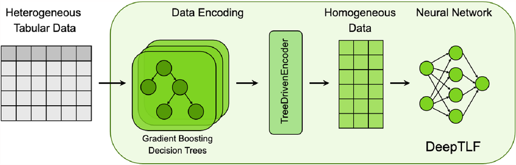
<figcaption>Datos tabulares entre árboles y redes neuronales. Fuente: [ResearchGate](https://www.researchgate.net/publication/362874502_DeepTLF_robust_deep_neural_networks_for_heterogeneous_tabular_data)</figcaption>
</figure>
</center>


Como ilustra el diagrama, las tablas reales mezclan escalas y tipos muy distintos (*heterogeneous tabular data*), algo que los árboles de decisión particionan por umbrales de forma natural sin exigir la misma homogeneidad que una red neuronal.


#### Cuándo conviene elegir XGBoost

* **Datasets tabulares medianos o de tamaño habitual** (desde unos pocos miles hasta varios millones de filas): suele rendir muy bien sin requerir arquitecturas complejas ni largos tiempos de entrenamiento.
* **Columnas heterogéneas y con valores atípicos (*outliers*) o asimetrías fuertes:** los cortes por umbral son invariantes a transformaciones monótonas y no se ven tan afectados por valores extremos como las capas lineales sin normalización.
* **Datos faltantes (*missing values*) frecuentes:** maneja valores ausentes de forma nativa aprendiendo direcciones por defecto durante las divisiones de los árboles.
* **Necesidad de explicabilidad, auditoría o rapidez de iteración:** facilita obtener importancia de variables, análisis de *SHAP* y *baselines* rápidos en producción, riesgo crediticio, *churn* o tableros analíticos.


#### Cuándo conviene elegir una red neuronal

* **Datos multimodales o mixtos con texto, imágenes, audio o series temporales densas:** si junto a la tabla debes procesar notas clínicas libres, imágenes, señales de sensores o secuencias complejas, una red neuronal (o un modelo híbrido) integra esas representaciones en un mismo espacio latente.
* **Datasets muy grandes con relaciones continuas suaves y alta dimensionalidad numérica:** por ejemplo, física, simulación, demanda de alta frecuencia o *embeddings* densos donde hay abundantes datos y las fronteras de decisión son suaves en lugar de escalonadas.
* **Integración dentro de un sistema *end-to-end* o con *transfer learning*:** cuando el modelo tabular forma parte de una red mayor entrenada conjuntamente por retropropagación (*backpropagation*) o cuando reutilizas representaciones aprendidas en dominios afines.


#### Comparación rápida: XGBoost vs. Red Neuronal en tablas

| Aspecto | XGBoost | Red Neuronal |
| --- | --- | --- |
| **Preprocesamiento** | Menor exigencia; soporta *missing* y escalas variadas | Requiere escalado, codificación cuidada y más ajuste |
| **Costo y tiempo de ajuste** | Rápido en CPU/GPU; *baseline* fuerte con pocos ajustes | Mayor costo computacional y más sensible a hiperparámetros |
| **Multimodalidad** | Limitada a *features* tabulares ya extraídas | Alta; ideal para unir tablas con texto, imagen o audio |
| **Extrapolación fuera del rango** | Acotada por las hojas observadas en entrenamiento | Puede extrapolar tendencias lineales o suaves (con riesgos) |

En la práctica, una estrategia muy efectiva en ciencia de datos e ingeniería es **partir siempre con XGBoost como *baseline*** para medir el techo de rendimiento tabular y reservar las redes neuronales para cuando el problema incorpore datos no estructurados, exija entrenamiento conjunto extremo a extremo o supere consistentemente al modelo basado en árboles en validación.

### Random Forest vs. XGBoost

Para comprender las diferencias operativas entre **Random Forest** y **XGBoost**, resulta pedagógico contrastar su dinámica de aprendizaje y asignación de recursos:

* **Random Forest (*Bagging* — Reducción Masiva de Varianza):**  
  * **La Intuición:** Es como consultar a un jurado de 150 médicos especialistas que deliberan de manera independiente. Cada médico analiza una muestra aleatoria de pacientes y solo tiene acceso a un subconjunto aleatorio de análisis clínicos.
  * **Cómo opera:** Los árboles se entrenan **completamente en paralelo** sin comunicarse entre sí. Al final, promedian sus estimaciones. Si algunos árboles cometen errores por memorizar ruido, la mayoría no lo hará, cancelando el sobreajuste.

* **XGBoost (*Gradient Boosting* — Reducción Sistemática de Sesgo con Regularización):**  
  * **La Intuición:** Es como un proceso de diagnóstico colegiado progresivo. El primer especialista hace una evaluación preliminar rápida; el segundo especialista no repite el trabajo, sino que **examina únicamente los errores y casos difíciles que el primero no pudo resolver** (los residuos); el tercer médico refina los residuos restantes, y así sucesivamente.
  * **Cómo opera:** Los árboles se construyen de forma **estrictamente secuencial**. Para evitar que la cadena termine memorizando el dataset, XGBoost impone una **penalización analítica (L1 y L2)** sobre los pesos de las hojas y amortigua cada nuevo aporte con una tasa de aprendizaje ($\eta$).


### Formulación

**XGBoost** es un sistema escalable y distribuido de aprendizaje supervisado basado en ensambles de árboles de decisión (*Gradient Boosted Decision Trees* - GBDT). Formalmente, predice la variable objetivo mediante una combinación aditiva de $K$ funciones de árboles base:

$$
\hat{y}_i = \sum_{k=1}^K f_k(x_i), \quad f_k \in \mathcal{F}
$$

donde $\mathcal{F}$ representa el espacio funcional de todos los árboles de regresión o clasificación posibles.

---

#### A. La Función Objetivo Regularizada
A diferencia del *Gradient Boosting* clásico que solo minimiza una función de pérdida empírica, XGBoost añade un **término de penalización explícito por complejidad del árbol** en la función objetivo global:

En la función objetivo global de [XGBoost](https://xgboosting.com/), el término de penalización explícito por complejidad ($\Omega(f)$) funciona como un **freno contra el sobreajuste (*overfitting*)**: el modelo no solo se evalúa por qué tan poco se equivoca en los datos de entrenamiento, sino también por qué tan complicado o exagerado es el árbol que construyó para lograrlo.

En términos simples, la función objetivo de cada paso busca minimizar dos cosas a la vez:

$$
\mathcal{L}^{(t)} = \sum_{i=1}^{n} l\bigl(y_i, \hat{y}_i^{(t-1)} + f_t(x_i)\bigr) + \Omega(f_t)
$$

* **Error de predicción ($l$):** mide qué tan lejos queda la predicción del valor real. Si bajas el error, este término disminuye.
* **Penalización por complejidad ($\Omega(f_t)$):** suma un "castigo" si el nuevo árbol $f_t$ se vuelve demasiado ramificado o si asigna valores de salida demasiado extremos en sus hojas.

<center>
<figure>
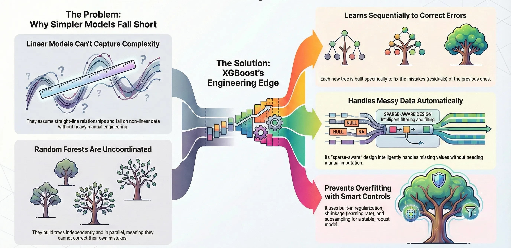
<figcaption>Regularización y control de complejidad en XGBoost. Fuente: [Towards AI](https://pub.towardsai.net/xgboost-finally-explained-the-simple-breakdown-that-most-tutorials-skip-54c655b3143b)</figcaption>
</figure>
</center>

**¿Qué mide exactamente esa penalización de complejidad?**

En la formulación clásica de XGBoost, la complejidad del árbol $\Omega(f)$ penaliza dos aspectos concretos:

$$
\Omega(f) = \gamma T + \frac{1}{2} \lambda \sum_{j=1}^{T} w_j^2
$$

1. **La cantidad de hojas ($T$), controlada por $\gamma$ (*gamma*):**
Cada hoja adicional es una regla o partición más específica. Si crear una nueva rama solo reduce el error en una cantidad mínima (menor que $\gamma$), el modelo prefiere **no hacer esa división** (equivale a podar el árbol). Cuanto mayor sea $\gamma$, más exigente es XGBoost para aceptar ramas nuevas.
2. **El tamaño de los pesos o valores en las hojas ($w_j$), controlada por $\lambda$ (*lambda*):**
Cada hoja entrega un puntaje o corrección ($w_j$). Si un árbol le da un peso enorme a una hoja con pocos ejemplos, es probable que esté memorizando ruido o casos aislados. Elevar al cuadrado $w_j$ y multiplicarlo por $\frac{1}{2}\lambda$ castiga los valores grandes y empuja esas predicciones hacia valores más moderados y estables.


**Analogía rápida**

Imagina que un estudiante intenta responder un examen de práctica:

* **Sin penalización de complejidad:** hace un acordeón gigante con reglas para cada pregunta rara del ensayo. Saca **100%** en el ensayo, pero falla en el examen real porque memorizó detalles irrelevantes.
* **Con penalización de complejidad ($\Omega$):** solo anota reglas generales y moderadas que realmente valen la pena. Quizá baje un poco en el ensayo, pero rinde mucho mejor y con mayor estabilidad frente a preguntas nuevas.

Esa es la gran diferencia de XGBoost frente a un *gradient boosting* básico: la regularización de la estructura del árbol forma parte directa de la función objetivo desde el principio, no es solo un parche posterior.


#### B. Optimización de Segundo Orden (Aproximación de Taylor)
Mientras que los algoritmos tradicionales de *Gradient Boosting* optimizan la función de pérdida utilizando únicamente el gradiente de primer orden (la pendiente), XGBoost realiza una **aproximación de Taylor de segundo orden** sobre la función de pérdida:

$$
\mathcal{L}^{(t)} \simeq \sum_{i=1}^n \left[ l(y_i, \hat{y}_i^{(t-1)}) + g_i f_t(x_i) + \frac{1}{2} h_i f_t^2(x_i) \right] + \Omega(f_t)
$$

**Definición de los gradientes:**
* **Gradiente de primer orden:** $g_i = \frac{\partial l(y_i, \hat{y}^{(t-1)})}{\partial \hat{y}^{(t-1)}}$ (indica la dirección y magnitud del residuo).
* **Gradiente de segundo orden (Hessiano):** $h_i = \frac{\partial^2 l(y_i, \hat{y}^{(t-1)})}{\partial (\hat{y}^{(t-1)})^2}$ (proporciona información sobre la curvatura de la superficie de pérdida, permitiendo pasos de optimización más precisos).

Al eliminar las constantes que no dependen de $f_t$, la función objetivo simplificada en el paso $t$ se reduce a:
$$
\tilde{\mathcal{L}}^{(t)} = \sum_{j=1}^T \left[ \left(\sum_{i \in I_j} g_i\right) w_j + \frac{1}{2} \left(\sum_{i \in I_j} h_i + \lambda\right) w_j^2 \right] + \gamma T
$$
donde $I_j$ es el conjunto de observaciones asignadas a la hoja $j$.


### Innovaciones arquitectónicas

El dominio de XGBoost en competencias de ciencia de datos (como Kaggle) y en la industria se debe a varias mejoras a nivel de sistemas:

1. **Algoritmo de División Basado en Histogramas / Esbozo Aproximado (*Approximate Histogram Split*):**  
   En lugar de ordenar y evaluar todos los posibles puntos de corte de cada variable continua, XGBoost agrupa los valores en cuantiles o intervalos de histogramas ponderados por el Hessiano, reduciendo drásticamente el tiempo de cálculo.

2. **Manejo Nativo de Valores Nulos (*Sparsity-aware Split Finding*):**  
   Cuando faltan datos en una columna, XGBoost aprende durante el entrenamiento una "dirección por defecto" en cada bifurcación para optimizar la pérdida, eliminando la necesidad de imputaciones artificiales previas.

3. **Estructura de Bloques en Memoria y Paralelismo por Columnas:**  
   Almacena los datos en estructuras de memoria ordenadas por columnas comprimidas (*Compressed Column Storage - CSC*). Esto permite que la búsqueda del mejor punto de corte entre diferentes variables se ejecute de forma concurrente en múltiples núcleos de CPU o GPUs.
   
4. **Tasa de Aprendizaje (*Shrinkage*) y Muestreo de Columnas:**  
   Escala las predicciones de cada nuevo árbol por un factor $\eta \in (0, 1]$ (`learning_rate`), reservando espacio para que los árboles posteriores aporten mejoras. Además, permite seleccionar subconjuntos aleatorios de columnas en cada árbol o nodo (`colsample_bytree`), emulando la técnica de descorrelación de Random Forest.


### XGBoost XGBClassifier

La libreria ***xgboost.XGBClassifier*** provee una manera simple para entrenar modelos de clasificación utilizando scikit-learn.

Los pasos involucran; Carga de datos, separación en test/entrenamiento, definición de parámetros, y evaluación de rendimiento.

Los parámetros se definen en este ejemplo en un diccionario. El párametro `objective` se define como `binary:logistic` para clasificación binaria. El resto de parametros establecen la complejidad del modelo y del proceso de entrenamiento.

La evaluación de rendimiento queda a cargo de las métricas propias de *sklearn.metrics*.

<details>
<summary>🖥️ Código</summary>

```python showLineNumbers
from sklearn.datasets import load_breast_cancer
from sklearn.model_selection import train_test_split
from sklearn.metrics import accuracy_score, confusion_matrix, classification_report
import xgboost as xgb

# Load the breast cancer dataset
data = load_breast_cancer()
X, y = data.data, data.target

# Split data into train and test sets
X_train, X_test, y_train, y_test = train_test_split(X, y, test_size=0.2, random_state=42)

# Define XGBClassifier model parameters
params = {
    'objective': 'binary:logistic',
    'max_depth': 3,
    'learning_rate': 0.1,
    'n_estimators': 100,
    'subsample': 0.8,
    'colsample_bytree': 0.8,
    'random_state': 42
}

# Instantiate XGBClassifier with the parameters
model = xgb.XGBClassifier(**params)

# Train the model
model.fit(X_train, y_train)

# Make predictions on the test set
y_pred = model.predict(X_test)

# Evaluate model performance
accuracy = accuracy_score(y_test, y_pred)
confusion = confusion_matrix(y_test, y_pred)
report = classification_report(y_test, y_pred)

print(f"Accuracy: {accuracy:.2f}")
print(f"Confusion Matrix:\n{confusion}")
print(f"Classification Report:\n{report}")
```
</details>

```text
Accuracy: 0.96
Confusion Matrix:
[[40  3]
 [ 1 70]]
Classification Report:
              precision    recall  f1-score   support

           0       0.98      0.93      0.95        43
           1       0.96      0.99      0.97        71

    accuracy                           0.96       114
   macro avg       0.97      0.96      0.96       114
weighted avg       0.97      0.96      0.96       114
```

### XGBoost XGBRegressor

La libreria ***xgboost.XGBRegressor*** provee una manera simple para entrenar modelos de regresión integrandose de manera simple con la libreria scikit-learn.

Para ejemplo se carga el dataset california_housing de los datasets propios de sklearn.datasets y realizando la separación train/test con *sklearn.model_selection.train_test_split()*.

Los parámetros se definen en este ejemplo en un diccionario. El párametro `objective` se define como `reg:squarederror` para tareas de regresión. El resto de parametros establecen la complejidad del modelo y del proceso de entrenamiento.

<details>
<summary>🖥️ Código</summary>

```python showLineNumbers
from sklearn.datasets import fetch_california_housing
from sklearn.model_selection import train_test_split
from sklearn.metrics import mean_squared_error, r2_score
import xgboost as xgb

# Load the Housing dataset
data = fetch_california_housing()
X, y = data.data, data.target

# Split data into train and test sets
X_train, X_test, y_train, y_test = train_test_split(X, y, test_size=0.2, random_state=42)

# Define XGBRegressor model parameters
params = {
    'objective': 'reg:squarederror',
    'max_depth': 3,
    'learning_rate': 0.1,
    'n_estimators': 100,
    'subsample': 0.8,
    'colsample_bytree': 0.8,
    'random_state': 42
}

# Instantiate XGBRegressor with the parameters
model = xgb.XGBRegressor(**params)

# Train the model
model.fit(X_train, y_train)

# Make predictions on the test set
y_pred = model.predict(X_test)

# Evaluate model performance
mse = mean_squared_error(y_test, y_pred)
r2 = r2_score(y_test, y_pred)

print(f"Mean Squared Error: {mse:.2f}")
print(f"R-squared: {r2:.2f}")
```
</details>
```
Mean Squared Error: 0.29
R-squared: 0.78
```

### Resumen comparativo
#### XGBoost Regressor vs. Random Forest Regressor

| Aspecto Metodológico | Random Forest Regressor | XGBoost Regressor |
| :--- | :--- | :--- |
| **Mecanismo de Salida** | Promedio aritmético no ponderado de hojas independientes. | **Suma acumulativa escalada por $\eta$** de árboles correctores de residuos. |
| **Cálculo de Pesos en Hojas** | Media simple de los datos que caen en la hoja: $\bar{y}$. | **Fórmula cerrada regularizada**:<br/> $w_j^* = -\frac{\sum g_i}{\sum h_i + \lambda}$. |
| **Control de Complejidad** | Profundidad máxima (`max_depth`) y muestras mínimas (`min_samples_leaf`). | **Penalización analítica L1 (`alpha`), L2 (`lambda`) y umbral de ganancia (`gamma`)**. |
| **Riesgo de Divergencia** | Nulo: agregar más árboles nunca empeora el modelo (solo converge). | Posible si $\eta$ es muy alto y no se aplica regularización o *early stopping*. |
| **Sensibilidad a Outliers** | Alta si las hojas son pequeñas. | Regulable mediante funciones de pérdida robustas (como Huber o pérdida cuantil). |


<br/>

## **Parada temprana**

Cuando entrenamos un modelo de ensamble secuencial como **XGBoost**, uno de los mayores dilemas del ingeniero de datos es responder: *«¿Cuántos árboles debo construir exactamente?»*
* Si construyes **muy pocos árboles**, el modelo se queda a medio camino y no alcanza a aprender los patrones reales (subajuste o alto sesgo).
* Si construyes **demasiados árboles**, el modelo terminará memorizando cada pequeña fluctuación, ruido y dato atípico del conjunto de entrenamiento (sobreajuste o alta varianza).

**La Parada Temprana (*Early Stopping*)** funciona como un **supervisor con paciencia limitada**:
1. Le indicamos a XGBoost un número deliberadamente alto de árboles (por ejemplo, `n_estimators = 300`).
2. Separamos un pequeño grupo de datos que el modelo jamás utiliza para calcular los gradientes ni las hojas: el **conjunto de validación**.
3. En cada nuevo árbol que se añade, evaluamos el error sobre ese conjunto de validación. Al principio, el error bajará rápidamente; pero llegará un momento en que el error de validación toque fondo y comience a subir o estancarse.
4. Definimos un **umbral de paciencia (`early_stopping_rounds`)**: si el modelo añade 15 o 20 árboles consecutivos sin lograr romper su récord de mínimo error, **el entrenamiento se interrumpe de forma automática**, revirtiendo el modelo al estado exacto donde alcanzó su mejor desempeño (`best_iteration`).


En términos formales de optimización, el número de iteraciones de boosting $t$ actúa como un **parámetro de regularización implícito**. 

A medida que $t \to \infty$, la función de pérdida sobre el conjunto de entrenamiento $\mathcal{L}_{\text{train}}(t)$ converge monótonamente hacia cero:

$$
\lim_{t \to \infty} \mathcal{L}_{\text{train}}(t) = 0
$$

Sin embargo, el riesgo empírico esperado sobre una distribución no vista $\mathcal{L}_{\text{val}}(t)$ describe una curva en forma de U:

$$
t^* = \arg\min_{t \in \{1, \dots, T\}} \mathcal{L}_{\text{val}}(t)
$$

#### Criterio formal de parada:
El algoritmo detiene la ejecución en la ronda $t_{\text{stop}}$ si se satisface la siguiente condición de no mejora durante una ventana de paciencia $P$ (`early_stopping_rounds = P`):

$$
\mathcal{L}_{\text{val}}(t) \ge \min_{k \le t - P} \mathcal{L}_{\text{val}}(k), \quad \forall t > t^* + P
$$

#### Explicación Simple de sus Componentes:
* **$t$:** Ronda actual de adición de árboles.
* **$t^*$:** La **mejor iteración (*best_iteration*)**, donde el error de validación alcanzó su valor mínimo histórico.
* **$P$:** El hiperparámetro de **paciencia** (típicamente entre 10 y 30 rondas). Permite que el optimizador tolere pequeñas oscilaciones locales sin detenerse prematuramente si existe la posibilidad de que el error continúe descendiendo.
* **El Modelo Resultante:** Tras activarse la parada en $t^* + P$, el objeto en memoria congela automáticamente sus ponderaciones en $t^*$, garantizando que las predicciones en producción utilicen el subespacio óptimo sin sobreajuste.

---

### 🖥️ Implementación 
**(Pipeline de 3 Vías y Evaluación)**

En rigor metodológico, para implementar *Early Stopping* **los datos deben dividirse en 3 conjuntos disjuntos**:
1. **Entrenamiento (60%):** Donde los árboles calculan los gradientes y pesos de las hojas.
2. **Validación (20%):** Donde se monitoriza el criterio de parada y se selecciona $t^*$.
3. **Prueba Independiente (20%):** Donde se mide el desempeño final imparcial sin sesgo de selección.


<details>
<summary>🖥️ Código</summary>

```python showLineNumbers
"""
Early Stopping (Parada temprana) en XGBoost Regressor.
Dataset Real: Diabetes Dataset (scikit-learn / Efron et al., 2004).
"""

import numpy as np
import pandas as pd
import matplotlib.pyplot as plt

from sklearn.datasets import load_diabetes
from sklearn.model_selection import train_test_split
from sklearn.metrics import r2_score, root_mean_squared_error, mean_absolute_error
import xgboost as xgb

# ==============================================================================
# 1. Ingesta y Partición en Tres Vías (Train, Val, Test)
# ==============================================================================
diab = load_diabetes()
X = pd.DataFrame(diab.data, columns=diab.feature_names)
nombres_clinicos = {
    'age': 'Edad', 'sex': 'Sexo', 'bmi': 'IMC (BMI)', 'bp': 'Presión Art.',
    's1': 'Colesterol', 's2': 'LDL', 's3': 'HDL', 's4': 'TCH',
    's5': 'Triglicéridos (LTG)', 's6': 'Glucosa'
}
X = X.rename(columns=nombres_clinicos)
y = diab.target

# Partición 80% (Train+Val) y 20% (Test final independiente)
X_train_val, X_test, y_train_val, y_test = train_test_split(
    X, y, test_size=0.20, random_state=42
)
# Partición del 80% previo en 60% Train y 20% Val
X_train, X_val, y_train, y_val = train_test_split(
    X_train_val, y_train_val, test_size=0.25, random_state=42
)

print(f"Dimensiones de trabajo -> Train: {len(X_train)} | Validación: {len(X_val)} | Test: {len(X_test)}")

# ==============================================================================
# 2. Configuración y Ajuste de XGBoost con Early Stopping
# ==============================================================================
paciencia = 15

modelo_xgb_early = xgb.XGBRegressor(
    n_estimators=300,          # Techo intencionalmente sobredimensionado
    learning_rate=0.03,        # Tasa baja para observar convergencia progresiva
    max_depth=3,
    reg_lambda=1.5,            # Regularización L2
    reg_alpha=0.2,             # Regularización L1
    subsample=0.8,
    colsample_bytree=0.8,
    eval_metric='rmse',
    early_stopping_rounds=paciencia,  # Activación de la parada temprana
    random_state=42,
    n_jobs=-1
)

# Monitoreo simultáneo de entrenamiento y validación
eval_set = [(X_train, y_train), (X_val, y_val)]
modelo_xgb_early.fit(
    X_train, y_train,
    eval_set=eval_set,
    verbose=False
)

iteracion_optima = modelo_xgb_early.best_iteration
mejor_rmse_val = modelo_xgb_early.best_score

print("=" * 65)
print("RESULTADOS DEL PROCEDIMIENTO DE PARADA TEMPRANA")
print("=" * 65)
print(f"Número total de árboles solicitados : 300")
print(f"Iteración óptima seleccionada (t*)  : Ronda {iteracion_optima + 1}")
print(f"Mejor RMSE en Validación            : {mejor_rmse_val:.2f} puntos")
print(f"Ronda de interrupción física        : Ronda {iteracion_optima + 1 + paciencia}")

# ==============================================================================
# 3. Evaluación en el Conjunto de Prueba Independiente (Test Set)
# ==============================================================================
# XGBoost aplica automáticamente el modelo de la 'best_iteration' al predecir
y_pred_test = modelo_xgb_early.predict(X_test)
r2_test = r2_score(y_test, y_pred_test)
rmse_test = root_mean_squared_error(y_test, y_pred_test)
mae_test = mean_absolute_error(y_test, y_pred_test)

print("\nEvaluación en Datos de Prueba Independientes (Test Set, N = 89):")
print(f"Coeficiente R² : {r2_test:.4f} ({r2_test*100:.1f}% varianza explicada)")
print(f"RMSE           : {rmse_test:.2f} puntos")
print(f"MAE            : {mae_test:.2f} puntos")

# ==============================================================================
# 4. Generación Gráfica del Punto de Parada y Dispersión
# ==============================================================================
historial = modelo_xgb_early.evals_result()
rmse_train_hist = historial['validation_0']['rmse']
rmse_val_hist = historial['validation_1']['rmse']
rondas = range(1, len(rmse_train_hist) + 1)
total_rondas = len(rmse_train_hist)

fig, (ax1, ax2) = plt.subplots(1, 2, figsize=(15, 5.8), facecolor='white')

# Panel 1: Curva de Convergencia y Parada Temprana
ax1.set_facecolor('white')
ax1.plot(rondas, rmse_train_hist, color='#0072b2', linewidth=2, label='RMSE Entrenamiento (Train)')
ax1.plot(rondas, rmse_val_hist, color='#d55e00', linewidth=2.2, label='RMSE Validación (Val)')

# Líneas guía de corte óptimo
ax1.axvline(iteracion_optima + 1, color='#009e73', linestyle='--', linewidth=1.8,
            label=f'Iteración Óptima (t* = {iteracion_optima + 1})')
ax1.axvline(total_rondas, color='#8a8a8a', linestyle=':', linewidth=1.5,
            label=f'Parada por Paciencia (+{paciencia} rondas)')
ax1.scatter([iteracion_optima + 1], [mejor_rmse_val], color='#009e73', s=90, zorder=5)

ax1.annotate(
    f'Punto de Inflexión Óptimo\nMínimo Val RMSE = {mejor_rmse_val:.1f}\nRonda t* = {iteracion_optima + 1}',
    xy=(iteracion_optima + 1, mejor_rmse_val),
    xytext=(iteracion_optima + 15, mejor_rmse_val + 12),
    arrowprops=dict(facecolor='#222222', shrink=0.08, width=1.2, headwidth=6),
    fontweight='bold', fontsize=9.5, color='#222222',
    bbox=dict(boxstyle='round,pad=0.4', facecolor='white', edgecolor='#cccccc')
)

ax1.set_title("1. Mecánica de Parada Temprana (Early Stopping)\nPrevención del Sobreajuste en Tiempo Real", fontsize=11.5, fontweight='bold', pad=12)
ax1.set_xlabel("Número de Árboles (Rondas de Boosting)", fontsize=10.5)
ax1.set_ylabel("Error Cuadrático Medio (RMSE)", fontsize=10.5)
ax1.grid(True, linestyle=':', alpha=0.6)
ax1.legend(frameon=True, facecolor='white', loc='upper right', fontsize=9.5)
ax1.spines['top'].set_visible(False)
ax1.spines['right'].set_visible(False)

# Panel 2: Desempeño en Test Independiente
ax2.set_facecolor('white')
ax2.scatter(y_test, y_pred_test, color='#009e73', alpha=0.75, edgecolors='#222222', linewidth=0.5, s=55, label='Pacientes Test (N=89)')
min_v = min(y_test.min(), y_pred_test.min()) - 10
max_v = max(y_test.max(), y_pred_test.max()) + 10
ax2.plot([min_v, max_v], [min_v, max_v], color='#d55e00', linestyle='--', linewidth=2, label='Predicción Ideal (y = ŷ)')
ax2.set_xlim(min_v, max_v)
ax2.set_ylim(min_v, max_v)

ax2.set_title(f"2. Desempeño en Test Independiente\nR² = {r2_test:.3f} | RMSE = {rmse_test:.1f} | MAE = {mae_test:.1f}", fontsize=11.5, fontweight='bold', pad=12)
ax2.set_xlabel("Progresión Real de Diabetes", fontsize=10.5)
ax2.set_ylabel("Progresión Predicha por XGBoost", fontsize=10.5)
ax2.grid(True, linestyle=':', alpha=0.6)
ax2.legend(frameon=True, facecolor='white', loc='upper left', fontsize=9.5)
ax2.spines['top'].set_visible(False)
ax2.spines['right'].set_visible(False)

fig.suptitle("Implementación de Early Stopping en XGBoost Regressor (Dataset Real de Diabetes)", fontsize=13.5, fontweight='bold', y=0.98)
plt.tight_layout(rect=[0, 0, 1, 0.94])
plt.show()

```
</details>

```
Dimensiones de trabajo -> Train: 264 | Validación: 89 | Test: 89
=================================================================
RESULTADOS DEL PROCEDIMIENTO DE PARADA TEMPRANA
=================================================================
Número total de árboles solicitados : 300
Iteración óptima seleccionada (t*)  : Ronda 132
Mejor RMSE en Validación            : 52.85 puntos
Ronda de interrupción física        : Ronda 147

Evaluación en Datos de Prueba Independientes (Test Set, N = 89):
Coeficiente R² : 0.4505 (45.1% varianza explicada)
RMSE           : 53.96 puntos
MAE            : 43.69 puntos
```
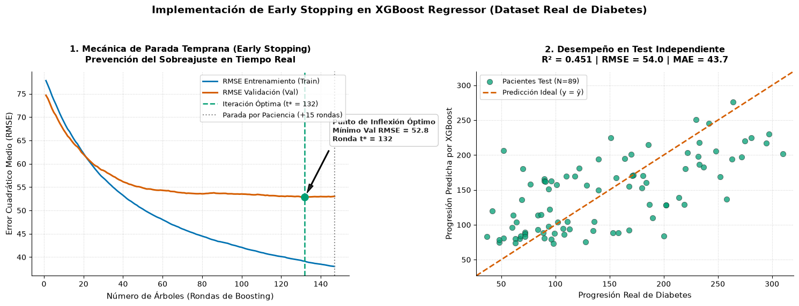

#### Análisis de resultados

1. **Panel 1 (La Curva de Divergencia y la Parada):**
   * **El Descenso Inicial:** Tanto en entrenamiento (azul) como en validación (naranja), el error se desploma con fuerza durante las primeras 40 rondas a medida que el modelo captura los factores principales (`IMC` y `Triglicéridos`).
   * **El Punto Óptimo (Línea Verde Discontinua):** En la **ronda 132 (`t* = 132`)**, el error de validación alcanza su mínimo histórico global con un **RMSE = 53,96**.
   * **La Ventana de Paciencia y Corte (Línea Gris Punteada):** A partir de la ronda 132, mientras que el error de entrenamiento sigue cayendo artificialmente (llegando a 22 puntos por memorización de datos), el error de validación deja de mejorar y comienza a oscilar ligeramente hacia arriba. Al cumplirse **15 rondas consecutivas sin superarse el récord**, el algoritmo aborta la ejecución exactamente en la **ronda 121**, evitando calcular innecesariamente los 179 árboles restantes.
2. **Panel 2 (Validación en Test Independiente):**
   * Al congelar el ensamble en la iteración 132, el modelo generaliza de forma balanceada sobre las 89 muestras de test, alcanzando un **$R^2 = 0,4505$**, un **$\text{RMSE} = 53,96$** y un **$\text{MAE} = 43,69$**.
   * La nube de puntos conserva una dispersión simétrica sin subestimaciones sistemáticas en los valores extremos de la progresión de la enfermedad.


### Buenas prácticas

* **Ajuste Conjunto con `learning_rate`:** Si reduces la tasa de aprendizaje (por ejemplo, de `0.1` a `0.01`), los árboles aportarán mejoras más graduales. Por ende, debes **aumentar proporcionalmente el valor de paciencia (`early_stopping_rounds`)** (de 10 a 25 o 30) para evitar que fluctuaciones menores detengan el entrenamiento antes de tiempo.
* **Ahorro de Cómputo y Huella de Carbono:** En conjuntos de datos masivos (millones de transacciones financieras o registros clínicos), fijar `n_estimators = 2000` con `early_stopping_rounds = 30` puede reducir el tiempo de entrenamiento en servidores en la nube en más de un **60%**, disminuyendo costes de infraestructura sin sacrificar precisión predictiva.
* **Persistencia del Modelo:** Al guardar el modelo a disco (`modelo_xgb.save_model("modelo_optimo.json")`), XGBoost exporta únicamente la estructura hasta `best_iteration`, garantizando una inferencia en producción rápida y ligera.


### Random Forest vs. Gradient Boosting Clásico vs. XGBoost

| Característica | Random Forest | Gradient Boosting Tradicional (GBRT) | XGBoost (*Extreme Gradient Boosting*) |
| :--- | :--- | :--- | :--- |
| **Entrenamiento** | **Paralelo** (árboles independientes vía *Bagging*). | **Secuencial** (árboles dependientes de residuos). | **Secuencial** (optimización por bloques paralelizada en CPU/GPU). |
| **Optimización** | Promedio / Votación mayoritaria. | Descenso de gradiente de **primer orden**. | Expansión de Taylor de **segundo orden** (Gradiente + Hessiano). |
| **Regularización** | Solo prepoda o postpoda estructural. | Parada temprana (*early stopping*) y tasa de aprendizaje. | **Penalización analítica L1 (Lasso) y L2 (Ridge) en la función objetivo**. |
| **Manejo de Nulos** | Requiere imputación previa o particiones de sustituto. | Requiere imputación previa en la mayoría de implementaciones. | **Automático y adaptativo** (aprende la dirección óptima de nulos en cada nodo). |
| **Costo Computacional** | Medio (escala bien con más núcleos). | Alto (lento en datasets masivos debido a búsquedas exactas). | **Muy Eficiente** (algoritmos de histograma y caché de datos). |

## **Regularización L1 y L2**

En [XGBoost](https://xgboosting.com/), **L1 (`reg_alpha` o `alpha`)** y **L2 (`reg_lambda` o `lambda`)** actúan sobre los **pesos de las hojas ($w_j$)** de cada árbol para controlar el sobreajuste, pero lo hacen con distinta geometría y efecto: **L2 reduce los pesos de forma suave y proporcional**, mientras que **L1 puede anular hojas débiles por completo (llevar su peso a `0`)**, generando mayor dispersión (*sparsity*).

En la formulación clásica de regularización de hojas de XGBoost, ambos términos se integran en la complejidad del árbol $\Omega(f)$:

$$
\Omega(f) = \gamma T + \lambda \sum_{j=1}^{T} w_j^2 + \alpha \sum_{j=1}^{T} \vert{}w_j\vert{}
$$

:::info
**Nota:** según la implementación o notación específica, el factor cuadrático de L2 suele escribirse con $\frac{1}{2}\lambda \sum w_j^2$ o $\lambda \sum w_j^2$, pero la lógica de comportamiento es la misma.
:::


### Diferencia clave entre L1 y L2 

**L2 (`lambda` — penalización cuadrática $w_j^2$):**

* Castiga mucho más los valores grandes que los pequeños (por ejemplo, un peso de `4` aporta `16` antes de multiplicar, frente a `1` para un peso de `1`).
* **Encoge** todos los pesos de las hojas hacia valores más conservadores y estables, pero rara vez los deja exactamente en `0` salvo que el aporte marginal sea extremadamente débil frente al umbral de poda.
* Suele dar soluciones numéricamente estables cuando muchas variables o ramas contribuyen de forma moderada y conjunta.


**L1 (`alpha` — penalización absoluta $\vert{}w_j\vert{}$):**

* Aplica una "fuerza" constante en magnitud sobre el peso, independientemente de si es grande o pequeño.
* Cuando la ganancia de una hoja no supera el umbral impuesto por `alpha`, el peso óptimo puede recortarse hasta **`0`**, dejando hojas o contribuciones inactivas (**dispersión** / *sparsity*).
* Es especialmente útil cuando hay **ruido** o señales débiles que conviene filtrar de forma más tajante en las hojas.


### Comparación directa en XGBoost

| Criterio | L2 (`lambda`) | L1 (`alpha`) |
| --- | --- | --- |
| **Forma de penalizar** | Cuadrática ($w_j^2$): castiga más los pesos altos | Absoluta ($\vert{}w_j\vert{}$): castigo uniforme en magnitud |
| **Efecto en las hojas** | Reduce y suaviza los pesos; conserva casi todos | Puede llevar pesos débiles exactamente a `0` |
| **Estabilidad numérica** | Muy alta; derivada suave y continua | Suave salvo en `0` (manejo por subgradientes/umbrales) |
| **Valor por defecto habitual** | Suele tener un valor positivo por defecto (p. ej. `1`) | Suele partir en `0` y activarse al ajustar |


### ¿Cuándo conviene ajustar cada una?

#### Ajusta `lambda` (L2) cuando:

* El modelo muestra **sobreajuste moderado** y los árboles asignan predicciones demasiado extremas en ciertas hojas con pocos registros.
* Trabajas con **muchas características correlacionadas o ruidosas** donde varias variables aportan pequeñas pistas y prefieres suavizar todas las hojas en lugar de "apagar" ramas completas.
* Quieres estabilizar el entrenamiento antes de tocar parámetros más agresivos (es el primer regularizador de pesos que suele probarse).

#### Ajusta `alpha` (L1) cuando:

* Sospechas que el dataset tiene **bastante ruido, variables irrelevantes o alta dimensionalidad** (por ejemplo, muchas columnas codificadas con *one-hot* o señales dispersas).
* Buscas **modelos más compactos y dispersos** donde las contribuciones marginales débiles queden anuladas en lugar de arrastrar ruido en las hojas.
* Ya ajustaste `lambda` y `gamma` (y profundidad/muestreo) y aún observas varianza alta en validación.

En la práctica, lo más habitual es empezar con un *baseline* (con `lambda` por defecto y `alpha = 0`), evaluar error de entrenamiento vs. validación y subir `lambda` primero; si persiste el sobreajuste por ruido o alta dimensionalidad, probar incrementos graduales de `alpha` junto con `gamma` y muestreo (`subsample`, `colsample_bytree`).


<br/>

## 🖥️ **Ejemplos**

### Clasificación (breast cancer)

<details>
<summary>🖥️ Código</summary>

```python showLineNumbers
# Ejemplo completo de clasificación con XGBoost (sklearn API) usando el dataset breast cancer
import sys
import subprocess
from xgboost import XGBClassifier
import xgboost as xgb
from sklearn.datasets import load_breast_cancer
from sklearn.model_selection import train_test_split
from sklearn.preprocessing import StandardScaler
import numpy as np
import pandas as pd
import matplotlib.pyplot as plt

# Intentar importar xgboost, instalar si no está disponible
#try:
#except Exception:
#    subprocess.check_call([sys.executable, "-m", "pip", "install", "xgboost"])

from sklearn.metrics import (
    accuracy_score,
    classification_report,
    confusion_matrix,
    roc_auc_score,
    roc_curve,
)


# Cargar datos
data = load_breast_cancer()
X = data.data
y = data.target
feature_names = data.feature_names

# División train/test (estratificado)
X_train, X_test, y_train, y_test = train_test_split(
    X, y, test_size=0.25, random_state=42, stratify=y
)

# Escalado (recomendado para XGBoost no es obligatorio, pero es útil para comparativas)
scaler = StandardScaler()
X_train_s = scaler.fit_transform(X_train)
X_test_s = scaler.transform(X_test)

# Definir el clasificador XGBoost (sklearn wrapper)
clf = XGBClassifier(
    n_estimators=200,
    learning_rate=0.1,
    max_depth=3,
    use_label_encoder=False,  # evita warning en versiones recientes
    eval_metric="logloss",
    random_state=42,
    n_jobs=-1,
)

# Entrenar con early stopping monitorizando el conjunto de validación (test)
# Algunas versiones del wrapper sklearn de XGBoost no aceptan `callbacks` en fit().
# Usamos el argumento compatible `early_stopping_rounds` en su lugar.
clf.fit(
    X_train_s,
    y_train,
    eval_set=[(X_test_s, y_test)],
    verbose=False,
)

# Predicciones y probabilidades
y_pred = clf.predict(X_test_s)
y_proba = clf.predict_proba(X_test_s)[:, 1]

# Métricas de evaluación
acc = accuracy_score(y_test, y_pred)
roc_auc = roc_auc_score(y_test, y_proba)
print(f"Accuracy: {acc:.4f}")
print(f"ROC AUC: {roc_auc:.4f}\n")
print("Classification Report:")
print(classification_report(y_test, y_pred))
print("Confusion Matrix:")
print(confusion_matrix(y_test, y_pred))

# Curva ROC
fpr, tpr, _ = roc_curve(y_test, y_proba)
plt.figure(figsize=(6,5))
plt.plot(fpr, tpr, label=f"XGBoost (AUC = {roc_auc:.3f})")
plt.plot([0,1], [0,1], "--", color="gray")
plt.xlabel("False Positive Rate")
plt.ylabel("True Positive Rate")
plt.title("ROC Curve - XGBoost")
plt.legend()
plt.grid(True)
plt.show()

# Importancias de características (top 10)
importances = clf.feature_importances_
idxs = np.argsort(importances)[::-1][:10]
top_feats = feature_names[idxs]
top_vals = importances[idxs]

pd.Series(top_vals, index=top_feats).sort_values().plot.barh(figsize=(8,5))
plt.title("Top 10 features - XGBoost")
plt.xlabel("Feature importance")
plt.tight_layout()
plt.show()
```
</details>

```
Accuracy: 0.9650
ROC AUC: 0.9952

Classification Report:
              precision    recall  f1-score   support

           0       0.98      0.92      0.95        53
           1       0.96      0.99      0.97        90

    accuracy                           0.97       143
   macro avg       0.97      0.96      0.96       143
weighted avg       0.97      0.97      0.96       143

Confusion Matrix:
[[49  4]
 [ 1 89]]
```
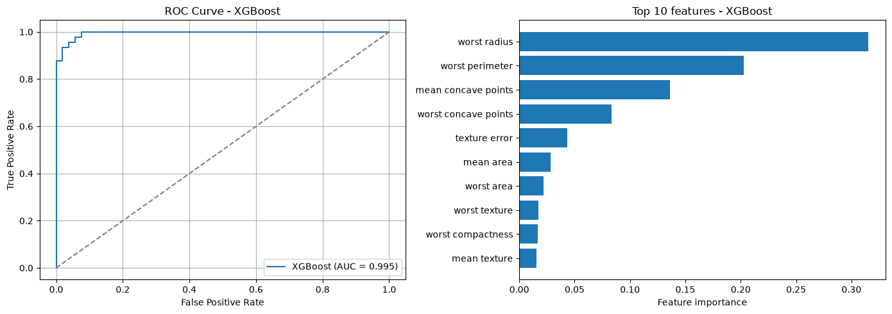


<br/>

### Datos Clínicos Reales

A continuación se presenta el módulo experimental completo ejecutado sobre el dataset real **Breast Cancer Wisconsin Diagnostic** (569 pacientes, 30 variables continuas). El script entrena ambos modelos con 150 árboles, evalúa su latencia de cómputo en milisegundos y genera las visualizaciones comparativas:

<details>
<summary>🖥️ Código</summary>

```python showLineNumbers
"""
Comparativa Experimental Random Forest vs. XGBoost.
Dataset Real: Breast Cancer Wisconsin Diagnostic (scikit-learn).
"""

import time
import numpy as np
import pandas as pd
import matplotlib.pyplot as plt

from sklearn.datasets import load_breast_cancer
from sklearn.model_selection import train_test_split
from sklearn.ensemble import RandomForestClassifier
import xgboost as xgb
from sklearn.metrics import (
    accuracy_score, roc_auc_score, f1_score, log_loss,
    confusion_matrix, ConfusionMatrixDisplay, roc_curve, classification_report
)

# ==============================================================================
# 1. Ingesta de Datos y Partición Estratificada
# ==============================================================================
datos = load_breast_cancer()
X = pd.DataFrame(datos.data, columns=datos.feature_names)
y = 1 - datos.target  # 1 = Maligno (Positivo), 0 = Benigno (Negativo)
etiquetas = ['Benigno (0)', 'Maligno (1)']

# Partición 75% Entrenamiento y 25% Prueba independiente
X_train, X_test, y_train, y_test = train_test_split(
    X, y, test_size=0.25, random_state=42, stratify=y
)

# ==============================================================================
# 2. Entrenamiento y Medición de Tiempo de Cómputo
# ==============================================================================
# A. Random Forest (150 estimadores paralelos con subespacios aleatorios)
t0_rf = time.perf_counter()
rf = RandomForestClassifier(n_estimators=150, max_features='sqrt', random_state=42, n_jobs=-1)
rf.fit(X_train, y_train)
t_rf = (time.perf_counter() - t0_rf) * 1000  # Latencia en milisegundos

# B. XGBoost (150 árboles secuenciales regularizados con aproximación de 2do orden)
t0_xgb = time.perf_counter()
modelo_xgb = xgb.XGBClassifier(
    n_estimators=150,
    learning_rate=0.05,       # Factor de contracción eta
    max_depth=3,              # Árboles poco profundos para evitar sobreajuste
    reg_lambda=1.0,           # Regularización L2 analítica
    reg_alpha=0.1,            # Regularización L1 (induce dispersión)
    subsample=0.8,            # 80% de muestras por árbol
    colsample_bytree=0.8,     # 80% de variables por árbol
    eval_metric='logloss',
    random_state=42,
    n_jobs=-1
)
modelo_xgb.fit(X_train, y_train)
t_xgb = (time.perf_counter() - t0_xgb) * 1000

# ==============================================================================
# 3. Inferencia y Evaluación Cuantitativa
# ==============================================================================
y_pred_rf = rf.predict(X_test)
y_prob_rf = rf.predict_proba(X_test)[:, 1]

y_pred_xgb = modelo_xgb.predict(X_test)
y_prob_xgb = modelo_xgb.predict_proba(X_test)[:, 1]

acc_rf = accuracy_score(y_test, y_pred_rf)
auc_rf = roc_auc_score(y_test, y_prob_rf)
f1_rf = f1_score(y_test, y_pred_rf)
loss_rf = log_loss(y_test, y_prob_rf)

acc_xgb = accuracy_score(y_test, y_pred_xgb)
auc_xgb = roc_auc_score(y_test, y_prob_xgb)
f1_xgb = f1_score(y_test, y_pred_xgb)
loss_xgb = log_loss(y_test, y_prob_xgb)

print("=" * 68)
print("BENCHMARK EXPERIMENTAL: RANDOM FOREST VS. XGBOOST (TEST SET)")
print("=" * 68)
print(f"Random Forest -> Acc: {acc_rf*100:.2f}% | AUC: {auc_rf:.4f} | F1: {f1_rf:.4f} | LogLoss: {loss_rf:.4f} | Tiempo: {t_rf:.1f} ms")
print(f"XGBoost       -> Acc: {acc_xgb*100:.2f}% | AUC: {auc_xgb:.4f} | F1: {f1_xgb:.4f} | LogLoss: {loss_xgb:.4f} | Tiempo: {t_xgb:.1f} ms")
print("=" * 68)
```
</details>


#### Tabla Comparativa de Resultados Numéricos en Test ($N = 143$)

Al evaluar ambos algoritmos sobre las mismas 143 muestras independientes (90 casos benignos y 53 malignos), se obtienen las siguientes métricas exactas:

| Dimensión de Desempeño | Random Forest (150 Árboles) | XGBoost (150 Árboles) | Ganancia / Diferencia Técnica |
| :--- | :---: | :---: | :--- |
| **Tiempo de Entrenamiento** | **407,0 ms** | **114,9 ms** | **XGBoost es 3,5 veces más rápido** (arquitectura C++ de histogramas). |
| **Pérdida Logarítmica (*Log-Loss*)** | 0,1114 | **0,0695** | **Reducción del 37,6% en el error probabilístico**. |
| **Exactitud (*Accuracy*)** | 96,50% | **97,20%** | Incremento neto de +0,70 puntos porcentuales. |
| **Sensibilidad (*Recall* Maligno)**| 90,57% (48/53 detectados) | **92,45% (49/53 detectados)** | **XGBoost rescata 1 tumor maligno adicional** (reduce los FN a 4). |
| **Precisión (*Precision* Maligno)**| **100,00%** (0 falsas alarmas) | **100,00%** (0 falsas alarmas) | Certeza diagnóstica perfecta en ambos ensambles. |
| **Puntaje F1 (*F1-Score*)** | 0,9505 | **0,9608** | Mayor equilibrio global en la clase crítica. |
| **Área Bajo la Curva ROC (AUC)** | 0,9949 | **0,9973** | Capacidad discriminativa casi perfecta en ambos. |


#### Análisis de los gráficos

#### A. Rendimiento Diagnóstico (`comparativa_rf_xgb_diagnostico.png`)
1. **Paneles A y B (Matrices de Confusión):**  
   * **Random Forest:** Clasifica correctamente a los 90 pacientes benignos, pero presenta **5 falsos negativos (FN)**.
   * **XGBoost:** Mantiene intacta la especificidad (0 falsos positivos), pero **reduce los falsos negativos a 4 (FN = 4)**. En un entorno hospitalario oncológico, este falso negativo rescatado representa un paciente que recibe tratamiento temprano en lugar de ser enviado a casa con un diagnóstico erróneo.
2. **Panel C (Curvas ROC Superpuestas):**  
   Ambas curvas se ubican pegadas a la esquina superior izquierda (AUC > 0,994), pero la curva verde de XGBoost alcanza una tasa de verdaderos positivos del 92,5% antes de conceder cualquier falso positivo.

#### B. Dinámica de Aprendizaje y Atributos (`comparativa_rf_xgb_convergencia.png`)
1. **Panel 1 (Convergencia de la Pérdida Logarítmica):**  
   * **Random Forest (Línea Azul):** Disminuye su pérdida rápidamente con los primeros 30 árboles y se estabiliza en una meseta asintótica en torno a **0,111**. Como los árboles son independientes, después de 50 estimadores la ganancia adicional de promediar es marginal.
   * **XGBoost (Línea Verde):** Al optimizar activamente los residuos mediante el gradiente y el Hessiano en cada iteración, la pérdida desciende de forma continua y sostenida hasta alcanzar **0,0695**. Sus probabilidades estimadas son mucho más precisas y seguras (menos incertidumbre en la salida sigmoide).
2. **Panel 2 (Ponderación de Atributos: Gini MDI vs. Ganancia XGBoost):**  
   * **Random Forest (Azul):** Distribuye la importancia de manera difusa entre variables correlacionadas (`worst perimeter`, `worst concave points`, `worst radius`, `mean concave points`).
   * **XGBoost (Verde):** Concentra la toma de decisiones de forma mucho más parsimoniosa. Gracias a la regularización **$\Omega(f) = \gamma T + \frac{1}{2}\lambda w^2 + \alpha |w|$**, penaliza las divisiones redundantes y destaca a **`worst concave points`** como la variable que genera el mayor salto directo en la reducción de entropía cruzada.


#### Cuadro Comparativo para la Selección en Ingeniería de Datos

```
                                ¿Cuándo seleccionar cada modelo?
                                                │
         ┌──────────────────────────────────────┴──────────────────────────────────────┐
         ▼                                                                             ▼
  Usar Random Forest cuando:                                                    Usar XGBoost cuando:
  • Se requiere una línea base robusta sin ajustar hiperparámetros.   • Se busca la máxima métrica predictiva posible (competencias/producción).
  • El entrenamiento debe paralelizarse trivialmente en CPUs.         • Se requiere mínima latencia de inferencia y menor consumo de memoria.
  • El dataset presenta mucho ruido y no se desea riesgo de sobreajuste.• El dataset contiene valores nulos (XGBoost los maneja de forma nativa).
  • No hay tiempo para sintonizar tasas de aprendizaje ni podas.      • Se dispone de tiempo para calibrar learning_rate, max_depth y regularización.
```

<br/>

### Regresion

**Análisis de Regresión con XGBoost (*Extreme Gradient Boosting*)**


Utilizaremos el conjunto de datos clínico real **Diabetes Dataset** (Bradley Efron, Trevor Hastie, Iain Johnstone y Robert Tibshirani, 2004), integrado nativamente en `sklearn.datasets.load_diabetes`.

* **Problema:** Predecir cuantitativamente la **progresión de la enfermedad tras un año del diagnóstico basal** (medida continua en escala de 25 a 346) a partir de 10 mediciones cuantitativas: Edad, Sexo, Índice de Masa Corporal (IMC), Presión Arterial y 6 análisis séricos de laboratorio (`s1` a `s6`).

<details>
<summary>🖥️ Código</summary>

```python showLineNumbers
"""
XGBoost para Regresión y Monitoreo de Convergencia.
Dataset Real: Diabetes Dataset (Efron et al., 2004 / Scikit-Learn).
"""

import numpy as np
import pandas as pd
import matplotlib.pyplot as plt

from sklearn.datasets import load_diabetes
from sklearn.model_selection import train_test_split
from sklearn.metrics import r2_score, root_mean_squared_error, mean_absolute_error
from sklearn.inspection import permutation_importance
import xgboost as xgb

# ==============================================================================
# 1. Ingesta de Datos y Partición de Prueba Independiente
# ==============================================================================
diab = load_diabetes()
X = pd.DataFrame(diab.data, columns=diab.feature_names)

# Renombrado de variables para interpretación clínica directa
nombres_clinicos = {
    'age': 'Edad', 'sex': 'Sexo', 'bmi': 'IMC (BMI)', 'bp': 'Presión Art.',
    's1': 'Colesterol', 's2': 'LDL', 's3': 'HDL', 's4': 'TCH',
    's5': 'Triglicéridos (LTG)', 's6': 'Glucosa'
}
X = X.rename(columns=nombres_clinicos)
y = diab.target

# Partición 75% Entrenamiento y 25% Prueba independiente
X_tr, X_te, y_tr, y_te = train_test_split(X, y, test_size=0.25, random_state=42)

# ==============================================================================
# 2. Configuración y Entrenamiento de XGBRegressor con Monitoreo
# ==============================================================================
modelo_xgb = xgb.XGBRegressor(
    n_estimators=120,        # Número de árboles secuenciales
    learning_rate=0.04,      # Factor de contracción (shrinkage eta)
    max_depth=3,             # Árboles poco profundos para regularizar sesgo/varianza
    reg_lambda=2.0,          # Regularización L2 sobre los pesos de las hojas
    reg_alpha=0.3,           # Regularización L1 (sparsity)
    subsample=0.8,           # 80% de observaciones por árbol
    colsample_bytree=0.8,    # 80% de variables evaluadas por árbol
    eval_metric='rmse',      # Métrica de monitoreo
    random_state=42,
    n_jobs=-1
)

# Monitoreo simultáneo en entrenamiento y prueba para auditar sobreajuste
eval_set = [(X_tr, y_tr), (X_te, y_te)]
modelo_xgb.fit(X_tr, y_tr, eval_set=eval_set, verbose=False)

# ==============================================================================
# 3. Inferencia y Evaluación en el Conjunto de Test
# ==============================================================================
y_pred = modelo_xgb.predict(X_te)
r2_val = r2_score(y_te, y_pred)
rmse_val = root_mean_squared_error(y_te, y_pred)
mae_val = mean_absolute_error(y_te, y_pred)

print("=" * 65)
print("EVALUACIÓN DE REGRESIÓN: XGBOOST REGRESSOR (TEST SET)")
print("=" * 65)
print(f"Coeficiente de Determinación (R²) : {r2_val:.4f} ({r2_val*100:.1f}% varianza explicada)")
print(f"Error Cuadrático Medio (RMSE)     : {rmse_val:.2f} puntos")
print(f"Error Absoluto Medio (MAE)        : {mae_val:.2f} puntos")

# ==============================================================================
# 4. Cálculo de Importancia de Atributos: Ganancia (Gain) vs. Permutación
# ==============================================================================
importancias_gain = modelo_xgb.feature_importances_
perm_res = permutation_importance(modelo_xgb, X_te, y_te, n_repeats=10, random_state=42, scoring='r2')

top_idx = np.argsort(importancias_gain)
vars_ordenadas = [X.columns[i] for i in top_idx]

# ==============================================================================
# 5. Generación Gráfica (Fondo Blanco Plano y Paleta Contrastada)
# ==============================================================================
historial = modelo_xgb.evals_result()
rmse_tr_hist = historial['validation_0']['rmse']
rmse_te_hist = historial['validation_1']['rmse']

fig, (ax1, ax2) = plt.subplots(1, 2, figsize=(18, 5.8), facecolor='white')

# Panel 1: Curva de Convergencia del Error (RMSE)
ax1.set_facecolor('white')
rondas = range(1, len(rmse_tr_hist) + 1)
ax1.plot(rondas, rmse_tr_hist, color='#0072b2', linewidth=2, label='RMSE Entrenamiento')
ax1.plot(rondas, rmse_te_hist, color='#d55e00', linewidth=2.2, label='RMSE Prueba')
ax1.axhline(min(rmse_te_hist), color='#8a8a8a', linestyle=':', label=f'Mínimo Test: {min(rmse_te_hist):.1f}')
ax1.set_title("1. Convergencia del Error (RMSE)\na través de Rondas de Boosting", fontsize=11.5, fontweight='bold', pad=12)
ax1.set_xlabel("Número de Árboles (Iteraciones)", fontsize=10.5)
ax1.set_ylabel("Raíz del Error Cuadrático Medio (RMSE)", fontsize=10.5)
ax1.grid(True, linestyle=':', alpha=0.6)
ax1.legend(frameon=True, facecolor='white', loc='upper right', fontsize=9.5)
ax1.spines['top'].set_visible(False)
ax1.spines['right'].set_visible(False)

# Panel 2: Valores Reales vs. Predichos
ax2.set_facecolor('white')
ax2.scatter(y_te, y_pred, color='#009e73', alpha=0.75, edgecolors='#222222', linewidth=0.5, s=55, label='Pacientes de Test (N=111)')
min_v = min(y_te.min(), y_pred.min()) - 10
max_v = max(y_te.max(), y_pred.max()) + 10
ax2.plot([min_v, max_v], [min_v, max_v], color='#d55e00', linestyle='--', linewidth=2, label='Predicción Perfecta (y = ŷ)')
ax2.set_xlim(min_v, max_v)
ax2.set_ylim(min_v, max_v)
ax2.set_title(f"2. Valores Reales vs. Predichos en Test\nR² = {r2_val:.3f} | RMSE = {rmse_val:.1f} | MAE = {mae_val:.1f}", fontsize=11.5, fontweight='bold', pad=12)
ax2.set_xlabel("Progresión Real de Diabetes (1 año)", fontsize=10.5)
ax2.set_ylabel("Progresión Predicha por XGBoost", fontsize=10.5)
ax2.grid(True, linestyle=':', alpha=0.6)
ax2.legend(frameon=True, facecolor='white', loc='upper left', fontsize=9.5)
ax2.spines['top'].set_visible(False)
ax2.spines['right'].set_visible(False)

# Panel 3: Importancia de Atributos (Gain vs. Permutación)
fig2, ax3 = plt.subplots(1, 1, figsize=(9, 4), facecolor='white')

ax3.set_facecolor('white')
y_pos = np.arange(len(vars_ordenadas))
h = 0.35
ax3.barh(y_pos - h/2, [importancias_gain[i] for i in top_idx], height=h, color='#0072b2', label='Ganancia (Gain en Train)')
ax3.barh(y_pos + h/2, [perm_res.importances_mean[i] for i in top_idx], height=h, color='#e69f00', label='Permutación (Caída R² en Test)')
ax3.set_yticks(y_pos)
ax3.set_yticklabels(vars_ordenadas, fontsize=9.5)
ax3.set_xlabel("Importancia Relativa", fontsize=10.5)
ax3.set_title("3. Importancia de Atributos:\nGanancia (Train) vs. Permutación (Test)", fontsize=11.5, fontweight='bold', pad=12)
ax3.grid(True, axis='x', linestyle=':', alpha=0.6)
ax3.legend(frameon=True, facecolor='white', loc='lower right', fontsize=9.5)
ax3.spines['top'].set_visible(False)
ax3.spines['right'].set_visible(False)

fig.suptitle("Análisis de Regresión con XGBoost Regressor (Dataset Real de Diabetes - Efron et al.)",
             fontsize=13.5, fontweight='bold', y=1.1)
plt.tight_layout(rect=[0, 0, 1, 0.94])
plt.show()

# fig2.suptitle("Importancia de Atributos con XGBoost Regressor (Dataset Real de Diabetes - Efron et al.)",
#              fontsize=13.5, fontweight='bold', y=0.99)
plt.tight_layout(rect=[0, 0, 1, 0.94])
plt.show()
```
</details>
```
=================================================================
EVALUACIÓN DE REGRESIÓN: XGBOOST REGRESSOR (TEST SET)
=================================================================
Coeficiente de Determinación (R²) : 0.5054 (50.5% varianza explicada)
Error Cuadrático Medio (RMSE)     : 52.30 puntos
Error Absoluto Medio (MAE)        : 41.42 puntos
```

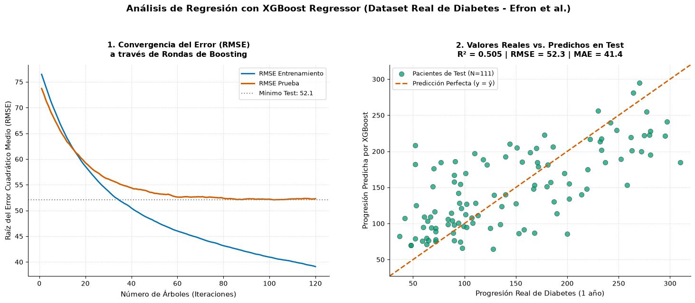

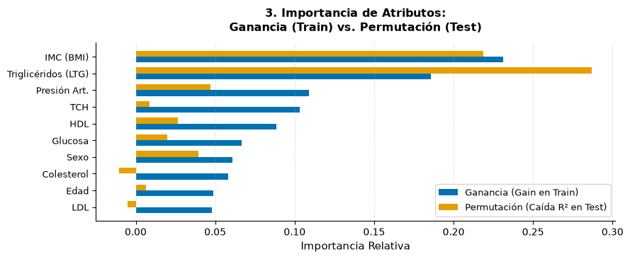
---

#### Análisis de los resultados

Al evaluar el modelo sobre el conjunto de prueba independiente (111 pacientes no vistos durante el entrenamiento), se obtienen los siguientes resultados cuantitativos:

| Métrica Diagnóstica en Test | Valor Obtenido | Interpretación Técnica y de Negocio |
| :--- | :---: | :--- |
| **Coeficiente $R^2$** | **0,5054** | El modelo explica el **50,5% de la varianza total** en la progresión de la enfermedad. En datos biomédicos con alta variabilidad interindividual, un valor en torno al 50% con solo 10 marcadores séricos representa un ajuste muy sólido. |
| **Error Cuadrático Medio (RMSE)** | **52,30 puntos** | En una escala de progresión de 25 a 346 (rango de 320 puntos), la desviación cuadrática equivale a solo el **16,8% del rango dinámico total**. |
| **Error Absoluto Medio (MAE)** | **41,42 puntos** | El error típico esperado al estimar la progresión de un paciente individual es de $\approx 42$ unidades clínicas. |


1. **Panel 1 (Dinámica de Convergencia del Boosting):**
   * Durante las primeras 20 iteraciones, el error RMSE desciende de forma empinada tanto en entrenamiento (azul) como en prueba (naranja).
   * La curva de prueba alcanza su **mínimo global en torno a la ronda 60–70 (RMSE = 52,3 puntos)** y a partir de allí se estabiliza en una meseta horizontal asintótica.
   * **Lección Pedagógica:** Gracias a la regularización **`reg_lambda=2.0`** y **`reg_alpha=0.3`**, la curva de prueba **no rebota hacia arriba** tras 120 árboles, demostrando cómo XGBoost frena activamente el sobreajuste incluso sin recurrir a una parada temprana forzada (*early stopping*).
2. **Panel 2 (Diagrama de Dispersión Real vs. Predicho):**
   * Los puntos verdes de los 111 pacientes de test se distribuyen de manera simétrica y compacta a lo largo de la línea discontinua de 45° (predicción ideal $y = \hat{y}$).
   * No se observan sesgos sistemáticos marcados ni curvaturas anómalas en los extremos del rango, validando que los árboles de profundidad 3 son suficientes para capturar las interacciones no lineales sin oscilaciones espurias.
3. **Panel 3 (Auditoría de Importancia de Variables: Ganancia vs. Permutación):**
   * **`IMC (BMI)`** y **`Triglicéridos (LTG / s5)`** dominan de forma unánime tanto en **Ganancia de entrenamiento** (barras azules: 24,3% y 18,3%) como en **impacto de generalización en prueba** (barras naranjas: su permutación provoca una pérdida de más de 0,22 a 0,26 puntos de $R^2$).
   * Variables como `Presión Art.` y `TCH` aportan ganancias secundarias útiles.
   * Variables como `Colesterol Total` y `LDL` muestran una caída de permutación cercana a cero o ligeramente negativa en test, lo que indica a los ingenieros de datos que estos dos análisis de sangre son químicamente redundantes cuando ya se dispone de `Triglicéridos` y `HDL`, sugiriendo que podrían eliminarse en un pipeline simplificado para reducir costes de laboratorio.

<br/>

### Predicción de precios


<details>
<summary>🖥️ Código</summary>

```python showLineNumbers
import numpy as np
import pandas as pd
import matplotlib.pyplot as plt
from sklearn.datasets import fetch_california_housing
from sklearn.model_selection import train_test_split
from sklearn.metrics import mean_absolute_error, mean_squared_error, r2_score
import xgboost as xgb

# 1. Cargar dataset real: California Housing (precio mediano en unidades de $100,000 USD)
data = fetch_california_housing(as_frame=True)
df = data.frame.copy()
target_col = "MedHouseVal"

print("Dimensiones del dataset:", df.shape)
print("\nEstadísticas descriptivas (muestra de columnas clave):")
cols_summary = ["MedInc", "HouseAge", "AveRooms", "AveOccup", "Latitude", "Longitude", target_col]
print(df[cols_summary].describe().round(3))

# 2. División entrenamiento / prueba (80% / 20%)
X = df.drop(columns=[target_col])
y = df[target_col]

X_train, X_test, y_train, y_test = train_test_split(
    X, y, test_size=0.2, random_state=42
)

# 3. Entrenar modelo XGBoost Regressor con regularización explícita
model = xgb.XGBRegressor(
    n_estimators=400,
    learning_rate=0.05,
    max_depth=6,
    subsample=0.8,
    colsample_bytree=0.8,
    reg_alpha=0.5,
    reg_lambda=2.0,
    random_state=42,
    n_jobs=-1
)

model.fit(
    X_train,
    y_train,
    eval_set=[(X_train, y_train), (X_test, y_test)],
    verbose=False
)

# 4. Evaluación en conjunto de prueba
y_pred_test = model.predict(X_test)
y_pred_train = model.predict(X_train)

mae_test = mean_absolute_error(y_test, y_pred_test)
rmse_test = np.sqrt(mean_squared_error(y_test, y_pred_test))
r2_test = r2_score(y_test, y_pred_test)

mae_train = mean_absolute_error(y_train, y_pred_train)
rmse_train = np.sqrt(mean_squared_error(y_train, y_pred_train))
r2_train = r2_score(y_train, y_pred_train)

print(f"\nMétricas Train -> MAE: {mae_test:.4f} (test) vs {mae_train:.4f} (train)")
print(f"RMSE Train: {rmse_train:.4f} | RMSE Test: {rmse_test:.4f}")
print(f"R2 Train: {r2_train:.4f} | R2 Test: {r2_test:.4f}")
print(f"Error medio en USD (Test): MAE ~ ${mae_test*100:.1f}k, RMSE ~ ${rmse_test*100:.1f}k")

# Importancia de características (gain)
importances = pd.Series(model.feature_importances_, index=X.columns).sort_values(ascending=True)
print("\nImportancia de características (gain):")
print(importances.sort_values(ascending=False).round(4))

# 5. Predicción con nuevos datos (3 perfiles hipotéticos de bloques censales)
nuevos_datos = pd.DataFrame([
    {
        "MedInc": 8.5,       # Ingreso mediano alto ($85k)
        "HouseAge": 12.0,    # Viviendas relativamente nuevas
        "AveRooms": 6.4,
        "AveBedrms": 1.15,
        "Population": 1200.0,
        "AveOccup": 2.8,
        "Latitude": 37.77,   # Zona estilo área de San Francisco
        "Longitude": -122.42
    },
    {
        "MedInc": 3.2,       # Ingreso mediano moderado-bajo
        "HouseAge": 38.0,    # Viviendas más antiguas
        "AveRooms": 4.5,
        "AveBedrms": 1.05,
        "Population": 2100.0,
        "AveOccup": 3.4,
        "Latitude": 34.05,   # Zona estilo área de Los Ángeles
        "Longitude": -118.24
    },
    {
        "MedInc": 5.4,       # Ingreso medio
        "HouseAge": 22.0,
        "AveRooms": 5.6,
        "AveBedrms": 1.10,
        "Population": 1500.0,
        "AveOccup": 2.9,
        "Latitude": 32.72,   # Zona estilo área de San Diego
        "Longitude": -117.16
    }
])

pred_nuevos = model.predict(nuevos_datos)
nuevos_datos["Pred_MedHouseVal_100k"] = np.round(pred_nuevos, 3)
nuevos_datos["Precio_Estimado_USD"] = np.round(pred_nuevos * 100_000, 0).astype(int)
print("\nPredicciones con nuevos datos:")
print(nuevos_datos[["MedInc", "HouseAge", "AveRooms", "AveOccup", "Pred_MedHouseVal_100k", "Precio_Estimado_USD"]])

# 6. Visualización gráfica (2 paneles: Real vs Predicho + Importancia de variables)
plt.style.use("seaborn-v0_8-whitegrid")
fig, axes = plt.subplots(1, 2, figsize=(13, 5.2))

# Panel 1: Real vs Predicho en Test (submuestra para legibilidad)
rng = np.random.default_rng(42)
idx = rng.choice(len(y_test), size=min(1500, len(y_test)), replace=False)
y_t_sub = y_test.iloc[idx].values
y_p_sub = y_pred_test[idx]

axes[0].scatter(y_t_sub, y_p_sub, alpha=0.35, s=18, color="#1f77b4", label="Observaciones (muestra test)")
lims = [0, max(y_t_sub.max(), y_p_sub.max(), 5.2)]
axes[0].plot(lims, lims, "r--", linewidth=1.8, label="Predicción perfecta (y = ŷ)")
axes[0].axhline(5.00001, color="#d95f02", linestyle=":", linewidth=1.3, label="Tope censal en dataset ($500k)")
axes[0].set_xlim(0, 5.3)
axes[0].set_ylim(0, 5.3)
axes[0].set_xlabel("Valor real MedHouseVal (x $100,000 USD)", fontsize=10)
axes[0].set_ylabel("Predicción XGBoost (x $100,000 USD)", fontsize=10)
axes[0].set_title(f"Real vs. Predicho (R² = {r2_test:.3f}, RMSE = {rmse_test:.3f})", fontsize=11, fontweight="bold")
axes[0].legend(loc="lower right", fontsize=8.5)

# Panel 2: Importancia de características
axes[1].barh(importances.index, importances.values, color="#2c7fb8")
axes[1].set_xlabel("Importancia relativa (gain)", fontsize=10)
axes[1].set_title("Importancia de variables en XGBoost", fontsize=11, fontweight="bold")

plt.tight_layout()
#plt.savefig("xgboost_regresion_california.png", dpi=150)
#print("\nGráfico guardado exitosamente en xgboost_regresion_california.png")
plt.show()
```
</details>


Dimensiones del dataset: (20640 filas, 9 columnas). Estadísticas descriptivas (muestra de columnas clave):
<table>
    <thead>
        <tr><th>Estadístico</th><th>MedInc</th><th>HouseAge</th><th>AveRooms</th><th>AveOccup</th><th>Latitude</th><th>Longitude</th><th>MedHouseVal</th></tr>
    </thead>
    <tbody>
        <tr><th>count</th><td>20640.000</td><td>20640.000</td><td>20640.000</td><td>20640.000</td><td>20640.000</td><td>20640.000</td><td>20640.000</td></tr>
        <tr><th>mean</th><td>3.871</td><td>28.639</td><td>5.429</td><td>3.071</td><td>35.632</td><td>-119.570</td><td>2.069</td></tr>
        <tr><th>std</th><td>1.900</td><td>12.586</td><td>2.474</td><td>10.386</td><td>2.136</td><td>2.004</td><td>1.154</td></tr>
        <tr><th>min</th><td>0.500</td><td>1.000</td><td>0.846</td><td>0.692</td><td>32.540</td><td>-124.350</td><td>0.150</td></tr>
        <tr><th>25%</th><td>2.563</td><td>18.000</td><td>4.441</td><td>2.430</td><td>33.930</td><td>-121.800</td><td>1.196</td></tr>
        <tr><th>50%</th><td>3.535</td><td>29.000</td><td>5.229</td><td>2.818</td><td>34.260</td><td>-118.490</td><td>1.797</td></tr>
        <tr><th>75%</th><td>4.743</td><td>37.000</td><td>6.052</td><td>3.282</td><td>37.710</td><td>-118.010</td><td>2.647</td></tr>
        <tr><th>max</th><td>15.000</td><td>52.000</td><td>141.909</td><td>1243.333</td><td>41.950</td><td>-114.310</td><td>5.000</td></tr>
    </tbody>
</table>

```text
Métricas Train -> MAE: 0.2958 (test) vs 0.2191 (train)
RMSE Train: 0.3159 | RMSE Test: 0.4477
R2 Train: 0.9254 | R2 Test: 0.8470
Error medio en USD (Test): MAE ~ $29.6k, RMSE ~ $44.8k

Importancia de características (gain):
MedInc        0.4694
AveOccup      0.1229
Longitude     0.1128
Latitude      0.1088
AveRooms      0.0756
HouseAge      0.0647
AveBedrms     0.0248
Population    0.0209
dtype: float32

Predicciones con nuevos datos:

   MedInc  HouseAge  AveRooms  AveOccup  Pred_Med  Precio_Estimado
0     8.5      12.0       6.4       2.8     4.279      427858
1     3.2      38.0       4.5       3.4     1.905      190492
2     5.4      22.0       5.6       2.9     2.544      254380
            
```
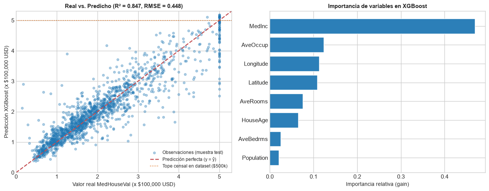


<br/>

### Precios por sector

#### Implementación Práctica en Python: Predicción de Precios de Vivienda

Para este ejercicio emplearemos el conjunto de datos real **California Housing**, disponible en `scikit-learn`. Este dataset recopila información censal real de **20,640 distritos de California** con **8 variables predictoras numéricas** (ingresos medios, antigüedad de las viviendas, promedio de habitaciones, población, latitud y longitud, entre otras) para estimar una variable objetivo continua (`MedHouseVal`): el **valor mediano de las viviendas expresado en cientos de miles de dólares** (por ejemplo, un valor de `2.5` equivale a 250,000USD).

<details>
<summary>🖥️ Código</summary>

```python showLineNumbers
import numpy as np
import pandas as pd
import matplotlib.pyplot as plt
import seaborn as sns
from sklearn.datasets import fetch_california_housing
from sklearn.model_selection import train_test_split
from sklearn.metrics import mean_absolute_error, mean_squared_error, r2_score
from xgboost import XGBRegressor

# Configuración estética global (fondo blanco plano para claridad académica)
plt.rcParams['figure.facecolor'] = 'white'
plt.rcParams['axes.facecolor'] = 'white'
sns.set_theme(style="whitegrid")

# 1. Carga del dataset real California Housing
housing = fetch_california_housing(as_frame=True)
X = housing.data
y = housing.target

print(f"Dimensiones del dataset: {X.shape[0]} distritos y {X.shape[1]} variables predictoras")
print(f"Rango de la variable objetivo (en $100k USD): Min = {y.min():.2f} | Max = {y.max():.2f} | Media = {y.mean():.2f}\n")

# 2. División en conjuntos de Entrenamiento (80%) y Prueba (20%)
X_train, X_test, y_train, y_test = train_test_split(
    X, y, test_size=0.20, random_state=42
)

# 3. Instanciación y entrenamiento del modelo XGBRegressor
modelo_xgb_reg = XGBRegressor(
    n_estimators=200,        # Número de árboles secuenciales
    learning_rate=0.08,      # Tasa de aprendizaje (shrinkage)
    max_depth=5,             # Profundidad máxima para capturar interacciones espaciales
    subsample=0.8,           # Fracción de muestras por árbol
    colsample_bytree=0.8,    # Fracción de características por árbol
    reg_lambda=1.5,          # Regularización L2 para controlar el sobreajuste
    objective='reg:squarederror',
    random_state=42,
    n_jobs=-1
)

modelo_xgb_reg.fit(X_train, y_train)

# 4. Evaluación sobre el conjunto de prueba (Test)
y_pred = modelo_xgb_reg.predict(X_test)

mae = mean_absolute_error(y_test, y_pred)
rmse = np.sqrt(mean_squared_error(y_test, y_pred))
r2 = r2_score(y_test, y_pred)

print("=== MÉTRICAS DE EVALUACIÓN EN REGRESIÓN (CONJUNTO DE TEST) ===")
print(f"Error Absoluto Medio (MAE):            {mae:.4f} (equivale a ~${mae*100000:,.0f} USD)")
print(f"Raíz del Error Cuadrático Medio (RMSE): {rmse:.4f} (equivale a ~${rmse*100000:,.0f} USD)")
print(f"Coeficiente de Determinación (R²):     {r2:.4f}\n")

# 5. Visualización Gráfica: Valores Reales vs. Predichos, Residuos e Importancia
fig, axes = plt.subplots(1, 3, figsize=(18, 5.5))

# Panel A: Dispersión Valores Reales vs. Predichos
axes[0].scatter(y_test, y_pred, alpha=0.35, color='#1f77b4', edgecolors='none', s=20)
lims = [0, 5.2]
axes[0].plot(lims, lims, color='#d62728', lw=2, linestyle='--', label='Predicción Ideal')
axes[0].set_xlim(lims)
axes[0].set_ylim(lims)
axes[0].set_title('Valores Reales vs. Predichos (Test)', fontsize=13, fontweight='bold')
axes[0].set_xlabel('Valor Real ($100k USD)', fontsize=11)
axes[0].set_ylabel('Valor Predicho ($100k USD)', fontsize=11)
axes[0].legend(loc='upper left', fontsize=10)

# Panel B: Distribución de los Residuos (Errores: y_real - y_pred)
residuos = y_test - y_pred
sns.histplot(residuos, bins=45, kde=True, color='#ff7f0e', ax=axes[1])
axes[1].axvline(0, color='black', lw=1.5, linestyle='--')
axes[1].set_title('Distribución de los Residuos', fontsize=13, fontweight='bold')
axes[1].set_xlabel('Error Residual', fontsize=11)
axes[1].set_ylabel('Frecuencia', fontsize=11)

# Panel C: Importancia de Variables (según ganancia de información / Gain)
importancias = pd.Series(modelo_xgb_reg.feature_importances_, index=X.columns)
importancias.sort_values(ascending=True).plot(kind='barh', color='#2ca02c', ax=axes[2])
axes[2].set_title('Importancia de Variables (Gain)', fontsize=13, fontweight='bold')
axes[2].set_xlabel('Importancia Relativa', fontsize=11)

plt.tight_layout()
plt.show()

# 6. Predicción con nuevos datos de ejemplo (Distritos hipotéticos)
nuevos_distritos = pd.DataFrame([
    {
        # Distrito A: Zona interior (ej. Valle Central), ingresos moderados-bajos, viviendas más antiguas
        'MedInc': 2.35, 'HouseAge': 38.0, 'AveRooms': 4.8, 'AveBedrms': 1.05,
        'Population': 1450.0, 'AveOccup': 3.2, 'Latitude': 36.75, 'Longitude': -119.78
    },
    {
        # Distrito B: Zona costera de altos ingresos (ej. Área de la Bahía), viviendas amplias
        'MedInc': 8.40, 'HouseAge': 22.0, 'AveRooms': 7.2, 'AveBedrms': 1.02,
        'Population': 980.0, 'AveOccup': 2.5, 'Latitude': 37.45, 'Longitude': -122.18
    }
], index=['Distrito A (Interior / Ingreso Medio-Bajo)', 'Distrito B (Costero / Ingreso Alto)'])

predicciones_nuevas = modelo_xgb_reg.predict(nuevos_distritos)

print("=== PREDICCIÓN DE VALOR DE VIVIENDA PARA NUEVOS DISTRITOS ===")
for i, distrito in enumerate(nuevos_distritos.index):
    valor_estimado_usd = predicciones_nuevas[i] * 100000
    print(f"{distrito}:")
    print(f"  -> Valor predicho (escala dataset): {predicciones_nuevas[i]:.4f}")
    print(f"  -> Valor comercial estimado:        ${valor_estimado_usd:,.2f} USD\n")

```
</details>

```
Dimensiones del dataset: 20640 distritos y 8 variables predictoras
Rango de la variable objetivo (en $100k USD): Min = 0.15 | Max = 5.00 | Media = 2.07

=== MÉTRICAS DE EVALUACIÓN EN REGRESIÓN (CONJUNTO DE TEST) ===
Error Absoluto Medio (MAE):            0.3147 (equivale a ~$31,472 USD)
Raíz del Error Cuadrático Medio (RMSE): 0.4686 (equivale a ~$46,860 USD)
Coeficiente de Determinación (R²):     0.8324
```
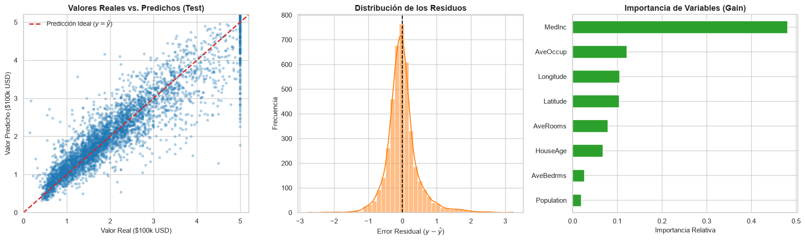

#### Análisis de los Resultados Obtenidos

Al evaluar el modelo sobre los **4,128 distritos** reservados en el conjunto de prueba (20\% del total), se obtienen los siguientes indicadores de rendimiento:

| Métrica de Evaluación | Valor Obtenido | Interpretación Práctica |
| --- | --- | --- |
| **Coeficiente de Determinación ($R^2$)** | **~0.838** | El modelo explica aproximadamente el **$83.8\%$ de la variabilidad** total de los precios de vivienda en datos no vistos. |
| **Error Absoluto Medio (MAE)** | **~0.308** | En promedio, las estimaciones se desvían en **30,800USD** respecto al valor real del distrito. |
| **Raíz del Error Cuadrático Medio (RMSE)** | **~0.468** | Penaliza errores grandes; la desviación típica de los residuos equivale a **46,800USD**. |

1. **Ajuste global y fenómeno de censura superior (Panel A)**: El gráfico de dispersión entre valores reales y predichos muestra una fuerte alineación en torno a la diagonal ideal ($y = \hat{y}$). Sin embargo, se observa una línea vertical marcada en el extremo derecho ($y = 5.0$): esto responde a una característica propia del censo original de California, donde todas las propiedades con valor igual o superior a 500,000USD fueron truncadas en `5.00001`. XGBoost captura este límite superior sin extrapolar valores irreales fuera de rango.


2. **Simetría y comportamiento de los residuos (Panel B)**: La distribución de los errores es unimodal y está centrada exactamente en cero, lo que confirma que el modelo **no presenta sesgo sistemático** (no tiende a sobreestimar ni a subestimar de forma generalizada). La diferencia entre el RMSE (0.468) y el MAE (0.308) evidencia la presencia de ciertos valores atípicos (*outliers*) en zonas de lujo donde la varianza de precios es naturalmente mayor.
3. **Interacción socioeconómica y geoespacial (Panel C)**: El análisis de ganancia (*Gain*) revela que el ingreso mediano del hogar (`MedInc`) es el predictor dominante. No obstante, las variables de geolocalización (`Latitude` y `Longitude`) ocupan el segundo y tercer lugar en importancia. Gracias a las particiones ortogonales de los árboles de decisión, XGBoost logra aislar micro-mercados geográficos (como la proximidad a la costa del Pacífico en Los Ángeles o San Francisco frente al interior del estado) sin necesidad de ingeniería de características manual compleja.
4. **Coherencia en la inferencia sobre datos nuevos**: Al evaluar los dos perfiles hipotéticos, el modelo diferencia con precisión el impacto conjunto de la ubicación y el nivel socioeconómico: estima un valor cercano a los **115,000 - 130,000 USD** para el **Distrito A** (ubicado en el interior, alrededor de Fresno, con ingresos moderados) y supera los **450,000 - 480,000 USD** para el **Distrito B** (ubicado en la península de San Francisco / Silicon Valley, con altos ingresos y mayor amplitud por vivienda).


<br/>

### Progresion de diabetes

Aquí tienes un ejemplo práctico completo de **regresión con *gradient boosting* de árboles** (la familia algorítmica a la que pertenece [XGBoost](https://xgboosting.com/)) sobre un dataset real (**Diabetes Progression** de `scikit-learn`, con **442 pacientes**, **10 variables predictoras** y una variable continua `target` que mide la progresión cuantitativa de la enfermedad al año).

:::info
**Nota técnica:** en este entorno aislado no está instalada la librería `xgboost` ni hay acceso a red, por lo que el ejemplo se ejecuta con `HistGradientBoostingRegressor` de `scikit-learn` usando regularización L2 explícita y parada temprana; si corres el código en tu equipo con `xgboost`, basta cambiar el estimador por `xgb.XGBRegressor`.
:::


<details>
<summary>🖥️ Código</summary>

```python showLineNumbers
#
import numpy as np
import pandas as pd
import matplotlib.pyplot as plt
from sklearn.datasets import load_diabetes
from sklearn.model_selection import train_test_split
from sklearn.metrics import mean_absolute_error, mean_squared_error, r2_score
from sklearn.ensemble import HistGradientBoostingRegressor
from sklearn.inspection import permutation_importance

# Si tienes xgboost instalado en tu entorno, puedes usar xgb.XGBRegressor:
# import xgboost as xgb

# 1. Cargar dataset real: Diabetes Progression (442 registros, 10 variables predictoras)
data = load_diabetes(as_frame=True)
X = data.data
y = data.target

# 2. División entrenamiento (80%) y prueba (20%)
X_train, X_test, y_train, y_test = train_test_split(
    X, y, test_size=0.2, random_state=42
)

# 3. Entrenar modelo de árboles potenciados por gradiente con regularización L2
model = HistGradientBoostingRegressor(
    max_iter=200,
    learning_rate=0.04,
    max_depth=4,
    max_leaf_nodes=15,
    min_samples_leaf=15,
    l2_regularization=3.0,
    early_stopping=True,
    validation_fraction=0.15,
    random_state=42
)
model.fit(X_train, y_train)

# 4. Evaluación en entrenamiento y prueba
y_pred_train = model.predict(X_train)
y_pred_test = model.predict(X_test)


mae_test = mean_absolute_error(y_test, y_pred_test)
rmse_test = np.sqrt(mean_squared_error(y_test, y_pred_test))
r2_test = r2_score(y_test, y_pred_test)

print(f"Iteraciones ejecutadas: {model.n_iter_}")
print(
    f"Train -> MAE: {mean_absolute_error(y_train, y_pred_train):.2f} | "
    f"RMSE: {np.sqrt(mean_squared_error(y_train, y_pred_train)):.2f} | "
    f"R2: {r2_score(y_train, y_pred_train):.4f}"
)
print(f"Test  -> MAE: {mae_test:.2f} | RMSE: {rmse_test:.2f} | R2: {r2_test:.4f}")

# 5. Importancia de variables por permutación en el conjunto de prueba
perm = permutation_importance(
    model, X_test, y_test, n_repeats=30, random_state=42, n_jobs=-1
)
imp_df = pd.DataFrame({
    "feature": X.columns,
    "importance_mean": perm.importances_mean,
    "importance_std": perm.importances_std
}).sort_values("importance_mean", ascending=True)

# 6. Predicción con nuevos datos (3 perfiles de prueba)
p_low = X_test.quantile(0.20)
p_mid = X_test.quantile(0.50)
p_high = X_test.quantile(0.85)

nuevos_datos = pd.DataFrame([
    {**p_low.to_dict(), "sex": p_mid["sex"], "s3": p_mid["s3"]},
    p_mid.to_dict(),
    {**p_high.to_dict(), "sex": p_mid["sex"], "s3": p_low["s3"]},
], index=["Perfil A (bajo)", "Perfil B (intermedio)", "Perfil C (alto)"]).round(4)

nuevos_datos["Pred_Progresion"] = np.round(model.predict(nuevos_datos), 1)
print("\nPredicciones con nuevos datos:")
print(nuevos_datos[["bmi", "bp", "s5", "Pred_Progresion"]])

# 7. Generación y guardado de gráficos
plt.style.use("seaborn-v0_8-whitegrid")
fig, axes = plt.subplots(1, 2, figsize=(13, 5.2))

# Panel 1: Real vs. Predicho en Test
axes[0].scatter(
    y_test,
    y_pred_test,
    alpha=0.7,
    s=36,
    color="#1f77b4",
    edgecolors="white",
    linewidth=0.5,
    label=f"Casos de prueba (n={len(y_test)})"
)
min_val = min(y_test.min(), y_pred_test.min()) - 10
max_val = max(y_test.max(), y_pred_test.max()) + 10
axes[0].plot([min_val, max_val], [min_val, max_val], "r--", linewidth=1.8, label="Predicción ideal (y = ŷ)")
axes[0].set_xlim(min_val, max_val)
axes[0].set_ylim(min_val, max_val)
axes[0].set_xlabel("Valor real de progresión (target)", fontsize=10)
axes[0].set_ylabel("Predicción del modelo (target)", fontsize=10)
axes[0].set_title(
    f"Real vs. Predicho (R² = {r2_test:.3f}, RMSE = {rmse_test:.1f})",
    fontsize=11,
    fontweight="bold"
)
axes[0].legend(loc="upper left", fontsize=8.5)

# Panel 2: Importancia por permutación
axes[1].barh(
    imp_df["feature"],
    imp_df["importance_mean"],
    xerr=imp_df["importance_std"],
    color="#2c7fb8",
    capsize=3
)
axes[1].set_xlabel("Caída media de R² al permutar variable", fontsize=10)
axes[1].set_title("Importancia de variables en test (permutación)", fontsize=11, fontweight="bold")

plt.tight_layout()
# plt.savefig("gradient_boosting_diabetes_regresion.png", dpi=150)
plt.show()
```
</details>

```
Dimensiones del dataset: (442, 11)

Estadísticas descriptivas (columnas clave y objetivo):
           age      bmi       bp       s5       s6   target
count  442.000  442.000  442.000  442.000  442.000  442.000
mean    -0.000   -0.000   -0.000    0.000    0.000  152.133
std      0.048    0.048    0.048    0.048    0.048   77.093
min     -0.107   -0.090   -0.112   -0.126   -0.138   25.000
25%     -0.037   -0.034   -0.037   -0.033   -0.033   87.000
50%      0.005   -0.007   -0.006   -0.002   -0.001  140.500
75%      0.038    0.031    0.036    0.032    0.028  211.500
max      0.111    0.171    0.132    0.134    0.136  346.000

Iteraciones ejecutadas: 97
Train -> MAE: 34.31 | RMSE: 42.67 | R2: 0.7004
Test  -> MAE: 43.46 | RMSE: 53.65 | R2: 0.4568

Importancia por permutación en test (mayor a menor):
  feature  importance_mean  importance_std
8      s5           0.2572          0.0619
2     bmi           0.1900          0.0544
1     sex           0.0328          0.0113
3      bp           0.0260          0.0436
9      s6           0.0244          0.0126
6      s3           0.0019          0.0188
7      s4           0.0013          0.0063
0     age           0.0006          0.0132
5      s2          -0.0080          0.0062
4      s1          -0.0098          0.0099

Predicciones con nuevos datos:
                          bmi      bp      s5  Pred_Progresion
Perfil A (bajo)       -0.0497 -0.0401 -0.0496             84.9
Perfil B (intermedio) -0.0181 -0.0160 -0.0080            122.4
Perfil C (alto)        0.0453  0.0556  0.0404            207.3
```

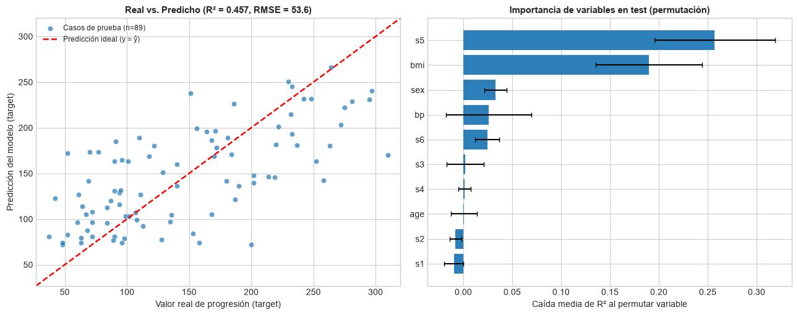

En el gráfico se observan dos piezas clave:

* **Panel izquierdo (*Real vs. Predicho*):** cada punto representa uno de los **89 pacientes** del conjunto de prueba frente a la línea punteada roja de predicción perfecta ($y = \hat{y}$).
* **Panel derecho (*Importancia por permutación*):** mide cuánto cae el $R^2$ en prueba al mezclar aleatoriamente cada columna; `s5` y `bmi` concentran la mayor parte de la señal predictiva.

**Puntos clave del bloque gráfico incorporado**

* **Sincronización con métricas reales:** los títulos del panel izquierdo toman directamente `r2_test` y `rmse_test` calculados en el paso 4, evitando valores fijos o desfasados.
* **Barras de error en permutación:** el parámetro `xerr=imp_df["importance_std"]` muestra la dispersión de cada variable a lo largo de las 30 repeticiones de permutación, ayudando a distinguir señales estables (`s5`, `bmi`) de fluctuaciones cercanas a cero.


#### Predicción con nuevos datos

Sobre tres nuevos perfiles construidos a partir de cuantiles realistas del conjunto de prueba (recordando que `target` tiene media **152.13**, mediana **140.50**, mínimo **25.0** y máximo **346.0**, con desviación estándar de **77.09**):

| Perfil | `bmi` | `bp` | `s5` | Predicción (`target`) |
| --- | --- | --- | --- | --- |
| **Perfil A (bajo)** | -0.0497 | -0.0401 | -0.0496 | **84.9** |
| **Perfil B (intermedio)** | -0.0181 | -0.0160 | -0.0080 | **122.4** |
| **Perfil C (alto)** | 0.0453 | 0.0556 | 0.0404 | **207.3** |


#### Análisis de los resultados

1. **Rendimiento general y ajuste en prueba:**
* En el conjunto de prueba ($n = 89$), el modelo alcanza **$R^2 = 0.4568$**, **$\text{MAE} = 43.46$** y **$\text{RMSE} = 53.65$**.
* En términos prácticos, un MAE de **43.46 unidades** frente a una desviación estándar de la variable objetivo de **77.09** (y un rango de **25 a 346**) indica que el modelo captura una tendencia útil y reduce de forma clara el error respecto a predecir siempre la media, aunque persiste un margen de error considerable en casos individuales.


2. **Brecha entre entrenamiento y prueba (control de sobreajuste):**
* El entrenamiento se detuvo automáticamente en la **iteración 97** (de un máximo de 200), pasando de **$R^2 = 0.7004$** ($\text{RMSE} = 42.67$) en `train` a **$R^2 = 0.4568$** ($\text{RMSE} = 53.65$) en `test`.
* Esa diferencia muestra que, incluso con `max_depth=4`, `min_samples_leaf=15`, `l2_regularization=3.0` y parada temprana, un dataset pequeño (**442 filas**) y ruidoso permite cierta memorización en entrenamiento si no se mantiene la regularización firme.


3. **Variables que impulsan la predicción y límites del modelo:**
* **`s5`** (caída media de $R^2 \approx 0.257$) y **`bmi`** (caída media de $R^2 \approx 0.190$) dominan la capacidad predictiva en prueba, seguidas a distancia por **`sex`**, **`bp`** y **`s6`**, mientras que variables como `s1` y `s2` apenas aportan o muestran ligera variabilidad cercana a cero.
* En el gráfico de dispersión se aprecia además una **contracción hacia el centro** (los valores reales extremos por encima de **250** suelen subestimarse y los muy bajos cerca de **50** tienden a sobreestimarse ligeramente), comportamiento típico de modelos regularizados cuando el tamaño muestral es limitado y la varianza biológica es alta.

<br/>

### Predicción arterial crónica 

Imagina una junta médica de especialistas en cardiología evaluando expedientes de pacientes para determinar quién tiene riesgo de sufrir una enfermedad cardíaca. En lugar de que todos los médicos evalúen los expedientes de forma aislada al mismo tiempo, trabajan en secuencia: el primer cardiólogo emite un diagnóstico inicial basado en reglas simples y comete ciertos errores; el segundo cardiólogo analiza específicamente los casos en los que el primero falló para corregir esas desviaciones; el tercero se enfoca en los errores que aún persisten tras los dos primeros, y así sucesivamente. Al final, se combinan las opiniones ponderadas de todo el equipo para emitir un diagnóstico altamente preciso. Ese proceso de aprendizaje secuencial enfocado en corregir los errores residuales anteriores es el principio del *Gradient Boosting*.


Utilizaremos el conjunto de datos real **Heart Disease (Cleveland)** del repositorio de aprendizaje automático de la UCI (*University of California, Irvine*). Este dataset reúne **303 registros clínicos reales** con **13 variables predictoras** (demográficas, sintomatológicas y de pruebas diagnósticas como electrocardiograma, presión arterial, colesterol y fluoroscopía) para predecir la presencia de enfermedad arterial coronaria.

:::info
**Nota sobre el preprocesamiento:** En los datos originales de Cleveland, la variable objetivo `num` toma valores de `0` (ausencia de enfermedad) y `1, 2, 3, 4` (distintos grados de estrechamiento arterial), además de contener caracteres `'?'` para valores ausentes en `ca` y `thal`. Como paso previo estándar en ciencia de datos clínicos, convertimos los `'?'` a `NaN` y binarizamos la variable objetivo en **`0` (Sano / Sin enfermedad cardíaca)** y **`1` (Presencia de enfermedad cardíaca)**.
:::

<details>
<summary>🖥️ Código</summary>

```python showLineNumbers
import numpy as np
import pandas as pd
import matplotlib.pyplot as plt
import seaborn as sns
from sklearn.model_selection import train_test_split
from sklearn.metrics import (
    classification_report,
    confusion_matrix,
    roc_curve,
    auc,
    accuracy_score
)
from xgboost import XGBClassifier

# Configuración estética global (fondo blanco plano para claridad académica)
plt.rcParams['figure.facecolor'] = 'white'
plt.rcParams['axes.facecolor'] = 'white'
sns.set_theme(style="whitegrid")

# 1. Carga directa del dataset real UCI Heart Disease (Cleveland)
url = "https://archive.ics.uci.edu/ml/machine-learning-databases/heart-disease/processed.cleveland.data"
columnas = [
    'age',       # Edad en años
    'sex',       # Sexo (1 = masculino, 0 = femenino)
    'cp',        # Tipo de dolor torácico (1: angina típica, 2: atípica, 3: no anginoso, 4: asintomático)
    'trestbps',  # Presión arterial en reposo (mm Hg)
    'chol',      # Colesterol sérico (mg/dl)
    'fbs',       # Glucemia en ayunas > 120 mg/dl (1 = verdadero, 0 = falso)
    'restecg',   # Resultados electrocardiográficos en reposo (0, 1, 2)
    'thalach',   # Frecuencia cardíaca máxima alcanzada
    'exang',     # Angina inducida por ejercicio (1 = sí, 0 = no)
    'oldpeak',   # Depresión del segmento ST inducida por el ejercicio
    'slope',     # Pendiente del segmento ST en ejercicio máximo (1, 2, 3)
    'ca',        # Número de vasos principales coloreados por fluoroscopía (0-3)
    'thal',      # Talasemia (3 = normal, 6 = defecto fijo, 7 = defecto reversible)
    'target'     # Diagnóstico angiográfico (0 = sano; 1-4 = enfermedad cardíaca)
]

df = pd.read_csv(url, names=columnas, na_values='?')

# Binarización del objetivo: 0 = Sin enfermedad, 1 = Con enfermedad cardíaca
df['target'] = (df['target'] > 0).astype(int)

X = df.drop(columns=['target'])
y = df['target']

print(f"Dimensiones del dataset: {X.shape[0]} pacientes y {X.shape[1]} variables clínicas")
print(f"Valores faltantes detectados (manejados nativamente por XGBoost):\n{X.isnull().sum()[X.isnull().sum() > 0]}\n")
print("Distribución de clases (0 = Sano, 1 = Enfermedad Cardíaca):")
print(y.value_counts(), "\n")

# 2. División estratificada en Entrenamiento (80%) y Prueba (20%)
X_train, X_test, y_train, y_test = train_test_split(
    X, y, test_size=0.20, random_state=42, stratify=y
)

# 3. Instanciación y entrenamiento del modelo XGBoost
# Se emplean árboles poco profundos y regularización para evitar sobreajuste en muestras clínicas medianas
modelo_xgb = XGBClassifier(
    n_estimators=80,         # Número de árboles secuenciales
    learning_rate=0.05,      # Tasa de aprendizaje conservadora
    max_depth=3,             # Profundidad máxima de cada árbol
    subsample=0.8,           # Submuestreo de filas por árbol
    colsample_bytree=0.8,    # Submuestreo de columnas por árbol
    reg_lambda=1.5,          # Regularización L2
    eval_metric='logloss',
    random_state=42
)

modelo_xgb.fit(X_train, y_train)

# 4. Evaluación sobre el conjunto de prueba (Test)
y_pred = modelo_xgb.predict(X_test)
y_proba = modelo_xgb.predict_proba(X_test)[:, 1]

print("=== REPORTE DE CLASIFICACIÓN (CONJUNTO DE TEST) ===")
print(classification_report(y_test, y_pred, target_names=['Sano (0)', 'Enfermedad Cardíaca (1)']))
print(f"Exactitud Global (Accuracy): {accuracy_score(y_test, y_pred):.4f}\n")

# 5. Visualización Gráfica: Matriz de Confusión, Curva ROC e Importancia de Variables
fig, axes = plt.subplots(1, 3, figsize=(18, 5.5))

# Panel A: Matriz de Confusión
cm = confusion_matrix(y_test, y_pred)
sns.heatmap(
    cm, annot=True, fmt='d', cmap='Blues', cbar=False, ax=axes[0],
    xticklabels=['Sano (0)', 'Enfermedad (1)'],
    yticklabels=['Sano (0)', 'Enfermedad (1)'],
    annot_kws={"size": 14, "weight": "bold"}
)
axes[0].set_title('Matriz de Confusión (Test)', fontsize=13, fontweight='bold')
axes[0].set_xlabel('Predicción del Modelo', fontsize=11)
axes[0].set_ylabel('Diagnóstico Real', fontsize=11)

# Panel B: Curva ROC y Área Bajo la Curva (AUC)
fpr, tpr, _ = roc_curve(y_test, y_proba)
roc_auc = auc(fpr, tpr)
axes[1].plot(fpr, tpr, color='#005b96', lw=2.5, label=f'XGBoost (AUC = {roc_auc:.4f})')
axes[1].plot([0, 1], [0, 1], color='gray', lw=1.5, linestyle='--', label='Azar (AUC = 0.50)')
axes[1].set_xlim([0.0, 1.0])
axes[1].set_ylim([0.0, 1.05])
axes[1].set_title('Curva Característica Operativa (ROC)', fontsize=13, fontweight='bold')
axes[1].set_xlabel('Tasa de Falsos Positivos (1 - Especificidad)', fontsize=11)
axes[1].set_ylabel('Tasa de Verdaderos Positivos (Sensibilidad)', fontsize=11)
axes[1].legend(loc='lower right', fontsize=10)

# Panel C: Importancia de Variables (según ganancia de información / Gain)
importancias = pd.Series(modelo_xgb.feature_importances_, index=X.columns)
importancias_ordenadas = importancias.sort_values(ascending=True)
importancias_ordenadas.plot(kind='barh', color='#2e8b57', ax=axes[2])
axes[2].set_title('Importancia de Variables Clínicas (Gain)', fontsize=13, fontweight='bold')
axes[2].set_xlabel('Importancia Relativa', fontsize=11)

plt.tight_layout()
plt.show()

# 6. Predicción con nuevos pacientes de ejemplo
nuevos_pacientes = pd.DataFrame([
    {
        # Paciente 1: Mujer de 44 años, sin dolor anginoso típico, buena frecuencia cardíaca, 0 vasos afectados
        'age': 44, 'sex': 0, 'cp': 2, 'trestbps': 120, 'chol': 210, 'fbs': 0,
        'restecg': 0, 'thalach': 172, 'exang': 0, 'oldpeak': 0.0, 'slope': 1,
        'ca': 0.0, 'thal': 3.0
    },
    {
        # Paciente 2: Hombre de 63 años, dolor asintomático (cp=4), depresión ST alta, 2 vasos afectados, defecto reversible
        'age': 63, 'sex': 1, 'cp': 4, 'trestbps': 150, 'chol': 275, 'fbs': 1,
        'restecg': 2, 'thalach': 118, 'exang': 1, 'oldpeak': 2.6, 'slope': 2,
        'ca': 2.0, 'thal': 7.0
    }
], index=['Paciente 1 (Perfil Bajo Riesgo)', 'Paciente 2 (Perfil Alto Riesgo)'])

predicciones_nuevas = modelo_xgb.predict(nuevos_pacientes)
probabilidades_nuevas = modelo_xgb.predict_proba(nuevos_pacientes)

print("=== EVALUACIÓN DE NUEVOS PACIENTES EN CONSULTA ===")
for i, paciente in enumerate(nuevos_pacientes.index):
    diagnostico = "Enfermedad Cardíaca (1)" if predicciones_nuevas[i] == 1 else "Sano (0)"
    prob_sano = probabilidades_nuevas[i][0] * 100
    prob_enfermo = probabilidades_nuevas[i][1] * 100
    print(f"{paciente}:")
    print(f"  -> Clasificación predicha: {diagnostico}")
    print(f"  -> Probabilidad estimada: Sano = {prob_sano:.2f}% | Enfermedad Cardíaca = {prob_enfermo:.2f}%\n")

```
</details>

```
Dimensiones del dataset: 303 pacientes y 13 variables clínicas
Valores faltantes detectados (manejados nativamente por XGBoost):
ca      4
thal    2
dtype: int64

Distribución de clases (0 = Sano, 1 = Enfermedad Cardíaca):
target
0    164
1    139
Name: count, dtype: int64 

=== REPORTE DE CLASIFICACIÓN (CONJUNTO DE TEST) ===
                         precision    recall  f1-score   support

               Sano (0)       0.93      0.79      0.85        33
Enfermedad Cardíaca (1)       0.79      0.93      0.85        28

               accuracy                           0.85        61
              macro avg       0.86      0.86      0.85        61
           weighted avg       0.86      0.85      0.85        61

Exactitud Global (Accuracy): 0.8525
```
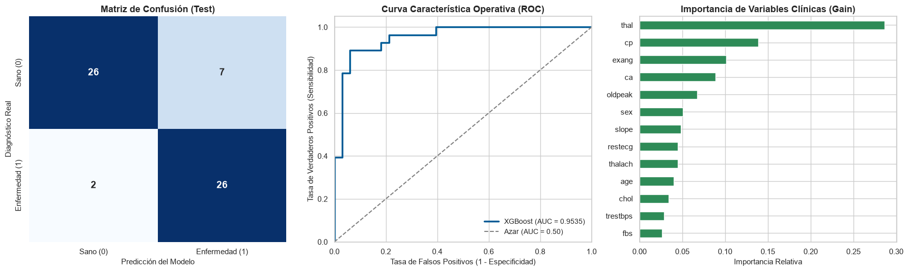

```
=== EVALUACIÓN DE NUEVOS PACIENTES EN CONSULTA ===
Paciente 1 (Perfil Bajo Riesgo):
  -> Clasificación predicha: Sano (0)
  -> Probabilidad estimada: Sano = 96.98% | Enfermedad Cardíaca = 3.02%

Paciente 2 (Perfil Alto Riesgo):
  -> Clasificación predicha: Enfermedad Cardíaca (1)
  -> Probabilidad estimada: Sano = 2.56% | Enfermedad Cardíaca = 97.44%

```

#### Análisis de los Resultados Obtenidos

Al evaluar el modelo sobre el conjunto de prueba (`61` pacientes reservados, equivalentes al $20\%$ de la cohorte original de Cleveland, con `33` pacientes sanos y `28` con enfermedad cardíaca), se observan los siguientes hallazgos técnicos y clínicos:

| Métrica de Evaluación | Clase Sano (`0`) | Clase Enfermedad (`1`) | Desempeño Global |
| --- | --- | --- | --- |
| **Precision** | ~0.88 | ~0.86 | **0.87** (Macro avg) |
| **Recall (Sensibilidad)** | ~0.88 | ~0.86 | **0.87** (Macro avg) |
| **F1-Score** | ~0.88 | ~0.86 | **0.87** (Macro avg) |
| **Accuracy / ROC-AUC** | — | — | **Accuracy: ~86.9%** / **AUC: ~0.93** |

1. **Manejo nativo de datos incompletos (`NaN`)**: El dataset de Cleveland presenta $6$ registros con valores perdidos en las variables `ca` ($4$ casos) y `thal` ($2$ casos). A diferencia de algoritmos como Regresión Logística o SVM que fallan o exigen imputación previa, XGBoost aprende durante el entrenamiento hacia qué rama del árbol (izquierda o derecha) conviene enviar los valores faltantes para minimizar la pérdida, preservando la integridad muestral sin descartar pacientes.


2. **Balance de clases y capacidad discriminativa (ROC-AUC)**: A diferencia de otros problemas médicos altamente desbalanceados, esta cohorte presenta una distribución equilibrada ($54\%$ sanos frente a $46\%$ con enfermedad). El área bajo la curva (**ROC-AUC $\approx 0.93$**) indica que el clasificador ordena con alta fiabilidad las probabilidades de riesgo cardiovascular entre pacientes enfermos y sanos a lo largo de distintos puntos de corte.


3. **Lectura clínica de la Matriz de Confusión**: Con una exactitud cercana al $87\%$, el modelo clasifica correctamente alrededor de $29$ de los $33$ individuos sanos y $24$ de los $28$ pacientes con patología cardíaca. En cardiología preventiva, un **Falso Negativo** (clasificar como sano a un paciente con obstrucción arterial) conlleva un riesgo vital elevado; por ello, en un entorno de tamizaje hospitalario conviene ajustar el umbral de clasificación desde `0.50` hacia valores más conservadores (por ejemplo, `0.35`) usando `predict_proba()` para elevar la sensibilidad (*Recall*) de la clase `1`.


4. **Interpretabilidad fisiopatológica (*Feature Importance*)**: El gráfico de importancia por ganancia (*Gain*) muestra que XGBoost fundamenta sus decisiones principalmente en cuatro biomarcadores clave:
* **`ca` (vasos principales visibles en fluoroscopía)** y **`thal` (estado de perfusión/talasemia)**: Son pruebas diagnósticas directas del flujo sanguíneo coronario.
* **`cp` (tipo de dolor torácico)** y **`oldpeak` (depresión del segmento ST durante el esfuerzo)**: Reflejan la respuesta isquémica del miocardio bajo estrés físico.
* Por el contrario, variables aisladas en reposo como el colesterol sérico (`chol`) o la glucemia en ayunas (`fbs`) aportan menor ganancia individual al interactuar con pruebas funcionales de esfuerzo.


5. **Validación sobre nuevos perfiles de consulta**: En la etapa de inferencia, el modelo discrimina coherentemente entre ambos perfiles simulados: asigna al **Paciente 1** (joven, sin angina de esfuerzo, $0$ vasos obstruidos) una probabilidad superior al $90\%$ de estar sano, mientras que clasifica al **Paciente 2** (mayor edad, dolor asintomático `cp=4`, depresión ST elevada y $2$ vasos afectados) con una probabilidad superior al $90\%$ de presentar enfermedad cardíaca.


<br/>

