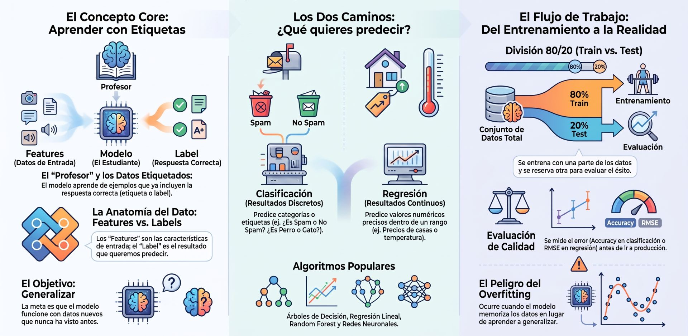

## **Aprendizaje supervisado**




El **aprendizaje supervisado** (*supervised learning*) es la rama más madura, utilizada y extendida del aprendizaje automático (*Machine Learning*). Se fundamenta en entrenar un modelo computacional a partir de un conjunto de datos donde las soluciones deseadas —denominadas **etiquetas** (*labels*), variables dependientes o respuestas objetivo (*targets*)— son conocidas de antemano para cada observación de entrada.

El término «supervisado» proviene de la analogía pedagógica de un maestro o tutor que guía el entrenamiento: el algoritmo recibe las variables explicativas o características (*features*, $X$), genera iterativamente una predicción ($\hat{y}$) y el sistema compara dicha salida con la respuesta real conocida ($y$) para cuantificar el error mediante una **función de coste o pérdida** (*loss function*). A través de algoritmos de optimización (como el descenso de gradiente), los parámetros internos del modelo se van ajustando hasta aproximar una función matemática de mapeo $Y = f(X)$ capaz de **generalizar** con precisión sobre datos futuros no observados.

:::info
En el aprendizaje supervisado, el proceso de entrenamiento implica ajustar los parámetros internos del modelo para minimizar el error entre las predicciones del modelo y las respuestas reales del conjunto de entrenamiento. Una vez entrenado, el modelo puede generalizar y realizar predicciones sobre datos nuevos.
:::

**Relevancia frente al ML no supervisado:**

El ML supervisado suele ser la técnica más utilizada en la industria, ya que muchas aplicaciones prácticas cuentan con datos históricos etiquetados y requieren predicciones precisas sobre variables específicas. El ML no supervisado, aunque relevante para tareas como agrupamiento, reducción de dimensionalidad o detección de anomalías, es menos frecuente en aplicaciones donde se necesita una predicción concreta o clasificación basada en ejemplos previos conocidos. Sin embargo, ambos enfoques son complementarios y pueden combinarse en soluciones avanzadas.

### Ramas

La categorización principal dentro del aprendizaje supervisado se define según la naturaleza matemática de la variable objetivo ($Y$):

```
                     ┌────────────────────────────────────────┐
                     │         APRENDIZAJE SUPERVISADO        │
                     └───────────────────┬────────────────────┘
                                         │
                 ┌───────────────────────┴───────────────────────┐
                 ▼                                               ▼
     ┌───────────────────────┐                       ┌───────────────────────┐
     │     CLASIFICACIÓN     │                       │       REGRESIÓN       │
     │ (Variable Discreta)   │                       │ (Variable Continua)   │
     └───────────┬───────────┘                       └───────────┬───────────┘
                 │                                               │
      ├── Binaria (ej. 0 / 1)                         ├── Unidimensional
      ├── Multiclase (A, B, C...)                     └── Multivariada
      └── Multietiqueta
```

1. **Clasificación (Variable Objetivo Categórica / Discreta):**  
   El modelo debe asignar cada instancia a una de entre un conjunto finito y predefinido de clases o categorías cualitativas.
   * **Clasificación Binaria:** El objetivo solo tiene dos salidas posibles mutuamente excluyentes (e.g., Sí/No, 1/0).
   * **Clasificación Multiclase:** El objetivo tiene más de dos categorías posibles (e.g., identificar el dígito del 0 al 9 en reconocimiento óptico de caracteres o una de las especies de la flor *Iris*).
   * **Clasificación Multietiqueta (*Multilabel*):** Una misma observación puede pertenecer simultáneamente a múltiples clases (e.g., asignar varias categorías temáticas a un mismo artículo).

2. **Regresión (Variable Objetivo Numérica / Continua):**  
   El modelo busca predecir una cantidad escalar continua a lo largo de un intervalo en la recta real. En estos problemas existe una noción matemática de orden y continuidad (por ejemplo, errar por \$1 en la predicción del precio de un activo es un error leve, mientras que errar por \$100.000 es sustancial).


### Casos de uso

El aprendizaje supervisado es ampliamente utilizado en aplicaciones como reconocimiento de voz, visión por computadora, diagnóstico médico, detección de fraudes y muchas otras áreas donde se dispone de datos históricos etiquetados.


Es ampliamente utilizado en sectores como la banca y finanzas (detección de fraudes, scoring crediticio), salud (diagnóstico médico, predicción de enfermedades), comercio electrónico (recomendaciones personalizadas, segmentación de clientes), telecomunicaciones (predicción de abandono de clientes), manufactura (mantenimiento predictivo), y seguros. Abarca la mayoría de los problemas de analítica predictiva en entornos de producción:

#### Casos de uso de Clasificación
* **Detección de Fraude Transaccional:** Identificar en milisegundos si una operación con tarjeta bancaria es genuina o fraudulenta a partir de patrones de consumo, importes y metadatos temporales.

* **Filtrado de Correo No Deseado (*Spam Filter*):** Discernir si un correo electrónico entrante es *spam* o legítimo (*ham*) analizando la frecuencia de términos y metadatos del encabezado.

* **Diagnóstico y Soporte Clínico:** Predecir si un tumor o lesión tisular analizada en imágenes médicas es benigno o maligno.

* **Evaluación de Riesgo Crediticio (*Credit Scoring*):** Decidir si una institución financiera aprueba o deniega una solicitud de crédito basándose en el historial de pago y el nivel de endeudamiento del solicitante.

* **Visión Artificial y Detección de Objetos:** Clasificar imágenes de productos, reconocer peatones y señales de tráfico para vehículos autónomos, o etiquetar personas en fotografías.

* **Análisis de Sentimiento y Clasificación Textual:** Catalogar comentarios, *reviews* o tuits en categorías (positivo, negativo, neutral) o asignar tópicos de prensa de forma automatizada.

* **Predicción de Abandono (*Customer Churn*):** Anticipar si un suscriptor cancelará su plan o abandonará el servicio en los próximos 30 días para activar campañas de retención.

#### Casos de uso de Regresión
* **Pronóstico Financiero y de Ventas (*Sales Forecasting*):** Predecir la facturación de una empresa, la demanda diaria de un producto o la cotización bursátil futura considerando variables macroeconómicas y estacionalidad.

* **Tasación y Valoración Inmobiliaria:** Estimar el valor de mercado o precio de alquiler de una vivienda en función de sus metros cuadrados, antigüedad, número de habitaciones y coordenadas geográficas.

* **Estimación del Valor de Vida del Cliente (*Customer Lifetime Value* - CLV):** Cuantificar el flujo de ingresos o el margen neto acumulado que un usuario aportará a la empresa a lo largo de su relación comercial.

* **Modelado y Pronóstico Meteorológico:** Estimar la temperatura continua o la cantidad exacta de precipitación acumulada en milímetros en lugar de solo clasificar el clima.

* **Series Temporales Industriales:** Modelar problemas dependientes del tiempo (mediante técnicas de ventanas deslizantes o *sliding window*) para prever el tiempo estimado de arribo (ETA) o la demanda de carga en redes de energía eléctrica.


### Algoritmos más utilizados

Los algoritmos supervisados se dividen habitualmente en **paramétricos** (asumen una estructura o función matemática fija con un número constante de coeficientes, como los modelos lineales) y **no paramétricos** (no imponen supuestos rígidos y su complejidad crece con los datos, como árboles o SVMs):

| Algoritmo | Tarea Principal | Mecánica y Fundamento Matemático | Ventajas y Desventajas |
| :--- | :--- | :--- | :--- |
| [**Regresión Lineal (OLS / Ridge / Lasso)**](/docs/machinelearning/supervisado/regresion-lineal) | Regresión | Ajusta una recta o hiperplano minimizando la suma de errores cuadráticos entre la predicción y el valor real ($y = w^T X + b$). Admite regularizaciones L1 (Lasso) para inducir dispersión y L2 (Ridge) contra el sobreajuste. | **Pros:** Rápido, interpretable, óptimo como línea base (*baseline*).<br/>**Contras:** Asume linealidad estricta entre variables. |
| [**Regresión Logística**](/docs/machinelearning/supervisado/regresion-logistica) | Clasificación | A pesar de llamarse regresión, es un clasificador lineal. Pasa la combinación lineal de entradas por una **función sigmoide** $g(z) = \frac{1}{1 + e^{-z}}$ para acotar la salida entre 0 y 1 como una probabilidad. | **Pros:** Entrega probabilidades calibradas, bajo costo computacional.<br/>**Contras:** No resuelve relaciones no lineales sin transformaciones previas. |
| [**Árboles de Decisión (CART / C4.5)**](/docs/machinelearning/supervisado/arboles) | Clasificación y Regresión | Divide recursivamente el espacio de características mediante preguntas condicionales binarias (*if-else*) evaluando pureza con métricas como el **Índice de Gini** o la **Entropía**. | **Pros:** Altamente interpretables, no requieren escalado de datos.<br/>**Contras:** Muy propensos al sobreajuste (*overfitting*) si no se podan. |
| [**Random Forest (Bagging)**](/docs/machinelearning/supervisado/random-forest) | Clasificación y Regresión | Ensamble que entrena en paralelo múltiples árboles descorrelacionados sobre subconjuntos *bootstrap*, promediando sus predicciones o por votación. | **Pros:** Muy robusto, reduce drásticamente la varianza de los árboles individuales.<br/>**Contras:** Mayor uso de memoria y menor interpretabilidad. |
| [**Gradient Boosted Trees (XGBoost, LightGBM, GBRT)**](/docs/machinelearning/supervisado/gradient-boosting) | Clasificación y Regresión | Ensamble secuencial donde cada nuevo árbol se entrena para corregir los residuos o errores del ensamble predecesor mediante descenso de gradiente. | **Pros:** Máximo nivel de precisión y rendimiento en datos tabulares.<br/>**Contras:** Exige sintonización cuidadosa de hiperparámetros. |
| [**Support Vector Machines (SVM / SVC / SVR)**](/docs/machinelearning/supervisado/svm) | Clasificación y Regresión | Busca el hiperplano óptimo que maximiza el **margen** de separación entre las clases más cercanas (vectores de soporte). Usa el *kernel trick* (RBF, polinómico) para espacios no lineales. | **Pros:** Muy eficaz en espacios de alta dimensionalidad.<br/>**Contras:** Escala deficientemente con grandes volúmenes de datos. |
| [**K-Nearest Neighbors (KNN)**](/docs/machinelearning/supervisado/knn) | Clasificación y Regresión | Algoritmo perezoso (*lazy learner*) basado en instancias: no construye un modelo explícito en entrenamiento, sino que memoriza los datos y asigna la clase mayoritaria de los $k$ vecinos más próximos. | **Pros:** Muy intuitivo, no asume ninguna distribución funcional.<br/>**Contras:** Inferencia lenta y alto consumo de RAM con datasets grandes. |
| [**Naive Bayes (Gaussian / Multinomial)**](/docs/machinelearning/supervisado/naive) | Clasificación | Aplica el Teorema de Bayes asumiendo independencia condicional total entre cada par de características dadas la clase. | **Pros:** Rápido de entrenar, excelente en clasificación de textos y spam.<br/>**Contras:** Su supuesto de independencia casi nunca se cumple en la práctica. |
| [**Redes Neuronales Artificiales (MLP / Deep Learning)**](/docs/machinelearning/aprendizaje_profundo/redneuronal) | Clasificación y Regresión | Capas interconectadas de neuronas con funciones de activación no lineales entrenadas mediante **propagación hacia atrás (*Backpropagation*)** y descenso de gradiente. | **Pros:** Capaces de aprender representaciones jerárquicas y patrones complejos (audio, imagen, texto).<br/>**Contras:** Requieren grandes volúmenes de datos y alto cómputo (GPU). |


### Implementación en Python
**Flujo Supervisado Completo**

El siguiente ejemplo académico ilustra el flujo de trabajo estándar en Python (utilizando `scikit-learn`): partición estratificada en entrenamiento y prueba, preprocesamiento dentro de un `Pipeline` para evitar fugas de datos (*data leakage*), entrenamiento del clasificador (`fit`) e inferencia sobre datos nuevos (`predict`) con reporte de métricas:

```python showLineNumbers
"""
Módulo Universitario: Implementación de Aprendizaje Supervisado (Clasificación).
Dataset: Diagnóstico clínico de cáncer de mama (Wisconsin Breast Cancer).
"""

import numpy as np
import pandas as pd
from sklearn.datasets import load_breast_cancer
from sklearn.model_selection import train_test_split
from sklearn.preprocessing import StandardScaler
from sklearn.pipeline import Pipeline
from sklearn.linear_model import LogisticRegression
from sklearn.metrics import classification_report, confusion_matrix, roc_auc_score

# 1. Ingesta del conjunto de datos con etiquetas conocidas
data = load_breast_cancer()
X = pd.DataFrame(data.data, columns=data.feature_names)
y = data.target  # Clases binarias: 0 = Maligno, 1 = Benigno

print(f"Dimensiones de la matriz de características X: {X.shape}")
print(f"Distribución de etiquetas conocidas: {np.bincount(y)} (0: Maligno, 1: Benigno)\n")

# 2. Partición rigurosa: 80% Entrenamiento y 20% Prueba (Estratificado)
# Permite evaluar si el modelo generaliza bien o si sufre de sobreajuste (overfitting)
X_train, X_test, y_train, y_test = train_test_split(
    X, y, test_size=0.20, random_state=42, stratify=y
)

# 3. Construcción del Pipeline Supervisado
# Encadenamos la normalización y el estimador para garantizar un flujo reproducible
supervised_pipeline = Pipeline([
    ('scaler', StandardScaler()),  # Estandarización z-score (media 0, varianza 1)
    ('classifier', LogisticRegression(C=1.0, penalty='l2', solver='lbfgs', random_state=42))
])

# 4. Fase de Entrenamiento (Model Fitting)
# El algoritmo minimiza la función de coste aprendiendo los coeficientes y el sesgo
supervised_pipeline.fit(X_train, y_train)

# 5. Fase de Inferencia (Model Scoring) sobre datos nunca vistos
y_pred = supervised_pipeline.predict(X_test)
y_prob = supervised_pipeline.predict_proba(X_test)[:, 1]

# 6. Evaluación de Rendimiento y Capacidad de Generalización
print("=== MATRIZ DE CONFUSIÓN (CONJUNTO DE PRUEBA) ===")
print(confusion_matrix(y_test, y_pred))

print("\n=== REPORTE DE CLASIFICACIÓN DETALLADO ===")
print(classification_report(y_test, y_pred, target_names=data.target_names))

roc_auc = roc_auc_score(y_test, y_prob)
print(f"Área bajo la curva ROC (ROC-AUC): {roc_auc:.4f}")
```

