## **Semi-supervisado**

El **aprendizaje semi-supervisado** (*Semi-Supervised Learning*, SSL) se sitúa formalmente como una hibridación entre el aprendizaje supervisado y el no supervisado. Opera en escenarios donde se dispone de un conjunto pequeño de datos etiquetados (*ground truth*) y un volumen sustancialmente mayor de datos no etiquetados.


### ¿Qué problemas busca resolver?

El objetivo primordial del aprendizaje semi-supervisado es **maximizar el rendimiento predictivo aprovechando la estructura estadística subyacente de los datos no etiquetados**, superando las limitaciones que tendría un modelo entrenado únicamente con los escasos datos etiquetados disponibles. Resuelve fundamentalmente tres problemas críticos de la ingeniería y ciencia de datos:

1. **El alto costo y lentitud del etiquetado manual (*Label Scarcity*):**
   * En dominios especializados como la medicina (diagnóstico en radiografías de tórax o tomografías), biología molecular o transcripción fonética de audio, la anotación de datos exige expertos calificados (e.g., radiólogos certificados), cuyo tiempo es limitado, costoso y lento. 
   * Mientras que recolectar millones de instancias no etiquetadas (e.g., imágenes de la web o registros de sensores) es económico y trivial, etiquetarlas todas a mano resulta inviable.
   
2. **Degradación del rendimiento por conjuntos pequeños de entrenamiento (*Overfitting / Variance*):**
   * Cuando se entrena un modelo supervisado convencional con muy pocas muestras etiquetadas, el estimador tiende a memorizar el ruido o a sufrir de alta varianza y sobreajuste (*overfitting*), exhibiendo una pobre capacidad de generalización. 
   * La masa de datos sin etiquetar ayuda a regularizar el modelo guiando la estimación hacia regiones del espacio de hipótesis consistentes con la distribución real marginal de las entradas $P(X)$.
3. **Ambigüedad en los límites de decisión (*Decision Boundary Refinement*):**
   * Al observar únicamente pocos puntos etiquetados, pueden trazarse múltiples hiperplanos separadores válidos. Los datos no etiquetados revelan la geometría del espacio, la densidad de los datos y la forma de las variedades (*manifolds*), empujando las fronteras de decisión hacia zonas de baja densidad.


### Algoritmos

Los métodos semi-supervisados se fundamentan en supuestos estructurales (como el supuesto de suavidad, el supuesto de agrupamiento y el de variedad) para propagar información o refinar representaciones:

```mermaid
---
config:
  theme: 'redux-color'
  look: neo
  layout: dagre
  themeVariables:
     fontSize: 18px
---
flowchart TD
    SSL["APRENDIZAJE<br> SEMI-SUPERVISADO"]
    SSL --> A["Auto-entrenamiento"]
    SSL --> B["Basados en Grafos"]
    SSL --> C["Basados en Consistencia / Perturbación"]
    SSL --> D["Preentrenamiento No Supervisado y Clustering"]

    A --> AE["Self-Training"]
    AE --- PL["Pseudo-Labeling"]

    B --> L["Label Propagation"]
    L --- LS["Label Spreading"]


```

<br/>

<br/>

#### A. Auto-entrenamiento y Pseudo-etiquetado (*Self-Training / Pseudo-Labeling*)
Es el método más intuitivo y directo de semi-supervisión:
* **Mecánica:** Se entrena un modelo base inicial (e.g., un clasificador lineal, *Random Forest* o una red neuronal) empleando únicamente el subconjunto de datos con etiquetas reales. Este modelo realiza inferencias sobre el conjunto de datos no etiquetados. Aquellas instancias cuyas predicciones superan un umbral de confianza predeterminado (probabilidad alta) reciben una "pseudo-etiqueta", se incorporan formalmente al conjunto de entrenamiento y se vuelve a ajustar el modelo de forma iterativa.
* **Implementación:** `sklearn.semi_supervised.SelfTrainingClassifier` en scikit-learn.
* **Riesgo:** Si el modelo genera pseudo-etiquetas erróneas con alta confianza, el error se realimenta y se amplifica en las rondas siguientes (*confirmation bias*).

#### B. Algoritmos Basados en Grafos (*Graph-Based SSL*)
Modelan todas las instancias (etiquetadas y no etiquetadas) como nodos de un grafo conexo ponderado \\(G = (V, E)\\), donde las aristas representan la similitud métrica (usualmente mediante distancias euclidianas o funciones de base radial/RBF) entre las observaciones:
* **Propagación de Etiquetas (*Label Propagation*):** Construye la matriz de afinidad probabilística y propaga de forma iterativa las etiquetas conocidas a través de los nodos vecinos densamente conectados hasta alcanzar un estado estacionario en la red.
* **Difusión de Etiquetas (*Label Spreading*):** Variante que regulariza la matriz de adyacencia (mediante el Laplaciano del grafo normalizado), permitiendo cierta pérdida o modificación controlada de las etiquetas iniciales para tolerar ruido estocástico en las etiquetas de origen.
* **Implementación:** `sklearn.semi_supervised.LabelPropagation` y `sklearn.semi_supervised.LabelSpreading`.

#### C. Métodos Híbridos basados en Clustering
Aprovechan algoritmos no supervisados de particionamiento como paso previo para guiar el aprendizaje supervisado:
* **Mecánica:** Se ejecuta un algoritmo de agrupamiento (como \\(K\\)-Means o Gaussian Mixture Models) sobre todo el conjunto de características \\(X\\) para identificar la estructura intrínseca de conglomerados. 
* Posteriormente, se toman las pocas instancias etiquetadas que caen en cada clúster (o se etiquetan selectivamente las instancias más cercanas a los centroides) y se propaga dicha etiqueta mayoritaria al resto de las instancias no etiquetadas dentro del mismo grupo, conformando un dataset completo para entrenar un clasificador supervisado convencional (e.g., regresión logística).

#### D. Métodos basados en Consistencia y Perturbación
* Asumen que **pequeñas perturbaciones aplicadas a una muestra de entrada no deben alterar drásticamente su etiqueta predicha** (*smoothness assumption*). 
* Se inyecta ruido aleatorio, aumentación de datos o transformaciones directas sobre las muestras no etiquetadas, penalizando a la red neuronal o modelo si su predicción sobre la instancia original difiere de la predicción sobre la instancia perturbada (como en modelos de *consistency regularization*).

#### E. Preentrenamiento No Supervisado (*Unsupervised Pretraining*)
* Común en modelos profundos: se entrena primero un modelo no supervisado (como un *autoencoder*, RBM o modelo generativo) sobre todo el conjunto masivo de datos no etiquetados para que aprenda representaciones latentes ricas del espacio de entrada.
* Luego, se transfieren y congelan las capas inferiores que capturaron la geometría del dato y se añade una capa clasificadora final que se ajusta finamente (*fine-tuning*) utilizando únicamente las pocas muestras etiquetadas disponibles.

---

### 3. Implementación Práctica en Python (Scikit-Learn)

El siguiente script en Python contrasta pedagógicamente el desempeño de un clasificador supervisado entrenado únicamente con un 5% de datos etiquetados frente a un modelo semi-supervisado (**`LabelSpreading`**) que utiliza las instancias no etiquetadas (codificadas con `-1` según la convención de scikit-learn) para propagar la información:

```python
"""
Módulo de Estudio: Aprendizaje Semi-Supervisado en Python.
Comparativa: Clasificador puramente supervisado vs. LabelSpreading.
"""

import numpy as np
from sklearn.datasets import load_digits
from sklearn.model_selection import train_test_split
from sklearn.linear_model import LogisticRegression
from sklearn.semi_supervised import LabelSpreading
from sklearn.metrics import accuracy_score

# 1. Ingesta de datos (reconocimiento óptico de dígitos 0-9)
X, y = load_digits(return_X_y=True)

# Partición en conjunto de desarrollo y conjunto de prueba final no visto
X_train, X_test, y_train, y_test = train_test_split(
    X, y, test_size=0.30, random_state=42, stratify=y
)

# 2. Simulación de escasez de etiquetas: solo el 5% de los datos están etiquetados
rng = np.random.RandomState(42)
proporcion_etiquetada = 0.05
indices_aleatorios = rng.rand(len(y_train)) < proporcion_etiquetada

# Creamos el vector semi-supervisado:
# Los datos no etiquetados se marcan obligatoriamente con el valor -1 en scikit-learn
y_semi = np.copy(y_train)
y_semi[~indices_aleatorios] = -1

total_etiquetados = np.sum(y_semi != -1)
print(f"Total instancias de entrenamiento: {len(y_train)}")
print(f"Instancias etiquetadas disponibles: {total_etiquetados} (~{proporcion_etiquetada*100:.0f}%)\n")

# ==============================================================================
# ENFOQUE 1: Supervisado Base (entrenado únicamente con el 5% etiquetado)
# ==============================================================================
X_solo_etiquetado = X_train[indices_aleatorios]
y_solo_etiquetado = y_train[indices_aleatorios]

clf_supervisado = LogisticRegression(max_iter=1000, random_state=42)
clf_supervisado.fit(X_solo_etiquetado, y_solo_etiquetado)
acc_supervisado = accuracy_score(y_test, clf_supervisado.predict(X_test))

print(f"1. Exactitud modelo puramente supervisado (solo 5% datos): {acc_supervisado * 100:.2f}%")

# ==============================================================================
# ENFOQUE 2: Semi-Supervisado (LabelSpreading sobre el 100% de X_train)
# ==============================================================================
# Utiliza la estructura geométrica de los no etiquetados (-1) para propagar clases
modelo_semi = LabelSpreading(kernel='rbf', gamma=0.001, max_iter=30)
modelo_semi.fit(X_train, y_semi)
acc_semi = accuracy_score(y_test, modelo_semi.predict(X_test))

print(f"2. Exactitud modelo semi-supervisado (LabelSpreading):      {acc_semi * 100:.2f}%")
print(f"-> Ganancia neta de desempeño gracias a los no etiquetados: +{(acc_semi - acc_supervisado) * 100:.2f}%")
```

---

### Resumen para el Manual de Estudio

* **Problema que aborda:** Mitigar la escasez, lentitud y costo financiero del etiquetado manual de datos, impidiendo el sobreajuste de modelos entrenados con muestras pequeñas.
* **Algoritmos principales:** 
  1. *Self-training / Pseudo-labeling* (asignación iterativa por umbral de confianza).
  2. *Label Propagation* y *Label Spreading* (difusión armónica basada en grafos de similitud).
  3. *Enfoques híbridos con clustering* (propagación de centroides y agrupamientos densos).
  4. *Preentrenamiento no supervisado* (modelos que aprenden representaciones latentes antes del ajuste supervisado).

***

🧩 Para complementar este tema dentro de tu plan de formación académica, ¿te gustaría que elabore un cuestionario interactivo de opción múltiple (Quiz) en tu panel de **Studio** enfocado en las diferencias teóricas entre pseudo-etiquetado, propagación de etiquetas en grafos y las suposiciones de suavidad del espacio latente?