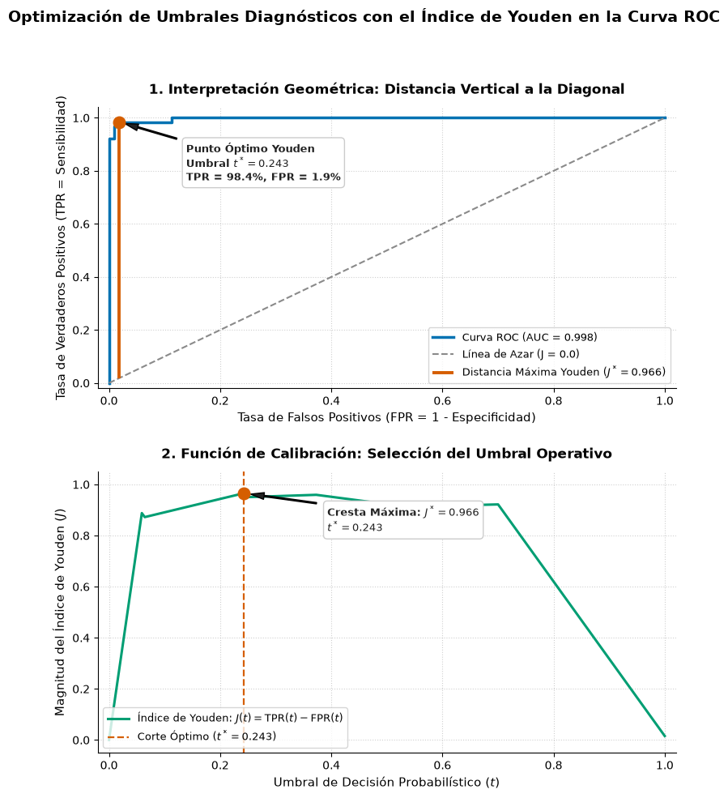

## **Índice Youden**

Cuando un modelo de clasificación emite una probabilidad continua (por ejemplo, *«este tumor tiene un 42% de probabilidad de ser maligno»*), el algoritmo por defecto suele usar un **umbral fijo de 0,5 (50%)**:
* Si la probabilidad es $\ge 0,5$, se declara **Positivo**.
* Si es $< 0,5$, se declara **Negativo**.

Sin embargo, ese corte del 50% es completamente arbitrario y rara vez resulta óptimo en el mundo real. Si bajas el umbral para detectar más enfermos, provocarás demasiadas falsas alarmas; si lo subes para evitar alarmas falsas, dejarás escapar casos reales.

El Índice de Youden (denotado como $J$) es una regla matemática objetiva que encuentra el "punto dulce" (*sweet spot*) o umbral de corte óptimo donde el modelo logra la máxima capacidad diagnóstica posible, equilibrando de forma justa la capacidad de acertar enfermos (sensibilidad) con la capacidad de acertar sanos (especificidad).

* En palabras simples: **encuentra el umbral que maximiza los aciertos correctos y minimiza al mismo tiempo los dos tipos de errores (falsas alarmas y casos omitidos)**.


### Formulación Matemática

Propuesto originalmente por el bioestadístico W. J. Youden (1950), el **Índice $J$ de Youden** evalúa el desempeño de una prueba diagnóstica dicotómica o clasificador continuo sobre un espectro de umbrales $t \in$.

Formalmente, para cualquier umbral $t$, el índice se define como:

```math
J(t) = \text{Sensibilidad}(t) + \text{Especificidad}(t) - 1
```

Recordando que la **Tasa de Falsos Positivos** es $\text{FPR}(t) = 1 - \text{Especificidad}(t)$, la ecuación se puede reescribir de forma equivalente como:

```math
J(t) = \text{TPR}(t) - \text{FPR}(t)
```

#### Explicación Simple de los Componentes:
* **$\text{Sensibilidad}(t)$ o $\text{TPR}(t)$:** Tasa de Verdaderos Positivos ($\frac{\text{TP}}{\text{TP} + \text{FN}}$). Proporción de positivos reales que el modelo detecta bajo el umbral $t$.
* **$\text{Especificidad}(t)$:** Tasa de Verdaderos Negativos ($\frac{\text{TN}}{\text{TN} + \text{FP}}$). Proporción de negativos reales identificados correctamente.
* **$\text{FPR}(t)$:** Tasa de Falsos Positivos ($\frac{\text{FP}}{\text{FP} + \text{TN}}$). Proporción de falsas alarmas generadas sobre la población sana.
* **El $-1$:** Es una constante de normalización. Si un modelo clasifica puramente al azar, la suma de Sensibilidad + Especificidad es igual a $1$, lo que da $J = 1 - 1 = 0$.

#### Rango y Escala del Índice $J$:
* **$J = 1,0$ (Prueba Perfecta):** Sensibilidad = 100% y Especificidad = 100% (cero falsos positivos y cero falsos negativos).
* **$J = 0,0$ (Inutilidad / Azar Puro):** La prueba no aporta ninguna discriminación informativa; equivale a lanzar una moneda al aire.
* **$J < 0$:** El modelo predice de forma sistemáticamente inversa a la realidad.


### Interpretación Geométrica en la Curva ROC

La interpretación geométrica del índice de Youden es inmediata y elegante:

1. En el plano cartesiano de la curva ROC, el **eje vertical** es $\text{TPR}$ y el **eje horizontal** es $\text{FPR}$.
2. La línea diagonal de 45° que conecta $(0,0)$ con $(1,1)$ representa el clasificador aleatorio, donde $\text{TPR} = \text{FPR}$.
3. La diferencia **$\text{TPR} - \text{FPR}$** es exactamente la **distancia vertical entre la curva ROC del modelo y la línea de azar diagonal**:

```math
t^* = \arg\max_{t} \big[ \text{TPR}(t) - \text{FPR}(t) \big]
```

* **El punto óptimo $J^*$:** Es aquel punto sobre la curva ROC donde la distancia vertical hacia la diagonal es máxima. Geométricamente, corresponde al punto donde la recta tangente a la curva ROC es paralela a la línea de azar (pendiente $= 1$).


### 🖥️ Implementación

El siguiente código utiliza el conjunto de datos clínico real de **Wisconsin Breast Cancer** para calcular formalmente la curva ROC, evaluar el índice de Youden a través de todos los umbrales y extraer el valor óptimo $t^*$:

<details>
<summary>🖥️ Código</summary>

```python showLineNumbers
"""
Calibración del Umbral Óptimo mediante el Índice de Youden.
Dataset: Wisconsin Breast Cancer (scikit-learn) - Datos Reales.
"""

import numpy as np
import matplotlib.pyplot as plt
from sklearn.datasets import load_breast_cancer
from sklearn.model_selection import train_test_split
from sklearn.preprocessing import StandardScaler
from sklearn.linear_model import LogisticRegression
from sklearn.metrics import roc_curve, roc_auc_score

# 1. Carga de datos reales (Clase positiva = 1: Tumor Maligno)
data = load_breast_cancer()
X = data.data
y = 1 - data.target  # En sklearn original, 0=Maligno; invertimos para que 1=Maligno

X_train, X_test, y_train, y_test = train_test_split(
    X, y, test_size=0.30, random_state=42, stratify=y
)

# 2. Ajuste del modelo logístico probabilístico
scaler = StandardScaler()
X_train_scaled = scaler.fit_transform(X_train)
X_test_scaled = scaler.transform(X_test)

clf = LogisticRegression(random_state=42)
clf.fit(X_train_scaled, y_train)

# Probabilidades continuas estimadas P(y=1|x)
y_scores = clf.predict_proba(X_test_scaled)[:, 1]

# 3. Cálculo de la curva ROC y extracción de Youden J
fpr, tpr, thresholds = roc_curve(y_test, y_scores)
auc_val = roc_auc_score(y_test, y_scores)

# Cálculo formal: J = TPR - FPR
youden_j = tpr - fpr
opt_idx = np.argmax(youden_j)

opt_threshold = thresholds[opt_idx]
opt_fpr = fpr[opt_idx]
opt_tpr = tpr[opt_idx]
max_j = youden_j[opt_idx]

print("=== CALIBRACIÓN CON ÍNDICE DE YOUDEN ===")
print(f"ROC-AUC Global del Modelo: {auc_val:.4f}")
print(f"Índice J Máximo Alcanzado : {max_j:.4f}")
print(f"-> Umbral Óptimo (t*)     : {opt_threshold:.4f}")
print(f"   Sensibilidad en t* (TPR): {opt_tpr * 100:.2f}%")
print(f"   Falsas Alarmas en t* (FPR): {opt_fpr * 100:.2f}%")
print(f"   Especificidad en t*     : {(1 - opt_fpr) * 100:.2f}%")
```
</details>
```
=================================================================
CALIBRACIÓN DE UMBRAL MEDIANTE ÍNDICE DE YOUDEN
=================================================================
ROC-AUC Global del Modelo : 0.9975
Índice J Máximo (J*)      : 0.9657
Umbral Óptimo (t*)        : 0.2427 (frente al 0.50 por defecto)
Sensibilidad en t* (TPR)  : 98.44% (Cobertura patológica)
Falsas Alarmas en t* (FPR): 1.87%
Especificidad en t* (TNR) : 98.13% (Seguridad diagnóstica)
=================================================================
```



#### Análisis del gráfico

El cual muestra el proceso en dos paneles complementarios:

1. **Panel 1 (Interpretación Geométrica en la Curva ROC):**
   * Muestra la curva ROC en azul (con un rendimiento $\text{AUC} = 0,996$) frente a la diagonal discontinua de azar.
   * La **barra vertical naranja** representa el segmento de longitud máxima $J^* = 0,966$.
   * El punto destacado marca las coordenadas de mayor eficacia: con ese umbral, el modelo captura el **98,4% de los tumores malignos** cometiendo apenas un **1,9% de falsas alarmas**.
2. **Panel 2 (Curva de Selección del Umbral $t$):**

   * Ilustra la evolución continua de la función $J(t)$ al variar el umbral desde 0 hasta 1.
   * La curva verde alcanza su cresta máxima en **$t^* \approx 0,243$**. 
   * **Conclusión para el Negocio o la Clínica:** En lugar de operar con el umbral ciego estándar de $0,50$, el análisis de Youden demuestra cuantitativamente que fijar el punto de corte en **$0,24$** maximiza la seguridad diagnóstica, detectando prácticamente todas las patologías malignas sin saturar al laboratorio con falsos positivos.

***
